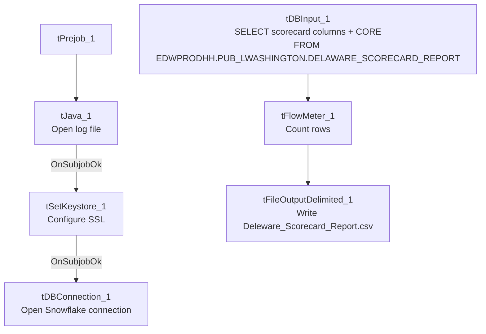

# Talend Job: LW_Delaware_Scorecard_Report

## Overview

This job extracts a per-call audit scorecard for the Delaware client relationship from a Snowflake view (`EDWPRODHH.PUB_LWASHINGTON.DELAWARE_SCORECARD_REPORT`) and writes the full result to `Deleware_Scorecard_Report.csv` (note the output filename carries a "Deleware" misspelling despite the job's own name being spelled correctly). Its query is nearly identical to `LW_Deleware_Audit_Scorecard`'s (collector name, call/audit dates, overall score, 7 category percentages, 32 pass/fail attribute flags, free-text summary), but reads from a **different, cross-database-qualified view** (`EDWPRODHH.PUB_LWASHINGTON.DELAWARE_SCORECARD_REPORT` vs. the other job's unqualified `PUB_LWASHINGTON.DELAWARE_AUDIT_REPORT`) and includes one extra column, `CORE`, not present in `LW_Deleware_Audit_Scorecard`'s query — see Issues observed for what this likely means.

## Detail table

| Field | Value |
|---|---|
| Job name | LW_Delaware_Scorecard_Report |
| Version | 0.1 |
| Project | EDW2SF |
| Author | jmach@harriscollect.com |
| Created | 2024-11-25T10:30:32.632-0800 |
| Last Modified | 2026-06-04T16:50:02.639-0700 |

## Step-by-step data flow

**Setup subjob:** `tPrejob_1` → `tJava_1` opens a per-run log file → on subjob-ok, `tSetKeystore_1` configures SSL → on subjob-ok, `tDBConnection_1` opens the Snowflake connection.

**Main flow (no explicit trigger link into it):** `tDBInput_1` runs the query below → `tFlowMeter_1` counts rows → `tFileOutputDelimited_1` writes the result (with header, file recreated each run) to `context.outputDir+"Deleware_Scorecard_Report.csv"`.

## Settings tables

### Source: `tDBInput_1` (`tSnowflakeInput`)

| Setting | Value | What it means |
|---|---|---|
| Query | `SELECT COLLECTOR_NAME, "CALL DATE", "AUDIT DATE", "OVERALL SCORE", OPENING_SCORE_PCT, SECOND_IDENTIFIER, IDENTIFY_SELF, COMPLIANCE_STATEMENT, IDENTIFY_CLIENT, STRATEGIC_PAUSES, AVOIDING_EARLY_TERMINATION_SCORE_PCT, ACKNOWLEDGE_THE_STAT, TRANSITION_BACK, BRIDGING_SCORE_PCT, LISTEN_TO_CONSUMER, REMOVE_ISOLATION, OFFER_TO_HELP, **CORE**, GET_THE_FACTS_SCORE_PCT, STATE_THE_BALANCE, ... ACTION_CODE, ACC_DOCUMENTATION, "AREA OF OPPORTUNITY", COMPLIANCE_STATUS FROM EDWPRODHH.PUB_LWASHINGTON.DELAWARE_SCORECARD_REPORT;` | Bolded `CORE` is the one column present here but absent from `LW_Deleware_Audit_Scorecard`'s otherwise-matching query — no `schema_columns` metadata was captured for this component (unlike its siblings), so `CORE`'s data type is unknown from this job's own metadata. |
| Database qualifier | `EDWPRODHH.PUB_LWASHINGTON....` | Cross-database reference, unlike `LW_Deleware_Audit_Scorecard`'s unqualified `PUB_LWASHINGTON....` — confirms these two jobs query genuinely different Snowflake objects, not just differently-cased names for the same view. |

### Target: `tFileOutputDelimited_1`

| Setting | Value | What it means |
|---|---|---|
| FILENAME | `context.outputDir+"Deleware_Scorecard_Report.csv"` | Filename carries the "Deleware" misspelling even though the job's own name (`LW_Delaware_Scorecard_Report`) is spelled correctly — the inverse inconsistency from `LW_Deleware_Audit_Scorecard`, where the job name itself is misspelled. |
| APPEND / INCLUDEHEADER | `false` / `true` | |

## Dependencies & configuration

- **Triggers/depends on other jobs:** none.
- **Context variables used:** `keystorePath`, `logDir`, `outputDir`.
- **Hardcoded paths:** `tSetKeystore_1.SSL_TRUSTSERVER_TRUSTSTORE`.
- **Sibling comparison:** Closely related to, but **not identical to**, `LW_Deleware_Audit_Scorecard` — different source view (`DELAWARE_SCORECARD_REPORT` vs. `DELAWARE_AUDIT_REPORT`), different database qualification, and an extra `CORE` column. There is no HPS/Lurie equivalent of this specific "Scorecard_Report" variant in this batch (only the "Audit_Scorecard" naming pattern exists for HPS and Lurie) — unable to determine from metadata whether a `LW_HPS_Scorecard_Report`/`LW_Lurie_Scorecard_Report` exists elsewhere in the project; not present in this batch's job list.

## Glossary

| Component type | Plain-English meaning |
|---|---|
| `tSnowflakeConnection` / `tSnowflakeInput` | Open a Snowflake connection and run a query against it. |
| `tFlowMeter` | Counts rows passing a point in the flow. |
| `tFileOutputDelimited` | Writes rows to a CSV file. |
| `tSetKeystore` | Configures SSL trust store/keystore for the Snowflake JDBC connection. |

## Issues observed

- **This job and `LW_Deleware_Audit_Scorecard` look like they should be the same report but aren't** — near-identical column lists (both ~46-47 columns covering the same category-score structure) but pointed at two differently-named Snowflake views (`DELAWARE_SCORECARD_REPORT` vs. `DELAWARE_AUDIT_REPORT`), with this job's view cross-database-qualified (`EDWPRODHH....`) and the other's not, and this job including an extra `CORE` column the other doesn't select. Unable to determine from metadata whether these are two genuinely different Snowflake objects (e.g., one raw and one curated) or the same underlying data exposed through two views that have drifted out of sync — worth confirming with the team, since having two very-similarly-named jobs producing similarly-but-not-identically-shaped Delaware scorecard reports is a likely source of confusion.
- **No `schema_columns` metadata was captured for `tDBInput_1` or `tFileOutputDelimited_1`** in this job (both show only `parameters`/`db.query`, with no column-level schema list), unlike every other job in this batch. This means the exact data types and column order for this job's output can't be independently verified from the extracted metadata beyond what's visible in the raw query text; verify directly in Talend Studio if precise column typing is needed.
- **Filename/job-name spelling is inverted relative to `LW_Deleware_Audit_Scorecard`**: here the job name is spelled correctly ("Delaware") but the output file is misspelled ("Deleware"); there, the job name is misspelled but nothing else was checked for a matching filename issue. Together these suggest the "Deleware" typo has propagated inconsistently across this Delaware job family rather than being confined to one place — worth a single find-and-fix pass across all Delaware-named jobs and their output filenames.
- **Same missing explicit trigger link** between the connection-setup subjob and the query subjob as the rest of this batch.
