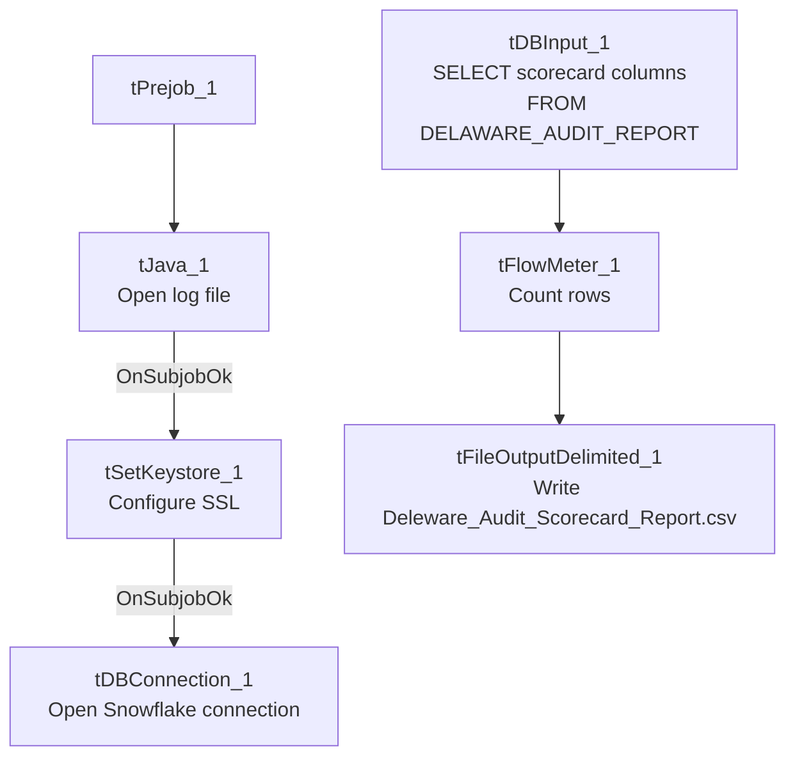

# Talend Job: LW_Deleware_Audit_Scorecard

## Overview

This job extracts a per-call audit scorecard for the Delaware client relationship — collector name, call/audit dates, overall score, per-category percentage scores (opening, bridging, get-the-facts, negotiation flow, customer service, call closing, documentation), the 32 underlying pass/fail attribute flags, and a free-text "area of opportunity"/compliance-status pair — from a Snowflake view (`PUB_LWASHINGTON.DELAWARE_AUDIT_REPORT`) and writes the full result to a CSV report. Note the job's own name is misspelled ("Deleware" rather than "Delaware") relative to its sibling jobs (`LW_Delaware_Focus_Attributes`, `LW_Delaware_Scorecard_Report`) — see Issues observed.

## Detail table

| Field | Value |
|---|---|
| Job name | LW_Deleware_Audit_Scorecard |
| Version | 0.1 |
| Project | EDW2SF |
| Author | jmach@harriscollect.com |
| Created | 2024-07-10T09:17:15.091-0700 |
| Last Modified | 2025-11-16T20:03:56.337-0800 |

## Step-by-step data flow

**Setup subjob:** `tPrejob_1` → `tJava_1` opens a per-run log file → on subjob-ok, `tSetKeystore_1` configures SSL → on subjob-ok, `tDBConnection_1` opens the Snowflake connection.

**Main flow (no explicit trigger link into it):** `tDBInput_1` runs the query below → `tFlowMeter_1` counts rows → `tFileOutputDelimited_1` writes the result (with header, file recreated each run) to `context.outputDir+"Deleware_Audit_Scorecard_Report.csv"` (note the output filename also carries the "Deleware" misspelling).

## Settings tables

### Source: `tDBInput_1` (`tSnowflakeInput`)

| Setting | Value | What it means |
|---|---|---|
| Query | `SELECT COLLECTOR_NAME, "CALL DATE", "AUDIT DATE", "OVERALL SCORE", OPENING_SCORE_PCT, SECOND_IDENTIFIER, IDENTIFY_SELF, COMPLIANCE_STATEMENT, IDENTIFY_CLIENT, STRATEGIC_PAUSES, AVOIDING_EARLY_TERMINATION_SCORE_PCT, ACKNOWLEDGE_THE_STAT, TRANSITION_BACK, BRIDGING_SCORE_PCT, LISTEN_TO_CONSUMER, REMOVE_ISOLATION, OFFER_TO_HELP, GET_THE_FACTS_SCORE_PCT, STATE_THE_BALANCE, MAKE_DEMAND_FOR_BALANCE, IF_NOT_BIF_TODAY, WHEN_CAN_REMAINING_BAL, IF_NOT_SOMETHING_TODAY, GATHER_F_AND_C_INFORMATION, NEGOTIATION_FLOW_SCORE_PCT, WIIFM, F_C_INFORMATION, SELL_THE_URGENCY, EMPHASIZE_TEMPORARY, NEGOTIATE_MAD, CUSTOMER_SERVICE_SCORE_PCT, EMPATHY_AND_RESPECT, DISPLAYED_COURTESY, SPEED_TONE_AND_VOLUME, CALL_CLOSING_SCORE_PCT, MAD, SET_FOLLOW_UP, REGRET, RECAP_AGREEMENT, COMMUNICATE_CONSEQUENCES, CONTACT_INFORMATION, END_WITH_A_PLEASANTRY, DOCUMENTATION_SCORE_PCT, ACTION_CODE, ACC_DOCUMENTATION, "AREA OF OPPORTUNITY", COMPLIANCE_STATUS FROM PUB_LWASHINGTON.DELAWARE_AUDIT_REPORT;` | 46 columns: identifying info (collector, dates), 7 category percentage scores, the 32 underlying pass/fail flags (as `BigDecimal(1)`, i.e. 0/1), and 2 free-text summary columns. This is the per-call detail behind the aggregated `LW_Delaware_Focus_Attributes` job. |

### Target: `tFileOutputDelimited_1`

| Setting | Value | What it means |
|---|---|---|
| FILENAME | `context.outputDir+"Deleware_Audit_Scorecard_Report.csv"` | Filename preserves the "Deleware" misspelling from the job name. |
| APPEND / INCLUDEHEADER | `false` / `true` | |

## Dependencies & configuration

- **Triggers/depends on other jobs:** none.
- **Context variables used:** `keystorePath`, `logDir`, `outputDir`.
- **Hardcoded paths:** `tSetKeystore_1.SSL_TRUSTSERVER_TRUSTSTORE`.
- **Sibling comparison:** `LW_HPS_Audit_Scorecard` and `LW_Lurie_Audit_Scorecard` use the identical 46-column query shape and category breakdown, differing only in source view (`HPS_AUDIT_REPORT`, `LURIE_AUDIT_SCORECARD_REPORT`) and output filename. `LW_Delaware_Scorecard_Report` is a closely related but **not identical** job: it queries a different view (`DELAWARE_SCORECARD_REPORT` vs. this job's `DELAWARE_AUDIT_REPORT`) and its column list includes one extra column, `CORE`, that does not appear in this job's query — see that job's own doc for detail.

## Glossary

| Component type | Plain-English meaning |
|---|---|
| `tSnowflakeConnection` / `tSnowflakeInput` | Open a Snowflake connection and run a query against it. |
| `tFlowMeter` | Counts rows passing a point in the flow. |
| `tFileOutputDelimited` | Writes rows to a CSV file. |
| `tSetKeystore` | Configures SSL trust store/keystore for the Snowflake JDBC connection. |

## Issues observed

- **The job name itself is misspelled** ("Deleware" instead of "Delaware"), inconsistent with `LW_Delaware_Focus_Attributes`, `LW_Delaware_Focus_Attributes_Granular`, and `LW_Delaware_Scorecard_Report`, all of which spell it correctly. The output filename (`Deleware_Audit_Scorecard_Report.csv`) inherits the same misspelling. This is a naming/discoverability issue rather than a functional one — anyone searching the job repository or output directory for "Delaware" jobs by exact name could miss this one.
- **Same missing explicit trigger link** between the connection-setup subjob and the query subjob as the rest of this batch.
- **No email/notification** and **no client/debtor identifying key beyond collector name and call/audit dates** — there's no debtor number or account identifier in this scorecard extract, so joining a given row back to a specific debtor/account would require a separate lookup not visible in this job.
