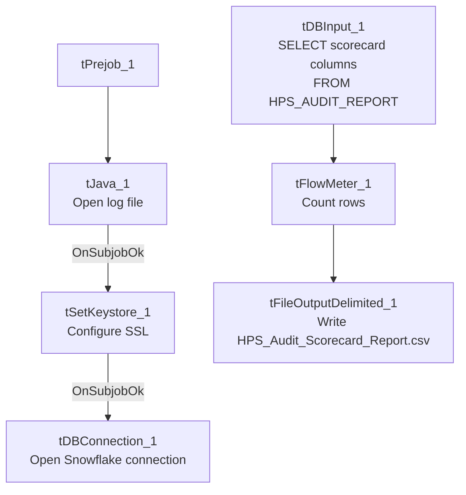

# Talend Job: LW_HPS_Audit_Scorecard

## Overview

This job extracts a per-call audit scorecard for the HPS client relationship — collector name, call/audit dates, overall score, 7 category percentage scores, the 32 underlying pass/fail attribute flags, and free-text summary columns — from a Snowflake view (`PUB_LWASHINGTON.HPS_AUDIT_REPORT`) and writes the full result to `HPS_Audit_Scorecard_Report.csv`. It is structurally and column-for-column identical to `LW_Deleware_Audit_Scorecard` and `LW_Lurie_Audit_Scorecard`, differing only in source view and output filename.

## Detail table

| Field | Value |
|---|---|
| Job name | LW_HPS_Audit_Scorecard |
| Version | 0.1 |
| Project | EDW2SF |
| Author | jmach@harriscollect.com |
| Created | 2024-08-12T10:23:27.648-0700 |
| Last Modified | 2025-11-16T20:04:46.303-0800 |

## Step-by-step data flow

**Setup subjob:** `tPrejob_1` → `tJava_1` opens a per-run log file → on subjob-ok, `tSetKeystore_1` configures SSL → on subjob-ok, `tDBConnection_1` opens the Snowflake connection.

**Main flow (no explicit trigger link into it):** `tDBInput_1` runs the 46-column query below → `tFlowMeter_1` counts rows → `tFileOutputDelimited_1` writes the result (with header, file recreated each run) to `context.outputDir+"HPS_Audit_Scorecard_Report.csv"`.

## Settings tables

### Source: `tDBInput_1` (`tSnowflakeInput`)

| Setting | Value | What it means |
|---|---|---|
| Query | `SELECT COLLECTOR_NAME, "CALL DATE", "AUDIT DATE", "OVERALL SCORE", OPENING_SCORE_PCT, ... ACTION_CODE, ACC_DOCUMENTATION, "AREA OF OPPORTUNITY", COMPLIANCE_STATUS FROM PUB_LWASHINGTON.HPS_AUDIT_REPORT;` (same 46-column list as `LW_Deleware_Audit_Scorecard`) | Identical shape to the Delaware and Lurie audit-scorecard siblings — only `HPS_AUDIT_REPORT` differs as the source view. |

### Target: `tFileOutputDelimited_1`

| Setting | Value | What it means |
|---|---|---|
| FILENAME | `context.outputDir+"HPS_Audit_Scorecard_Report.csv"` | |
| APPEND / INCLUDEHEADER | `false` / `true` | |

## Dependencies & configuration

- **Triggers/depends on other jobs:** none.
- **Context variables used:** `keystorePath`, `logDir`, `outputDir`.
- **Hardcoded paths:** `tSetKeystore_1.SSL_TRUSTSERVER_TRUSTSTORE`.
- **Sibling comparison:** Identical structure to `LW_Deleware_Audit_Scorecard` and `LW_Lurie_Audit_Scorecard`. This is the per-call detail counterpart to `LW_HPS_Focus_Attributes` (aggregated) and `LW_HPS_Focus_Attributes_Granular` (long-format).

## Glossary

| Component type | Plain-English meaning |
|---|---|
| `tSnowflakeConnection` / `tSnowflakeInput` | Open a Snowflake connection and run a query against it. |
| `tFlowMeter` | Counts rows passing a point in the flow. |
| `tFileOutputDelimited` | Writes rows to a CSV file. |
| `tSetKeystore` | Configures SSL trust store/keystore for the Snowflake JDBC connection. |

## Issues observed

- **Same missing explicit trigger link** between the connection-setup subjob and the query subjob as the rest of this batch.
- **No email/notification and no debtor/account identifier**, same as the Delaware sibling — a given scorecard row can only be traced to a collector name and call/audit date, not to a specific account.
- Note this job's name is spelled correctly ("HPS"), so unlike `LW_Deleware_Audit_Scorecard` there is no naming-consistency issue for this specific job — the misspelling flagged there is unique to the Delaware variant.
