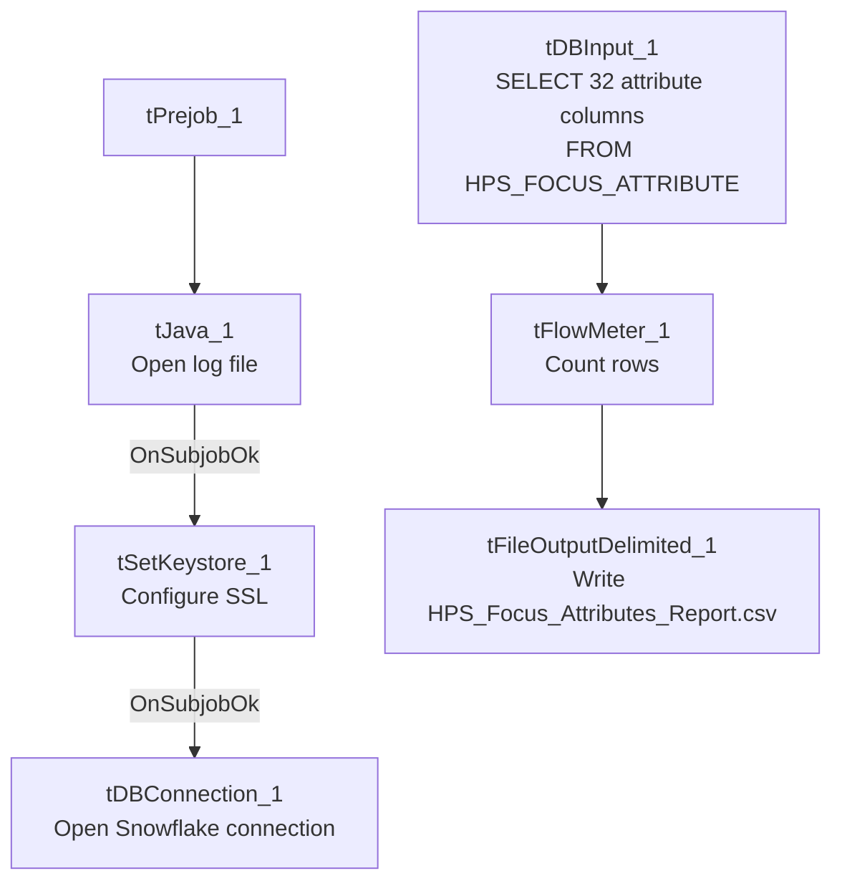

# Talend Job: LW_HPS_Focus_Attributes

## Overview

This job extracts the same fixed set of 32 call-audit compliance attribute scores as `LW_Delaware_Focus_Attributes`, but for the HPS client relationship, from a Snowflake view (`PUB_LWASHINGTON.HPS_FOCUS_ATTRIBUTE`) and writes the result to `HPS_Focus_Attributes_Report.csv`. It is structurally and column-for-column identical to `LW_Delaware_Focus_Attributes` and `LW_Lurie_Focus_Attributes` — the only differences across the three are the source view name and output filename.

## Detail table

| Field | Value |
|---|---|
| Job name | LW_HPS_Focus_Attributes |
| Version | 0.1 |
| Project | EDW2SF |
| Author | jmach@harriscollect.com |
| Created | 2024-08-12T10:24:45.282-0700 |
| Last Modified | 2025-11-16T20:06:13.841-0800 |

## Step-by-step data flow

**Setup subjob:** `tPrejob_1` → `tJava_1` opens a per-run log file → on subjob-ok, `tSetKeystore_1` configures SSL → on subjob-ok, `tDBConnection_1` opens the Snowflake connection.

**Main flow (no explicit trigger link into it):** `tDBInput_1` runs the 32-column query below → `tFlowMeter_1` counts rows → `tFileOutputDelimited_1` writes the result (with header, file recreated each run) to `context.outputDir+"HPS_Focus_Attributes_Report.csv"`.

## Settings tables

### Source: `tDBInput_1` (`tSnowflakeInput`)

| Setting | Value | What it means |
|---|---|---|
| Query | `SELECT SECOND_IDENTIFIER, IDENTIFY_SELF, COMPLIANCE_STATEMENT, ... ACTION_CODE, ACC_DOCUMENTATION FROM PUB_LWASHINGTON.HPS_FOCUS_ATTRIBUTE;` (same 32-column list as `LW_Delaware_Focus_Attributes`) | Identical column list to the Delaware and Lurie siblings — only `HPS_FOCUS_ATTRIBUTE` differs as the source view. |

### Target: `tFileOutputDelimited_1`

| Setting | Value | What it means |
|---|---|---|
| FILENAME | `context.outputDir+"HPS_Focus_Attributes_Report.csv"` | |
| APPEND / INCLUDEHEADER | `false` / `true` | |

## Dependencies & configuration

- **Triggers/depends on other jobs:** none.
- **Context variables used:** `keystorePath`, `logDir`, `outputDir`.
- **Hardcoded paths:** `tSetKeystore_1.SSL_TRUSTSERVER_TRUSTSTORE`.
- **Sibling comparison:** Identical structure to `LW_Delaware_Focus_Attributes` and `LW_Lurie_Focus_Attributes`; differs only in source view (`HPS_FOCUS_ATTRIBUTE`) and output filename. `LW_HPS_Focus_Attributes_Granular` is the related 2-column name/value variant for HPS.

## Glossary

| Component type | Plain-English meaning |
|---|---|
| `tSnowflakeConnection` / `tSnowflakeInput` | Open a Snowflake connection and run a query against it. |
| `tFlowMeter` | Counts rows passing a point in the flow. |
| `tFileOutputDelimited` | Writes rows to a CSV file. |
| `tSetKeystore` | Configures SSL trust store/keystore for the Snowflake JDBC connection. |

## Issues observed

- **Same missing explicit trigger link** between the connection-setup subjob and the query subjob as its Delaware/Lurie siblings — see `LW_Delaware_Focus_Attributes`'s doc for detail; not repeated in full here since it's the identical finding.
- **No client/debtor identifying columns and no email/notification component** — same as the Delaware sibling; nothing in this job's own metadata distinguishes normal completion from an empty result set.
- This job is copy-paste identical to its Delaware/Lurie siblings apart from the table name and filename — a genuine defect introduced in one (e.g., the Insurance_Report_Extract-style hardcoded-path issue, or the truncated-header-write bug seen in the Dashboard jobs) would very likely also exist in the other two; conversely, a fix applied to one should be checked against the others.
