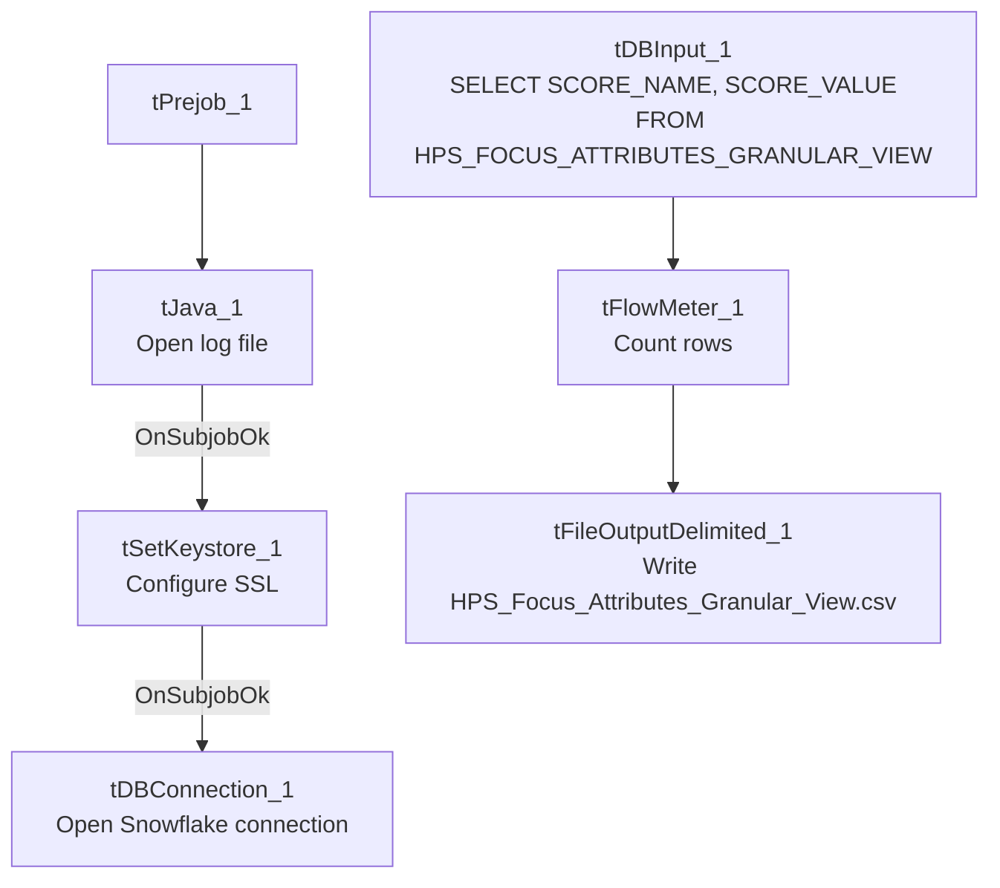

# Talend Job: LW_HPS_Focus_Attributes_Granular

## Overview

This job extracts a narrow, long-format (name/value pair) view of HPS focus-attribute scores from a Snowflake view (`PUB_LWASHINGTON.HPS_FOCUS_ATTRIBUTES_GRANULAR_VIEW`) and writes them to `HPS_Focus_Attributes_Granular_View.csv`. It is the HPS counterpart to `LW_Delaware_Focus_Attributes_Granular`, structurally identical apart from the source view name and output filename.

## Detail table

| Field | Value |
|---|---|
| Job name | LW_HPS_Focus_Attributes_Granular |
| Version | 0.1 |
| Project | EDW2SF |
| Author | jmach@harriscollect.com |
| Created | 2024-08-12T10:24:06.383-0700 |
| Last Modified | 2025-11-16T20:05:29.368-0800 |

## Step-by-step data flow

**Setup subjob:** `tPrejob_1` → `tJava_1` opens a per-run log file → on subjob-ok, `tSetKeystore_1` configures SSL → on subjob-ok, `tDBConnection_1` opens the Snowflake connection.

**Main flow (no explicit trigger link into it):** `tDBInput_1` runs `SELECT SCORE_NAME, SCORE_VALUE FROM PUB_LWASHINGTON.HPS_FOCUS_ATTRIBUTES_GRANULAR_VIEW;` → `tFlowMeter_1` counts rows → `tFileOutputDelimited_1` writes the result (with header, file recreated each run) to `context.outputDir+"HPS_Focus_Attributes_Granular_View.csv"`.

## Settings tables

### Source: `tDBInput_1` (`tSnowflakeInput`)

| Setting | Value | What it means |
|---|---|---|
| Query | `SELECT SCORE_NAME, SCORE_VALUE FROM PUB_LWASHINGTON.HPS_FOCUS_ATTRIBUTES_GRANULAR_VIEW;` | Note this source view's name (`HPS_FOCUS_ATTRIBUTES_GRANULAR_VIEW`, with `_VIEW` suffix) differs from Delaware's (`DELAWARE_FOCUS_GRANULAR`, no suffix) and Lurie's (`LURIE_FOCUS_ATTRIBUTES_GRANULAR`, no `_VIEW` suffix) — see Issues observed. |

### Target: `tFileOutputDelimited_1`

| Setting | Value | What it means |
|---|---|---|
| FILENAME | `context.outputDir+"HPS_Focus_Attributes_Granular_View.csv"` | |
| APPEND / INCLUDEHEADER | `false` / `true` | |

## Dependencies & configuration

- **Triggers/depends on other jobs:** none.
- **Context variables used:** `keystorePath`, `logDir`, `outputDir`.
- **Hardcoded paths:** `tSetKeystore_1.SSL_TRUSTSERVER_TRUSTSTORE`.
- **Sibling comparison:** Identical structure to `LW_Delaware_Focus_Attributes_Granular` and `LW_Lurie_Focus_Attributes_Granular`. This is the granular counterpart to `LW_HPS_Focus_Attributes` and `LW_HPS_Audit_Scorecard`.

## Glossary

| Component type | Plain-English meaning |
|---|---|
| `tSnowflakeConnection` / `tSnowflakeInput` | Open a Snowflake connection and run a query against it. |
| `tFlowMeter` | Counts rows passing a point in the flow. |
| `tFileOutputDelimited` | Writes rows to a CSV file. |
| `tSetKeystore` | Configures SSL trust store/keystore for the Snowflake JDBC connection. |

## Issues observed

- **Source view naming inconsistency across the three Granular siblings**: HPS's view is `HPS_FOCUS_ATTRIBUTES_GRANULAR_VIEW` (plural "Attributes", `_VIEW` suffix), Delaware's is `DELAWARE_FOCUS_GRANULAR` (singular "Focus", no `_VIEW` suffix, no "Attributes"), and Lurie's is `LURIE_FOCUS_ATTRIBUTES_GRANULAR` (plural "Attributes", no `_VIEW` suffix). Purely a Snowflake catalog naming-consistency observation, not a functional defect — the query shape and job behavior are otherwise identical across all three.
- **Same missing explicit trigger link** between the connection-setup subjob and the query subjob.
- **No client/debtor/audit identifying columns**, same limitation as the Delaware sibling.
