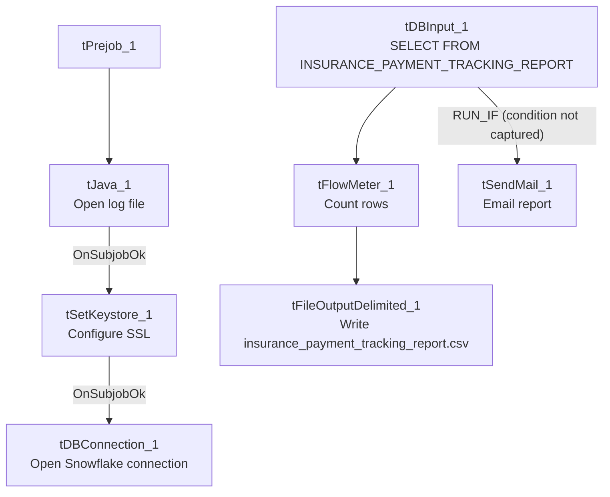

# Talend Job: LW_Insurance_Pmt_Tracking

## Overview

This job extracts insurance-payment tracking records — CUBS account numbers, client info, payment/commission status and posted amounts, principal balance after transaction, CUBS desk assignment, and payment type — from a Snowflake view (`PUB_LWASHINGTON.INSURANCE_PAYMENT_TRACKING_REPORT`), writes them to a CSV file, and conditionally emails the report to a distribution list. It follows the same query→write→mail template as the other `LW_*` report jobs in this batch, but is the only one in this batch where the mail step is wired as a conditional (`RUN_IF`) branch rather than an unconditional on-success (`SUBJOB_OK`) trigger — see Issues observed.

## Detail table

| Field | Value |
|---|---|
| Job name | LW_Insurance_Pmt_Tracking |
| Version | 0.1 |
| Project | EDW2SF |
| Author | jmach@harriscollect.com |
| Created | 2024-05-02T14:48:58.772-0700 |
| Last Modified | 2025-11-16T20:11:17.477-0800 |

## Step-by-step data flow

**Setup subjob:** `tPrejob_1` → `tJava_1` opens a per-run log file → on subjob-ok, `tSetKeystore_1` configures SSL → on subjob-ok, `tDBConnection_1` opens the Snowflake connection.

**Main flow (no explicit trigger link into it):** `tDBInput_1` runs the query below. Its `MAIN` output feeds `tFlowMeter_1` (row count) → `tFileOutputDelimited_1` (writes the CSV). Separately, `tDBInput_1` has a **`RUN_IF`** connector (not `SUBJOB_OK`) to `tSendMail_1` — meaning the email is sent only if some condition evaluates true, not unconditionally on query success (the specific condition expression is not captured in this metadata).

## Settings tables

### Source: `tDBInput_1` (`tSnowflakeInput`)

| Setting | Value | What it means |
|---|---|---|
| Query | `SELECT "CUBS#" AS CUBS_NUM, "Primary CUBS#" AS PRIMARY_CUBS_NUM, "Client Number", "Payment Status", "Current Status", "Payment Posted", "Commission Posted", "Date of Payment Posted", PRIN_BAL_AFTER_TRANS, "Payment CUBS Desk", "Current CUBS Desk", "Client Name", TCODE, PL_GROUP, "Pmt Type" FROM PUB_LWASHINGTON.INSURANCE_PAYMENT_TRACKING_REPORT;` | 15 columns tracking insurance payment posting status per account, including both the "payment" desk and "current" desk (suggesting accounts can move desks after a payment is posted). |

### Target: `tFileOutputDelimited_1`

| Setting | Value | What it means |
|---|---|---|
| FILENAME | `context.outputDir+"insurance_payment_tracking_report.csv"` | |
| APPEND / INCLUDEHEADER | `false` / `true` | |

### Mail: `tSendMail_1`

| Setting | Value | What it means |
|---|---|---|
| Trigger | `RUN_IF` from `tDBInput_1` (not `SUBJOB_OK`) | Email is conditional — the job's wiring only sends it when some (uncaptured) condition holds, unlike every other `tSendMail`-using job in this batch, where the mail step is unconditional on subjob success. |
| SUBJECT / MESSAGE | `"Insurance Payment Tracking Report"` / `"The insurance payment tracking report is attached."` | |
| DIE_ON_ERROR | `true` | |

## Dependencies & configuration

- **Triggers/depends on other jobs:** none.
- **Context variables used:** `keystorePath`, `logDir`, `mailRecipients`, `outputDir`.
- **Hardcoded paths:** `tSetKeystore_1.SSL_TRUSTSERVER_TRUSTSTORE`.
- Per `05_operational_runbook.md`, `LW_Insurance_Pmt_Tracking` is listed among the jobs that send email on completion — but see Issues observed regarding the conditional wiring, which means "on completion" may not always be accurate for this specific job.

## Glossary

| Component type | Plain-English meaning |
|---|---|
| `tSnowflakeConnection` / `tSnowflakeInput` | Open a Snowflake connection and run a query against it. |
| `tFlowMeter` | Counts rows passing a point in the flow. |
| `tFileOutputDelimited` | Writes rows to a CSV file. |
| `tSendMail` | Sends an email with the finished report attached — here, conditionally rather than unconditionally. |
| `tSetKeystore` | Configures SSL trust store/keystore for the Snowflake JDBC connection. |

## Issues observed

- **The email is wired as a `RUN_IF` (conditional) branch off `tDBInput_1`, not an unconditional `SUBJOB_OK` trigger** — every other `tSendMail`-using job in this batch (`LW_COC_Water_Scrub`, `LW_Carle_Asset_Scrub`, `LW_ProMedica_Scrub`) fires its mail step unconditionally once the query subjob succeeds. Here, the actual `RUN_IF` condition expression is not captured in this job's extracted metadata, so it's unable to determine from metadata what governs whether the email actually gets sent on a given run (e.g., "only if row count > 0," or some other business rule). This is worth confirming directly in Talend Studio, since a silently-skipped email (if the condition evaluates false) with no accompanying warning or log message would leave the report generated but never delivered, with nothing in this job's own logic to flag that gap.
- **Same missing explicit trigger link** between the connection-setup subjob and the query subjob as the rest of this batch.
- **No `tWarn`/`tDie` logic tied to the RUN_IF's alternate (false) branch** — if the condition is false and the mail is skipped, there is no visible fallback logging that would tell an operator the email didn't go out.
