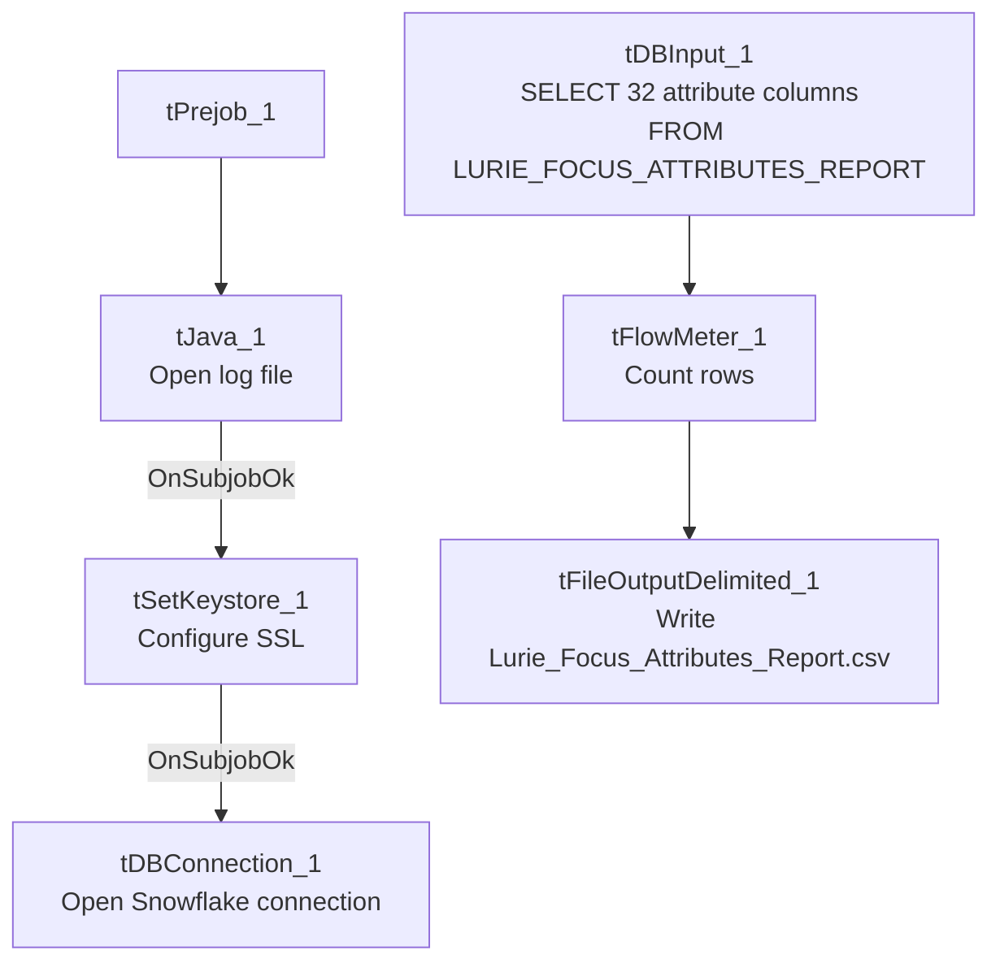

# Talend Job: LW_Lurie_Focus_Attributes

## Overview

This job extracts the same fixed set of 32 call-audit compliance attribute scores as `LW_Delaware_Focus_Attributes` and `LW_HPS_Focus_Attributes`, but for the Lurie client relationship, from a Snowflake view (`PUB_LWASHINGTON.LURIE_FOCUS_ATTRIBUTES_REPORT`) and writes the result to `Lurie_Focus_Attributes_Report.csv`. It is column-for-column identical to its two siblings.

## Detail table

| Field | Value |
|---|---|
| Job name | LW_Lurie_Focus_Attributes |
| Version | 0.1 |
| Project | EDW2SF |
| Author | jmach@harriscollect.com |
| Created | 2024-07-09T11:32:39.160-0700 |
| Last Modified | 2025-11-16T20:14:01.888-0800 |

## Step-by-step data flow

**Setup subjob:** `tPrejob_1` → `tJava_1` opens a per-run log file → on subjob-ok, `tSetKeystore_1` configures SSL → on subjob-ok, `tDBConnection_1` opens the Snowflake connection.

**Main flow (no explicit trigger link into it):** `tDBInput_1` runs the 32-column query below → `tFlowMeter_1` counts rows → `tFileOutputDelimited_1` writes the result (with header, file recreated each run) to `context.outputDir+"Lurie_Focus_Attributes_Report.csv"`.

## Settings tables

### Source: `tDBInput_1` (`tSnowflakeInput`)

| Setting | Value | What it means |
|---|---|---|
| Query | `SELECT SECOND_IDENTIFIER, IDENTIFY_SELF, COMPLIANCE_STATEMENT, ... ACTION_CODE, ACC_DOCUMENTATION FROM PUB_LWASHINGTON.LURIE_FOCUS_ATTRIBUTES_REPORT;` (same 32-column list as the Delaware/HPS siblings) | Note the source view name here follows a `_REPORT` suffix convention (`LURIE_FOCUS_ATTRIBUTES_REPORT`) unlike Delaware's (`DELAWARE_FOCUS_ATTRIBUTE`, singular, no suffix) and HPS's (`HPS_FOCUS_ATTRIBUTE`, singular) — a naming inconsistency across otherwise-identical sibling views. |

### Target: `tFileOutputDelimited_1`

| Setting | Value | What it means |
|---|---|---|
| FILENAME | `context.outputDir+"Lurie_Focus_Attributes_Report.csv"` | |
| APPEND / INCLUDEHEADER | `false` / `true` | |

## Dependencies & configuration

- **Triggers/depends on other jobs:** none.
- **Context variables used:** `keystorePath`, `logDir`, `outputDir`.
- **Hardcoded paths:** `tSetKeystore_1.SSL_TRUSTSERVER_TRUSTSTORE`.
- **Sibling comparison:** Identical structure to `LW_Delaware_Focus_Attributes` and `LW_HPS_Focus_Attributes`. The Lurie source view name (`LURIE_FOCUS_ATTRIBUTES_REPORT`) is pluralized/suffixed differently from its siblings' singular view names — see Issues observed. `LW_Lurie_Focus_Attributes_Granular` is the related 2-column name/value variant.

## Glossary

| Component type | Plain-English meaning |
|---|---|
| `tSnowflakeConnection` / `tSnowflakeInput` | Open a Snowflake connection and run a query against it. |
| `tFlowMeter` | Counts rows passing a point in the flow. |
| `tFileOutputDelimited` | Writes rows to a CSV file. |
| `tSetKeystore` | Configures SSL trust store/keystore for the Snowflake JDBC connection. |

## Issues observed

- **Source view naming is inconsistent across the three Focus Attributes siblings**: `DELAWARE_FOCUS_ATTRIBUTE` (singular, no suffix), `HPS_FOCUS_ATTRIBUTE` (singular, no suffix), `LURIE_FOCUS_ATTRIBUTES_REPORT` (plural, `_REPORT` suffix). This is purely a naming-convention observation (the columns and job structure are otherwise identical) but could confuse anyone searching the Snowflake catalog for a consistent naming pattern across these three views.
- **Same missing explicit trigger link** between the connection-setup subjob and the query subjob as its siblings.
- **No client/debtor identifying columns and no email/notification component**, same as the Delaware and HPS siblings.
