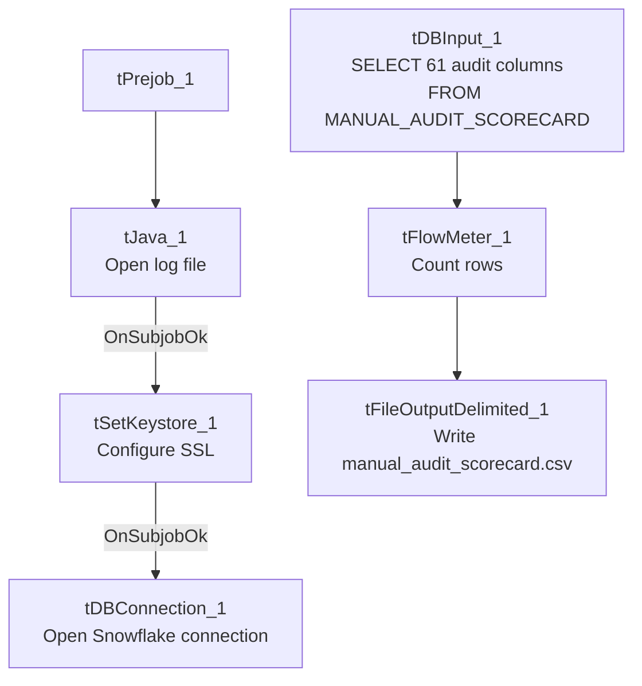

# Talend Job: LW_Manual_Audit_Scorecard

## Overview

This job extracts a general, client-agnostic manual-audit scorecard — auditor name, audit/call dates, acknowledgement status, call duration/direction/ID, a letter grade, and the same category-and-attribute structure seen in the Delaware/HPS/Lurie audit scorecards (Opening, Bridging, Get the Facts, Negotiation Flow, Customer Service, Call Closing, Documentation, each with its underlying yes/no checklist items) — from a Snowflake view (`PUB_LWASHINGTON.MANUAL_AUDIT_SCORECARD`) and writes the full result to `manual_audit_scorecard.csv`. Unlike the Delaware/HPS/Lurie variants, this job is not tied to one specific client: its schema includes a `Latitude Id` and `Phone Number` column, and its category-breakdown columns are typed as `id_Boolean` (true/false) rather than `id_BigDecimal` — suggesting this is a more general/manual audit process feeding into (or alongside) the client-specific automated scorecards.

## Detail table

| Field | Value |
|---|---|
| Job name | LW_Manual_Audit_Scorecard |
| Version | 0.1 |
| Project | EDW2SF |
| Author | jmach@harriscollect.com |
| Created | 2024-11-25T10:53:35.104-0800 |
| Last Modified | 2025-11-16T20:23:31.487-0800 |

## Step-by-step data flow

**Setup subjob:** `tPrejob_1` → `tJava_1` opens a per-run log file → on subjob-ok, `tSetKeystore_1` configures SSL → on subjob-ok, `tDBConnection_1` opens the Snowflake connection.

**Main flow (no explicit trigger link into it):** `tDBInput_1` runs the 61-column query below → `tFlowMeter_1` counts rows → `tFileOutputDelimited_1` writes the result (with header, file recreated each run) to `context.outputDir+"manual_audit_scorecard.csv"`.

## Settings tables

### Source: `tDBInput_1` (`tSnowflakeInput`)

| Setting | Value | What it means |
|---|---|---|
| Query | `SELECT "Scorecard Link", "Auditor Name", "Audit Date", "Edited By", "Edited At", "Collector Name", "call Date", "Acknowledged", "Acknowledged By", "Call Duration", "Call Direction", "Call ID", "File", "Auto-Fail?", "Score", "Latitude Id", "Phone Number", "Grade", "Opening", ...category checklist items..., "Documentation", "1. Action Code", "2. Acc Documentation" FROM PUB_LWASHINGTON.MANUAL_AUDIT_SCORECARD;` | 61 columns total: audit metadata (scorecard link, auditor, edit trail, acknowledgement), call metadata (duration, direction, ID, phone number), an overall `Score`/`Grade`, a `Latitude Id` (suggesting this table also aggregates data originating from a separate "Latitude" system — see `Latitude` project context if available), and the full category-checklist structure as `id_Boolean` flags rather than the numeric flags used in the Delaware/HPS/Lurie audit scorecards. |

### Target: `tFileOutputDelimited_1`

| Setting | Value | What it means |
|---|---|---|
| FILENAME | `context.outputDir+"manual_audit_scorecard.csv"` | Lowercase filename, unlike the Title_Case convention used by the Delaware/HPS/Lurie scorecard jobs. |
| APPEND / INCLUDEHEADER | `false` / `true` | |

## Dependencies & configuration

- **Triggers/depends on other jobs:** none.
- **Context variables used:** `keystorePath`, `logDir`, `outputDir`.
- **Hardcoded paths:** `tSetKeystore_1.SSL_TRUSTSERVER_TRUSTSTORE`.
- **Relationship to sibling jobs:** Not a client-specific sibling of the Delaware/HPS/Lurie audit-scorecard family — it has a different, broader column set (auditor/edit-trail/acknowledgement fields not present in those jobs) and represents manually-conducted audits rather than an automated per-call scoring pipeline. The `Latitude Id` column is a notable cross-system reference not otherwise explained in this job's own metadata.

## Glossary

| Component type | Plain-English meaning |
|---|---|
| `tSnowflakeConnection` / `tSnowflakeInput` | Open a Snowflake connection and run a query against it. |
| `tFlowMeter` | Counts rows passing a point in the flow. |
| `tFileOutputDelimited` | Writes rows to a CSV file. |
| `tSetKeystore` | Configures SSL trust store/keystore for the Snowflake JDBC connection. |

## Issues observed

- **The presence of a `Latitude Id` column** suggests this manual-audit data set spans or references the separate "LATITUDE" Talend project/system documented elsewhere in this reverse-engineering effort. Unable to determine from this job's own metadata what that cross-system relationship actually is (e.g., whether `MANUAL_AUDIT_SCORECARD` is populated by a process that also touches LATITUDE data, or whether `Latitude Id` is simply a legacy column name carried over) — worth confirming with the team, especially since it implies a cross-project data dependency not visible anywhere else in this batch.
- **Column naming in the query mixes numbered prefixes with descriptive names** (e.g., `"1. 2nd identifier"`, `"2. Identify self"`), and the extracted `schema_columns` shows several truncated/collided auto-generated column names (`___Transition_back_to_c` and `___Transition_back_to_c1` both derived from what are presumably two different underlying "Transition back to..." questions, and a generic `Column50` with no descriptive name) — a sign the source view's column headers are long free-text questions that Talend's schema import truncated and, in at least one case, could not fully disambiguate. This is a data-quality/schema-hygiene observation rather than a job-logic defect, but it means anyone mapping this CSV's columns back to the original audit questions should verify column meaning directly against the Snowflake view rather than relying solely on the truncated names in this extract.
- **Same missing explicit trigger link** between the connection-setup subjob and the query subjob as the rest of this batch.
