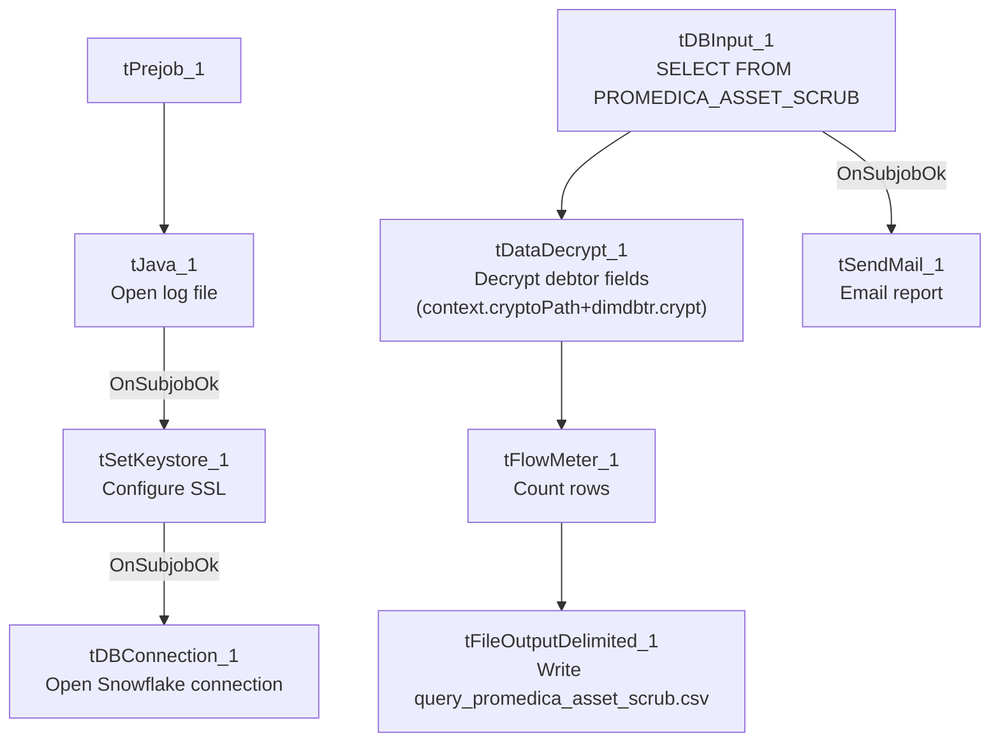

# Talend Job: LW_ProMedica_Scrub

## Overview

This job produces a monthly "ProMedica" asset scrub report for a health-system client: it queries a curated Snowflake view (`PUB_LWASHINGTON.PROMEDICA_ASSET_SCRUB`) for debtor/account/employment/denial-reason details, decrypts protected debtor fields, writes the result to a CSV file, and emails it to a distribution list. It follows the same query→decrypt→write→mail template as `LW_Carle_Asset_Scrub`, differing in the source table, target client, and column list — this job includes a denial/approval reason and transaction date not present in the Carle variant, while omitting Carle's last-payment-date column.

## Detail table

| Field | Value |
|---|---|
| Job name | LW_ProMedica_Scrub |
| Version | 0.1 |
| Project | EDW2SF |
| Author | jmach@harriscollect.com |
| Created | 2024-03-20T09:36:44.437-0700 |
| Last Modified | 2025-11-16T20:24:14.545-0800 |

## Step-by-step data flow

**Setup subjob:** `tPrejob_1` → `tJava_1` opens a per-run log file → on subjob-ok, `tSetKeystore_1` configures SSL from `context.keystorePath` → on subjob-ok, `tDBConnection_1` opens the Snowflake connection.

**Main flow:** `tDBInput_1` runs the query below → `tDataDecrypt_1` decrypts protected debtor fields using `context.cryptoPath+"dimdbtr.crypt"` → `tFlowMeter_1` counts rows → `tFileOutputDelimited_1` writes the full result (with header, file recreated each run) to `context.outputDir+"query_promedica_asset_scrub.csv"`. Separately, on subjob-ok from `tDBInput_1`, `tSendMail_1` emails the finished report.

## Settings tables

### Source: `tDBInput_1` (`tSnowflakeInput`)

| Setting | Value | What it means |
|---|---|---|
| Query | `SELECT DEBTORNUMBER, CLIENT, NAME1, "DENIAL/APPROVAL REASON", ADD1, CITY, ST, ZIP, PACKET, PHONE, DOB, "C.D.#", SSNUM, STATUS, ASGN_AMT, ASGN_COLL, TOTAL_BAL, BALANCE_DIMDEBTOR_PACKET, EMP1_NAME, EMP1_ADDR, EMP1_CSZ, EMP1_PHN, ADMIT_DATE, DISCHARGE_DATE, NAME, TRANS_DATE, DT_ASSIGNED FROM PUB_LWASHINGTON.PROMEDICA_ASSET_SCRUB;` | 26-column pull, insurance-denial-focused: includes a `"DENIAL/APPROVAL REASON"` column not present in `LW_Carle_Asset_Scrub`'s equivalent query, plus a duplicate-looking `NAME` column alongside `NAME1`. |

### Transform: `tDataDecrypt_1`

| Setting | Value | What it means |
|---|---|---|
| CRYPTO_FILE_PATH | `context.cryptoPath+"dimdbtr.crypt"` | Same context-driven key path convention as `LW_Carle_Asset_Scrub`/`LW_Property_Scrub`. |
| DIE_ON_ERROR | `true` | Decryption failure fails the job. |
| SECRET_TYPE / SECRET_KEY / PASSWORD_M1 | `***REDACTED***` | Preserved as redacted. |

### Target: `tFileOutputDelimited_1`

| Setting | Value | What it means |
|---|---|---|
| FILENAME | `context.outputDir+"query_promedica_asset_scrub.csv"` | |
| APPEND / INCLUDEHEADER | `false` / `true` | File recreated fresh each run with a header. |

### Mail: `tSendMail_1`

| Setting | Value | What it means |
|---|---|---|
| SUBJECT / MESSAGE | `"ProMedica Asset Scrub Report"` / `"The monthly ProMedica asset scrub report is attached."` | |
| DIE_ON_ERROR | `true` | Unconditional on-success mail (`SUBJOB_OK`), unlike `LW_Insurance_Pmt_Tracking`'s conditional `RUN_IF` wiring. |

## Dependencies & configuration

- **Triggers/depends on other jobs:** none.
- **Context variables used:** `cryptoPath`, `keystorePath`, `logDir`, `mailRecipients`, `outputDir`.
- **Hardcoded paths:** `tSetKeystore_1.SSL_TRUSTSERVER_TRUSTSTORE`.
- Per `05_operational_runbook.md`, this is one of the jobs that sends email on completion, consistent with its role as a partner-facing monthly report.

## Glossary

| Component type | Plain-English meaning |
|---|---|
| `tSnowflakeConnection` / `tSnowflakeInput` | Open a Snowflake connection and run a query against it. |
| `tDataDecrypt` | Decrypts protected debtor fields (SSN, etc.) using a local key file before the data is written out. |
| `tFlowMeter` | Counts rows passing a point in the flow. |
| `tFileOutputDelimited` | Writes rows to a CSV file. |
| `tSendMail` | Emails the finished report to a distribution list. |
| `tSetKeystore` | Configures SSL trust store/keystore for the Snowflake JDBC connection. |

## Issues observed

- **The query selects both `NAME1` and a separate `NAME` column** — it's not clear from this job's own metadata whether these represent genuinely different fields (e.g., a formatted vs. raw name) or a redundant/leftover column; unable to determine intent from metadata alone.
- **No reject-row handling or row-count-based warning/failure path** — same observation as `LW_Carle_Asset_Scrub`: `tFlowMeter_1` counts rows but nothing branches on the count, so an empty upstream view would still produce and email a header-only report with no in-job indication that something may be off.
- No other job-specific issues beyond the project-wide hardcoded truststore path already covered in `05_operational_runbook.md`.
