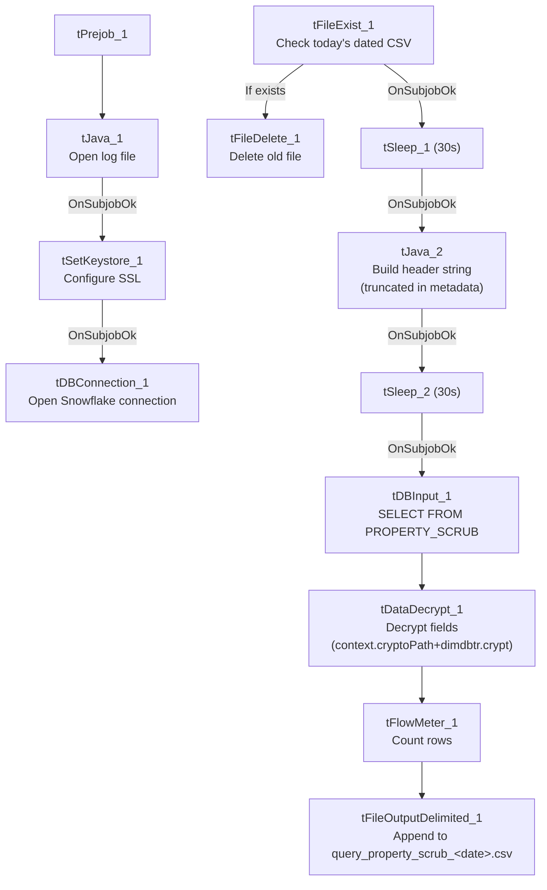

# Talend Job: LW_Property_Scrub

## Overview

This job produces a "Property Scrub" report: it queries a Snowflake view (`PUB_LWASHINGTON.PROPERTY_SCRUB`) for customer identity/address fields and SSN, decrypts the protected fields, and appends the result to a date-stamped CSV file (`query_property_scrub_<CCYYMMDD>.csv`) in the output directory. Unlike the Carle/ProMedica scrub jobs, this one has no email step — its output is presumably picked up by a separate downstream process — and follows the same file-reset/header-build/sleep template seen in `LW_COC_Water_Scrub` and the `LW_Dashboard_*` jobs rather than the simple query→decrypt→write→mail pattern used by its `LW_*_Scrub` siblings.

## Detail table

| Field | Value |
|---|---|
| Job name | LW_Property_Scrub |
| Version | 0.1 |
| Project | EDW2SF |
| Author | jmach@harriscollect.com |
| Created | 2024-12-18T09:24:35.959-0800 |
| Last Modified | 2025-11-16T20:24:55.516-0800 |

## Step-by-step data flow

**Setup subjob:** `tPrejob_1` → `tJava_1` opens a per-run log file → on subjob-ok, `tSetKeystore_1` configures SSL → on subjob-ok, `tDBConnection_1` opens the Snowflake connection.

**File-reset subjob** (separate chain): `tFileExist_1` checks whether today's dated output file (`context.outputDir+"query_property_scrub_"+<CCYYMMDD>+".csv"`) already exists → if so (`RUN_IF`), `tFileDelete_1` deletes it → on subjob-ok, `tSleep_1` (30s) → `tJava_2` builds a header-record string (truncated in the captured metadata, same pattern as `LW_COC_Water_Scrub` — see Issues observed) → on subjob-ok, `tSleep_2` (30s) → `tDBInput_1` runs the query below.

**Query, decrypt, and output:** `tDBInput_1` → `tDataDecrypt_1` decrypts protected fields using `context.cryptoPath+"dimdbtr.crypt"` → `tFlowMeter_1` counts rows → `tFileOutputDelimited_1` appends the rows (`APPEND=true`, `INCLUDEHEADER=false`) to `context.outputDir+"query_property_scrub_"+<CCYYMMDD>+".csv"`.

## Settings tables

### Source: `tDBInput_1` (`tSnowflakeInput`)

| Setting | Value | What it means |
|---|---|---|
| Query | `SELECT "Customer's Unique Record ID" AS CUSTOMER_ID, "First Name" AS FIRST_NAME, "Middle Name" AS MIDDLE_NAME, "Last Name" AS LAST_NAME, "Address Line 1" AS ADDRESS_1, "Address Line 2" AS ADDRESS_2, "City" AS CITY, "State" AS STATE, "Zip" AS ZIP, SSN FROM PUB_LWASHINGTON.PROPERTY_SCRUB;` | 10-column customer identity/address extract with SSN — no client/desk/balance columns, unlike the other `LW_*_Scrub` jobs, suggesting this feeds a property/skip-tracing match process rather than an account-status report. |

### Transform: `tDataDecrypt_1`

| Setting | Value | What it means |
|---|---|---|
| CRYPTO_FILE_PATH | `context.cryptoPath+"dimdbtr.crypt"` | |
| DIE_ON_ERROR | `true` | |
| SECRET_TYPE / SECRET_KEY / PASSWORD_M1 | `***REDACTED***` | Preserved as redacted. |

### Target: `tFileOutputDelimited_1`

| Setting | Value | What it means |
|---|---|---|
| FILENAME | `context.outputDir+"query_property_scrub_"+TalendDate.getDate("CCYYMMDD")+".csv"` | Date-stamped filename — a new file per calendar day, unlike the other `LW_*` jobs' fixed filenames. |
| APPEND / INCLUDEHEADER | `true` / `false` | Header expected from the (truncated) `tJava_2` step, same pattern as `LW_COC_Water_Scrub`. |

## Dependencies & configuration

- **Triggers/depends on other jobs:** none.
- **Context variables used:** `cryptoPath`, `keystorePath`, `logDir`, `outputDir`.
- **Hardcoded paths:** `tFileDelete_1.DIRECTORY`/`PATH` (generic Talend-Studio-workspace placeholder path), `tSetKeystore_1.SSL_TRUSTSERVER_TRUSTSTORE`.
- **No email step** — unlike `LW_Carle_Asset_Scrub`/`LW_ProMedica_Scrub`, this job is not listed in `05_operational_runbook.md`'s email-sending jobs, and indeed has no `tSendMail` component in its own metadata.

## Glossary

| Component type | Plain-English meaning |
|---|---|
| `tFileExist` / `tFileDelete` | Check for and conditionally delete the current day's output file before rebuilding it. |
| `tSleep` | Pauses the job for a fixed duration around the delete/header-build steps. |
| `tSnowflakeConnection` / `tSnowflakeInput` | Open a Snowflake connection and run a query against it. |
| `tDataDecrypt` | Decrypts protected fields (SSN) using a local key file. |
| `tFlowMeter` | Counts rows passing a point in the flow. |
| `tFileOutputDelimited` | Writes rows to a CSV file. |
| `tSetKeystore` | Configures SSL trust store/keystore for the Snowflake JDBC connection. |

## Issues observed

- **Same truncated header-write pattern as `LW_COC_Water_Scrub`/`LW_Dashboard_By_Agent`/`LW_Dashboard_By_Metric`** — `tJava_2`'s `headerRecord` string cuts off mid-literal ("...Cit...") with no visible file-write call, and `tFileOutputDelimited_1` relies on `INCLUDEHEADER=false`. If the code genuinely stops short of writing the header, each day's new dated CSV could end up without a header row. This is now the fourth job in this batch showing the identical truncation pattern, reinforcing that it's likely either a genuine shared template gap or a consistent metadata-extraction limit on inline Java code length — worth resolving which by checking one job directly in Talend Studio, since the answer applies to all four at once.
- **No email or downstream-notification step**, despite decrypting SSNs — worth confirming with the team how/whether the daily dated CSV output is picked up (e.g., a scheduled file transfer, a separate consuming job not present in this project's metadata) since nothing in this job's own logic signals completion externally.
- **Same missing explicit trigger link between the connection-setup subjob and the file-reset/query subjob** as the rest of this batch — `tSetKeystore_1 → tDBConnection_1` and `tFileExist_1 → ... → tDBInput_1` are two separate chains in the `connections` array, with nothing explicitly linking the Snowflake connection's completion to the start of the file-reset/query chain. Within the file-reset/query chain itself, however, the internal sequencing (`tFileExist_1 → tSleep_1 → tJava_2 → tSleep_2 → tDBInput_1`) is fully and explicitly wired.
