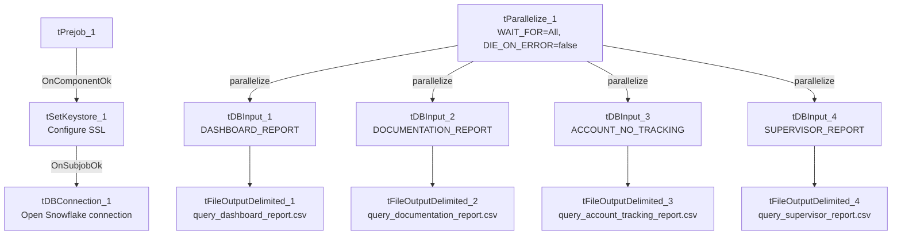

# Talend Job: LW_REPORTS

## Overview

This job is a multi-report batch extractor: it runs four independent Snowflake queries in parallel — a dashboard summary, a call "documentation" compliance report, an account-number-tracking report, and a supervisor-level call-score report — each writing straight to its own CSV file in `context.outputDir`. All four source views live in the `EDWPRODHH.PUB_LWASHINGTON` schema and appear to feed the same BI/reporting layer as the other `LW_*` jobs in this batch, but bundled into one job rather than split into four separate jobs (contrast with `LW_Dashboard_Base_Report`/`LW_Dashboard_By_Agent`/`LW_Dashboard_By_Metric`, which are separate jobs for a related purpose).

## Detail table

| Field | Value |
|---|---|
| Job name | LW_REPORTS |
| Version | 0.1 |
| Project | EDW2SF |
| Author | jmach@harriscollect.com |
| Created | 2023-12-12T11:03:17.037-0800 |
| Last Modified | 2025-11-16T20:26:21.880-0800 |

## Step-by-step data flow

**Setup subjob:** `tPrejob_1` → `tSetKeystore_1` configures SSL from `context.keystorePath` (note: no `tJava_1` log-file-open step in this job — see Issues observed) → on subjob-ok, `tDBConnection_1` opens the Snowflake connection.

**Main flow:** `tParallelize_1` (a separate, unconnected chain — see Issues observed) fans out to four independent query→write pairs, run concurrently:
- `tDBInput_1` (Dashboard Report) → `tFileOutputDelimited_1` → `query_dashboard_report.csv`
- `tDBInput_2` (Documentation Report) → `tFileOutputDelimited_2` → `query_documentation_report.csv`
- `tDBInput_3` (Account No. Tracking) → `tFileOutputDelimited_3` → `query_account_tracking_report.csv`
- `tDBInput_4` (Supervisor Report) → `tFileOutputDelimited_4` → `query_supervisor_report.csv`

`tParallelize_1` is configured with `WAIT_FOR=All` (waits for all four branches to finish) and `DIE_ON_ERROR=false` (a failure in one branch does not stop the others or fail the parallelize step itself).

## Settings tables

### `tParallelize_1`

| Setting | Value | What it means |
|---|---|---|
| WAIT_FOR | `All` | The parallelize step considers itself done only once all four query/write branches finish. |
| DIE_ON_ERROR | `false` | A failure in any one of the four branches does not fail the parallelize step or block the others from completing. |

### Sources (all `tSnowflakeInput`)

| Component | Table/view | Notable columns |
|---|---|---|
| `tDBInput_1` | `EDWPRODHH.PUB_LWASHINGTON.DASHBOARD_REPORT` | Call date, week of year, agent/supervisor, campaign, line of business, metric name/value — a general dashboard feed similar in shape to `LW_Dashboard_Base_Report`'s source but from a differently-named view (`DASHBOARD_REPORT` vs. `DASHBOARD_BASE_REPORT`). |
| `tDBInput_2` | `EDWPRODHH.PUB_LWASHINGTON.DOCUMENTATION_REPORT` | Call metadata (duration, direction, state), agent/supervisor/director/manager hierarchy, current balance, compliance flags (`WRAP_CODE_COMPLIANCE_FLAG`, `AC_COMPLIANCE`/`AC_NON_COMPLIANCE`, `PAY_CLOSE_FLAG`) — a call-documentation compliance audit feed. |
| `tDBInput_3` | `EDWPRODHH.PUB_LWASHINGTON.ACCOUNT_NO_TRACKING` | Subset of the documentation report's compliance columns (wrap-code flag, account-number-tracked flag) — appears to isolate one specific compliance metric (account number disclosure/tracking) from the broader documentation report. |
| `tDBInput_4` | `EDWPRODHH.PUB_LWASHINGTON.SUPERVISOR_REPORT` | Call score percentage, acknowledgement status/by-whom — a supervisor-facing scorecard-acknowledgement feed. |

### Targets (all `tFileOutputDelimited`)

| Setting | Value applies to all 4 | What it means |
|---|---|---|
| APPEND / INCLUDEHEADER | `false` / `true` | Each output file is recreated fresh each run with a header row. |
| Filenames | `context.outputDir+"query_dashboard_report.csv"`, `..._documentation_report.csv`, `..._account_tracking_report.csv`, `..._supervisor_report.csv` | All four write into the same shared output directory. |

## Dependencies & configuration

- **Triggers/depends on other jobs:** none.
- **Context variables used:** `keystorePath`, `outputDir` — notably **`logDir` is not referenced**, consistent with this job having no log-file-open step (see Issues observed).
- **Hardcoded paths:** `tSetKeystore_1.SSL_TRUSTSERVER_TRUSTSTORE`.
- **Relationship to other jobs:** No `tRunJob` links to/from `LW_Dashboard_Base_Report`/`LW_Dashboard_By_Agent`/`LW_Dashboard_By_Metric` or `LW_REPORTS_2`, despite the overlapping "dashboard report" theme — these are all independently-scheduled jobs, not orchestrated together in this metadata.

## Glossary

| Component type | Plain-English meaning |
|---|---|
| `tParallelize` | Runs its downstream branches at the same time rather than one after another. |
| `tSnowflakeConnection` / `tSnowflakeInput` | Open a Snowflake connection and run a query against it. |
| `tFileOutputDelimited` | Writes rows to a CSV file. |
| `tSetKeystore` | Configures SSL trust store/keystore for the Snowflake JDBC connection. |

## Issues observed

- **No per-run log file is opened** — unlike nearly every other job in this batch (which use a `tJava_1` component to redirect `System.out`/`System.err` to a timestamped log file in `context.logDir`), this job goes straight from `tPrejob_1` to `tSetKeystore_1`. Consistent with this, `logDir` does not appear in `context_vars_referenced`. Unable to determine whether this is intentional (e.g., an older job predating that convention, similar to `Insurance_Report_Extract`) or an oversight; it does mean this job's own run won't produce a dedicated log file the way its siblings do.
- **`tParallelize_1` has no incoming trigger link from the connection-setup chain** — the `connections` array shows `tPrejob_1 → tSetKeystore_1 → tDBConnection_1` as one chain and `tParallelize_1 → {tDBInput_1..4}` as a separate, unconnected chain. As with several other jobs in this batch, the ordering guarantee (Snowflake connection open before any of the four queries run) is not explicit in this job's own wiring; verify directly in Talend Studio.
- **`DIE_ON_ERROR=false` on `tParallelize_1` means a failure in any one of the four report queries will not fail the job overall** — the job could complete "successfully" even if, say, the Supervisor Report query failed and its output file was never written or left stale from a prior run. There is no `tWarn`/`tDie` logic checking each branch's individual outcome, so distinguishing "all four reports succeeded" from "three succeeded, one silently failed" would require checking the job's execution log line-by-line rather than relying on the job's own overall status.
- **`ACCOUNT_NO_TRACKING`'s columns are a strict subset of `DOCUMENTATION_REPORT`'s** (both include `WEEKLY_FILE_DATE`, `SUPERVISOR`, `DIRECTOR`, `MANAGER`, `CAMPAIGN`, `LINE_OF_BUSINESS`, `ACCOUNT_NUMBER`, `CALL_FILE_NAME`, `WRAP_CODE_COMPLIANCE_FLAG`) — this may simply be a narrower, purpose-built view for one specific compliance metric, but it does mean two of this job's four output files carry overlapping data; unable to determine from metadata whether both are still actively consumed downstream.
