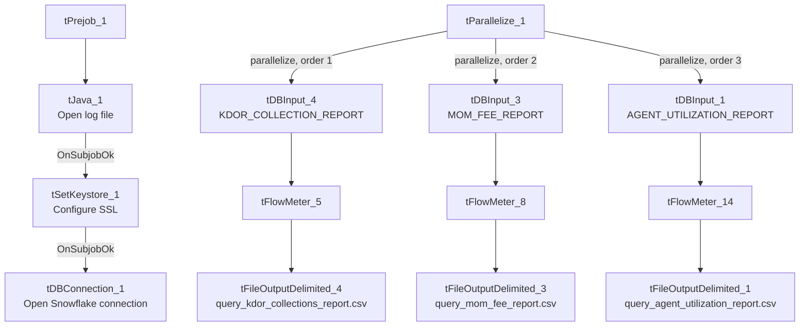

# Talend Job: LW_REPORTS_2

## Overview

This job is a second multi-report batch extractor, structurally similar to `LW_REPORTS` but pulling a different set of four (well, effectively three run in parallel plus one run outside the parallel block) Snowflake reports: agent utilization (call-type breakdowns, idle/break time), a month-over-month fee report, and a Kansas Department of Revenue ("KDOR") collections report. Each writes straight to its own CSV file in `context.outputDir`. It shares the "several independent queries bundled into one job" pattern with `LW_REPORTS`, but is not identical to it — different source views, and only 3 of its 4 report branches actually run inside the `tParallelize_1` block (see Issues observed).

## Detail table

| Field | Value |
|---|---|
| Job name | LW_REPORTS_2 |
| Version | 0.1 |
| Project | EDW2SF |
| Author | jmach@harriscollect.com |
| Created | 2023-12-20T12:39:13.782-0800 |
| Last Modified | 2025-11-16T20:25:39.458-0800 |

## Step-by-step data flow

**Setup subjob:** `tPrejob_1` → `tJava_1` opens a per-run log file → on subjob-ok, `tSetKeystore_1` configures SSL → on subjob-ok, `tDBConnection_1` opens the Snowflake connection.

**Main flow:** `tParallelize_1` (a separate, unconnected chain from the setup subjob — see Issues observed) fans out to three query→write pairs, run concurrently (`order` 1–3 in the metadata):
- `tDBInput_4` (KDOR Collection Report) → `tFlowMeter_5` → `tFileOutputDelimited_4` → `query_kdor_collections_report.csv`
- `tDBInput_3` (MOM Fee Report) → `tFlowMeter_8` → `tFileOutputDelimited_3` → `query_mom_fee_report.csv`
- `tDBInput_1` (Agent Utilization Report) → `tFlowMeter_14` → `tFileOutputDelimited_1` → `query_agent_utilization_report.csv`

Note the component numbering (`tDBInput_1`, `_3`, `_4` — no `_2`; `tFlowMeter_5`, `_8`, `_14` — no lower numbers; `tFileOutputDelimited_1`, `_3`, `_4` — no `_2`) has gaps, suggesting components were added/removed during development and never renumbered — see Issues observed.

## Settings tables

### Sources (all `tSnowflakeInput`)

| Component | Table/view | Notable columns |
|---|---|---|
| `tDBInput_1` | `EDWPRODHH.PUB_LWASHINGTON.AGENT_UTILIZATION_REPORT` | Per-agent call-type breakdown (dialer/preview/inbound/manual calls, counts and averages), idle and break time totals and percentages — an agent time-utilization report. |
| `tDBInput_3` | `EDWPRODHH.PUB_LWASHINGTON.MOM_FEE_REPORT` | Department, PL group, industry, client, director, fee total, and revenue growth by transaction date — a month-over-month fee/revenue tracking report. |
| `tDBInput_4` | `PUB_LWASHINGTON.KDOR_COLLECTION_REPORT` | Posted month/year, payment type, place flag, collections, fees posted — appears specific to Kansas Department of Revenue collections (unqualified by `EDWPRODHH.`, unlike the other two queries in this job). |

### Targets (all `tFileOutputDelimited`)

| Setting | Value | What it means |
|---|---|---|
| APPEND / INCLUDEHEADER | `false` / `true` (all three) | Each output file is recreated fresh each run with a header row. |

## Dependencies & configuration

- **Triggers/depends on other jobs:** none.
- **Context variables used:** `keystorePath`, `logDir`, `outputDir`.
- **Hardcoded paths:** `tSetKeystore_1.SSL_TRUSTSERVER_TRUSTSTORE`.
- **Relationship to `LW_REPORTS`:** Same "bundle multiple independent Snowflake report queries into one job with a shared `tParallelize_1`" pattern, but a different, non-overlapping set of source views. Not orchestrated together via `tRunJob`.

## Glossary

| Component type | Plain-English meaning |
|---|---|
| `tParallelize` | Runs its downstream branches at the same time rather than one after another. |
| `tSnowflakeConnection` / `tSnowflakeInput` | Open a Snowflake connection and run a query against it. |
| `tFlowMeter` | Counts rows passing a point in the flow. |
| `tFileOutputDelimited` | Writes rows to a CSV file. |
| `tSetKeystore` | Configures SSL trust store/keystore for the Snowflake JDBC connection. |

## Issues observed

- **Component numbering has gaps** (`tDBInput_1`, `_3`, `_4` with no `_2`; `tFlowMeter_5`, `_8`, `_14` with no lower-numbered siblings; `tFileOutputDelimited_1`, `_3`, `_4` with no `_2`) — a strong indicator that this job previously had at least one more report branch (e.g., a `tDBInput_2`/`tFileOutputDelimited_2` pair) that was later deleted without renumbering the survivors, and/or that components were copy-pasted from a larger template job and partially pruned. This doesn't affect current functionality but is worth flagging as a signal that this job's history may have removed a report that once existed — verify with the team whether a fourth report was intentionally retired or is missing by mistake.
- **`tParallelize_1` has no incoming trigger link from the connection-setup chain** — same gap as `LW_REPORTS`: `tPrejob_1 → tJava_1 → tSetKeystore_1 → tDBConnection_1` and `tParallelize_1 → {tDBInput_1,3,4}` are separate, unconnected chains in the extracted `connections` array. Verify ordering directly in Talend Studio.
- **No `DIE_ON_ERROR`/`WAIT_FOR` values were captured for this job's `tParallelize_1`** in the way `LW_REPORTS`'s were (`tParallelize_1` here has the same parameter keys — `WAIT_FOR=All`, `SLEEPTIME=100`, `DIE_ON_ERROR=false` — so behavior is the same: a failure in one of the three report branches won't fail the job or stop the others, and there's no branch-level success/failure check beyond the row-count `tFlowMeter`s).
- **The KDOR report's table reference is not database-qualified** (`PUB_LWASHINGTON.KDOR_COLLECTION_REPORT`) while the other two in this same job are (`EDWPRODHH.PUB_LWASHINGTON....`) — likely just relying on the connection's default database matching `EDWPRODHH`, but worth confirming rather than assuming, since an inconsistency here could indicate the KDOR view actually lives in a different database.
