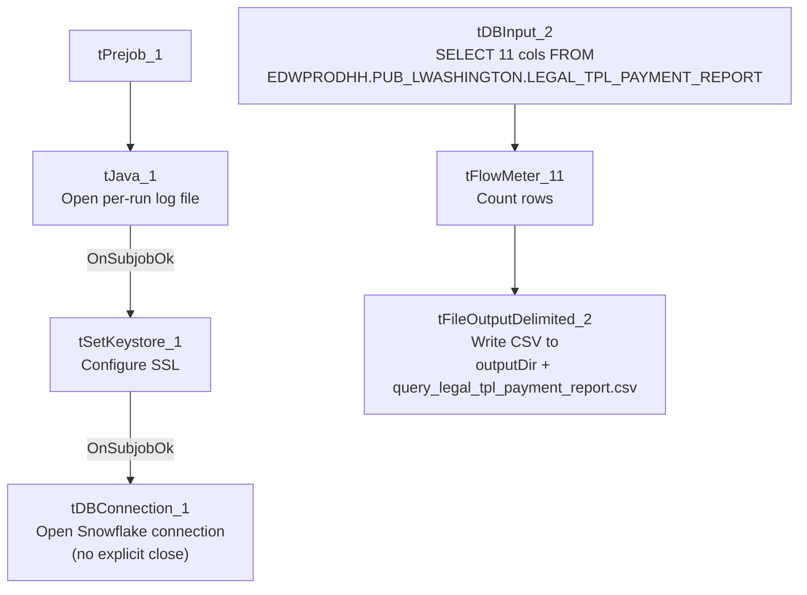

# Talend Job: LW_TPL_PMT_REPORT

## Overview

This is a single-query reporting extract: it reads a pre-built "Legal TPL Payment Report" view/table (`EDWPRODHH.PUB_LWASHINGTON.LEGAL_TPL_PAYMENT_REPORT`) from Snowflake — CUBS account number, client number, current/previous status, payment and commission amounts posted, payment date, current CUBS desk, client name, and two grouping/bank codes (`PL_GROUP`, `KDOR_BANK`) — and writes the result straight to a CSV file in `context.outputDir`. It moves no data anywhere else; its only purpose is to hand a flat file of this report to whoever consumes it downstream (name and "TPL" suggest a Third-Party Liability legal payment report). The `PUB_LWASHINGTON` schema name (compare `PUB_JCHANG` documented project-wide in `01_system_architecture.md`) suggests this reads from an individually-owned publish schema rather than shared platform infrastructure.

## Detail table

| Field | Value |
|---|---|
| Job name | LW_TPL_PMT_REPORT |
| Version | 0.1 |
| Project | EDW2SF |
| Author | jmach@harriscollect.com |
| Created | 2024-06-26T14:37:42.488-0700 |
| Last Modified | 2025-11-16T20:26:57.689-0800 |

## Step-by-step data flow

**Setup subjob:** `tPrejob_1` → `tJava_1` opens a per-run log file at `context.logDir + jobName + "_" + <timestamp> + ".log"` and redirects `System.out`/`System.err` to it → on subjob-ok, `tSetKeystore_1` configures SSL trust/keystore from `context.keystorePath` (passwords redacted) → on subjob-ok, `tDBConnection_1` opens the Snowflake connection.

**Main subjob** (no explicit trigger connection from the setup subjob or from `tDBConnection_1` — it runs independently and relies on Talend's implicit shared-connection behavior, same pattern seen in other jobs in this project):

1. `tDBInput_2` runs a fixed `SELECT` of 11 columns from `EDWPRODHH.PUB_LWASHINGTON.LEGAL_TPL_PAYMENT_REPORT` (CUBS#, Client Number, Current Status, Payment Posted, Commission Posted, Date of Payment Posted, Current CUBS Desk, Previous Status, Client Name, PL_GROUP, KDOR_BANK).
2. `tFlowMeter_11` counts rows passing through (labeled "MyLabel", not renamed for this job).
3. `tFileOutputDelimited_2` writes the rows to `context.outputDir + "query_legal_tpl_payment_report.csv"` — comma-delimited, header included, ISO-8859-15 encoding, `CREATE=true`, `APPEND=false` (overwrites on each run).

**Teardown:** none — there is no `tPostjob`/`tDBClose` component in this job at all; the Snowflake connection opened by `tDBConnection_1` is never explicitly closed (see Issues observed).

## Settings tables

### Source: `tDBInput_2` (`tSnowflakeInput`)

| Setting | Value | What it means |
|---|---|---|
| Query | `SELECT "CUBS#" AS CUBS_Number, "Client Number", "Current Status", "Payment Posted", "Commission Posted", "Date of Payment Posted", "Current CUBS Desk", "Previous Status", "Client Name", PL_GROUP, KDOR_BANK FROM EDWPRODHH.PUB_LWASHINGTON.LEGAL_TPL_PAYMENT_REPORT;` | Reads a pre-existing report table/view fully qualified across database (`EDWPRODHH`) and an individually-named schema (`PUB_LWASHINGTON`) — no filtering or date-scoping visible in the query text. |

### Target: `tFileOutputDelimited_2`

| Setting | Value | What it means |
|---|---|---|
| FILENAME | `context.outputDir + "query_legal_tpl_payment_report.csv"` | Destination CSV path, driven entirely by the `outputDir` context variable. |
| FIELDSEPARATOR / INCLUDEHEADER | `,` / `true` | Standard comma-delimited CSV with a header row. |
| APPEND | `false` | Each run overwrites the previous file rather than accumulating rows. |
| ENCODING | `ISO-8859-15` | Non-default encoding choice (most other file-output jobs in this project use US-ASCII per the shared context groups) — worth confirming this is intentional for whatever consumes the file. |

## Dependencies & configuration

- **Triggers/depends on other jobs:** none — no `tRunJob` links found (`runjob_targets` is empty), and not listed as a target in `06_dependency_matrix.md`.
- **Context variables used:** `keystorePath`, `logDir`, `outputDir`.
- **1 hardcoded path finding:** `tSetKeystore_1.SSL_TRUSTSERVER_TRUSTSTORE` = `"C:/clientTrustStore.trustStore"` — a Windows-workstation-style path, consistent with the project-wide hardcoded-path pattern noted in `05_operational_runbook.md` (though this specific path isn't the `C:/Talend-Studio-...` one called out there).

## Glossary

| Component type | Plain-English meaning |
|---|---|
| `tPrejob` / `tPostjob` | Marks the start/end of a job's setup/teardown subjob; this job has no `tPostjob`. |
| `tJava` | Runs custom Java code once — here, only to open a per-run log file. |
| `tSetKeystore` | Configures SSL trust/keystore settings for the job's outbound connections. |
| `tSnowflakeConnection` / `tSnowflakeInput` | Open a Snowflake connection / run a query against Snowflake and return result rows. |
| `tFlowMeter` | Counts rows passing a point in the flow, for logging/monitoring. |
| `tFileOutputDelimited` | Writes rows to a delimited (CSV-style) text file. |

## Issues observed

- **No `tPostjob`/`tDBClose` component exists in this job at all** — the Snowflake connection opened by `tDBConnection_1` is never explicitly closed within the job. Every other reviewed job in this project pairs its `tDBConnection`/`tPrejob` with a `tPostjob`/`tDBClose` teardown; this job's absence of one is a deviation from that pattern. Whether Talend's runtime closes the connection implicitly on job exit is unable to determine from metadata — worth confirming this isn't leaking a connection on a long-running server.
- **No explicit wiring connects the setup subjob (`tDBConnection_1`) to the main query subjob (`tDBInput_2`)** — the two subjobs appear to run independently in the component graph, relying on Talend's shared-connection-by-name behavior rather than a `SUBJOB_OK`/`COMPONENT_OK` link. This is common in Talend but means the query's success is not gated on the connection setup subjob completing first from this metadata's perspective alone.
- **No error handling of any kind** (no `tWarn`, `tDie`, `tLogRow`, reject flow) — a query failure or file-write failure here would only show up as a generic Talend execution error.
- **`PUB_LWASHINGTON` looks like an individually-owned schema** (compare `PUB_JCHANG`, flagged project-wide in `01_system_architecture.md` and `06_dependency_matrix.md` as a likely one-off/personal connection rather than shared infrastructure) — if the underlying person/relationship behind this schema changes, this report could silently break with no one else aware of the dependency.
