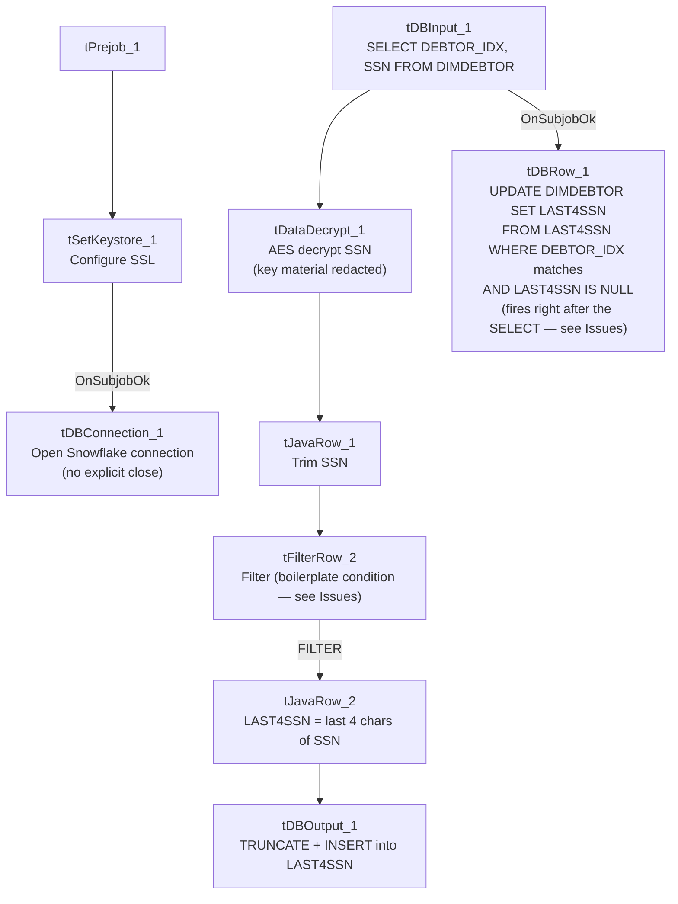

# Talend Job: Last4SSN_Extract

## Overview

Extracts and decrypts debtor Social Security Numbers from the Snowflake `DIMDEBTOR` table, derives just the last 4 digits of each SSN, and writes the result into a Snowflake `LAST4SSN` table (truncate-and-reload) — then immediately uses that table to back-fill a `LAST4SSN` column directly on `DIMDEBTOR` wherever it's currently null. This is a data-privacy-minimization pattern: rather than exposing full SSNs elsewhere in the warehouse, downstream consumers can join to (or read the column added to) `DIMDEBTOR` for just the last 4 digits, which is enough for identity verification without keeping the fully decrypted SSN in view.

## Detail table

| Field | Value |
|---|---|
| Job name | Last4SSN_Extract |
| Version | 0.1 |
| Project | EDW2SF |
| Author | jmach@harriscollect.com |
| Created | 2026-05-22T10:08:48.767-0700 |
| Last Modified | 2026-05-22T11:22:58.998-0700 |

## Step-by-step data flow

**Setup subjob:** `tPrejob_1` → `tSetKeystore_1` configures SSL trust/keystore from `context.keystorePath` (passwords redacted) → on subjob-ok, `tDBConnection_1` opens the Snowflake connection.

**Main subjob** (runs independently of the setup chain in the component graph, same implicit shared-connection pattern seen elsewhere in this project):

1. `tDBInput_1` runs `SELECT DEBTOR_IDX, SSN FROM DIMDEBTOR;` against Snowflake, pulling every debtor's (presumably encrypted) SSN value.
2. `tDataDecrypt_1` decrypts the `SSN` column using AES (algorithm version 2), reading its crypto key material from `context.cryptoPath + "dimdbtr.crypt"` (secret type, secret key, and password all redacted); `DIE_ON_ERROR=true`, so a decryption failure fails the job outright.
3. `tJavaRow_1` trims the decrypted `SSN` value (passing `DEBTOR_IDX` through unchanged), guarding against a null `SSN` by leaving it null rather than trimming.
4. `tFilterRow_2` applies a row filter — **its condition text is left as unmodified template boilerplate** (`input_row.columnName1.equals(input_row.columnNam...`, truncated in this metadata) rather than a real business condition; see Issues observed. Rows passing the `FILTER` branch continue; there's no visible handling of the "else" branch.
5. `tJavaRow_2` derives `LAST4SSN` as the last 4 characters of the trimmed `SSN` (`input_row.SSN.trim().substring(...length() - 4)`), dropping the full SSN from the output row entirely (only `DEBTOR_IDX` and `LAST4SSN` remain).
6. `tDBOutput_1` writes to Snowflake table `LAST4SSN` with `outputAction=INSERT` and `tableAction=TRUNCATE` — the table is fully cleared and reloaded every run.
7. Separately, `tDBInput_1` also connects on `SUBJOB_OK` directly to `tDBRow_1`, which runs `UPDATE DIMDEBTOR dd SET LAST4SSN = l4.LAST4SSN FROM LAST4SSN l4 WHERE dd.DEBTOR_IDX = l4.DEBTOR_IDX AND dd.LAST4SSN IS NULL;` — this only back-fills debtors that don't already have a `LAST4SSN` value, and it fires once the SELECT from `tDBInput_1` completes (not once the full extract/decrypt/load chain into `LAST4SSN` finishes) — see Issues observed.

**Teardown:** none — there is no `tPostjob`/`tDBClose` component in this job.

## Settings tables

### Source: `tDBInput_1` (`tSnowflakeInput`)

| Setting | Value | What it means |
|---|---|---|
| Query | `SELECT DEBTOR_IDX, SSN FROM DIMDEBTOR;` | Pulls every debtor row's (presumably still-encrypted) SSN — no filtering by null/existing `LAST4SSN`, so every run re-decrypts the full table. |

### Transform: `tDataDecrypt_1`

| Setting | Value | What it means |
|---|---|---|
| CRYPTO_METHOD / ALGO_VERSION | `AES` / `2` | Symmetric decryption of the SSN column. |
| SECRET_TYPE / SECRET_KEY / PASSWORD_M1 | `***REDACTED***` / `***REDACTED***` / `***REDACTED***` | Key material for decryption — preserved as redacted, not guessable from this metadata. |
| CRYPTO_FILE_PATH | `context.cryptoPath + "dimdbtr.crypt"` | Points at a per-table crypto key file. |
| DIE_ON_ERROR | `true` | A decryption failure (e.g. bad key, corrupted value) fails the job outright rather than skipping the row. |

### Target: `tDBOutput_1` (`tSnowflakeOutput`)

| Setting | Value | What it means |
|---|---|---|
| Table | `LAST4SSN` | Destination table for the derived last-4-digit values. |
| Output action / Table action | `INSERT` / `TRUNCATE` | Table is cleared and reloaded every run — standard staging-table pattern. |

### Back-fill: `tDBRow_1` (`tSnowflakeRow`)

| Setting | Value | What it means |
|---|---|---|
| Query | `UPDATE DIMDEBTOR dd SET LAST4SSN = l4.LAST4SSN FROM LAST4SSN l4 WHERE dd.DEBTOR_IDX = l4.DEBTOR_IDX AND dd.LAST4SSN IS NULL;` | Only touches `DIMDEBTOR` rows that don't already have a `LAST4SSN` value — an incremental back-fill, not a full overwrite, of the dimension table itself. |

## Dependencies & configuration

- **Triggers/depends on other jobs:** none — no `tRunJob` links found (`runjob_targets` is empty), and not listed as a target in `06_dependency_matrix.md`.
- **Context variables used:** `cryptoPath`, `keystorePath`.
- **1 hardcoded path finding:** `tSetKeystore_1.SSL_TRUSTSERVER_TRUSTSTORE` = `"C:/clientTrustStore.trustStore"`.

## Glossary

| Component type | Plain-English meaning |
|---|---|
| `tDataDecrypt` | Decrypts a column's value using a stored key/algorithm — the reverse of however the SSN was originally encrypted at rest. |
| `tJavaRow` | Runs custom Java code once per input row — here used to trim a string and to derive a substring. |
| `tFilterRow` | Passes rows through only if they meet a configured condition. |
| `tSnowflakeInput` / `tSnowflakeOutput` / `tSnowflakeRow` / `tSnowflakeConnection` | Read from / write to / run arbitrary SQL against Snowflake, and open the shared connection. |

## Issues observed

- **`tFilterRow_2`'s condition is left as unmodified Talend template boilerplate** — the captured text is `input_row.columnName1.equals(input_row.columnNam...` (truncated), which is the literal placeholder Talend inserts into a new `tFilterRow`'s advanced-condition editor before a developer customizes it. Column names `columnName1`/`columnName2` don't exist in this job's `DEBTOR_IDX`/`SSN` schema at all. **This strongly suggests the filter was never actually configured** and may pass all rows through unconditionally (if `USE_ADVANCED=false` and no basic-mode conditions were captured either) or may throw a runtime error referencing nonexistent columns. Unable to determine the actual runtime behavior from this metadata — verify directly in Talend Studio, since as written this looks like a job that was never fully finished before being put into use (consistent with its very recent creation/modification dates, both in May 2026).
- **The `DIMDEBTOR` back-fill (`tDBRow_1`) is wired to fire on `tDBInput_1`'s `SUBJOB_OK`, not after the full extract-decrypt-load chain into `LAST4SSN` completes.** Both `tDBRow_1` and the `tDataDecrypt_1`→...→`tDBOutput_1` chain branch off the same `tDBInput_1` component. Depending on Talend's execution-order guarantees for parallel branches off one source, the `UPDATE ... FROM LAST4SSN` back-fill could run before this run's fresh `TRUNCATE`+`INSERT` into `LAST4SSN` has completed, in which case it would either back-fill from a stale/empty `LAST4SSN` table or race with the truncate. Unable to determine execution ordering from this metadata alone — verify with the team, since this affects whether the back-fill uses this run's data or last run's.
- **No reject-row or error-count logging** on `tDataDecrypt_1`, `tJavaRow_1`, or `tJavaRow_2` beyond the blanket `DIE_ON_ERROR=true` on the decrypt step — a single bad/corrupt SSN value fails the entire job rather than being skipped and logged.
- **No `tPostjob`/`tDBClose`** — same pattern as `LW_TPL_PMT_REPORT` in this batch; the Snowflake connection is never explicitly closed within the job.
- **This job handles decrypted SSNs in-memory and briefly in a Snowflake staging table (`LAST4SSN`)** — per this organization's data-handling guidance, confirm `LAST4SSN`'s access controls are at least as restrictive as `DIMDEBTOR`'s, since the table transiently holds derived SSN fragments tied to `DEBTOR_IDX`.
