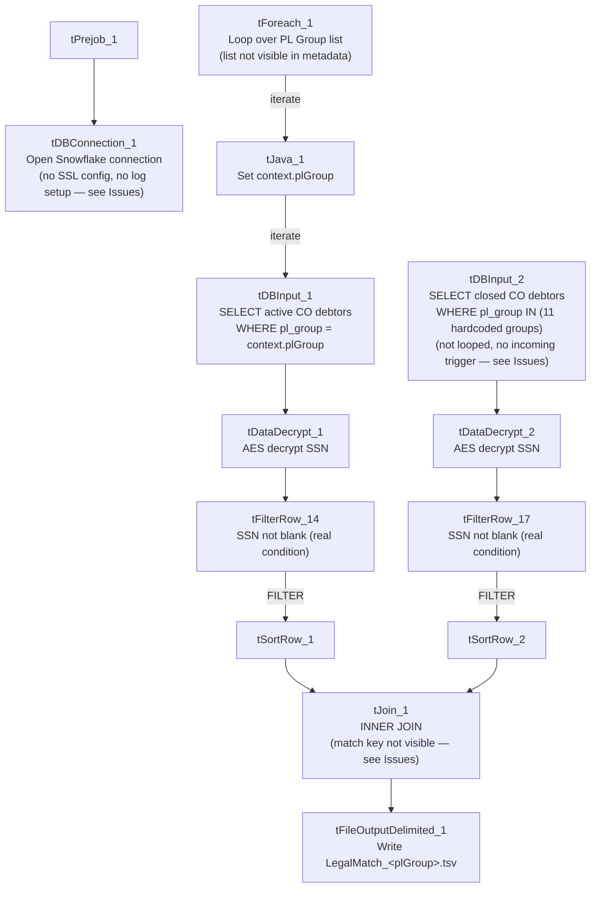

# Talend Job: LegalMatch_Extract

## Overview

For each value in a configured list of "PL Group" codes (client/portfolio groupings — the list itself isn't visible in this metadata), this job finds currently-active "CO" (site code) debtors in that group and cross-references them against a separate, fixed list of debtors whose accounts were previously closed as paid ("LPF"/"PIF" status) under one of eleven specific county/state legal-referral portfolios (Illinois counties Kane, DuPage, McHenry, Kankakee, Kendall, Winnebago, Champaign, Will, Lake, LaSalle, plus "STATE OF KS - DOR"). Both sides' SSNs are decrypted, and matched pairs are written to a per-group TSV file (`LegalMatch_<plGroup>.tsv`) containing both the active debtor's and the matched historical debtor's full details side by side. This looks like a legal-referral/skip-eligibility check: finding debtors currently being worked who have a history of being legally pursued (e.g., a lien, garnishment, or county/state legal collection) elsewhere.

## Detail table

| Field | Value |
|---|---|
| Job name | LegalMatch_Extract |
| Version | 0.1 |
| Project | EDW2SF |
| Author | jmach@harriscollect.com |
| Created | 2023-08-28T09:38:17.322-0700 |
| Last Modified | 2025-09-24T11:00:17.280-0700 |

## Step-by-step data flow

**Setup subjob:** `tPrejob_1` → `tDBConnection_1` opens the Snowflake connection — **no `tSetKeystore` SSL configuration and no per-run log file** exist anywhere in this job, unlike most other Legal_* extract jobs in this project; see Issues observed.

**Main subjob** has two independent starting branches feeding into a join:

**Branch A — currently-active debtors, looped per PL Group (this is the main/driving flow):**
1. `tForeach_1` iterates over a fixed list of values (not captured in this metadata, same limitation as `Semaphore_Check`'s `tForeach_1`) → `tJava_1` sets `context.plGroup` to the current value.
2. `tDBInput_1` runs (per iteration) a query joining `DIMDEBTOR`, `DIMCLIENT`, and (left join) `DIMFISCAL_CO_A`/`DIMFISCAL_CO_C` for employer name/address and a second encrypted SSN field (`TEC_SSN`), filtered to `logon = 'CO'`, `status IN ('ACT','PPD','LNA')` (active-family statuses), non-null name/SSN, name length > 3, **and `dc.pl_group = '<context.plGroup>'`** — i.e., scoped to whichever group the current loop iteration is processing.
3. `tDataDecrypt_1` decrypts the row (AES, algorithm version 2, hardcoded key path `"C:/Data/dimdbtr.crypt"`; `DIE_ON_ERROR=true`).
4. `tFilterRow_14` applies a **genuinely configured** condition, `input_row.SSN.trim().length() > 0` — unlike the unmodified-boilerplate `tFilterRow` instances found elsewhere in this project (`Last4SSN_Extract`, `Load_Evergreen_Hours`, `LoadLegalRpt20231130`), this one actually filters out rows whose decrypted SSN came back blank.
5. `tSortRow_1` sorts the filtered rows, feeding the main side of `tJoin_1`.

**Branch B — historical closed legal-referral debtors, fixed list of groups (independent starting point, no incoming trigger — same pattern as the unconnected branches in `Livevox_Daily_Load`):**
6. `tDBInput_2` runs a similarly-shaped query, but filtered to `status IN ('LPF','PIF')` (closed/paid statuses) **and a hardcoded list of 11 specific `pl_group` values** (the Illinois counties and Kansas DOR named above) — this query is **not parameterized by `context.plGroup`** and does not change across `tForeach_1`'s iterations; see Issues observed.
7. `tDataDecrypt_2` decrypts this row the same way (same hardcoded crypto key path).
8. `tFilterRow_17` applies the same genuine SSN-not-blank condition.
9. `tSortRow_2` sorts, feeding the lookup side of `tJoin_1`.

**Join and output:**
10. `tJoin_1` (`USE_INNER_JOIN=true`, `USE_LOOKUP_COLS=true`) inner-joins Branch A's active debtors against Branch B's historical closed-legal debtors — **the actual match key column(s) aren't captured in this metadata** (`USE_LOOKUP_COLS=true` only confirms specific columns were selected in the Studio UI, not which ones); see Issues observed. The joined output carries every column from both sides, with Branch B's columns prefixed `M_` (e.g. `M_NAME1`, `M_SSN`, `M_TEC_SSN`).
11. `tFileOutputDelimited_1` writes matched rows to `"C:/Data/LegalMatch_" + context.plGroup + ".tsv"` (tab-delimited, header included, ISO-8859-15 encoding) — one output file per PL Group processed by the outer loop.

## Settings tables

### Source A: `tDBInput_1` (`tSnowflakeInput`, looped per PL Group)

| Setting | Value | What it means |
|---|---|---|
| Query filter | `logon = 'CO'`, `status IN ('ACT','PPD','LNA')`, `dc.pl_group = '<context.plGroup>'`, non-null name/SSN, `len(name1) > 3` | Currently-active-family debtors for the CO site, scoped to whichever group the loop is currently processing. |
| Joins | `DIMDEBTOR` inner-joined to `DIMCLIENT`; left-joined to `DIMFISCAL_CO_A` (employer info) and `DIMFISCAL_CO_C` (`TEC_SSN`, a second encrypted SSN-like field) | Employer/second-SSN fields are optional (left join) — a debtor without a fiscal-CO record still appears with those fields null. |

### Source B: `tDBInput_2` (`tSnowflakeInput`, fixed, not looped)

| Setting | Value | What it means |
|---|---|---|
| Query filter | `logon = 'CO'`, `status IN ('LPF','PIF')`, `dc.pl_group IN ('COUNTY OF KANE IL - 3P', 'COUNTY OF DUPAGE IL - 3P', 'COUNTY OF MCHENRY IL - 3P', 'COUNTY OF KANKAKEE IL - 3P', 'COUNTY OF KENDALL IL - 3P', 'COUNTY OF WINNEBAGO IL - 3P', 'COUNTY OF CHAMPAIGN IL - 3P', 'COUNTY OF WILL IL - 3P', 'COUNTY OF LAKE IL - 3P', 'COUNTY OF LASALLE IL - 3P', 'STATE OF KS - DOR - 3P')` | A fixed, hardcoded reference set of closed/paid legal-referral accounts across 10 Illinois counties and Kansas's Department of Revenue — independent of which group `tForeach_1` is currently processing. |

### Transform: `tDataDecrypt_1` / `tDataDecrypt_2`

| Setting | Value | What it means |
|---|---|---|
| CRYPTO_FILE_PATH | `"C:/Data/dimdbtr.crypt"` (hardcoded literal, both instances) | Same hardcoded key path pattern seen in `LoadLegalRpt20231130` and `Legal_Asset_Scrub_Illinois_Counties_Extract` (v1). |
| DIE_ON_ERROR | `true` (both) | A decryption failure fails the job outright. |

### Join: `tJoin_1`

| Setting | Value | What it means |
|---|---|---|
| USE_INNER_JOIN | `true` | Only debtors matching on both sides appear in the output — non-matches from either branch are dropped, not carried through with nulls. |
| USE_LOOKUP_COLS | `true` | Match key columns were explicitly selected in the Studio UI, but the specific column(s) used are not captured in this metadata — see Issues observed. |

### Target: `tFileOutputDelimited_1`

| Setting | Value | What it means |
|---|---|---|
| FILENAME | `"C:/Data/LegalMatch_" + context.plGroup + ".tsv"` | One output file per group processed, tab-delimited. |
| Columns | Full column set from both sides (unprefixed for the active debtor, `M_`-prefixed for the matched historical debtor), including both decrypted `SSN`/`TEC_SSN` and `M_SSN`/`M_TEC_SSN` | Writes two people's decrypted SSNs per output row into an unencrypted flat file — see Issues observed. |

## Dependencies & configuration

- **Triggers/depends on other jobs:** none — no `tRunJob` links found (`runjob_targets` is empty).
- **Context variables used:** `plGroup` (set internally by `tJava_1` from the `tForeach_1` loop).
- **2 hardcoded path findings:** `tSortRow_1.TEMPFILE` and `tSortRow_2.TEMPFILE` (both `C:/Talend-Studio-20211109_1610-V8.0.1/workspace/temp`) — plus the crypto key path and output filename base, both also hardcoded literals not captured in the `hardcoded_path_findings` array.

## Glossary

| Component type | Plain-English meaning |
|---|---|
| `tForeach` | Loops over a fixed list of values (defined in the component's own configuration), running the same downstream steps once per value. |
| `tSnowflakeInput` | Runs a query against Snowflake and returns its result rows. |
| `tDataDecrypt` | Decrypts a column's value using a stored key/algorithm. |
| `tFilterRow` | Passes rows through only if they meet a configured condition. |
| `tSortRow` | Sorts rows by one or more configured columns. |
| `tJoin` | Joins two input flows together by matching column(s), similar to a SQL join but performed in-memory within the Talend job. |
| `tFileOutputDelimited` | Writes rows to a delimited (here, tab-separated) text file. |

## Issues observed

- **The exact column(s) `tJoin_1` matches on are not captured in this metadata.** For a job explicitly built to find "legal matches" between two debtor populations, the match key is the single most consequential design decision (e.g., matching on SSN alone is high-precision but would miss name/DOB-based matches for people whose SSN wasn't captured on one side; matching on name+address is higher-recall but risks false positives between different people). Verify directly in Talend Studio which columns `tJoin_1` actually uses before relying on this job's output for any legal or compliance decision.
- **`tDBInput_2`'s lookup query is a fixed, hardcoded list of 11 `pl_group` values and does not vary with `context.plGroup`** — it has no incoming trigger connection at all, making it an independent starting point (same pattern flagged in `Livevox_Daily_Load`'s unconnected archive branch) that presumably runs once per job execution rather than once per loop iteration. This is very likely the intended design (Branch B is meant to be a fixed reference set for every group processed by Branch A, not itself parameterized), but it does mean: (a) any group value that `tForeach_1` iterates over which is *not* meaningfully related to these 11 counties/Kansas would only produce matches for debtors who happen to also have a historical closed record in exactly one of those 11 groups, and (b) this query and its downstream decrypt/filter/sort chain are unable to be confirmed, from this metadata, to execute only once rather than being re-triggered per iteration — verify actual runtime behavior in Talend Studio.
- **This job writes two people's decrypted SSNs per matched row into an unencrypted flat TSV file** (`SSN`/`TEC_SSN` for the active debtor and `M_SSN`/`M_TEC_SSN` for the matched historical debtor), one file per PL Group, with no visible file-level protection (no password, no encryption option configured on `tFileOutputDelimited_1`). Given the apparent legal/compliance purpose of this data, confirm the output location (`C:/Data/`) and downstream handling meet this organization's requirements for sensitive PII in a legal-discovery-adjacent context.
- **No `tSetKeystore`/SSL configuration and no per-run log file** exist anywhere in this job, unlike most other file/report-extract jobs reviewed in this project — a decryption or connection failure here would produce a generic Talend error with no job-specific log trail.
- **No `tPostjob`/`tDBClose`** — the Snowflake connection opened by `tDBConnection_1` is never explicitly closed, the same gap found in `LW_TPL_PMT_REPORT` and `Last4SSN_Extract` elsewhere in this batch.
- **The list of PL Group values `tForeach_1` iterates over is not captured in this metadata** — unable to determine how many output files this job produces per run or which groups are actually processed; verify directly in Talend Studio.
- **Positive note:** unlike several other jobs reviewed in this project, `tFilterRow_14` and `tFilterRow_17` in this job both have **genuinely configured, working conditions** (`input_row.SSN.trim().length() > 0`), not the unmodified Talend template boilerplate found in `Last4SSN_Extract`, `Load_Evergreen_Hours`, and `LoadLegalRpt20231130` — this job is not part of that recurring project-wide pattern.
