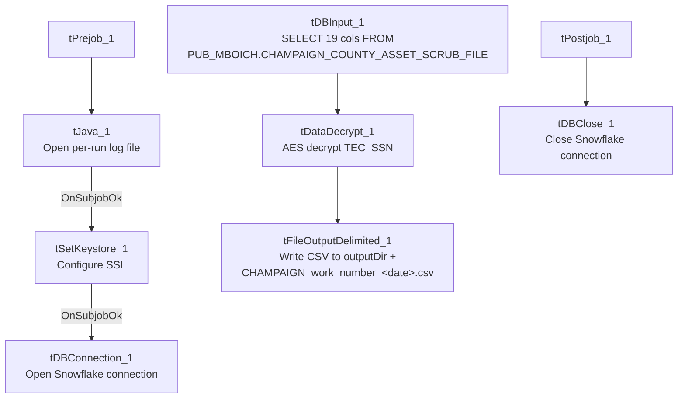

# Talend Job: Legal_Asset_Scrub_Champaign_County_Extract

## Overview

Extracts a legal "asset scrub" file for Champaign County from a Snowflake publish view (`PUB_MBOICH.CHAMPAIGN_COUNTY_ASSET_SCRUB_FILE`) — debtor identity, address, DOB, packet/CDN references, assigned/interest/misc dollar amounts, payment, total balance, status, and employer name/address — decrypts the debtor's SSN column, and writes the combined result to a dated CSV file for a legal/asset-verification partner ("work number" in the filename suggests an employment/income-verification service, e.g. The Work Number). This is one of three closely related "Legal_Asset_Scrub" jobs in this batch; see Issues observed for exactly how it differs from `Legal_Asset_Scrub_Illinois_Counties_Extract` and `_2`.

## Detail table

| Field | Value |
|---|---|
| Job name | Legal_Asset_Scrub_Champaign_County_Extract |
| Version | 0.2 |
| Project | EDW2SF |
| Author | jmach@harriscollect.com |
| Created | 2024-12-05T15:41:16.634-0800 |
| Last Modified | 2025-11-12T06:18:43.547-0800 |

## Step-by-step data flow

**Setup subjob:** `tPrejob_1` → `tJava_1` opens a per-run log file at `context.logDir + jobName + "_" + <timestamp> + ".log"` → on subjob-ok, `tSetKeystore_1` configures SSL trust/keystore from `context.keystorePath` (passwords redacted) → on subjob-ok, `tDBConnection_1` opens the Snowflake connection.

**Main subjob** (runs independently of the setup chain, relying on the shared connection):

1. `tDBInput_1` runs a fixed `SELECT` of 19 columns from `PUB_MBOICH.CHAMPAIGN_COUNTY_ASSET_SCRUB_FILE` — county is **hardcoded in the table name**, not parameterized.
2. `tDataDecrypt_1` decrypts the `TEC_SSN` column (AES, algorithm version 2) using key material from `context.cryptoPath + "dimdbtr.crypt"` (all secret fields redacted); `DIE_ON_ERROR=true`.
3. `tFileOutputDelimited_1` writes the decrypted rows to `context.outputDir + "CHAMPAIGN_work_number_" + <CCYYMMDD> + ".csv"` — comma-delimited, header included, ISO-8859-15 encoding, overwrite-on-run (`APPEND=false`).

**Teardown subjob:** `tPostjob_1` → `tDBClose_1` closes the Snowflake connection.

## Settings tables

### Source: `tDBInput_1` (`tSnowflakeInput`)

| Setting | Value | What it means |
|---|---|---|
| Query | `SELECT DEBTOR_IDX, CLIENT_IDX, NAME1, ADDRESS_1, CITY, STATE, ZIP_CODE, PACKET_IDX, DOB, CDN, ASSIGNED_AMOUNT, INT_AMT, MISC_AMT, PAYMENT, TTL_BAL, STATUS, EMP1_NAME, EMP1_ADDR, TEC_SSN FROM PUB_MBOICH.CHAMPAIGN_COUNTY_ASSET_SCRUB_FILE;` | Fixed to Champaign County only — includes employer name/address (`EMP1_NAME`, `EMP1_ADDR`), which the sibling `Illinois_Counties_Extract` (v1) job's column set does not. |

### Transform: `tDataDecrypt_1`

| Setting | Value | What it means |
|---|---|---|
| CRYPTO_FILE_PATH | `context.cryptoPath + "dimdbtr.crypt"` | Key file location driven by context variable (unlike sibling `Illinois_Counties_Extract` v1, which hardcodes this path — see that job's doc). |
| SECRET_TYPE / SECRET_KEY / PASSWORD_M1 | `***REDACTED***` | Preserved as redacted. |
| DIE_ON_ERROR | `true` | A decryption failure fails the job outright. |

### Target: `tFileOutputDelimited_1`

| Setting | Value | What it means |
|---|---|---|
| FILENAME | `context.outputDir + "CHAMPAIGN_work_number_" + TalendDate.getDate("CCYYMMDD") + ".csv"` | County name is hardcoded into the filename as well as the source table. |
| Format | CSV, comma-delimited, header included, ISO-8859-15 | Same output shape as `Legal_Asset_Scrub_Illinois_Counties_Extract_2`, but that job writes a per-county filename via `context.countyName` rather than a literal "CHAMPAIGN". |

## Dependencies & configuration

- **Triggers/depends on other jobs:** none — no `tRunJob` links found (`runjob_targets` is empty).
- **Context variables used:** `cryptoPath`, `keystorePath`, `logDir`, `outputDir`.
- **1 hardcoded path finding:** `tSetKeystore_1.SSL_TRUSTSERVER_TRUSTSTORE` = `"C:/clientTrustStore.trustStore"`.

## Glossary

| Component type | Plain-English meaning |
|---|---|
| `tDataDecrypt` | Decrypts a column's value using a stored key/algorithm. |
| `tFileOutputDelimited` | Writes rows to a delimited (CSV-style) text file. |
| `tSetKeystore` | Configures SSL trust/keystore settings for the job's outbound connections. |
| `tSnowflakeConnection` / `tSnowflakeInput` / `tSnowflakeClose` | Open a Snowflake connection, run a query against it, and close it. |

## Issues observed

- **This job hardcodes "Champaign" into both the source table name and the output filename**, rather than using the `context.countyName` parameterization pattern that `Legal_Asset_Scrub_Illinois_Counties_Extract` and `_2` both use. Since those two sibling jobs already generalize this exact pattern (query `PUB_MBOICH."+context.countyName+"_COUNTY_ASSET_SCRUB_FILE`), it's unclear why Champaign has its own dedicated, non-parameterized copy rather than being run as one more value passed to the generalized job — possibly Champaign's asset-scrub table has a genuinely different column layout (it does: this job's query includes `EMP1_NAME`/`EMP1_ADDR`, which the `Illinois_Counties_Extract` v1 job's query does not) that made a one-off copy easier than reconciling schemas. Unable to determine from metadata which came first; verify with the team whether Champaign could be folded into the generalized job's per-county schema instead.
- **No reject-row or error-count logging** beyond `DIE_ON_ERROR=true` on the decrypt step — a single bad/corrupt SSN value fails the entire job.
- **This job's output file carries decrypted SSNs (via the derived data) to a partner-facing flat file** — confirm the "work number" recipient's data-sharing agreement covers full SSN transmission (unlike `Last4SSN_Extract` in this same batch, which deliberately truncates to the last 4 digits before persisting anywhere).
