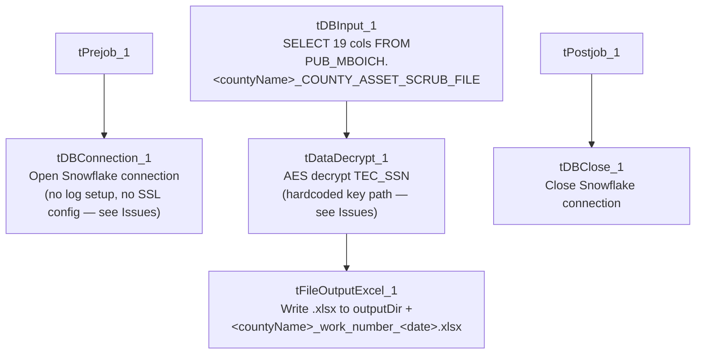

# Talend Job: Legal_Asset_Scrub_Illinois_Counties_Extract

## Overview

Extracts a legal "asset scrub" file for a parameterized Illinois county (the table name is built dynamically as `PUB_MBOICH."+context.countyName+"_COUNTY_ASSET_SCRUB_FILE`) — debtor identity, address, DOB, packet/CDN references, dollar amounts, misc collections, status, and assignment date — decrypts the debtor's SSN column, and writes the combined result to a dated **Excel** workbook. This is the original, generalized version of the county-parameterized asset scrub; a near-identical `_2` version exists with a different output format and a materially different setup subjob (see Issues observed for the specific differences).

## Detail table

| Field | Value |
|---|---|
| Job name | Legal_Asset_Scrub_Illinois_Counties_Extract |
| Version | 0.1 |
| Project | EDW2SF |
| Author | jmach@harriscollect.com |
| Created | 2023-09-13T10:10:15.911-0700 |
| Last Modified | 2023-10-04T16:22:49.835-0700 |

## Step-by-step data flow

**Setup subjob:** `tPrejob_1` → `tDBConnection_1` opens the Snowflake connection directly — **there is no `tJava` log-file setup and no `tSetKeystore` SSL configuration in this job** (both present in the sibling jobs; see Issues observed).

**Main subjob** (runs independently of the setup chain, relying on the shared connection):

1. `tDBInput_1` runs `SELECT DEBTOR_IDX, CLIENT_IDX, NAME1, ADDRESS_1, CITY, STATE, ZIP_CODE, PACKET_IDX, DOB, CDN, ASSIGNED_AMOUNT, PAYMENT, TOTAL_BAL, MISC_AMT, MISC_COLL, STATUS, TEC_SSN, MD_MISC_3, DT_ASSIGNED FROM PUB_MBOICH."+context.countyName+"_COUNTY_ASSET_SCRUB_FILE;` — 19 columns, dynamically scoped to whatever county the run is configured for.
2. `tDataDecrypt_1` decrypts `TEC_SSN` (AES, algorithm version 2) using key material from a **hardcoded** path, `"C:/Data/dimdbtr.crypt"` (not a context variable — see Issues observed); `DIE_ON_ERROR=true`.
3. `tFileOutputExcel_1` writes the decrypted rows to `context.outputDir + context.countyName + "_work_number_" + <CCYYMMDD> + ".xlsx"` (Excel 2007+ format, single sheet "Sheet1", header included, `DELETE_EMPTYFILE=true` so a zero-row run produces no file at all). `PROTECT_FILE=false`, but a `PASSWORD` field is present and redacted anyway — see Issues observed.

**Teardown subjob:** `tPostjob_1` → `tDBClose_1` closes the Snowflake connection.

## Settings tables

### Source: `tDBInput_1` (`tSnowflakeInput`)

| Setting | Value | What it means |
|---|---|---|
| Query | `SELECT ... FROM PUB_MBOICH."+context.countyName+"_COUNTY_ASSET_SCRUB_FILE;` | County-parameterized via string concatenation with `context.countyName` — which value(s) this runs with per-invocation isn't captured in this job's own metadata (no `tRunJob`/context override visible). |
| Column set | `TOTAL_BAL`, `MISC_COLL`, `MD_MISC_3`, `DT_ASSIGNED` (no `EMP1_NAME`/`EMP1_ADDR`, no `INT_AMT`, no `TTL_BAL`) | Different column set from both `Legal_Asset_Scrub_Champaign_County_Extract` and `_2` — see Issues observed. |

### Transform: `tDataDecrypt_1`

| Setting | Value | What it means |
|---|---|---|
| CRYPTO_FILE_PATH | `"C:/Data/dimdbtr.crypt"` (hardcoded string literal) | Unlike `Champaign_County_Extract` and `_2`, which both use `context.cryptoPath + "dimdbtr.crypt"`, this job hardcodes the full Windows path — a portability risk consistent with the project-wide hardcoded-path pattern in `05_operational_runbook.md`, though this specific path wasn't captured in `hardcoded_path_findings` for this job (empty array) since it's inside the `CRYPTO_FILE_PATH` parameter rather than a recognized path-bearing field. |
| DIE_ON_ERROR | `true` | A decryption failure fails the job outright. |

### Target: `tFileOutputExcel_1`

| Setting | Value | What it means |
|---|---|---|
| FILENAME | `context.outputDir + context.countyName + "_work_number_" + <date> + ".xlsx"` | Output format is Excel, not CSV (contrast both sibling jobs, which write CSV). |
| PROTECT_FILE / PASSWORD | `false` / `***REDACTED***` | Password protection is disabled, but a password value is still configured and redacted in this metadata — dead configuration, or a remnant from when protection was enabled; see Issues observed. |
| DELETE_EMPTYFILE | `true` | If the query returns zero rows for a given county, no file is produced at all (rather than an empty workbook) — worth knowing if a downstream process expects a file to always exist. |

## Dependencies & configuration

- **Triggers/depends on other jobs:** none — no `tRunJob` links found (`runjob_targets` is empty).
- **Context variables used:** `countyName`, `outputDir` — notably **no** `cryptoPath`, `keystorePath`, or `logDir`, unlike both sibling jobs (see Issues observed).
- **`hardcoded_path_findings` is empty for this job**, but `tDataDecrypt_1.CRYPTO_FILE_PATH` is in fact a hardcoded literal (`"C:/Data/dimdbtr.crypt"`) not caught by the extraction's path-detection — see the settings table above.

## Glossary

| Component type | Plain-English meaning |
|---|---|
| `tDataDecrypt` | Decrypts a column's value using a stored key/algorithm. |
| `tFileOutputExcel` | Writes rows to an Excel workbook (`.xlsx`), as opposed to a plain delimited text file. |
| `tSnowflakeConnection` / `tSnowflakeInput` / `tSnowflakeClose` | Open a Snowflake connection, run a query against it, and close it. |

## Issues observed

- **No `tSetKeystore` and no dedicated `tJava` log-file setup exist in this job at all** — both `Legal_Asset_Scrub_Champaign_County_Extract` and `Legal_Asset_Scrub_Illinois_Counties_Extract_2` open a per-run log file and configure SSL trust/keystore settings before connecting to Snowflake; this job connects directly from `tPrejob_1` with neither step. Since `keystorePath` and `logDir` also don't appear in this job's `context_vars_referenced` at all, this looks like an earlier, less-mature version of the pattern that `_2` later added — consistent with this job's older creation date (2023-09) versus `_2`'s (2023-12) and `_2`'s more recent last-modified date (2025-11, vs. this job's 2023-10). Confirm with the team whether this v1 job is still actively scheduled or has been superseded by `_2`.
- **The decryption key file path is hardcoded** (`"C:/Data/dimdbtr.crypt"`) rather than built from a `context.cryptoPath` variable, unlike both sibling jobs. This is a portability/maintainability risk on its own (same class of issue as the project-wide `C:/Talend-Studio-...` hardcoded paths in `05_operational_runbook.md`), and it did not surface in this job's `hardcoded_path_findings` array, so anyone scanning that field alone would miss it.
- **This job's column set differs from both sibling jobs**: it includes `TOTAL_BAL`, `MISC_COLL`, `MD_MISC_3`, and `DT_ASSIGNED`, none of which appear in `Champaign_County_Extract` or `_2`'s queries; conversely it lacks `EMP1_NAME`, `EMP1_ADDR`, `INT_AMT`, and uses `TOTAL_BAL` where the other two jobs use `TTL_BAL`. Since all three query the same `PUB_MBOICH.<county>_COUNTY_ASSET_SCRUB_FILE` naming pattern, this suggests either the underlying per-county publish tables/views genuinely have different column layouts, or this job's column list is simply out of date relative to `_2`. Unable to determine which from metadata; verify against the actual `PUB_MBOICH` tables before assuming both jobs can be safely consolidated.
- **A `PASSWORD` value is configured (and redacted) on `tFileOutputExcel_1` even though `PROTECT_FILE=false`.** The password has no effect while protection is off, but its presence suggests file-level password protection may have been intended or previously enabled — verify whether this workbook should in fact be password-protected before being sent externally, given it carries decrypted SSNs.
- **Output file is silently skipped when the query returns zero rows** (`DELETE_EMPTYFILE=true`) — if a downstream process expects a file (even an empty one) to confirm the job ran, a zero-row county could look like the job never executed.
