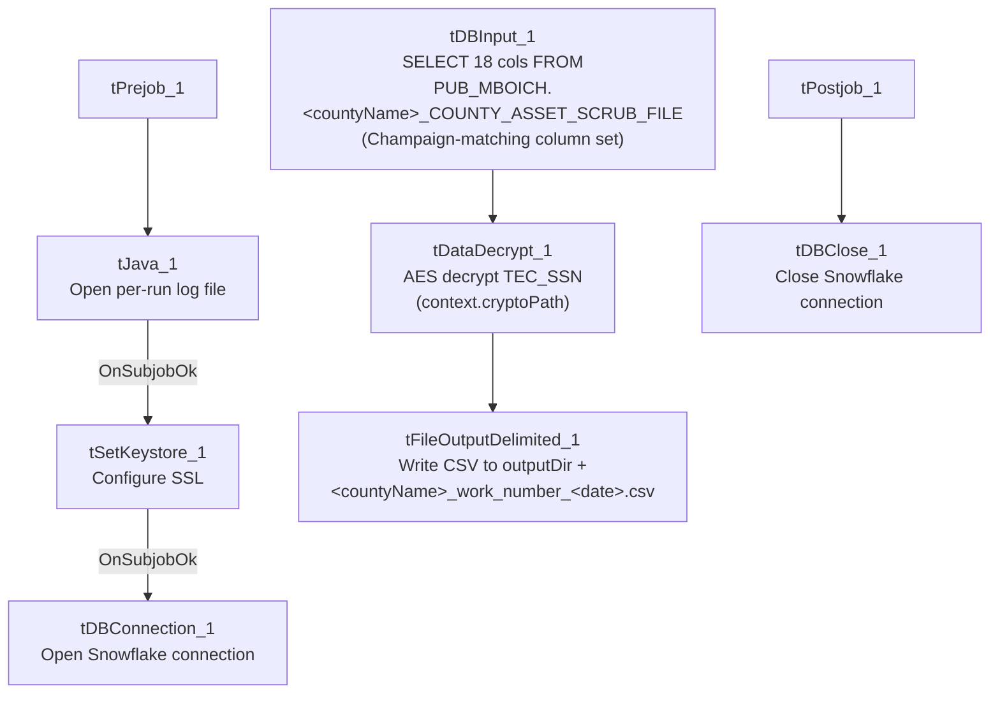

# Talend Job: Legal_Asset_Scrub_Illinois_Counties_Extract_2

## Overview

Extracts a legal "asset scrub" file for a parameterized Illinois county (`PUB_MBOICH."+context.countyName+"_COUNTY_ASSET_SCRUB_FILE`) — debtor identity, address, DOB, packet/CDN references, assigned/interest/misc dollar amounts, payment, total balance, status, and employer name/address — decrypts the debtor's SSN column, and writes the combined result to a dated CSV file. This is a revised version of `Legal_Asset_Scrub_Illinois_Counties_Extract` (no suffix): it keeps the same county-parameterization approach but adds the SSL/logging setup subjob and switches output format from Excel back to CSV, while also switching to the same column set used by `Legal_Asset_Scrub_Champaign_County_Extract`. See Issues observed for the full comparison.

## Detail table

| Field | Value |
|---|---|
| Job name | Legal_Asset_Scrub_Illinois_Counties_Extract_2 |
| Version | 0.2 |
| Project | EDW2SF |
| Author | jmach@harriscollect.com |
| Created | 2023-12-21T10:39:02.722-0800 |
| Last Modified | 2025-11-12T06:22:57.817-0800 |

## Step-by-step data flow

**Setup subjob:** `tPrejob_1` → `tJava_1` opens a per-run log file at `context.logDir + jobName + "_" + <timestamp> + ".log"` → on subjob-ok, `tSetKeystore_1` configures SSL trust/keystore from `context.keystorePath` (passwords redacted) → on subjob-ok, `tDBConnection_1` opens the Snowflake connection. (This setup chain is absent in the sibling v1 job — see Issues observed.)

**Main subjob** (runs independently of the setup chain, relying on the shared connection):

1. `tDBInput_1` runs `SELECT DEBTOR_IDX, CLIENT_IDX, NAME1, ADDRESS_1, CITY, STATE, ZIP_CODE, PACKET_IDX, DOB, CDN, ASSIGNED_AMOUNT, INT_AMT, MISC_AMT, PAYMENT, TTL_BAL, STATUS, EMP1_NAME, EMP1_ADDR, TEC_SSN FROM PUB_MBOICH."+context.countyName+"_COUNTY_ASSET_SCRUB_FILE;` — 18 columns, dynamically scoped by county, and (unlike the v1 sibling) matching `Champaign_County_Extract`'s exact column set (including `EMP1_NAME`/`EMP1_ADDR`, `INT_AMT`, `TTL_BAL`) rather than v1's (`TOTAL_BAL`, `MISC_COLL`, `MD_MISC_3`, `DT_ASSIGNED`).
2. `tDataDecrypt_1` decrypts `TEC_SSN` (AES, algorithm version 2) using key material from `context.cryptoPath + "dimdbtr.crypt"` (a context variable, not the hardcoded path v1 uses); `DIE_ON_ERROR=true`.
3. `tFileOutputDelimited_1` writes the decrypted rows to `context.outputDir + context.countyName + "_work_number_" + <CCYYMMDD> + ".csv"` — comma-delimited CSV (not the Excel format v1 produces), header included, ISO-8859-15 encoding, overwrite-on-run.

**Teardown subjob:** `tPostjob_1` → `tDBClose_1` closes the Snowflake connection.

## Settings tables

### Source: `tDBInput_1` (`tSnowflakeInput`)

| Setting | Value | What it means |
|---|---|---|
| Query | `SELECT DEBTOR_IDX, CLIENT_IDX, NAME1, ADDRESS_1, CITY, STATE, ZIP_CODE, PACKET_IDX, DOB, CDN, ASSIGNED_AMOUNT, INT_AMT, MISC_AMT, PAYMENT, TTL_BAL, STATUS, EMP1_NAME, EMP1_ADDR, TEC_SSN FROM PUB_MBOICH."+context.countyName+"_COUNTY_ASSET_SCRUB_FILE;` | County-parameterized, and column-for-column identical to `Legal_Asset_Scrub_Champaign_County_Extract`'s query (differing only in that this job's table name is dynamic, Champaign's is a literal). |

### Transform: `tDataDecrypt_1`

| Setting | Value | What it means |
|---|---|---|
| CRYPTO_FILE_PATH | `context.cryptoPath + "dimdbtr.crypt"` | Context-driven, matching `Champaign_County_Extract`; the v1 sibling hardcodes this instead. |
| DIE_ON_ERROR | `true` | A decryption failure fails the job outright. |

### Target: `tFileOutputDelimited_1`

| Setting | Value | What it means |
|---|---|---|
| FILENAME | `context.outputDir + context.countyName + "_work_number_" + <date> + ".csv"` | CSV output with the county name interpolated into the filename — combines v1's dynamic-filename approach with Champaign's CSV format. |
| Format | Comma-delimited, header included, ISO-8859-15, `APPEND=false` | Identical output shape to `Champaign_County_Extract`. |

## Dependencies & configuration

- **Triggers/depends on other jobs:** none — no `tRunJob` links found (`runjob_targets` is empty).
- **Context variables used:** `countyName`, `cryptoPath`, `keystorePath`, `logDir`, `outputDir` — the full set used by `Champaign_County_Extract`, unlike the v1 sibling which only references `countyName` and `outputDir`.
- **1 hardcoded path finding:** `tSetKeystore_1.SSL_TRUSTSERVER_TRUSTSTORE` = `"C:/clientTrustStore.trustStore"`.

## Glossary

| Component type | Plain-English meaning |
|---|---|
| `tDataDecrypt` | Decrypts a column's value using a stored key/algorithm. |
| `tFileOutputDelimited` | Writes rows to a delimited (CSV-style) text file. |
| `tSetKeystore` | Configures SSL trust/keystore settings for the job's outbound connections. |
| `tSnowflakeConnection` / `tSnowflakeInput` / `tSnowflakeClose` | Open a Snowflake connection, run a query against it, and close it. |

## Issues observed

- **This job appears to be a consolidation/rewrite of `Legal_Asset_Scrub_Illinois_Counties_Extract` (v1) that copies `Legal_Asset_Scrub_Champaign_County_Extract`'s setup subjob, column set, and CSV output format onto v1's county-parameterization.** Concretely: it adds the `tJava_1`/`tSetKeystore_1` setup chain v1 lacks; it switches `tDataDecrypt_1`'s key path from v1's hardcoded literal to `context.cryptoPath` (matching Champaign); it switches output from v1's Excel format to CSV (matching Champaign); and its query's column list is identical to Champaign's rather than v1's. Given this job's later creation date (2023-12 vs. v1's 2023-09) and both this job and Champaign sharing a near-identical last-modified timestamp (2025-11-12, ~4 minutes apart), it's plausible this job and Champaign were edited together as part of the same later maintenance pass. **Whether v1 (Excel-based) or this job (CSV-based) is the one actually scheduled today for the parameterized counties is unable to determine from metadata — verify with the team before assuming either is dead code**, since running both against the same counties would produce duplicate output files in different formats.
- **Its column set no longer matches what `PUB_MBOICH.<county>_COUNTY_ASSET_SCRUB_FILE` apparently contains per the v1 job's query** (`TOTAL_BAL`, `MISC_COLL`, `MD_MISC_3`, `DT_ASSIGNED` are dropped; `INT_AMT`, `TTL_BAL`, `EMP1_NAME`, `EMP1_ADDR` are added instead). If the underlying per-county publish views genuinely differ in shape from Champaign's, this job could fail at runtime for counties whose view doesn't have `EMP1_NAME`/`EMP1_ADDR`/`INT_AMT`/`TTL_BAL` columns — unable to confirm from metadata; verify against the actual Snowflake views for at least one non-Champaign county before relying on this job.
- **No reject-row or error-count logging** beyond `DIE_ON_ERROR=true` on the decrypt step.
- **Carries decrypted SSNs into a partner-facing flat file**, same consideration as `Legal_Asset_Scrub_Champaign_County_Extract` — confirm the receiving party's data-sharing agreement covers full SSN transmission.
