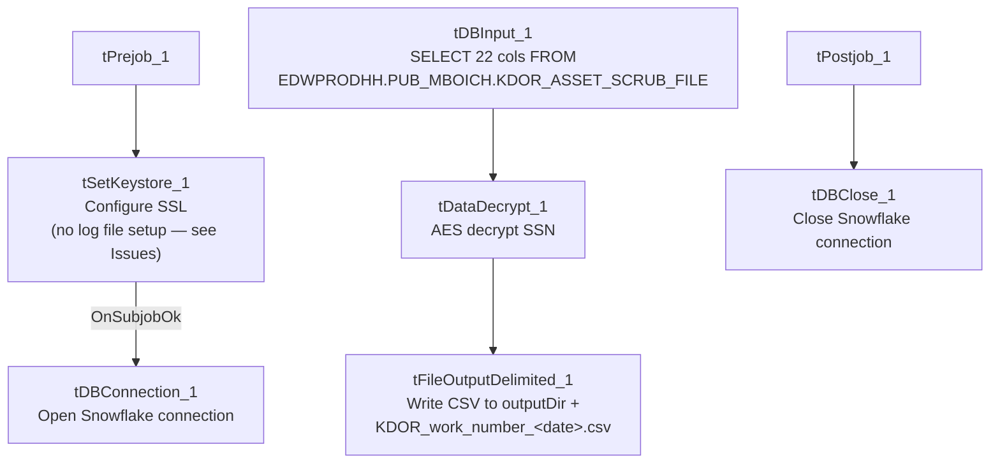

# Talend Job: Legal_Asset_Scrub_KDOR_Extract

## Overview

Extracts a legal "asset scrub" file for KDOR (Kansas Department of Revenue, based on the `KDOR_BANK`/`WARRANT_SRV_DT` columns and job name) from `EDWPRODHH.PUB_MBOICH.KDOR_ASSET_SCRUB_FILE` — debtor identity, address, desk, DOB, status, transaction/assignment dates, dollar amounts, employer name/address, and KDOR-specific bank/warrant fields — decrypts the debtor's SSN column, and writes the combined result to a dated CSV file. It's the fourth "Legal_Asset_Scrub" job in this batch, sharing the same overall shape as the three county-based siblings but with its own distinct column set and source-table qualification (see Issues observed).

## Detail table

| Field | Value |
|---|---|
| Job name | Legal_Asset_Scrub_KDOR_Extract |
| Version | 0.2 |
| Project | EDW2SF |
| Author | jmach@harriscollect.com |
| Created | 2023-10-04T17:38:03.351-0700 |
| Last Modified | 2025-11-12T06:36:20.174-0800 |

## Step-by-step data flow

**Setup subjob:** `tPrejob_1` → `tSetKeystore_1` configures SSL trust/keystore from `context.keystorePath` (passwords redacted) — **no per-run log file is opened in this job** (no `tJava`/log-setup component, unlike `Champaign_County_Extract` and `Illinois_Counties_Extract_2`; see Issues observed) → on subjob-ok, `tDBConnection_1` opens the Snowflake connection.

**Main subjob** (runs independently of the setup chain, relying on the shared connection):

1. `tDBInput_1` runs a fixed `SELECT` of 22 columns from `EDWPRODHH.PUB_MBOICH.KDOR_ASSET_SCRUB_FILE` — **note the fully database-qualified table reference (`EDWPRODHH.PUB_MBOICH...`)**, whereas all three sibling jobs reference `PUB_MBOICH.<table>` without the leading `EDWPRODHH.` database name; see Issues observed.
2. `tDataDecrypt_1` decrypts the `SSN` column (AES, algorithm version 2) using key material from `context.cryptoPath + "dimdbtr.crypt"` (all secret fields redacted); `DIE_ON_ERROR=true`.
3. `tFileOutputDelimited_1` writes the decrypted rows to `context.outputDir + "KDOR_work_number_" + <CCYYMMDD> + ".csv"` — comma-delimited, header included, ISO-8859-15 encoding, overwrite-on-run.

**Teardown subjob:** `tPostjob_1` → `tDBClose_1` closes the Snowflake connection.

## Settings tables

### Source: `tDBInput_1` (`tSnowflakeInput`)

| Setting | Value | What it means |
|---|---|---|
| Query | `SELECT DEBTOR_IDX, CLIENT_IDX, NAME1, ADDRESS_1, CITY, STATE, ZIP_CODE, DESK, SSN, DOB, STATUS, TRANS_DATE, DT_ASSIGNED, ASSIGNED_AMOUNT, PAYMENT, TOTAL_BAL, BALANCE_DIMDEBTOR_PACKET, MD_MISC_2, MD_MISC_3, EMP1_NAME, EMP1_ADDR, KDOR_BANK, WARRANT_SRV_DT FROM EDWPRODHH.PUB_MBOICH.KDOR_ASSET_SCRUB_FILE;` | KDOR-specific columns (`DESK`, `TRANS_DATE`, `BALANCE_DIMDEBTOR_PACKET`, `MD_MISC_2`, `KDOR_BANK`, `WARRANT_SRV_DT`) not present in any of the three county-based sibling jobs; conversely it lacks `PACKET_IDX`, `CDN`, `INT_AMT`/`MISC_AMT`, `MISC_COLL`. The plain (unprefixed) SSN column name is also unique to this job — the others use `TEC_SSN`. |

### Transform: `tDataDecrypt_1`

| Setting | Value | What it means |
|---|---|---|
| CRYPTO_FILE_PATH | `context.cryptoPath + "dimdbtr.crypt"` | Context-driven, matching `Champaign_County_Extract` and `Illinois_Counties_Extract_2`. |
| DIE_ON_ERROR | `true` | A decryption failure fails the job outright. |

### Target: `tFileOutputDelimited_1`

| Setting | Value | What it means |
|---|---|---|
| FILENAME | `context.outputDir + "KDOR_work_number_" + <date> + ".csv"` | "KDOR" is hardcoded into the filename (same pattern as `Champaign_County_Extract` hardcoding "CHAMPAIGN" — this job is not county-parameterized). |
| Format | Comma-delimited, header included, ISO-8859-15, `APPEND=false` | Same output shape as the other three jobs in this batch. |

## Dependencies & configuration

- **Triggers/depends on other jobs:** none — no `tRunJob` links found (`runjob_targets` is empty).
- **Context variables used:** `cryptoPath`, `keystorePath`, `outputDir` — notably **no `logDir`**, consistent with this job having no log-file-setup component.
- **1 hardcoded path finding:** `tSetKeystore_1.SSL_TRUSTSERVER_TRUSTSTORE` = `"C:/clientTrustStore.trustStore"`.

## Glossary

| Component type | Plain-English meaning |
|---|---|
| `tDataDecrypt` | Decrypts a column's value using a stored key/algorithm. |
| `tFileOutputDelimited` | Writes rows to a delimited (CSV-style) text file. |
| `tSetKeystore` | Configures SSL trust/keystore settings for the job's outbound connections. |
| `tSnowflakeConnection` / `tSnowflakeInput` / `tSnowflakeClose` | Open a Snowflake connection, run a query against it, and close it. |

## Issues observed

- **No per-run log file is opened in this job** (no `tJava` component writing to `context.logDir`), unlike `Legal_Asset_Scrub_Champaign_County_Extract` and `Legal_Asset_Scrub_Illinois_Counties_Extract_2`, both of which redirect `System.out`/`System.err` to a dated log file before connecting. This job does, however, have the `tSetKeystore_1` SSL step those two also have — so it sits between the more mature Champaign/`_2` pattern and the less mature `Illinois_Counties_Extract` (v1), which has neither log setup nor SSL config. Confirm whether this project has a preferred/required setup-subjob template all extract jobs should follow.
- **The source table reference is fully database-qualified** (`EDWPRODHH.PUB_MBOICH.KDOR_ASSET_SCRUB_FILE`) while all three sibling `Legal_Asset_Scrub` jobs reference `PUB_MBOICH.<table>` without the leading database name. Since the job connects via a single Snowflake connection component either way, this likely resolves to the same effective database either through a default-database setting on the connection or because both forms point at the same place — but it's inconsistent, and if the connection's default database ever changed, this job and its siblings could start pointing at different data without anyone noticing from the job definitions alone. Unable to confirm from metadata; verify the Snowflake connection's default database/schema configuration.
- **No reject-row or error-count logging** beyond `DIE_ON_ERROR=true` on the decrypt step.
- **Carries decrypted SSNs into a partner-facing flat file**, same consideration as the sibling Legal_Asset_Scrub jobs — confirm KDOR's data-sharing agreement covers full SSN transmission.
