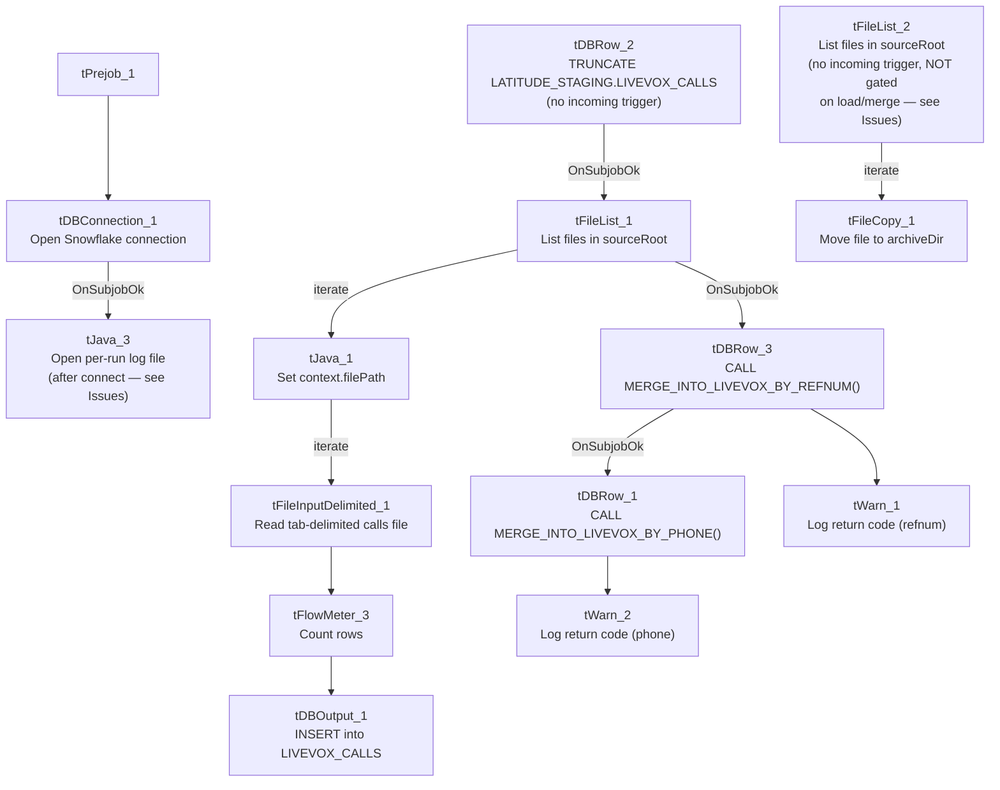

# Talend Job: Livevox_Daily_Load

## Overview

Loads daily call-result files from the Livevox outbound dialer platform (tab-delimited "calls" files — call direction, phone dialed, result code, agent, campaign, talk/hold/wrapup times, etc.) into a Snowflake staging table, then calls two stored procedures to merge the newly loaded calls into the downstream warehouse — once matching by phone number and once by an internal reference number. It separately archives the source files to `context.archiveDir`. The staging table and merge procedures are all named `LATITUDE_STAGING.*` even though this job lives in the EDW2SF project — see Issues observed for why that's notable.

## Detail table

| Field | Value |
|---|---|
| Job name | Livevox_Daily_Load |
| Version | 0.1 |
| Project | EDW2SF |
| Author | jmach@harriscollect.com |
| Created | 2025-02-10T09:57:45.302-0800 |
| Last Modified | 2025-09-24T11:00:14.413-0700 |

## Step-by-step data flow

**Setup subjob:** `tPrejob_1` → `tDBConnection_1` opens the Snowflake connection → on `SUBJOB_OK`, `tJava_3` opens a per-run log file at `context.logDir + jobName + "_" + <timestamp> + ".log"` — note the log file is opened **after** the DB connection here, the reverse order from most other jobs in this project.

**Main subjob** has three separate starting points with **no wiring between them**, meaning their relative execution order is not guaranteed by this job's own component graph (see Issues observed):

1. **Load chain:** `tDBRow_2` runs `TRUNCATE TABLE LATITUDE_STAGING.LIVEVOX_CALLS;` (no incoming trigger — an independent starting point) → on `SUBJOB_OK`, `tFileList_1` lists files in `context.sourceRoot` (the usual unapplied `*.txt` exclusion mask is present here too) → for each file (`ITERATE`), `tJava_1` sets `context.filePath` → `tFileInputDelimited_1` reads the tab-delimited "calls" file (`DIE_ON_ERROR=false`, `TRIMALL=true`) → `tFlowMeter_3` counts rows → `tDBOutput_1` inserts into Snowflake `LIVEVOX_CALLS` (`INSERT`, `tableAction=NONE` — relies on the earlier truncate, not a per-file truncate).
2. **Merge chain:** once `tFileList_1`'s entire file loop completes (`SUBJOB_OK`), `tDBRow_3` runs `CALL LATITUDE_STAGING.MERGE_INTO_LIVEVOX_BY_REFNUM();` first, then on `SUBJOB_OK`, `tDBRow_1` runs `CALL LATITUDE_STAGING.MERGE_INTO_LIVEVOX_BY_PHONE();`. Each procedure's `RETVALUE` is captured (`tDBRow_3`→`tMap_1`→`tWarn_1` logs "Return Code from merge by refnum: ..."; `tDBRow_1`→`tMap_2`→`tWarn_2` logs "Return Code from merge by phone: ...") — both are warnings, not `tDie`, so a bad merge result doesn't fail the job.
3. **Archive chain (unconnected to the above):** `tFileList_2` independently lists files in `context.sourceRoot` (no incoming trigger) → for each file (`ITERATE`), `tFileCopy_1` moves it to `context.archiveDir` (`REMOVE_FILE=true`). This branch has **no dependency on the load or merge chain completing** — see Issues observed.

## Settings tables

### Staging reset: `tDBRow_2`

| Setting | Value | What it means |
|---|---|---|
| Query | `TRUNCATE TABLE LATITUDE_STAGING.LIVEVOX_CALLS;` | Clears the staging table before this run's files are loaded. |

### Source: `tFileInputDelimited_1`

| Setting | Value | What it means |
|---|---|---|
| FILENAME | `context.filePath` | Current file from `tFileList_1`'s iteration over `context.sourceRoot`. |
| FIELDSEPARATOR / HEADER | `\t` (tab) / 1 header row | Tab-delimited Livevox export format. |
| DIE_ON_ERROR | `false` | Malformed rows don't fail the job... |
| Reject flow | Not wired | ...but (same as `ADP_Payroll_Load`) no connection carries rejected rows anywhere — silently dropped. Contrast `Livevox_Sample_Load`, which does wire (though disable) a reject output. |

### Target: `tDBOutput_1` (`tSnowflakeOutput`)

| Setting | Value | What it means |
|---|---|---|
| Table | `LIVEVOX_CALLS` | Destination staging table, relies on the earlier `tDBRow_2` truncate rather than truncating itself. |
| Output action / Table action | `INSERT` / `NONE` | Appends; safe because the whole table was truncated once before the file loop began. |

### Merge steps: `tDBRow_3` / `tDBRow_1` (`tSnowflakeRow`)

| Setting | Value | What it means |
|---|---|---|
| Query (refnum, runs first) | `CALL LATITUDE_STAGING.MERGE_INTO_LIVEVOX_BY_REFNUM();` | Merges staged calls into the warehouse by matching on an internal reference number. |
| Query (phone, runs second) | `CALL LATITUDE_STAGING.MERGE_INTO_LIVEVOX_BY_PHONE();` | Merges staged calls into the warehouse by matching on phone number — presumably a fallback/secondary match strategy for calls without a usable reference number. |
| Result handling | `RETVALUE` → `tMap` → `tWarn` | Logged as a warning only; a bad merge result does not fail the job. |

### Archive: `tFileCopy_1`

| Setting | Value | What it means |
|---|---|---|
| FILENAME / DESTINATION | current file from `tFileList_2` / `context.archiveDir` | Moves (not copies — `REMOVE_FILE=true`) each source file to the archive directory. |

## Dependencies & configuration

- **Triggers/depends on other jobs:** none — no `tRunJob` links found (`runjob_targets` is empty).
- **Context variables used:** `archiveDir`, `filePath`, `logDir`, `sourceRoot`.
- **1 hardcoded path finding:** `tFileInputDelimited_1.TEMP_DIR` = `"C:/Talend-Studio-20211109_1610-V8.0.1/workspace"`.

## Glossary

| Component type | Plain-English meaning |
|---|---|
| `tFileList` | Lists files in a directory for the job to iterate over one at a time. |
| `tFileInputDelimited` | Reads a delimited (here, tab-separated) text file according to a schema. |
| `tSnowflakeRow` | Runs an arbitrary SQL statement or stored-procedure call against Snowflake. |
| `tWarn` | Logs a warning without failing the job. |
| `tFileCopy` | Copies (or, with `REMOVE_FILE=true`, moves) a file from one location to another. |
| `tFlowMeter` | Counts rows passing a point in the flow, for logging/monitoring. |

## Issues observed

- **This job's staging table and merge procedures are all namespaced `LATITUDE_STAGING.*`, despite living in the EDW2SF project.** Per `01_system_architecture.md`, LATITUDE is documented as a separate, distinct Talend project from EDW2SF. This strongly suggests either (a) `LATITUDE_STAGING` is a genuinely shared Snowflake schema used by both projects, or (b) this job (and its sibling `Livevox_Sample_Load`) was copied from the LATITUDE project's job set and the schema reference was never updated to an EDW2SF-appropriate name — the same class of copy-paste-and-not-fully-updated issue documented in `ADP_Payroll_Load` (which copies from `ADP_Roster_Load`). Verify with the team which is the case; if it's (b) and `LATITUDE_STAGING` doesn't actually exist in this project's Snowflake environment, this job would fail entirely.
- **The archive step (`tFileList_2` → `tFileCopy_1`) has no wiring connecting it to the load-and-merge chain at all** — it's an entirely separate, unconnected component graph within the same job, with its own independent `tFileList_2` (no incoming trigger). In Talend, subjobs with no explicit ordering between them do not have a guaranteed relative execution order. **This means the archive/move-to-`archiveDir` step could run before, during, or after the load-and-merge chain**, with no guarantee the files being archived have actually been loaded and merged successfully yet. This is a genuine data-integrity risk: a file could be moved out of `sourceRoot` (and thus out of `tFileList_1`'s view, if the two `tFileList` components happen to run concurrently) before or without it ever being loaded. Verify with the team whether Talend Studio's actual subjob execution order (not captured in this metadata) enforces the load to run first, or whether this is an unaddressed race condition.
- **`tDBRow_2` (the truncate) and `tFileList_2` (the archive list) both have no incoming trigger connection**, making them independent starting points in the same job — same root cause as the above finding.
- **No reject-row handling** on `tFileInputDelimited_1` — unlike `Livevox_Sample_Load`, which at least wires (if inactive) a reject-file output.
- **Both merge procedures only warn on failure, never `tDie`** — consistent with the truncate-load-merge-warn pattern flagged project-wide for merge-result handling in `05_operational_runbook.md`, but worth knowing that a persistently failing `MERGE_INTO_LIVEVOX_BY_PHONE`/`_BY_REFNUM` would not stop this job from reporting success.
