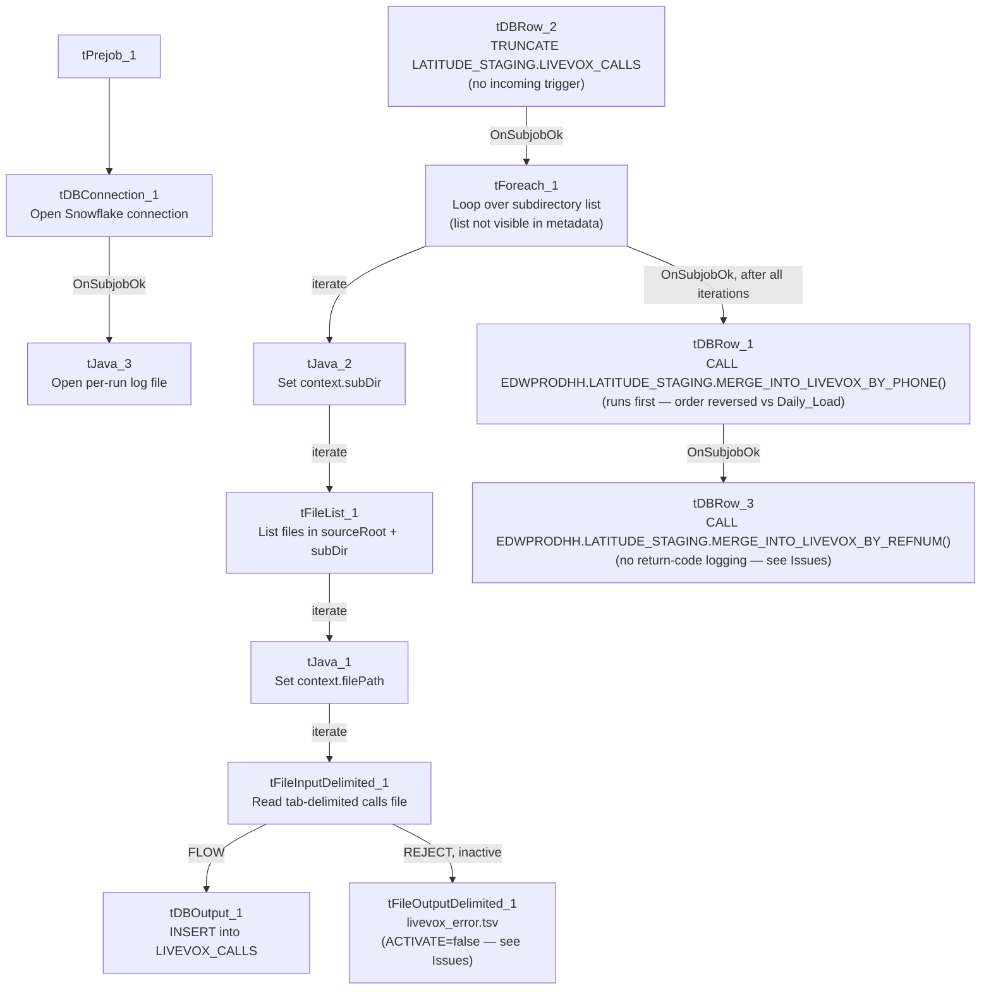

# Talend Job: Livevox_Sample_Load

## Overview

Loads Livevox call-result files (the same tab-delimited "calls" format as `Livevox_Daily_Load`) from **multiple subdirectories** under `context.sourceRoot` — one per value in a `tForeach` loop — into the same Snowflake staging table used by the daily job, then merges by phone number and reference number. This looks like a bulk/backfill or per-client "sample" loader that processes a set of directories in one run rather than a single daily inbox, sharing target tables with `Livevox_Daily_Load` but differing in several structural details (see Issues observed).

## Detail table

| Field | Value |
|---|---|
| Job name | Livevox_Sample_Load |
| Version | 0.1 |
| Project | EDW2SF |
| Author | jmach@harriscollect.com |
| Created | 2024-12-23T09:49:28.214-0800 |
| Last Modified | 2025-09-24T11:00:27.048-0700 |

## Step-by-step data flow

**Setup subjob:** `tPrejob_1` → `tDBConnection_1` opens the Snowflake connection → on `SUBJOB_OK`, `tJava_3` opens a per-run log file (same after-connect ordering as `Livevox_Daily_Load`).

**Main subjob** (starts independently — `tDBRow_2` has no incoming trigger, same pattern as `Livevox_Daily_Load`):

1. `tDBRow_2` runs `TRUNCATE TABLE LATITUDE_STAGING.LIVEVOX_CALLS;` → on `SUBJOB_OK`, `tForeach_1` iterates over a fixed list of values (the list itself isn't captured in this metadata, same limitation documented in `Semaphore_Check`).
2. For each value (`ITERATE`), `tJava_2` sets `context.subDir` to the current value → `tFileList_1` lists files in `context.sourceRoot + context.subDir` (a **per-iteration subdirectory**, unlike `Livevox_Daily_Load`'s single fixed `sourceRoot`) → for each file (`ITERATE`), `tJava_1` sets `context.filePath` → `tFileInputDelimited_1` reads the tab-delimited "calls" file → the flow splits:
   - `FLOW` → `tDBOutput_1` inserts into Snowflake `LIVEVOX_CALLS` (`INSERT`, `tableAction=NONE`).
   - `REJECT` → `tFileOutputDelimited_1` would write rejected rows to `context.logDir + "livevox_error.tsv"` — **but this component is deactivated (`ACTIVATE=false`)**, so despite being wired, it does not actually run; see Issues observed.
3. Once the entire `tForeach_1` loop (all subdirectories) completes (`SUBJOB_OK`), `tDBRow_1` runs `CALL EDWPRODHH.LATITUDE_STAGING.MERGE_INTO_LIVEVOX_BY_PHONE();` first, then on `SUBJOB_OK`, `tDBRow_3` runs `CALL EDWPRODHH.LATITUDE_STAGING.MERGE_INTO_LIVEVOX_BY_REFNUM();` — **note the merge order (phone, then refnum) is reversed from `Livevox_Daily_Load` (refnum, then phone)**, and both queries here are fully database-qualified (`EDWPRODHH.LATITUDE_STAGING....`) whereas `Livevox_Daily_Load`'s equivalents are not — see Issues observed. **Neither merge's return code is captured or logged** in this job (no `tWarn`/`tMap` following these `tDBRow` components, unlike `Livevox_Daily_Load`'s `RETVALUE`-to-`tWarn` pattern).

**No archive step exists in this job** — files are read and loaded but never moved or deleted from their source subdirectories, unlike `Livevox_Daily_Load`.

## Settings tables

### Loop: `tForeach_1` / `tJava_2`

| Setting | Value | What it means |
|---|---|---|
| Value list | Not captured in this metadata | Same limitation as `Semaphore_Check`'s `tForeach_1` — unable to determine how many subdirectories/values this job processes per run. |
| `tJava_2` | `context.subDir = ((String)globalMap.get("tForeach_1_CURRENT_VALUE"));` | Each loop iteration points `tFileList_1` at a different subdirectory. |

### Source: `tFileInputDelimited_1`

| Setting | Value | What it means |
|---|---|---|
| FILENAME | `context.filePath` | Current file from `tFileList_1`'s iteration over `context.sourceRoot + context.subDir`. |
| REJECT wiring | Wired to `tFileOutputDelimited_1`, but that component has `ACTIVATE=false` | The job's design includes reject-row logging to a TSV file, but it's switched off — rejected rows are effectively silently dropped despite the pipeline looking, at a glance, like it handles them. |

### Target: `tDBOutput_1` (`tSnowflakeOutput`)

| Setting | Value | What it means |
|---|---|---|
| Table | `LIVEVOX_CALLS` | Same destination table as `Livevox_Daily_Load` — both jobs load into the same staging table, so running them close together could interleave their inserts (the truncate only happens once per job run, at the start of each job). |
| Output action / Table action | `INSERT` / `NONE` | Appends across all subdirectories processed by the `tForeach_1` loop. |

### Merge steps: `tDBRow_1` / `tDBRow_3`

| Setting | Value | What it means |
|---|---|---|
| Query 1 (runs first) | `CALL EDWPRODHH.LATITUDE_STAGING.MERGE_INTO_LIVEVOX_BY_PHONE();` | Fully database-qualified, unlike `Livevox_Daily_Load`'s unqualified `LATITUDE_STAGING.MERGE_INTO_LIVEVOX_BY_PHONE()`. |
| Query 2 (runs second) | `CALL EDWPRODHH.LATITUDE_STAGING.MERGE_INTO_LIVEVOX_BY_REFNUM();` | Same procedure as `Livevox_Daily_Load` calls, but no return-code capture/logging follows it here. |

## Dependencies & configuration

- **Triggers/depends on other jobs:** none — no `tRunJob` links found (`runjob_targets` is empty).
- **Context variables used:** `filePath`, `logDir`, `sourceRoot`, `subDir`.
- **1 hardcoded path finding:** `tFileInputDelimited_1.TEMP_DIR` = `"C:/Talend-Studio-20211109_1610-V8.0.1/workspace"`.

## Glossary

| Component type | Plain-English meaning |
|---|---|
| `tForeach` | Loops over a fixed list of values (defined in the component's own configuration), running the same downstream steps once per value. |
| `tFileList` | Lists files in a directory for the job to iterate over one at a time. |
| `tFileInputDelimited` | Reads a delimited (here, tab-separated) text file according to a schema. |
| `tSnowflakeRow` | Runs an arbitrary SQL statement or stored-procedure call against Snowflake. |
| `tFileOutputDelimited` | Writes rows to a delimited text file — here, present but deactivated. |

## Issues observed

- **The reject-row output (`tFileOutputDelimited_1`) is wired but deactivated (`ACTIVATE=false`).** This is a more advanced (if unfinished) error-handling design than `Livevox_Daily_Load`'s complete absence of a reject flow — someone built the reject-logging path here and then switched it off, or built it as a template for future activation. Either way, rejected rows are currently dropped with no record, same practical outcome as `Livevox_Daily_Load` despite the more complete-looking wiring. Verify with the team whether this should be turned on.
- **Neither merge procedure's return code is captured or logged in this job**, unlike `Livevox_Daily_Load`'s `RETVALUE`→`tWarn` pattern for the same two procedures. A failed merge here produces no job-specific signal at all — only a generic Talend execution error if the `CALL` statement itself throws, and no warning if the procedure runs but reports an internal failure via its return value.
- **This job shares its destination table (`LIVEVOX_CALLS`) and both merge procedures with `Livevox_Daily_Load`, but differs in merge call order (phone-then-refnum here vs. refnum-then-phone in Daily_Load) and in database-qualification (`EDWPRODHH.LATITUDE_STAGING....` here vs. unqualified in Daily_Load).** Since both jobs truncate the same staging table at the start of their own run, running them concurrently (or close together) against the same environment would cause one job's truncate to wipe out the other's just-loaded rows before its merge runs — verify with the team that these two jobs are never scheduled to overlap.
- **Same cross-project `LATITUDE_STAGING` naming question as `Livevox_Daily_Load`** — this job lives in EDW2SF but references a schema/procedure set literally named for the separate LATITUDE project (see that job's Issues observed for the full explanation).
- **No archive or cleanup step exists in this job at all** — source files in each processed subdirectory are read and loaded but never moved, renamed, or deleted. If this job is re-run against the same subdirectories (e.g., for a genuine "sample" reload), it would simply re-insert the same files' rows again (no truncate-per-subdirectory, only one truncate at the very start of the whole run) — worth confirming this is the intended re-run behavior.
