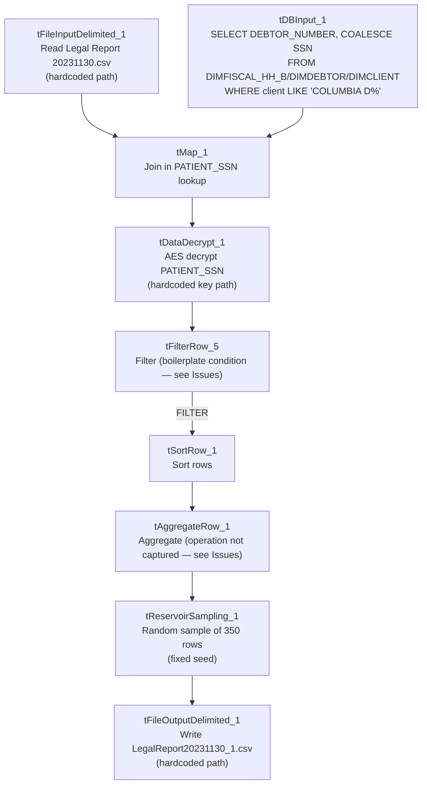

# Talend Job: LoadLegalRpt20231130

## Overview

This is a one-time, dated legal report job (built and named for a specific run on November 30, 2023): it reads a hardcoded "Legal Report" CSV export (debtor/patient identity, address, packet/case numbers, balances, admit/discharge/last-payment dates), enriches it with a decrypted patient SSN looked up from the warehouse (scoped specifically to clients named "COLUMBIA D%" — likely Columbia Doctors, a hospital/health-system client referenced elsewhere in this project's runbook), sorts and aggregates the result, then draws a random 350-row sample and writes it to a second hardcoded CSV file. This looks like a one-off legal discovery/audit sample rather than a recurring pipeline — see Issues observed.

## Detail table

| Field | Value |
|---|---|
| Job name | LoadLegalRpt20231130 |
| Version | 0.1 |
| Project | EDW2SF |
| Author | jmach@harriscollect.com |
| Created | 2023-12-04T09:55:07.105-0800 |
| Last Modified | 2025-09-24T10:59:24.718-0700 |

## Step-by-step data flow

This job has no `tPrejob`/`tPostjob` and no explicit `tDBConnection`/`tDBClose` — it is a single linear chain with one lookup input:

1. `tFileInputDelimited_1` reads `"C:/Data/Legal Report 20231130.csv"` (hardcoded literal, comma-delimited, header row, `DIE_ON_ERROR=false`) — 20 columns spanning department, patient/debtor identity, address, packet/case references, balances, and key dates.
2. `tDBInput_1` (`tSnowflakeInput`) runs `SELECT fisc.DEBTOR_NUMBER, COALESCE(fisc.PATIENT_SSN, dd.SSN) AS PATIENT_SSN FROM DIMFISCAL_HH_B fisc INNER JOIN DIMDEBTOR dd ON fisc.DEBTOR_IDX = dd.DEBTOR_IDX INNER JOIN DIMCLIENT dc ON dd.CLIENT = dc.CLIENT WHERE COALESCE(TRIM(fisc.PATIENT_SSN), TRIM(dd.SSN), '') <> '' AND dc.NAME LIKE 'COLUMBIA D%';` — an (encrypted) SSN lookup **scoped only to debtors whose client name matches "COLUMBIA D%"**, even though the main input file's `DEPARTMENT` column suggests it may span multiple departments/clients; see Issues observed.
3. `tMap_1` combines the file rows (main) with the SSN lookup (`tDBInput_1`, presumably joined on `DEBTORNUMBER`/`DEBTOR_NUMBER`) and adds `PATIENT_SSN` to the row shape — the join type (inner vs. left outer) isn't captured in this metadata, so it's unable to determine from metadata whether non-Columbia-Doctors rows are dropped or simply left with a null `PATIENT_SSN`.
4. `tDataDecrypt_1` decrypts the (presumably) `PATIENT_SSN` column using AES (algorithm version 2) with key material from a **hardcoded** path, `"C:/Data/dimdbtr.crypt"` (same crypto file used elsewhere in this project, e.g. `Legal_Asset_Scrub_Illinois_Counties_Extract`'s v1); `DIE_ON_ERROR=true`.
5. `tFilterRow_5` applies a row filter — **its condition is left as unmodified Talend template boilerplate** (`input_row.columnName1.equals(input_row.columnNam...`), the same recurring pattern documented in `Last4SSN_Extract` and `Load_Evergreen_Hours` elsewhere in this project; see Issues observed.
6. `tSortRow_1` sorts the filtered rows (the actual sort key(s) aren't captured in this metadata).
7. `tAggregateRow_1` is configured with only generic settings visible (`LIST_DELIMITER`, `USE_FINANCIAL_PRECISION`) — **no group-by key or aggregation operation is captured in this metadata, and its output schema is identical, column-for-column, to its input schema** (no summed/counted columns added). Unable to determine what this component actually aggregates, or whether it functions as a de-duplication step; see Issues observed.
8. `tReservoirSampling_1` draws a random sample of exactly 350 rows (`SAMPLE_SIZE=350`, fixed `RANDOM_SEED=12345678` for reproducibility).
9. `tFileOutputDelimited_1` writes the sampled rows to `"C:/Data/LegalReport20231130_1.csv"` (hardcoded literal, comma-delimited, header included, ISO-8859-15 encoding).

## Settings tables

### Source: `tFileInputDelimited_1`

| Setting | Value | What it means |
|---|---|---|
| FILENAME | `"C:/Data/Legal Report 20231130.csv"` | Hardcoded literal, dated filename — no context-variable indirection at all in this job. |
| DIE_ON_ERROR | `false` | Malformed rows don't fail the job... |
| Reject flow | Not wired | ...but no connection carries rejected rows anywhere — silently dropped. |

### Lookup: `tDBInput_1` (`tSnowflakeInput`)

| Setting | Value | What it means |
|---|---|---|
| Query | `SELECT fisc.DEBTOR_NUMBER, COALESCE(fisc.PATIENT_SSN, dd.SSN) AS PATIENT_SSN FROM DIMFISCAL_HH_B fisc INNER JOIN DIMDEBTOR dd ON fisc.DEBTOR_IDX = dd.DEBTOR_IDX INNER JOIN DIMCLIENT dc ON dd.CLIENT = dc.CLIENT WHERE COALESCE(TRIM(fisc.PATIENT_SSN), TRIM(dd.SSN), '') <> '' AND dc.NAME LIKE 'COLUMBIA D%';` | Restricts the SSN source data to one client family (name pattern "COLUMBIA D%") — see Issues observed for the scope mismatch against the main file's apparent multi-department content. |

### Transform: `tDataDecrypt_1`

| Setting | Value | What it means |
|---|---|---|
| CRYPTO_FILE_PATH | `"C:/Data/dimdbtr.crypt"` (hardcoded literal) | Same hardcoded-path pattern flagged in `Legal_Asset_Scrub_Illinois_Counties_Extract` (v1) elsewhere in this project. |
| DIE_ON_ERROR | `true` | A decryption failure fails the job outright. |

### Sampling: `tReservoirSampling_1`

| Setting | Value | What it means |
|---|---|---|
| SAMPLE_SIZE | `350` | Draws exactly 350 rows at random from whatever reaches this point in the pipeline (post-filter, post-sort, post-aggregate). |
| RANDOM_SEED | `12345678` | A fixed seed makes the "random" sample reproducible across re-runs — useful for a legal/audit context where the same sample needs to be regenerable. |

### Target: `tFileOutputDelimited_1`

| Setting | Value | What it means |
|---|---|---|
| FILENAME | `"C:/Data/LegalReport20231130_1.csv"` | Hardcoded literal output path — the `_1` suffix suggests this may be one of possibly multiple output variants for this report date. |

## Dependencies & configuration

- **Triggers/depends on other jobs:** none — no `tRunJob` links found (`runjob_targets` is empty), and this job is not listed as a caller or target in `06_dependency_matrix.md`. Note `05_operational_runbook.md` separately documents a job named `Columbia_Doctors_Legal_Rpt` (in its email-on-failure list) — this job (`LoadLegalRpt20231130`) is a **different** job and does not call or get called by it per this job's own metadata; the relationship between the two (if any) is unable to determine from metadata.
- **Context variables used:** none — `context_vars_referenced` is empty.
- **2 hardcoded path findings:** `tFileInputDelimited_1.TEMP_DIR` and `tSortRow_1.TEMPFILE` (both `C:/Talend-Studio-20211109_1610-V8.0.1/workspace/...`) — plus the source `FILENAME`, the crypto key path, and the output `FILENAME`, all also hardcoded literals not captured in the `hardcoded_path_findings` array.

## Glossary

| Component type | Plain-English meaning |
|---|---|
| `tFileInputDelimited` / `tFileOutputDelimited` | Read/write a delimited (CSV-style) text file. |
| `tSnowflakeInput` | Runs a query against Snowflake and returns its result rows. |
| `tMap` | Maps/transforms columns from one schema to another, and can join multiple input flows (here, joining the file with a database lookup). |
| `tDataDecrypt` | Decrypts a column's value using a stored key/algorithm. |
| `tFilterRow` | Passes rows through only if they meet a configured condition. |
| `tSortRow` | Sorts rows by one or more configured columns. |
| `tAggregateRow` | Groups rows and computes aggregate values (sums, counts, etc.) per group — configuration not fully captured for this instance; see Issues observed. |
| `tReservoirSampling` | Selects a fixed-size random sample from a stream of rows, useful when the total row count isn't known in advance. |

## Issues observed

- **The SSN lookup query is scoped only to clients named "COLUMBIA D%" (`dc.NAME LIKE 'COLUMBIA D%'`), while the main input file includes a `DEPARTMENT` column suggesting it spans more than one department/client.** If the source CSV contains legal-report rows for clients other than Columbia Doctors, those rows would either be dropped (if `tMap_1`'s join is an inner join) or pass through with a null `PATIENT_SSN` (if it's a left outer join) — the join type isn't captured in this metadata. Verify in Talend Studio which join type `tMap_1` uses, since it materially changes whether this job silently narrows the report to one client or produces a report with missing SSNs for everyone else.
- **`tAggregateRow_1`'s actual grouping key and aggregation operation(s) are not captured in this metadata**, and its output schema is identical to its input — no summed, counted, or otherwise aggregated column is visible anywhere downstream. This makes it unable to determine from metadata whether this component is doing meaningful aggregation (e.g., collapsing duplicate debtor rows) or is effectively a no-op / mis-configured pass-through. Verify directly in Talend Studio.
- **`tFilterRow_5`'s condition is unmodified Talend template boilerplate** (`input_row.columnName1.equals(input_row.columnNam...`) — the same class of finding now documented in at least three jobs in this project (`Last4SSN_Extract`, `Load_Evergreen_Hours`, and this job). This continues to support treating it as a project-wide pattern worth auditing across all `tFilterRow` components, not a one-off oversight.
- **Every path in this job (source file, crypto key, output file) is a hardcoded literal embedding a specific date**, and there are zero context variables in use. Combined with the job name itself (`LoadLegalRpt20231130`) and the very specific "Legal Report 20231130.csv" / "LegalReport20231130_1.csv" filenames, this strongly indicates a one-time job built for a single historical legal request rather than a recurring pipeline. If it's still present and runnable in the active job repository, verify with the team whether it should be archived/disabled to avoid confusion with any current, similarly-purposed recurring job (e.g., `Columbia_Doctors_Legal_Rpt`).
- **This job decrypts and writes patient SSNs to a flat file intended for a legal proceeding** — confirm the file's handling (storage location, retention, access) meets this organization's data-handling requirements for sensitive PII used in litigation contexts, especially given the file paths point to a local `C:/Data/` directory rather than a managed/audited location.
- **No error/row-count logging** beyond `DIE_ON_ERROR=true` on the decrypt step, and no reject-row handling on the file input.
