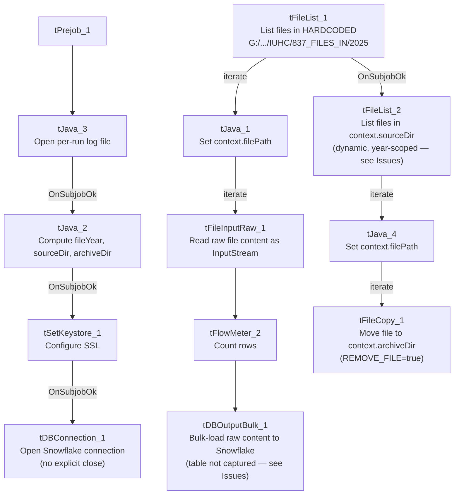

# Talend Job: Load_837_Files

## Overview

Loads raw healthcare claim files (the "837" name is the standard ANSI X12 837 electronic health-care-claim transaction format) from a network drop-zone directory into Snowflake as bulk raw content, then separately lists and archives files out of a year-scoped source directory. This looks like an ingestion pipeline for an external healthcare partner's claim files (`IUHC` in the hardcoded path — likely a partner/payer name) rather than a structured column-by-column load: files are read as raw byte streams and bulk-loaded, not parsed into business columns.

## Detail table

| Field | Value |
|---|---|
| Job name | Load_837_Files |
| Version | 0.1 |
| Project | EDW2SF |
| Author | jmach@harriscollect.com |
| Created | 2025-08-06T10:29:52.135-0700 |
| Last Modified | 2026-02-26T10:24:54.183-0800 |

## Step-by-step data flow

**Setup subjob:** `tPrejob_1` → `tJava_3` opens a per-run log file at `context.logDir + jobName + "_" + <timestamp> + ".log"` → on subjob-ok, `tJava_2` computes `context.fileYear` as the current calendar year, then rebuilds `context.sourceDir` as `Paths.get(context.sourceDir, context.fileYear)` and recomputes `context.archiveDir` similarly (the archive-dir expression is truncated in this metadata) → on subjob-ok, `tSetKeystore_1` configures SSL trust/keystore from `context.keystorePath` (passwords redacted) → on subjob-ok, `tDBConnection_1` opens the Snowflake connection.

**Main subjob, phase 1 — bulk-load raw file content** (runs independently of the setup chain in the component graph):

1. `tFileList_1` lists files (non-recursive) in the **hardcoded** directory `"G:/Analytics_Team/Drop_zone/IUHC/837_FILES_IN/2025"` — note the year "2025" is a literal string here, not derived from `context.fileYear` the way the setup subjob computes it; see Issues observed. An `EXCLUDEFILEMASK` of `*.txt` is configured but `IFEXCLUDE=false`, so (same pattern as `ADP_Payroll_Load` in this project) the exclusion is not actually applied.
2. For each file (`ITERATE`), `tJava_1` sets `context.filePath` from `tFileList_1`'s current file path.
3. `tFileInputRaw_1` reads the file's entire content as a raw `InputStream` (schema: a single `content` column of type `id_Object`) — `DIE_ON_ERROR=false`, so a file that can't be read is skipped rather than failing the job.
4. `tFlowMeter_2` counts files/rows passing through (labeled "MyLabel").
5. `tDBOutputBulk_1` (`tSnowflakeOutputBulk`) bulk-loads the raw content into Snowflake — **the destination table name is not captured in this job's metadata** (its `db` block is empty); see Issues observed.

**Main subjob, phase 2 — archive source files** (triggered by `tFileList_1`'s `SUBJOB_OK`, i.e. after the entire phase-1 loop completes):

6. `tFileList_2` lists files (non-recursive, glob expressions enabled) in `context.sourceDir` — this is the **dynamically year-scoped** directory computed by `tJava_2` in the setup subjob, which may or may not be the same physical directory `tFileList_1` hardcoded in step 1; see Issues observed. The same unapplied `*.txt` exclusion mask appears here too.
7. For each file (`ITERATE`), `tJava_4` sets `context.filePath` from `tFileList_2`'s current file path.
8. `tFileCopy_1` moves the file to `context.archiveDir` (`REMOVE_FILE=true`, `REPLACE_FILE=true`, `CREATE_DIRECTORY=true`) — effectively an archive-and-delete-from-source operation, not a plain copy.

## Settings tables

### Source: `tFileList_1`

| Setting | Value | What it means |
|---|---|---|
| DIRECTORY | `"G:/Analytics_Team/Drop_zone/IUHC/837_FILES_IN/2025"` | Hardcoded network-share path with a literal year — the drop zone where the partner ("IUHC") lands incoming 837 claim files. |
| EXCLUDEFILEMASK / IFEXCLUDE | `"*.txt"` / `false` | Exclusion mask configured but not applied — every file in the directory is picked up regardless of extension, same unused-exclusion pattern seen in `ADP_Payroll_Load`. |

### Read: `tFileInputRaw_1`

| Setting | Value | What it means |
|---|---|---|
| FILENAME | `context.filePath` | Current file from `tFileList_1`'s iteration. |
| AS_INPUTSTREAM | `true` | Reads the file as a raw byte stream rather than parsing it as delimited/structured text — appropriate for an EDI-format file that isn't meant to be column-split here. |
| DIE_ON_ERROR | `false` | A file that fails to read is skipped, not fatal to the job. |

### Target: `tDBOutputBulk_1` (`tSnowflakeOutputBulk`)

| Setting | Value | What it means |
|---|---|---|
| Table | **Not captured in this job's metadata** (`db` block is empty) | Unable to determine from metadata which Snowflake table receives the bulk-loaded raw file content — verify directly in Talend Studio. |

### Archive: `tFileCopy_1`

| Setting | Value | What it means |
|---|---|---|
| FILENAME / DESTINATION | `context.filePath` / `context.archiveDir` | Moves the current file (from `tFileList_2`'s iteration) into the archive directory. |
| REMOVE_FILE / REPLACE_FILE | `true` / `true` | Deletes the original after copying (a move, not a copy) and overwrites if a same-named file already exists at the destination. |
| SOURCE_DERECTORY (hardcoded, unused in this mode) | `"C:/Talend-Studio-20211109_1610-V8.0.1/workspace"` | A directory-copy-mode setting left at its default Talend-Studio-workspace value; since `ENABLE_COPY_DIRECTORY=false`, this field is not actually used for the single-file copy this job performs — but it's still a hardcoded developer-workstation path sitting in the job's configuration. |

## Dependencies & configuration

- **Triggers/depends on other jobs:** none — no `tRunJob` links found (`runjob_targets` is empty).
- **Context variables used:** `archiveDir`, `filePath`, `fileYear`, `keystorePath`, `logDir`, `sourceDir`.
- **2 hardcoded path findings:** `tFileCopy_1.SOURCE_DERECTORY` = `"C:/Talend-Studio-20211109_1610-V8.0.1/workspace"` (the project-wide developer-workstation path pattern from `05_operational_runbook.md`, though inactive here per above) and `tSetKeystore_1.SSL_TRUSTSERVER_TRUSTSTORE` = `"C:/clientTrustStore.trustStore"`. The drop-zone directory itself (`"G:/Analytics_Team/Drop_zone/IUHC/837_FILES_IN/2025"`) is also a hardcoded, year-literal path, though it wasn't flagged in the `hardcoded_path_findings` array (likely because the extraction's path-detection targets specific known parameter names).

## Glossary

| Component type | Plain-English meaning |
|---|---|
| `tFileList` | Lists files in a directory for the job to iterate over one at a time. |
| `tFileInputRaw` | Reads a file's entire content as raw bytes/an input stream, without parsing it into columns. |
| `tSnowflakeOutputBulk` | Bulk-loads data into a Snowflake table, typically faster than row-by-row insert for large volumes. |
| `tFileCopy` | Copies (or, with `REMOVE_FILE=true`, moves) a file from one location to another. |
| `tFlowMeter` | Counts rows/files passing a point in the flow, for logging/monitoring. |
| `tSetKeystore` | Configures SSL trust/keystore settings for the job's outbound connections. |

## Issues observed

- **`tFileList_1`'s source directory hardcodes the year "2025" as a literal string** (`.../837_FILES_IN/2025`), while the setup subjob's `tJava_2` computes `context.fileYear` dynamically from the current date and uses it to build a year-scoped `context.sourceDir` for the *separate* `tFileList_2` archive step. This means the job's load phase (phase 1, reading from the hardcoded 2025 path) and its archive phase (phase 2, reading from the dynamically computed `context.sourceDir`) are **not guaranteed to be looking at the same directory** — in fact, from 2026 onward, `tFileList_2` would look at a "2026" subdirectory while `tFileList_1` would still be pointed at "2025." **This is a likely functional bug**: either the job will stop loading new files once the drop zone rolls over to a new year's folder (if the drop zone itself is year-partitioned to match), or the archive step will find nothing to move (if `context.sourceDir`'s base differs from the drop-zone path) while phase 1 keeps loading from the same static 2025 folder indefinitely. Unable to determine the intended directory structure from metadata alone — verify with the team before this job runs past 2025, or confirm it was already caught and is scheduled for correction.
- **`tDBOutputBulk_1`'s destination table is not captured in this metadata** — its `db` configuration block is empty. Which Snowflake table receives this partner's raw 837 file content is unable to determine from metadata; verify directly in Talend Studio.
- **`tJava_2`'s archive-directory computation is truncated in this metadata** (`context.archiveDir = Paths.get(...` cuts off) — the exact archive path structure isn't fully visible; verify the full expression in Talend Studio before assuming where archived files land.
- **No `tPostjob`/`tDBClose` component exists in this job** — the Snowflake connection opened by `tDBConnection_1` is never explicitly closed, same gap as `LW_TPL_PMT_REPORT` and `Last4SSN_Extract` elsewhere in this batch.
- **No error/row-count logging specific to the bulk-load outcome** (no `tWarn`/`tDie`) — if the bulk load silently fails or loads zero rows, nothing in this job's own components would flag it beyond a generic Talend execution error.
- **The unapplied `EXCLUDEFILEMASK`/`IFEXCLUDE=false` pattern appears on both `tFileList_1` and `tFileList_2`** — same as `ADP_Payroll_Load`'s documented issue: the `*.txt` exclusion is configured but never actually takes effect, so any stray `.txt` file dropped in either directory would be picked up and processed like any other file.
