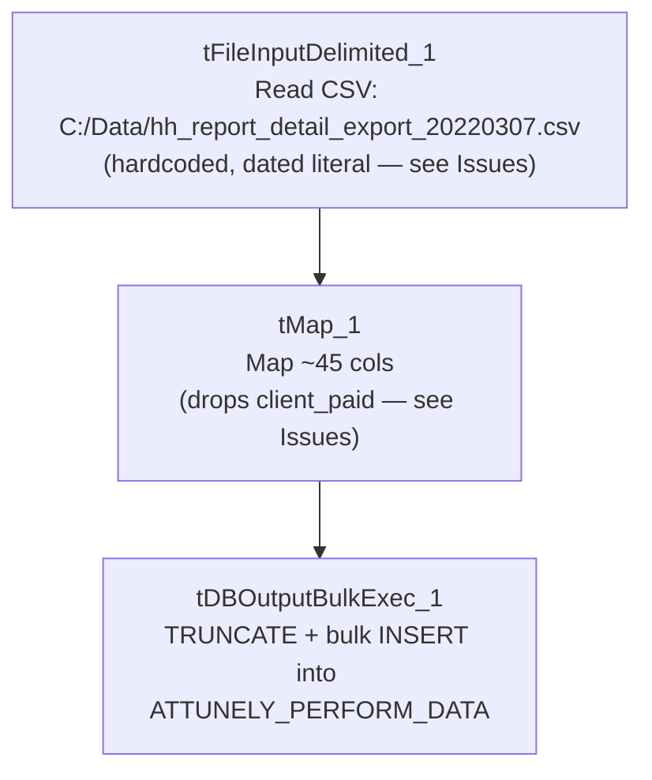

# Talend Job: Load_Attunely_Data

## Overview

Loads a collections-performance scoring export (customer/debt keys, credit score, creditor info, call-outcome and right-party-contact statistics, payment/fee amounts by payer category, and a "future PDC value" projection — "Attunely" appears to be a third-party predictive-scoring or analytics vendor) from a CSV file directly into the Snowflake table `ATTUNELY_PERFORM_DATA` via a bulk truncate-and-load. This is one of the simplest jobs reviewed in this batch — a single read→map→bulk-load chain with no connection setup, logging, or error handling components at all — but its source filename is a literal, dated string from 2022 despite the job having been modified as recently as August 2025 (see Issues observed).

## Detail table

| Field | Value |
|---|---|
| Job name | Load_Attunely_Data |
| Version | 0.1 |
| Project | EDW2SF |
| Author | jmach@harriscollect.com |
| Created | 2022-03-06T10:04:19.875-0800 |
| Last Modified | 2025-08-28T08:57:23.991-0700 |

## Step-by-step data flow

This job has no `tPrejob`/`tPostjob`, no explicit `tDBConnection`, and no per-run log file — it is a single linear chain:

1. `tFileInputDelimited_1` reads `"C:/Data/hh_report_detail_export_20220307.csv"` — a **hardcoded, dated literal filename** (comma-delimited, CSV mode, header row present, `DIE_ON_ERROR=false`, `TRIMALL=true`), using a repository schema labeled "metadata" for both main and reject rows.
2. `tMap_1` maps the ~45 source columns to an uppercase-named target schema — **but the mapping drops one source column, `client_paid`, entirely** (present in the source schema, absent from the target); `DIE_ON_ERROR=true`.
3. `tDBOutputBulkExec_1` (`tSnowflakeOutputBulkExec`) bulk-loads the mapped rows into Snowflake table `ATTUNELY_PERFORM_DATA` (`INSERT`, `tableAction=TRUNCATE`).

## Settings tables

### Source: `tFileInputDelimited_1`

| Setting | Value | What it means |
|---|---|---|
| FILENAME | `"C:/Data/hh_report_detail_export_20220307.csv"` | Hardcoded literal path **and filename**, including an embedded date (March 7, 2022) — not built from any context variable, and not a pattern/glob that would pick up a newer file. See Issues observed. |
| SCHEMA / SCHEMA_REJECT | Both repository schema `"metadata"` | Reject rows use the same schema as the main flow. |
| DIE_ON_ERROR | `false` | Malformed rows don't fail the job... |
| Reject flow | Not wired | ...but (same pattern as several other jobs in this batch) no connection carries rejected rows anywhere — silently dropped. |

### Transform: `tMap_1`

| Setting | Value | What it means |
|---|---|---|
| Output columns | ~44 columns, uppercase-named | Matches the source column set except `client_paid`, which has no corresponding output column — see Issues observed. `client_fee`, `agency_paid`, `agency_fee` and the rest all do map through correctly. |
| DIE_ON_ERROR | `true` | A mapping/lookup failure fails the job outright. |

### Target: `tDBOutputBulkExec_1` (`tSnowflakeOutputBulkExec`)

| Setting | Value | What it means |
|---|---|---|
| Table | `ATTUNELY_PERFORM_DATA` | Destination table for the bulk load. |
| Output action / Table action | `INSERT` / `TRUNCATE` | Table is cleared and reloaded every run — but every run reads the same fixed, dated source file (see Issues observed), so in practice this table's contents would never change once that file stops being updated. |

## Dependencies & configuration

- **Triggers/depends on other jobs:** none — no `tRunJob` links found (`runjob_targets` is empty).
- **Context variables used:** none — `context_vars_referenced` is empty. This job has zero configuration indirection; every setting is a literal value in the component itself.
- **1 hardcoded path finding:** `tFileInputDelimited_1.TEMP_DIR` = `"C:/Talend-Studio-20211109_1610-V8.0.1/workspace"` — plus the source `FILENAME` itself, which is also a hardcoded literal but wasn't captured in the `hardcoded_path_findings` array.

## Glossary

| Component type | Plain-English meaning |
|---|---|
| `tFileInputDelimited` | Reads a delimited (CSV-style) text file according to a schema. |
| `tMap` | Maps/transforms columns from one schema to another. |
| `tSnowflakeOutputBulkExec` | Bulk-loads data into a Snowflake table using Snowflake's native bulk-load mechanism, typically faster than row-by-row insert for large volumes. |

## Issues observed

- **The source filename is a hardcoded literal that embeds a specific date from March 2022** (`"C:/Data/hh_report_detail_export_20220307.csv"`), with no context variable, date-formatting expression, or file-pattern match involved at all. Given this job was last modified in August 2025 — over three years after the date in the filename — **either this job has not actually been run/scheduled as a recurring load since 2022 (i.e., it's effectively dead or dormant despite still being present and edited in the repository), or it is run repeatedly against the same static, years-old file, which would make `ATTUNELY_PERFORM_DATA` permanently stale.** Unable to determine which from metadata alone; this is worth an immediate conversation with the team, since either interpretation means this job is very likely not doing what its presence in the active job repository implies.
- **`tMap_1`'s output schema is missing the `client_paid` column present in the source file's schema.** Every other payment/fee column (`client_fee`, `agency_paid`, `agency_fee`, `insurance_paid`, `insurance_fee`, `total_paid`, `total_fee`, etc.) maps through to the target; `client_paid` alone does not appear anywhere in `tMap_1`'s output columns or in `tDBOutputBulkExec_1`'s schema. If this was accidentally dropped during a schema edit, `ATTUNELY_PERFORM_DATA` is missing a real business metric (client-paid amounts) that any downstream consumer relying on Attunely payment data by payer category would not see. Verify with the team whether this was an intentional exclusion or an unnoticed mapping gap.
- **No error/row-count logging of any kind** — no `tWarn`, `tDie`, `tLogRow`, or per-run log file. A read failure, mapping failure, or bulk-load failure would only surface as a generic Talend execution error with no job-specific context.
- **No reject-row handling** on `tFileInputDelimited_1` despite `DIE_ON_ERROR=false` — malformed rows are silently dropped with no count or record.
- **No context-variable use anywhere in this job** — every path and setting is a hardcoded literal, meaning this job cannot be pointed at a different file, environment, or schedule without directly editing the job definition. This is a more extreme version of the same pattern flagged in `Load_HH_Debtor_Special_20251222` elsewhere in this batch.
