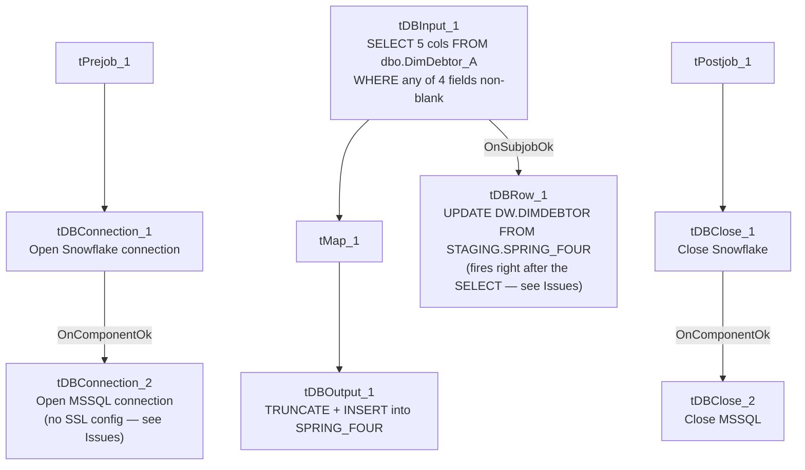

# Talend Job: Load_Debtor_New_Columns

## Overview

Loads a small set of newly-added debtor fields — cancellation reason, department ID, a "Spring Four" flag (likely referencing the SpringFour financial-hardship assistance program), and an offer-status code — from the legacy EDWProdHH MSSQL table `dbo.DimDebtor_A` into a Snowflake staging table (`SPRING_FOUR`), but only for debtors where at least one of those fields is actually populated. It then merges those values into the main `DW.DIMDEBTOR` dimension table. This looks like a narrowly scoped job built to backfill/sync a handful of specific columns rather than a full debtor reload.

## Detail table

| Field | Value |
|---|---|
| Job name | Load_Debtor_New_Columns |
| Version | 0.1 |
| Project | EDW2SF |
| Author | jmach@harriscollect.com |
| Created | 2022-09-06T12:55:22.502-0700 |
| Last Modified | 2025-09-24T11:08:33.697-0700 |

## Step-by-step data flow

**Setup subjob:** `tPrejob_1` → `tDBConnection_1` opens the Snowflake connection → on `COMPONENT_OK`, `tDBConnection_2` opens the MSSQL connection to `context.EDWProdHH_Server`/`Port`/`Schema`/`Database`/`Login` (password redacted, JTDS driver). **No `tSetKeystore` and no per-run log file** are configured in this job, unlike most file/report-extract jobs in this project — see Issues observed.

**Main subjob** (runs independently of the setup chain, relying on shared connections):

1. `tDBInput_1` runs a query (using the shared `tDBConnection_2` MSSQL connection) against `dbo.DimDebtor_A`, selecting `DEBTOR_IDX, CANCEL_REASON, DEPARTMENT_ID, SPRING_FOUR, SF_OFFER_ST` **filtered to only rows where at least one of those four columns is non-blank** (`WHERE RTRIM(COALESCE(CANCEL_REASON,'')) <> '' OR ... OR ...` — the query text is truncated in this metadata after the third `OR`, so the exact condition on `SF_OFFER_ST` isn't fully visible).
2. `tMap_1` passes the rows through unchanged in shape (`DIE_ON_ERROR=true`).
3. `tDBOutput_1` writes to Snowflake table `SPRING_FOUR` with `outputAction=INSERT` and `tableAction=TRUNCATE` — the staging table is cleared and reloaded every run.
4. Separately, `tDBInput_1` also connects on `SUBJOB_OK` directly to `tDBRow_1`, which runs `UPDATE DW.DIMDEBTOR db FROM STAGING.SPRING_FOUR sf SET CANCEL_REASON = sf.CANCEL_REASON, DEPARTMENT_ID = sf.DEPARTMENT_ID, SPRING_FOUR = sf.SPRING_FOUR, SF_OFFER_ST = sf.SF_OFFER_ST WHERE db.DEBTOR_IDX = sf.DEBTOR_IDX;` — this fires once the MSSQL `SELECT` completes, not once the full extract→map→load chain into `SPRING_FOUR` finishes; see Issues observed (same pattern flagged in `Last4SSN_Extract` in this batch).

**Teardown subjob:** `tPostjob_1` → `tDBClose_1` closes the Snowflake connection → on `COMPONENT_OK`, `tDBClose_2` closes the MSSQL connection.

## Settings tables

### Source: `tDBInput_1` (`tMSSqlInput`)

| Setting | Value | What it means |
|---|---|---|
| Query | `SELECT DEBTOR_IDX, CANCEL_REASON, DEPARTMENT_ID, SPRING_FOUR, SF_OFFER_ST FROM dbo.DimDebtor_A WHERE RTRIM(COALESCE(CANCEL_REASON,'')) <> '' OR RTRIM(COALESCE(DEPARTMENT_ID,'')) <> '' OR RTRIM(COALESCE(SPRING_FOUR,'')) <> '' OR RTRIM(COA...` (truncated) | Pulls only debtors with at least one of the four target fields populated — an incremental/delta-style filter, not a full-table pull. |

### Target: `tDBOutput_1` (`tSnowflakeOutput`)

| Setting | Value | What it means |
|---|---|---|
| Table | `SPRING_FOUR` | Staging table for the four fields — shares its name with one of its own columns (`SPRING_FOUR`), which is a potential source of confusion when reading logs/queries referencing it. |
| Output action / Table action | `INSERT` / `TRUNCATE` | Cleared and reloaded every run. |

### Merge step: `tDBRow_1` (`tSnowflakeRow`)

| Setting | Value | What it means |
|---|---|---|
| Query | `UPDATE DW.DIMDEBTOR db FROM STAGING.SPRING_FOUR sf SET CANCEL_REASON = sf.CANCEL_REASON, DEPARTMENT_ID = sf.DEPARTMENT_ID, SPRING_FOUR = sf.SPRING_FOUR, SF_OFFER_ST = sf.SF_OFFER_ST WHERE db.DEBTOR_IDX = sf.DEBTOR_IDX;` | Overwrites these four columns on `DW.DIMDEBTOR` for every debtor present in the staging table — note this always overwrites (no `IS NULL` guard, unlike `Last4SSN_Extract`'s back-fill pattern), so a stale/incomplete `SPRING_FOUR` reload could blank out or revert previously-set values on `DIMDEBTOR`. |

## Dependencies & configuration

- **Triggers/depends on other jobs:** none — no `tRunJob` links found (`runjob_targets` is empty).
- **Context variables used:** `EDWProdHH_Database`, `EDWProdHH_Login`, `EDWProdHH_Port`, `EDWProdHH_Schema`, `EDWProdHH_Server` — the standard EDWProdHH MSSQL connection group (see `01_system_architecture.md`).
- No hardcoded path findings in this job.

## Glossary

| Component type | Plain-English meaning |
|---|---|
| `tMSSqlConnection` / `tMSSqlInput` / `tMSSqlClose` | Open a Microsoft SQL Server connection, run a query against it, and close it. |
| `tSnowflakeConnection` / `tSnowflakeOutput` / `tSnowflakeRow` / `tSnowflakeClose` | Open a Snowflake connection, write rows to a table, run an arbitrary SQL statement, and close the connection. |
| `tMap` | Maps/transforms columns from one schema to another. |

## Issues observed

- **The `DIMDEBTOR` merge (`tDBRow_1`) is wired to fire on `tDBInput_1`'s `SUBJOB_OK`, not after the full extract→map→load chain into `SPRING_FOUR` finishes.** Both `tDBRow_1` and the `tMap_1`→`tDBOutput_1` chain branch off the same `tDBInput_1` component. As with `Last4SSN_Extract` in this same batch, it's unable to determine from this metadata whether Talend's execution ordering guarantees the `TRUNCATE`+`INSERT` into `SPRING_FOUR` completes before the `UPDATE ... FROM STAGING.SPRING_FOUR` runs — if it doesn't, the merge could read a stale or momentarily-empty `SPRING_FOUR` table. Verify execution ordering with the team.
- **The merge always overwrites `DIMDEBTOR`'s four target columns for every debtor in `SPRING_FOUR`, with no `IS NULL`/change-guard condition** (contrast `Last4SSN_Extract`'s `AND dd.LAST4SSN IS NULL` back-fill guard). Combined with the source query's non-blank filter, this should be safe in the common case, but if `SPRING_FOUR` ever contained a stale row from a previous, differently-filtered run, this job would blindly re-apply it.
- **No `tSetKeystore`/SSL configuration and no per-run log file** exist in this job, unlike most other jobs reviewed in this batch that connect to Snowflake — whether that's because this job predates the SSL-setup convention (created 2022-09, one of the earliest jobs in this batch) or because MSSQL-primary jobs in this project don't need it is unable to determine from metadata.
- **The query text captured in this metadata is truncated** after the third `OR` condition — the exact filter on `SF_OFFER_ST` isn't fully visible; verify the complete `WHERE` clause in Talend Studio before assuming which debtors are included.
