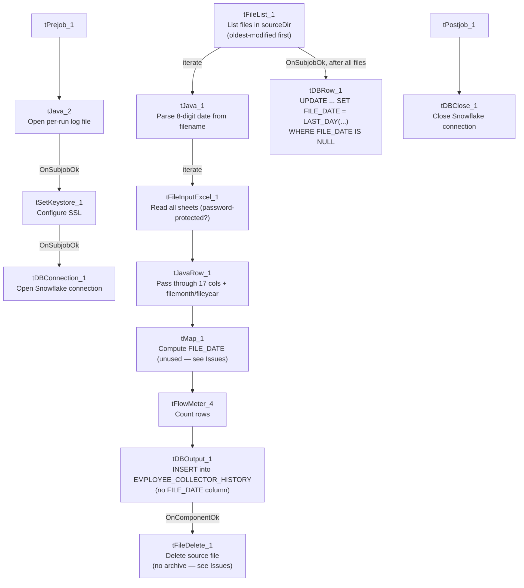

# Talend Job: Load_Employee_Collector_History

## Overview

Loads periodic employee/collector roster snapshot files (Excel workbooks — name, initials, desk, team, CUBS logon, payroll ID, start/end dates, manager/supervisor/director, title, department, agent type, subgroup) into the Snowflake `EMPLOYEE_COLLECTOR_HISTORY` table, tagging each loaded row with the file's month/year (parsed from an 8-digit date embedded in the filename itself) so the table accumulates a dated history of roster snapshots over time, rather than reflecting only the current staffing. After each file's rows are loaded, the source file is deleted (with no archive copy — see Issues observed), and once all files for the run are processed, a follow-up SQL statement back-fills a `FILE_DATE` column for any newly-loaded rows still missing one.

## Detail table

| Field | Value |
|---|---|
| Job name | Load_Employee_Collector_History |
| Version | 0.1 |
| Project | EDW2SF |
| Author | jmach@harriscollect.com |
| Created | 2022-10-28T09:41:29.886-0700 |
| Last Modified | 2025-11-04T11:08:13.666-0800 |

## Step-by-step data flow

**Setup subjob:** `tPrejob_1` → `tJava_2` opens a per-run log file → on subjob-ok, `tSetKeystore_1` configures SSL trust/keystore from `context.keystorePath` (passwords redacted) → on subjob-ok, `tDBConnection_1` opens the Snowflake connection.

**Main subjob** (runs independently of the setup chain):

1. `tFileList_1` lists files in `context.sourceDir`, **ordered by modified date, oldest first** (`ORDER_BY_MODIFIEDDATE=true`, `ORDER_ACTION_ASC=true`) — unlike most other file-iterating jobs in this project, which don't specify an order. The usual unapplied `*.txt` exclusion mask is present here too.
2. For each file (`ITERATE`), `tJava_1` sets `context.filePath`/`context.fileName`, then uses a regex (`\d{8}`) to extract an 8-digit date string embedded in the filename and parses it into a date, presumably populating `context.fileDate`, `context.fileMonth`, and `context.fileYear` (the code is truncated in this metadata after the date-parsing setup, so the exact assignment logic isn't fully visible).
3. `tFileInputExcel_1` reads the workbook (all sheets, `ALL_SHEETS=true`, `DIE_ON_ERROR=false`, password field present and redacted — suggesting these workbooks may be password-protected) using a repository schema labeled "employee," with `filemonth`/`fileyear` columns appended to carry the parsed context values alongside each row.
4. `tJavaRow_1` passes the 17 roster columns plus `filemonth`/`fileyear` straight through (code truncated but appears to be a direct field-by-field copy).
5. `tMap_1` maps to an uppercase target schema and **also computes a `FILE_DATE` column** (not present in the upstream schema) — but see Issues observed, this computed value is not actually carried through to the database write.
6. `tFlowMeter_4` counts rows passing through (labeled "ech").
7. `tDBOutput_1` inserts into Snowflake `EMPLOYEE_COLLECTOR_HISTORY` (`INSERT`, `tableAction=NONE` — append-only, appropriate for a historical/dated table) — **its own schema excludes the `FILE_DATE` column** that `tMap_1`/`tFlowMeter_4` computed and carried, so `FILE_DATE` is not populated at insert time; see Issues observed.
8. On `COMPONENT_OK`, `tFileDelete_1` deletes the just-loaded source file (`context.filePath`) — **no archive/zip step precedes this deletion**, unlike `ADP_Payroll_Load`'s archive-then-delete pattern; see Issues observed.
9. Separately, once `tFileList_1`'s entire loop completes (`SUBJOB_OK`), `tDBRow_1` runs `UPDATE EMPLOYEE_COLLECTOR_HISTORY SET FILE_DATE = LAST_DAY(DATE_FROM_PARTS(FILE_YEAR::INTEGER, FILE_MONTH, 1)) WHERE FILE_DATE IS NULL;` — this is how `FILE_DATE` actually gets populated: as the last calendar day of the row's file month/year, computed in SQL after all files are loaded, not from `tMap_1`'s per-row computation.

**Teardown subjob:** `tPostjob_1` → `tDBClose_1` closes the Snowflake connection.

## Settings tables

### Source: `tFileInputExcel_1`

| Setting | Value | What it means |
|---|---|---|
| FILENAME | `context.filePath` | Current file from `tFileList_1`'s iteration. |
| ALL_SHEETS / AFFECT_EACH_SHEET | `true` / `false` | Reads every sheet in the workbook into the same flow, without treating each sheet as a separately-schemaed input. |
| PASSWORD | `***REDACTED***` | Suggests the source workbooks may be password-protected. |
| DIE_ON_ERROR | `false` | Malformed rows don't fail the job... |
| Reject flow | Not wired | ...but no connection carries rejected rows anywhere (same pattern as several other jobs in this batch) — silently dropped. |

### Filename parsing: `tJava_1`

| Setting | Value | What it means |
|---|---|---|
| Regex | `\d{8}` against `context.fileName` | Extracts an 8-digit date embedded in the filename (e.g., a `YYYYMMDD` or `MMDDYYYY` pattern) to derive the file's reporting month/year. The exact date-format assumption and null/no-match handling are truncated in this metadata — see Issues observed. |

### Target: `tDBOutput_1` (`tSnowflakeOutput`)

| Setting | Value | What it means |
|---|---|---|
| Table | `EMPLOYEE_COLLECTOR_HISTORY` | Append-only historical roster table. |
| Output action / Table action | `INSERT` / `NONE` | No truncate — every file's rows accumulate, consistent with a dated-history design. |
| Columns | Excludes `FILE_DATE` (present in `tMap_1`'s output but not here) | `FILE_DATE` is populated later via `tDBRow_1`'s `UPDATE`, not at insert time — see Issues observed. |

### Post-load back-fill: `tDBRow_1`

| Setting | Value | What it means |
|---|---|---|
| Query | `UPDATE EMPLOYEE_COLLECTOR_HISTORY SET FILE_DATE = LAST_DAY(DATE_FROM_PARTS(FILE_YEAR::INTEGER, FILE_MONTH, 1)) WHERE FILE_DATE IS NULL;` | Sets `FILE_DATE` to the last calendar day of the row's file month/year, for any row that doesn't already have one — runs once per job, after the full file loop. |

### Cleanup: `tFileDelete_1`

| Setting | Value | What it means |
|---|---|---|
| FILENAME | `context.filePath` | Deletes the just-processed source file immediately after a successful load of that file. |
| DIRECTORY / PATH (hardcoded, unused) | `"C:/Talend-Studio-20211109_1610-V8.0.1/workspace/delete_folder"` / `".../delete_folder or delete_file"` | Default template values; `FOLDER=false`/`FOLDER_FILE=false` mean actual deletion is single-file via `FILENAME`. |

## Dependencies & configuration

- **Triggers/depends on other jobs:** none — no `tRunJob` links found (`runjob_targets` is empty).
- **Context variables used:** `fileDate`, `fileMonth`, `fileName`, `filePath`, `fileYear`, `keystorePath`, `logDir`, `sourceDir`.
- **3 hardcoded path findings:** `tFileDelete_1.DIRECTORY`, `tFileDelete_1.PATH` (both `C:/Talend-Studio-20211109_1610-V8.0.1/workspace/...`), and `tSetKeystore_1.SSL_TRUSTSERVER_TRUSTSTORE` = `"C:/clientTrustStore.trustStore"`.

## Glossary

| Component type | Plain-English meaning |
|---|---|
| `tFileList` | Lists files in a directory for the job to iterate over one at a time. |
| `tFileInputExcel` | Reads an Excel workbook, optionally across all sheets, according to a schema. |
| `tJavaRow` | Runs custom Java code once per input row. |
| `tMap` | Maps/transforms columns from one schema to another. |
| `tFlowMeter` | Counts rows passing a point in the flow, for logging/monitoring. |
| `tSnowflakeOutput` / `tSnowflakeRow` / `tSnowflakeConnection` / `tSnowflakeClose` | Write rows to a Snowflake table / run arbitrary SQL against Snowflake / open and close the shared connection. |
| `tFileDelete` | Deletes a file from disk. |
| `tSetKeystore` | Configures SSL trust/keystore settings for the job's outbound connections. |

## Issues observed

- **Source files are deleted immediately after loading, with no archive/backup step first** — unlike `ADP_Payroll_Load` and `Load_Evergreen_Hours` elsewhere in this project, which zip the source file to an archive directory before (or, in `Load_Evergreen_Hours`'s case, regardless of) deleting it, this job has no `tFileArchive` component at all. If a load needs to be re-run, corrected, or audited after the fact, the original source workbook is gone — the only surviving record is whatever made it into `EMPLOYEE_COLLECTOR_HISTORY`. Given these files apparently contain employee personal/organizational data (and may be password-protected), losing the only copy without a retention/archive policy is worth flagging for review.
- **`tMap_1` computes a `FILE_DATE` column that is never actually written to the database** — it's present in `tMap_1`'s and `tFlowMeter_4`'s schemas but absent from `tDBOutput_1`'s. The real population of `FILE_DATE` happens via the separate `tDBRow_1` `UPDATE ... WHERE FILE_DATE IS NULL` statement after the load. This isn't necessarily a bug (the end result is the same, and computing it in SQL avoids potential precision differences with a Java-side calculation), but the unused `tMap_1` computation is dead work that could confuse future maintainers into thinking `FILE_DATE` is set at load time — worth cleaning up or documenting.
- **The filename date-parsing logic in `tJava_1` is truncated in this metadata**, so the exact assumed date format and the behavior when a file's name doesn't contain a matching 8-digit sequence (e.g., an unrelated file dropped in `sourceDir`) is unable to determine — a `Pattern`/`Matcher` failing to find a match and then being dereferenced would typically throw a `NullPointerException`, which could fail the whole file-processing loop rather than just skipping that one file. Verify the full code in Talend Studio.
- **No reject-row handling** on `tFileInputExcel_1` despite `DIE_ON_ERROR=false` — malformed rows are silently dropped with no count or record.
- **This table accumulates historical rows from every workbook ever processed with no de-duplication logic visible in this job** — if the same file were accidentally reprocessed (e.g., a backup copy with a different filename but the same embedded date and same roster data), `EMPLOYEE_COLLECTOR_HISTORY` would gain duplicate rows for that month with no unique-key constraint enforcement visible in this job's own components.
