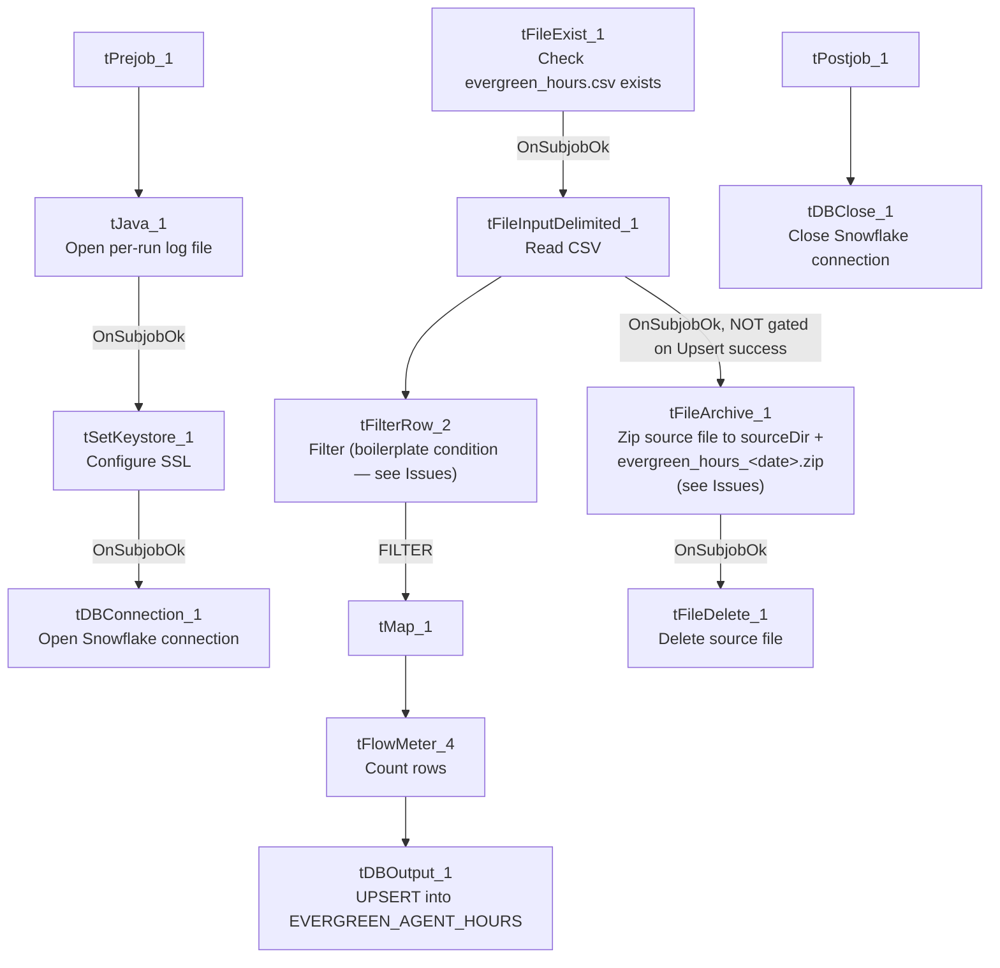

# Talend Job: Load_Evergreen_Hours

## Overview

Loads a daily agent-hours timekeeping export ("Evergreen" — likely a workforce-management or timekeeping system name) from a CSV file into the Snowflake `EVERGREEN_AGENT_HOURS` table, keyed by work date and agent ID, with regular and overtime hours. Unlike most file-load jobs in this project, it uses a genuine `UPSERT` rather than a truncate-and-reload, so it can be re-run without wiping prior days' data — but see Issues observed for a file-handling risk that could still cause silent data loss.

## Detail table

| Field | Value |
|---|---|
| Job name | Load_Evergreen_Hours |
| Version | 0.1 |
| Project | EDW2SF |
| Author | jmach@harriscollect.com |
| Created | 2022-11-01T14:53:05.758-0700 |
| Last Modified | 2025-11-04T11:08:06.208-0800 |

## Step-by-step data flow

**Setup subjob:** `tPrejob_1` → `tJava_1` opens a per-run log file at `context.logDir + jobName + "_" + <timestamp> + ".log"` → on subjob-ok, `tSetKeystore_1` configures SSL trust/keystore from `context.keystorePath` (passwords redacted) → on subjob-ok, `tDBConnection_1` opens the Snowflake connection.

**Main subjob** (runs independently of the setup chain, relying on the shared connection):

1. `tFileExist_1` checks whether `context.sourceDir + "evergreen_hours.csv"` exists; only if it does does `tFileInputDelimited_1` proceed (`SUBJOB_OK`) — this job **gates on file presence before attempting to read it**, unlike several other file-load jobs in this project that attempt the read unconditionally.
2. `tFileInputDelimited_1` reads the CSV (comma-delimited, header row present, `DIE_ON_ERROR=false`) using a repository schema labeled "evergreen_hours" for both main and reject rows.
3. `tFilterRow_2` applies a row filter — **its condition is left as unmodified Talend template boilerplate** (`input_row.columnName1.equals(input_row.columnNam...`, truncated), the same placeholder text found in `Last4SSN_Extract` elsewhere in this project; see Issues observed. Only rows passing the `FILTER` branch continue.
4. `tMap_1` maps the filtered rows to a 5-column target schema (`WORKDATE`, `AGENT_ID`, `AGENT_NAME`, `REGULAR_HOURS`, `OVERTIME_HOURS`); `DIE_ON_ERROR=true`.
5. `tFlowMeter_4` counts rows passing through (labeled "MyLabel").
6. `tDBOutput_1` **upserts** the rows into Snowflake table `EVERGREEN_AGENT_HOURS` (`outputAction=UPSERT`, `tableAction=NONE`) — no truncate; this genuinely merges by key rather than replacing the whole table.
7. Separately, `tFileInputDelimited_1` also connects on `SUBJOB_OK` directly to `tFileArchive_1`, which zips the source file to `context.sourceDir + "evergreen_hours_" + <CCYYMMDD> + ".zip"` (note: archived **into the same `sourceDir`**, not a separate `archiveDir`, unlike most other file-archiving jobs in this project) — this fires as soon as the file read completes, **not after the load into Snowflake succeeds**; see Issues observed. On `SUBJOB_OK`, `tFileDelete_1` then deletes the original source file (`context.sourceDir + "evergreen_hours.csv"`).

**Teardown subjob:** `tPostjob_1` → `tDBClose_1` closes the Snowflake connection.

## Settings tables

### Source: `tFileInputDelimited_1`

| Setting | Value | What it means |
|---|---|---|
| FILENAME | `context.sourceDir + "evergreen_hours.csv"` | Fixed filename, no date/pattern matching — expects the same file to be dropped and overwritten each run. |
| Gate | `tFileExist_1` must succeed first | Prevents a "file not found" error from surfacing as a generic Talend failure; the job simply won't proceed to read if the file isn't there yet. |
| SCHEMA / SCHEMA_REJECT | Both repository schema `"evergreen_hours"` | Reject rows use the same schema as the main flow. |
| DIE_ON_ERROR | `false` | Malformed rows don't fail the job... |
| Reject flow | Not wired | ...but (same as `ADP_Payroll_Load`) no connection carries rejected rows anywhere — they're silently dropped. |

### Filter: `tFilterRow_2`

| Setting | Value | What it means |
|---|---|---|
| ADVANCED_COND | `input_row.columnName1.equals(input_row.columnNam...` (truncated placeholder) | Unmodified Talend template boilerplate — `columnName1`/`columnName2` don't exist in this job's schema. Unable to determine actual filtering behavior; see Issues observed. |
| LOGICAL_OP | `\|\|` (OR) | The logical operator was changed from Talend's default, suggesting someone partially configured this component without ever writing a real condition. |

### Target: `tDBOutput_1` (`tSnowflakeOutput`)

| Setting | Value | What it means |
|---|---|---|
| Table | `EVERGREEN_AGENT_HOURS` | Destination table, keyed presumably by `WORKDATE` + `AGENT_ID` for the upsert to work correctly (the actual key column(s) used for matching aren't captured in this metadata). |
| Output action / Table action | `UPSERT` / `NONE` | Genuinely merges by key rather than truncating — a better fit for a daily incremental timekeeping load than the truncate-reload pattern used elsewhere in this project. |

### Archive/cleanup: `tFileArchive_1` / `tFileDelete_1`

| Setting | Value | What it means |
|---|---|---|
| TARGET (archive) | `context.sourceDir + "evergreen_hours_" + <date> + ".zip"` | Archives into the **same** source directory rather than a separate `context.archiveDir`, unlike other archiving jobs (e.g. `ADP_Payroll_Load` archives to `context.archiveDir`). |
| SOURCE_FILE (hardcoded, likely unused) | `"C:/Talend-Studio-20211109_1610-V8.0.1/workspace/source.csv"` | Leftover default value from the component template — the actual archived file is driven by `SOURCE=context.sourceDir`, not this field. |
| tFileDelete_1 FILENAME | `context.sourceDir + "evergreen_hours.csv"` | Deletes the original source file after archiving. |
| tFileDelete_1 DIRECTORY / PATH (hardcoded, unused) | `"C:/Talend-Studio-20211109_1610-V8.0.1/workspace/delete_folder"` / `".../delete_folder or delete_file"` | Default template values; `FOLDER=false`/`FOLDER_FILE=false` mean the component is actually doing single-file deletion via `FILENAME`, not folder deletion via these fields. |

## Dependencies & configuration

- **Triggers/depends on other jobs:** none — no `tRunJob` links found (`runjob_targets` is empty).
- **Context variables used:** `keystorePath`, `logDir`, `sourceDir`.
- **5 hardcoded path findings:** `tFileInputDelimited_1.TEMP_DIR`, `tFileArchive_1.SOURCE_FILE`, `tFileDelete_1.DIRECTORY`, `tFileDelete_1.PATH` (all `C:/Talend-Studio-20211109_1610-V8.0.1/workspace/...`, the project-wide developer-workstation pattern from `05_operational_runbook.md`), and `tSetKeystore_1.SSL_TRUSTSERVER_TRUSTSTORE` = `"C:/clientTrustStore.trustStore"`.

## Glossary

| Component type | Plain-English meaning |
|---|---|
| `tFileExist` | Checks whether a specific file exists on disk before proceeding. |
| `tFileInputDelimited` | Reads a delimited (CSV-style) text file according to a schema. |
| `tFilterRow` | Passes rows through only if they meet a configured condition. |
| `tMap` | Maps/transforms columns from one schema to another. |
| `tFlowMeter` | Counts rows passing a point in the flow, for logging/monitoring. |
| `tSnowflakeOutput` | Writes rows to a Snowflake table — here using `UPSERT` rather than `INSERT` after `TRUNCATE`. |
| `tFileArchive` / `tFileDelete` | Zip a processed file to an archive location, then delete the original from the source directory. |

## Issues observed

- **The file archive-and-delete steps are not gated on the Snowflake upsert succeeding.** `tFileArchive_1` and `tFileDelete_1` are wired off `tFileInputDelimited_1`'s `SUBJOB_OK` (i.e., the file was successfully *read*), which is a separate branch from the `tFilterRow_2` → `tMap_1` → `tDBOutput_1` chain that actually loads the data. If the filter, map, or upsert step fails or dies partway through (`tMap_1` has `DIE_ON_ERROR=true`), the source file would still be archived and deleted, because that branch only depends on the file having been read, not on the load having succeeded. **This is a genuine data-loss risk**: a failed run could leave `EVERGREEN_AGENT_HOURS` unchanged (or partially updated) while the only copy of that day's source file is gone, with just a zip archive (which may itself only be checked for after the fact) as a recovery path. Verify with the team whether this is an accepted risk (archive is one form of preservation) or should be re-wired to depend on load success.
- **`tFilterRow_2`'s condition is unmodified Talend template boilerplate** (`input_row.columnName1.equals(input_row.columnNam...`) — the same class of finding documented in `Last4SSN_Extract`. Since `columnName1`/`columnName2` don't exist in this job's `Date`/`Agent_ID`/etc. schema, this filter's actual runtime behavior (pass everything, pass nothing, or error) is unable to determine from metadata — verify directly in Talend Studio. This is now a **recurring pattern across multiple jobs in this project** (at least this job and `Last4SSN_Extract`), suggesting it may be worth a project-wide audit of `tFilterRow` components for unconfigured template text, not just a per-job fix.
- **No reject-row handling** on `tFileInputDelimited_1` despite `DIE_ON_ERROR=false` — malformed rows are silently dropped with no count or record.
- **Archived files land in the same `sourceDir` as the incoming file**, not a dedicated `archiveDir` — over time this could accumulate zip files in what's meant to be a drop-zone/inbox directory, unlike the `archiveDir`-based pattern used elsewhere in this project.
