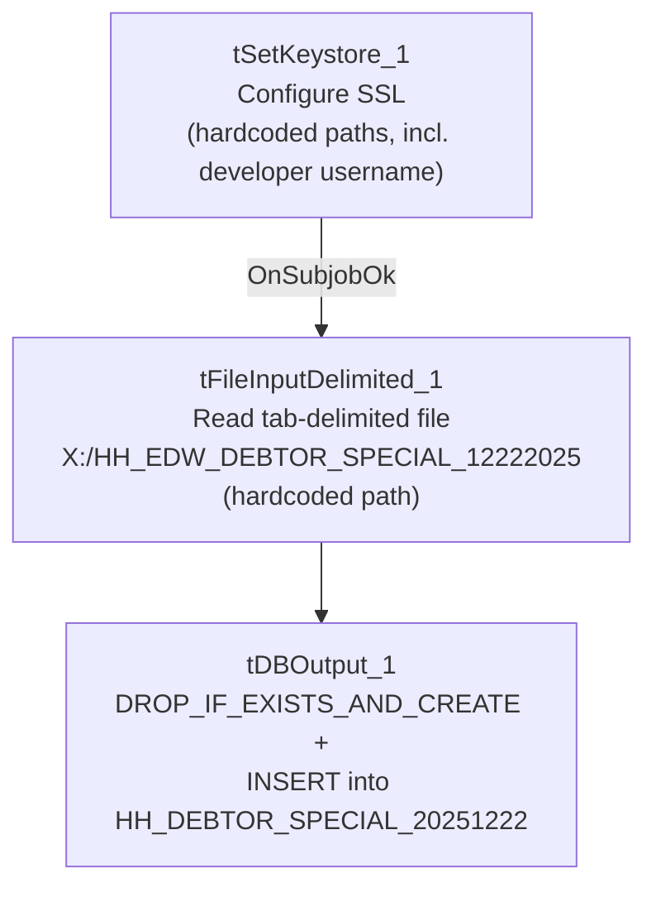

# Talend Job: Load_HH_Debtor_Special_20251222

## Overview

This is a one-off, ad hoc load job: its name embeds a specific date (December 22, 2025) and it was both created and last modified on that same day. It reads a single tab-delimited file (`X:/HH_EDW_DEBTOR_SPECIAL_12222025`, no file extension) containing debtor logon/client/case identifiers plus up to five document references with their dates and a "previous agency" field, and loads it as-is into a brand-new Snowflake table named after the job itself (`HH_DEBTOR_SPECIAL_20251222`), dropping and recreating that table every run. This has the shape of a special one-time data drop for the "HH" site rather than a recurring pipeline component.

## Detail table

| Field | Value |
|---|---|
| Job name | Load_HH_Debtor_Special_20251222 |
| Version | 0.1 |
| Project | EDW2SF |
| Author | jmach@harriscollect.com |
| Created | 2025-12-22T16:22:14.820-0800 |
| Last Modified | 2025-12-22T16:31:30.328-0800 |

## Step-by-step data flow

This job has no `tPrejob`/`tPostjob` and no explicit `tDBConnection`/`tDBClose` pair — the Snowflake connection details live inline on `tDBOutput_1` itself rather than as a separate shared connection component (see Issues observed).

1. `tSetKeystore_1` configures SSL trust/keystore, but **with hardcoded literal paths** rather than context variables: `SSL_KEYSTORE = "C:/Users/jmach/.ssl/keystore.p12"` (note this embeds the developer's own Windows username, `jmach`) and `SSL_TRUSTSERVER_TRUSTSTORE = "C:/clientTrustStore.trustStore"` (passwords redacted).
2. On `SUBJOB_OK`, `tFileInputDelimited_1` reads `"X:/HH_EDW_DEBTOR_SPECIAL_12222025"` — also a hardcoded literal path, not built from any context variable — tab-delimited, 1 header row, `DIE_ON_ERROR=false` (malformed rows are skipped, not fatal).
3. `tDBOutput_1` writes the 16 columns (`LOGON`, `CLIENT`, `CLIENT_IDX`, `CASE_NO`, `LIENED`, `DOCUMENT1`–`DOCUMENT5`, `DOC1_DATE`–`DOC5_DATE`, `PREV_AGENCY`) into Snowflake table `HH_DEBTOR_SPECIAL_20251222`, with `tableAction=DROP_IF_EXISTS_AND_CREATE` — the table is fully rebuilt from scratch each run, not just truncated.

## Settings tables

### Source: `tFileInputDelimited_1`

| Setting | Value | What it means |
|---|---|---|
| FILENAME | `"X:/HH_EDW_DEBTOR_SPECIAL_12222025"` | Hardcoded literal path with no context-variable indirection and no file extension — a one-time, manually-placed source file. |
| FIELDSEPARATOR / HEADER | `\t` (tab) / 1 header row | Tab-delimited rather than comma-delimited, unlike most other file-based jobs in this project. |
| DIE_ON_ERROR | `false` | Malformed rows are skipped rather than failing the job — and, as with `ADP_Payroll_Load`, there's no reject flow wired, so skipped rows are silently dropped with no record. |
| TEMP_DIR (hardcoded) | `"C:/Talend-Studio-20211109_1610-V8.0.1/workspace"` | The project-wide developer-workstation hardcoded path documented in `05_operational_runbook.md`. |

### Target: `tDBOutput_1` (`tSnowflakeOutput`)

| Setting | Value | What it means |
|---|---|---|
| Table | `HH_DEBTOR_SPECIAL_20251222` | Table name is literally the job name — this table exists solely for this one-time load, not as an ongoing staging table for a recurring pipeline. |
| Table action | `DROP_IF_EXISTS_AND_CREATE` | Fully rebuilds the table structure each run — different from the truncate-and-reload pattern used by most other load jobs in this project (a `DROP`/`CREATE` also resets any downstream grants or dependent views on this table). |

## Dependencies & configuration

- **Triggers/depends on other jobs:** none — no `tRunJob` links found (`runjob_targets` is empty), and this job is not listed as a caller or target in `06_dependency_matrix.md`.
- **Context variables used:** none — `context_vars_referenced` is empty. Every path in this job is a hardcoded literal (see Issues observed).
- **2 hardcoded path findings:** `tFileInputDelimited_1.TEMP_DIR` = `"C:/Talend-Studio-20211109_1610-V8.0.1/workspace"` and `tSetKeystore_1.SSL_TRUSTSERVER_TRUSTSTORE` = `"C:/clientTrustStore.trustStore"` — plus the source `FILENAME` and `SSL_KEYSTORE` paths, which are also hardcoded literals but weren't captured in the `hardcoded_path_findings` array.

## Glossary

| Component type | Plain-English meaning |
|---|---|
| `tFileInputDelimited` | Reads a delimited (here, tab-separated) text file according to a schema. |
| `tSnowflakeOutput` | Writes rows to a Snowflake table. |
| `tSetKeystore` | Configures SSL trust/keystore settings for the job's outbound connections. |

## Issues observed

- **Every path in this job is a hardcoded literal, with zero context-variable use** — a clear departure from the pattern used across the rest of this project (where `sourceDir`, `outputDir`, `keystorePath`, etc. are consistently parameterized via context groups like `StandardFolders_0.1`). This is consistent with the job's evident purpose as a one-time, throwaway data load rather than a maintained pipeline component — but it also means this job cannot be safely reused or re-pointed at a different file/environment without editing the job definition directly.
- **`tSetKeystore_1.SSL_KEYSTORE` hardcodes a specific developer's personal keystore path** (`"C:/Users/jmach/.ssl/keystore.p12"`), tying this job's SSL trust configuration to one individual's workstation. If that keystore file is unavailable (e.g., the developer's machine is reimaged, or the job runs on a different execution host), this job would fail to establish its Snowflake connection. Since this job has no context-variable-driven keystore path (contrast every other job in this batch, which uses `context.keystorePath`), it cannot simply be redirected via configuration.
- **No explicit `tDBConnection`/`tDBClose` pair and no `tPrejob`/`tPostjob`** — this job's Snowflake connection details are configured inline on `tDBOutput_1` rather than through a separate, shared connection component. This is a simpler but less consistent pattern than the rest of the project's jobs (all of which open/close a named connection explicitly).
- **`DROP_IF_EXISTS_AND_CREATE` rebuilds the destination table from scratch every run** — any downstream view, grant, or dependency on `HH_DEBTOR_SPECIAL_20251222` would need to be re-established after each run, and re-running this job is not simply idempotent in the way a `TRUNCATE`+`INSERT` job would be.
- **No reject-row handling** on `tFileInputDelimited_1` despite `DIE_ON_ERROR=false` — malformed rows are silently dropped with no count or record.
- **Given the very narrow, single-run purpose of this job** (a specific dated filename, no context parameterization, and same-day creation/modification), verify with the team whether it should be disabled/archived after its one-time use rather than left active in the shared job repository, where it could confuse anyone browsing for "the" HH debtor-load job.
