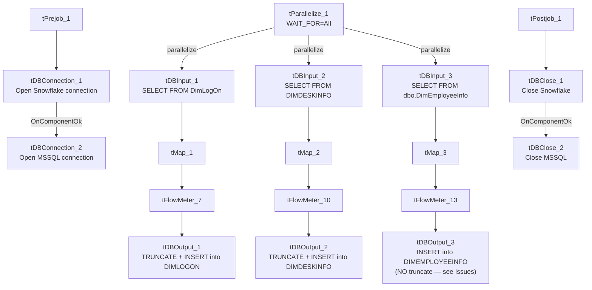

# Talend Job: Load_Misc_Dims

## Overview

Loads three small reference/dimension tables from the legacy EDWProdHH MSSQL database into Snowflake in parallel: logon codes (`DimLogOn` → `DIMLOGON`), collector desk/team assignments (`DIMDESKINFO` → `DIMDESKINFO`), and employee login/account info (`DimEmployeeInfo` → `DIMEMPLOYEEINFO`). All three are simple one-for-one column copies with a type cast on the shared `DIMLOGON` key column. Despite doing the same kind of load for all three, one of the three (`DIMEMPLOYEEINFO`) is configured without the truncate-before-insert step the other two use — see Issues observed for the consequence.

## Detail table

| Field | Value |
|---|---|
| Job name | Load_Misc_Dims |
| Version | 0.1 |
| Project | EDW2SF |
| Author | jmach@harriscollect.com |
| Created | 2022-01-05T16:17:26.375-0800 |
| Last Modified | 2022-05-24T09:48:37.480-0700 |

## Step-by-step data flow

**Setup subjob:** `tPrejob_1` → `tDBConnection_1` opens the Snowflake connection → on `COMPONENT_OK`, `tDBConnection_2` opens the MSSQL connection to `context.EDWProdHH_Server`/`Port`/`Schema`/`Database`/`Login` (password redacted, JTDS driver).

**Main subjob:** `tParallelize_1` (`WAIT_FOR=All`, `DIE_ON_ERROR=false`) fans out into three independent branches that run concurrently, each reading from MSSQL via the shared `tDBConnection_2` and writing to Snowflake via the shared `tDBConnection_1`:

1. **DimLogOn branch:** `tDBInput_1` runs `SELECT CAST(DimLogOn AS numeric(38,0)) AS DimLogOn, LogOn, Description FROM DimLogOn` → `tMap_1` (pass-through, `DIE_ON_ERROR=true`) → `tFlowMeter_7` counts rows (labeled "DimLogon") → `tDBOutput_1` writes to Snowflake table `DIMLOGON` (`INSERT`, `tableAction=TRUNCATE`).
2. **DimDeskInfo branch:** `tDBInput_2` runs `SELECT DESK_IDX, CAST(DIMLOGON AS NUMERIC(38,0)) AS DIMLOGON, DESK, NAME, PSEUDONYM, BRANCH_NAME, TEAM_NAME FROM DIMDESKINFO` → `tMap_2` (pass-through, `DIE_ON_ERROR=true`) → `tFlowMeter_10` counts rows (labeled "DimDesk") → `tDBOutput_2` writes to Snowflake table `DIMDESKINFO` (`INSERT`, `tableAction=TRUNCATE`).
3. **DimEmployeeInfo branch:** `tDBInput_3` runs `SELECT EMP_IDX, CAST(DimLogon AS NUMERIC(38,0)) AS DIMLOGON, EMPPWD, EMP_NAME, EMP_INIT, LST_LOGIN, DISABLED FROM dbo.DimEmployeeInfo` → `tMap_3` (pass-through, `DIE_ON_ERROR=true`) → `tFlowMeter_13` counts rows (labeled "DimEmp") → `tDBOutput_3` writes to Snowflake table `DIMEMPLOYEEINFO` (`INSERT`, **`tableAction=NONE`** — no truncate; see Issues observed).

**Teardown subjob:** `tPostjob_1` → `tDBClose_1` closes the Snowflake connection → on `COMPONENT_OK`, `tDBClose_2` closes the MSSQL connection.

## Settings tables

### Sources: `tDBInput_1` / `tDBInput_2` / `tDBInput_3` (`tMSSqlInput`)

| Setting | Value | What it means |
|---|---|---|
| Query 1 | `SELECT CAST(DimLogOn AS numeric(38,0)) AS DimLogOn, LogOn, Description FROM DimLogOn` | Full-table pull of the logon code lookup, no filtering. |
| Query 2 | `SELECT DESK_IDX, CAST(DIMLOGON AS NUMERIC(38,0)) AS DIMLOGON, DESK, NAME, PSEUDONYM, BRANCH_NAME, TEAM_NAME FROM DIMDESKINFO` | Full-table pull of desk/team assignment reference data. |
| Query 3 | `SELECT EMP_IDX, CAST(DimLogon AS NUMERIC(38,0)) AS DIMLOGON, EMPPWD, EMP_NAME, EMP_INIT, LST_LOGIN, DISABLED FROM dbo.DimEmployeeInfo` | Full-table pull of employee login records — includes an `EMPPWD` column (see Issues observed for the data-sensitivity implication). |

### Targets: `tDBOutput_1` / `tDBOutput_2` / `tDBOutput_3` (`tSnowflakeOutput`)

| Setting | Value | What it means |
|---|---|---|
| `DIMLOGON` table action | `TRUNCATE` | Cleared and reloaded every run. |
| `DIMDESKINFO` table action | `TRUNCATE` | Cleared and reloaded every run. |
| `DIMEMPLOYEEINFO` table action | **`NONE`** | Not cleared before the insert — every run appends the full source table's rows on top of whatever is already there. See Issues observed. |

### Fan-out: `tParallelize_1`

| Setting | Value | What it means |
|---|---|---|
| WAIT_FOR | `All` | The job doesn't consider the parallel section complete until all three branches finish. |
| DIE_ON_ERROR | `false` | A failure in one branch doesn't automatically fail the `tParallelize_1` step itself — combined with `WAIT_FOR=All`, this means a broken branch might not visibly block the others, though the job's overall success/failure signaling from this component alone is unable to determine from metadata. |

## Dependencies & configuration

- **Triggers/depends on other jobs:** none — no `tRunJob` links found (`runjob_targets` is empty). Not listed as a target of any `tRunJob` calls in `06_dependency_matrix.md` either — unlike `DimDeskInfo_Load` and `DimEmployeeInfo_Load`, which per that matrix each call `CUBS_Raw_File_Load`, this job appears to be its own independent, non-orchestrated dimension loader with overlapping table names/purpose to those two — worth confirming with the team whether `Load_Misc_Dims` and `DimDeskInfo_Load`/`DimEmployeeInfo_Load` are redundant, sequential, or serve different environments.
- **Context variables used:** `EDWProdHH_Database`, `EDWProdHH_Login`, `EDWProdHH_Port`, `EDWProdHH_Schema`, `EDWProdHH_Server`.
- No hardcoded path findings in this job.

## Glossary

| Component type | Plain-English meaning |
|---|---|
| `tParallelize` | Runs its downstream branches at the same time instead of one after another. |
| `tMSSqlConnection` / `tMSSqlInput` / `tMSSqlClose` | Open a Microsoft SQL Server connection, run a query against it, and close it. |
| `tMap` | Maps/transforms columns from one schema to another (used here as a straight pass-through with a type cast already done in the source query). |
| `tFlowMeter` | Counts rows passing a point in the flow, for logging/monitoring. |
| `tSnowflakeOutput` | Writes rows to a Snowflake table. |

## Issues observed

- **`DIMEMPLOYEEINFO`'s load has no truncate step (`tableAction=NONE`), unlike its two sibling branches in the same job (`DIMLOGON` and `DIMDESKINFO`, both `TRUNCATE`).** Since the output action is a plain `INSERT` (not `UPSERT`/`MERGE`), **every run of this job appends the entire `dbo.DimEmployeeInfo` source table on top of whatever rows are already in `DIMEMPLOYEEINFO`**, rather than replacing them. If this job runs on any kind of recurring schedule, `DIMEMPLOYEEINFO` would accumulate duplicate rows indefinitely — a likely data-quality bug given the other two branches in the same job clearly intend a fresh-reload pattern. Verify with the team whether this was an intentional exception (e.g., `DIMEMPLOYEEINFO` is meant to be append-only for historical login tracking) or a configuration oversight.
- **The `dbo.DimEmployeeInfo` source table includes an `EMPPWD` column, and this job loads it into Snowflake `DIMEMPLOYEEINFO` unmodified** — no masking, hashing, or exclusion of the password field is visible anywhere in this job's mapping. Per this organization's data-handling guidance, storing employee passwords (even legacy/hashed ones — the actual format of `EMPPWD` is unable to determine from metadata) in a reporting warehouse table warrants review; confirm whether `EMPPWD` should be excluded from this load or whether it's already a non-sensitive placeholder/hash in the source system.
- **No reject-row or error-count logging** in any of the three branches — a bad row or connection issue in one branch would only surface as a generic Talend execution error, and per-branch failure isolation (since `tParallelize_1.DIE_ON_ERROR=false`) makes it unclear from this metadata alone whether one branch's failure is reported distinctly from the others'.
- **No per-run log file setup and no SSL/keystore configuration** in this job, consistent with `Load_Debtor_New_Columns` elsewhere in this batch (both are MSSQL-to-Snowflake dimension loaders from a similar era, 2022) — a different, less-elaborate setup pattern than the file-extract jobs in this project.
