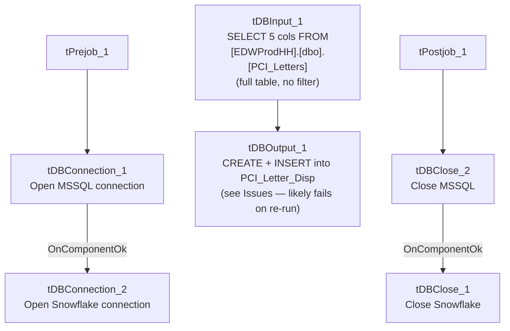

# Talend Job: Load_PCI_Letter_Disp_Desc

## Overview

Copies mail-disposition tracking data for PCI (likely a mail-fulfillment vendor or letter-processing system) letters — customer key, raw letter code, mail disposition code and description, and file date — from the legacy EDWProdHH MSSQL table `[dbo].[PCI_Letters]` straight into a new Snowflake table `PCI_Letter_Disp`, with no filtering, transformation, or intermediate staging. This is one of the simplest and most direct MSSQL-to-Snowflake copies in this batch, but its table-creation setting looks likely to break on a second run — see Issues observed.

## Detail table

| Field | Value |
|---|---|
| Job name | Load_PCI_Letter_Disp_Desc |
| Version | 0.1 |
| Project | EDW2SF |
| Author | jmach@harriscollect.com |
| Created | 2022-04-15T13:39:17.862-0700 |
| Last Modified | 2025-09-24T11:08:01.278-0700 |

## Step-by-step data flow

**Setup subjob:** `tPrejob_1` → `tDBConnection_1` opens the MSSQL connection to `context.EDWProdHH_Server`/`Port`/`Schema`/`Database`/`Login` (password redacted, JTDS driver) → on `COMPONENT_OK`, `tDBConnection_2` opens the Snowflake connection. No per-run log file and no SSL/keystore configuration exist in this job.

**Main subjob** (runs independently of the setup chain, relying on the shared MSSQL connection):

1. `tDBInput_1` runs `SELECT [Customer_Key], [Raw_Letter_Code], [Mail_DispositionCode], [Mail_Disposition], [File_Date] FROM [EDWProdHH].[dbo].[PCI_Letters]` — a full, unfiltered table pull with no date-scoping or incremental logic.
2. `tDBOutput_1` writes the rows directly into Snowflake table `PCI_Letter_Disp`, with `outputAction=INSERT` and **`tableAction=CREATE`** (not `TRUNCATE`, not `DROP_IF_EXISTS_AND_CREATE`, not `CREATE_IF_NOT_EXISTS`) — see Issues observed for why this setting is likely to cause a failure or unbounded duplication on any run after the first.

**Teardown subjob:** `tPostjob_1` → `tDBClose_2` closes the MSSQL connection → on `COMPONENT_OK`, `tDBClose_1` closes the Snowflake connection.

## Settings tables

### Source: `tDBInput_1` (`tMSSqlInput`)

| Setting | Value | What it means |
|---|---|---|
| Query | `SELECT [Customer_Key], [Raw_Letter_Code], [Mail_DispositionCode], [Mail_Disposition], [File_Date] FROM [EDWProdHH].[dbo].[PCI_Letters]` | Pulls the entire source table every run — no `WHERE` clause of any kind. |

### Target: `tDBOutput_1` (`tSnowflakeOutput`)

| Setting | Value | What it means |
|---|---|---|
| Table | `PCI_Letter_Disp` | Destination table. |
| Output action | `INSERT` | Appends rows; nothing clears the table between runs. |
| Table action | `CREATE` | Attempts to create the table fresh — this is a different setting from every other job reviewed in this batch, which use `TRUNCATE`, `NONE`, `CREATE_IF_NOT_EXISTS`-style semantics, or `DROP_IF_EXISTS_AND_CREATE`. See Issues observed. |

## Dependencies & configuration

- **Triggers/depends on other jobs:** none — no `tRunJob` links found (`runjob_targets` is empty).
- **Context variables used:** `EDWProdHH_Database`, `EDWProdHH_Login`, `EDWProdHH_Port`, `EDWProdHH_Schema`, `EDWProdHH_Server`.
- No hardcoded path findings in this job.

## Glossary

| Component type | Plain-English meaning |
|---|---|
| `tMSSqlConnection` / `tMSSqlInput` / `tMSSqlClose` | Open a Microsoft SQL Server connection, run a query against it, and close it. |
| `tSnowflakeConnection` / `tSnowflakeOutput` / `tSnowflakeClose` | Open a Snowflake connection, write rows to a table, and close the connection. |

## Issues observed

- **`tDBOutput_1`'s table action is set to `CREATE` rather than `TRUNCATE`, `NONE`, or `DROP_IF_EXISTS_AND_CREATE`.** A plain `CREATE` table action in Talend's Snowflake output component typically issues a `CREATE TABLE` statement that fails if the table already exists (unlike `CREATE_IF_NOT_EXISTS` or `DROP_IF_EXISTS_AND_CREATE`, which this project's other jobs use when they need repeatable table creation — e.g. `Load_HH_Debtor_Special_20251222` uses `DROP_IF_EXISTS_AND_CREATE`). **This strongly suggests the job would only succeed on its very first run against a fresh Snowflake environment, then fail on every subsequent run once `PCI_Letter_Disp` already exists** — unless Talend's specific implementation of this `CREATE` option is more permissive than a literal `CREATE TABLE` (unable to confirm the exact runtime semantics from this metadata alone). Given the job has clearly been run and re-modified over a long period (created 2022, last modified 2025), either this setting has never actually caused a failure in practice (worth understanding why — perhaps the job hasn't been re-run since its table was first created, or the table is manually dropped before each run), or it's failing silently/being caught elsewhere. Verify directly with the team how this job is actually operated.
- **No incremental filtering on the source query** — every run pulls the entire `PCI_Letters` table. Combined with the `CREATE`/`INSERT` (no truncate) table action, if this job ever does run successfully more than once against an existing table, it would duplicate every previously-loaded row on top of itself with no de-duplication.
- **No error/row-count logging** — a load failure would only surface as a generic Talend execution error, with the ambiguous `CREATE`-on-existing-table failure mode described above being especially opaque to diagnose without direct access to the job's run history.
- **No SSL/keystore configuration or per-run log file**, consistent with `Load_Debtor_New_Columns` and `Load_Misc_Dims` elsewhere in this batch (all MSSQL-to-Snowflake dimension/reference loaders using a similar, simpler setup pattern than the file-extract jobs in this project).
