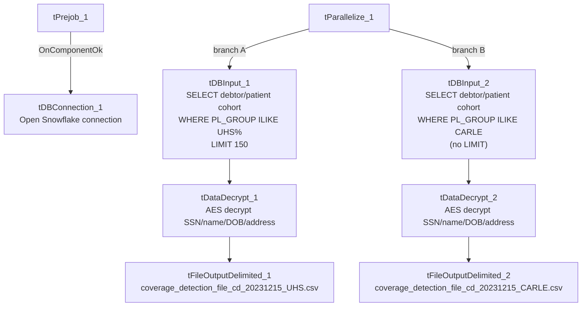

# Talend Job: MBoich_Experian_Extracts

## Overview

This job extracts a batch of debtor/patient insurance-discovery candidates for two specific clients (a "UHS" — Universal Health Services — cohort and a "CARLE" — Carle Healthcare — cohort) from the Snowflake warehouse, decrypts sensitive fields (SSN, name, DOB, address), and writes each cohort to its own CSV file for an external partner named "Experian" (Experian Health), likely for insurance-coverage/eligibility discovery on delinquent accounts. The two extracts run in parallel and are functionally identical except for the client filter and NPI (National Provider Identifier) lookup embedded in each query.

## Detail table

| Field | Value |
|---|---|
| Job name | MBoich_Experian_Extracts |
| Version | 0.1 |
| Project | EDW2SF |
| Author | jmach@harriscollect.com |
| Created | 2023-12-15T09:13:26.258-0800 |
| Last Modified | 2025-09-24T11:00:04.386-0700 |

## Step-by-step data flow

**Setup subjob:** `tPrejob_1` → `tDBConnection_1` opens the Snowflake connection (`OnComponentOk`).

**Main subjob** — `tParallelize_1` starts two independent, structurally identical branches:

1. **Branch A (UHS):** `tDBInput_1` runs a Snowflake query joining `DW.DIMDEBTOR`, `DW.DIMFISCAL_HH_A`, `DW.DIMFISCAL_HH_B`, and `DW.DIMCLIENT`, filtered to `DC.PL_GROUP ILIKE 'UNIVERSAL HEALTH SERVICES - 3P%' AND DD.ASGN_AMT >= 1000`, plus a large set of business-rule exclusions (assignment-date window, admit-date window, excluded status codes, DOB sanity bounds, non-test/non-blank name and address requirements) and a `LIMIT 150` cap, and a `NPI` lookup derived via `CASE`/`ILIKE` matching on `DC.PL_GROUP` against a fixed list of partner facility names → `tDataDecrypt_1` decrypts the row (AES, key/secret/password all `***REDACTED***`, using `context.cryptoPath+"dimdbtr.crypt"`, `DIE_ON_ERROR=true`) → `tFileOutputDelimited_1` writes the decrypted rows to a hardcoded path, `G:/Analytics_Team/Drop_zone/Mark_B/coverage_detection_file_cd_20231215_UHS.csv` (comma-delimited, header included, ISO-8859-15 encoding).
2. **Branch B (CARLE):** Same shape — `tDBInput_2` runs the same query filtered to `DC.PL_GROUP ILIKE 'CARLE HEALTHCARE - 3P'` (no `LIMIT` clause, and its `NPI` `CASE` statement omits the `COLUMBIA DOCTORS` branch present in Branch A's query — see Issues observed) → `tDataDecrypt_2` (same decryption settings) → `tFileOutputDelimited_2` writes to `G:/Analytics_Team/Drop_zone/Mark_B/coverage_detection_file_cd_20231215_CARLE.csv`.

## Settings tables

### Source queries: `tDBInput_1` (UHS) / `tDBInput_2` (CARLE)

| Setting | Value | What it means |
|---|---|---|
| Source tables | `DW.DIMDEBTOR`, `DW.DIMFISCAL_HH_A`, `DW.DIMFISCAL_HH_B`, `DW.DIMCLIENT` (joined) | Pulls debtor demographic/SSN, patient DOB/sex/admit-date, and client/facility grouping into one row per candidate. |
| Client filter | `DC.PL_GROUP ILIKE 'UNIVERSAL HEALTH SERVICES - 3P%'` (Branch A) / `'CARLE HEALTHCARE - 3P'` (Branch B) | Restricts the extract to one client portfolio per branch. |
| Balance/date filters | `ASGN_AMT >= 1000`; `DT_ASSIGNED` between 2 and 30 days ago; `ADMIT_DATE` within the last 325 days | Business rules described in the query's own inline comments as maximizing ROI and reducing the chance of a non-billable timely-filing-limit result. |
| Exclusion: already-loaded | `REF NOT IN (SELECT DISTINCT INP_REF FROM EDWPRODHH.DW.INSURANCE_DISCOVERY)` | Avoids re-sending a request already loaded as a result in `EDWPRODHH.DW.INSURANCE_DISCOVERY` (see `MaxRTE_Result_Load`/`MaxRTE_Request_Export` docs for a related but not identical process). |
| Excluded status codes | A fixed list of ~40 status codes (`CAD`, `CAN`, `CAS`, ... `SIF`, `PIF`) | Excludes closed/cancelled/paid-in-full and similar terminal account states from the extract. |
| Data-quality filters | DOB not in the future, DOB not more than 41,975 days ago (~115 years); name/address/city/state not blank or containing "TEST" | Removes obviously invalid or test records before sending to the partner. |
| NPI lookup | `CASE` on `DC.PL_GROUP ILIKE '%<facility>%'` mapping to one of 8 hardcoded NPI numbers (Broward, IU Health, Weill, Franciscan Health, Columbia Doctors, CHOP, Carle Healthcare, Universal Health Services); else `''` | Embeds the receiving facility's National Provider Identifier directly in the extract row rather than joining to a reference table. |
| LIMIT | `150` (Branch A only) | Branch A caps its result set; Branch B (CARLE) has no `LIMIT`, so its row count is unbounded within the other filters. |

### Decrypt: `tDataDecrypt_1` / `tDataDecrypt_2`

| Setting | Value | What it means |
|---|---|---|
| SECRET_TYPE / SECRET_KEY / PASSWORD_M1 | `***REDACTED***` (all three) | Decryption credentials are not visible in this metadata — preserved as redacted. |
| CRYPTO_METHOD / ALGO_VERSION | `AES` / `2` | Standard AES decryption, algorithm version 2. |
| CRYPTO_FILE_PATH | `context.cryptoPath+"dimdbtr.crypt"` | Points to a shared crypto key file named for the `DIMDEBTOR`/`DIMFISCAL` source tables. |
| DIE_ON_ERROR | `true` (both) | A decryption failure fails the job outright rather than silently producing garbled/undecrypted output. |

### Targets: `tFileOutputDelimited_1` / `_2`

| Setting | Value | What it means |
|---|---|---|
| FILENAME | `"G:/Analytics_Team/Drop_zone/Mark_B/coverage_detection_file_cd_20231215_UHS.csv"` / `..._CARLE.csv` | Hardcoded network-drive path with a fixed date (`20231215`) baked into the filename — see Issues observed. |
| FIELDSEPARATOR / INCLUDEHEADER | `,` / `true` | Standard CSV with header row. |
| ENCODING | `ISO-8859-15` | Not UTF-8; relevant if names/addresses contain non-Latin-1 characters. |
| APPEND | `false` | Each run overwrites the file rather than appending. |

## Dependencies & configuration

- **Triggers/depends on other jobs:** none — no `tRunJob` links found.
- **Context variables used:** `cryptoPath` (points to the shared decryption key file directory; not resolved to a specific context group in `_shared_context.json`).
- **No hardcoded developer-workstation path** (`C:/Talend-Studio-...`) found in this job, but both output file paths are hardcoded to a specific network drive/folder (`G:/Analytics_Team/Drop_zone/Mark_B/...`) with a literal date string baked into the filename — see Issues observed.

## Glossary

| Component type | Plain-English meaning |
|---|---|
| `tSnowflakeInput` | Runs a query against Snowflake and returns its result rows. |
| `tDataDecrypt` | Decrypts previously-encrypted column values (here, SSN/name/DOB/address) using a key file and algorithm configured on the component. |
| `tFileOutputDelimited` | Writes rows to a delimited (CSV-style) text file. |
| `tParallelize` | Runs its downstream branches at the same time rather than one after another. |
| `tSnowflakeConnection` | Opens the Snowflake database connection shared by other components in the job. |

## Issues observed

- **Both output filenames have a literal date (`20231215`, the job's creation date) hardcoded into them**, rather than being derived from the current run date (e.g. via `TalendDate.getDate(...)`, as seen in other jobs in this project). Since `APPEND=false`, every run of this job overwrites the same two files regardless of when it actually runs — there is no way to tell from the filename alone which run's data is in the file, and historical extracts are not retained unless someone renames the file out of the drop zone before the next run. This should be verified with the team; it may be intentional for a one-time/point-in-time extract given the job's name and specific-client focus, but if it is meant to run repeatedly, the hardcoded date is a functional risk, not just cosmetic.
- **The two branches' `NPI` lookup `CASE` statements are not identical.** Branch A (UHS)'s query includes a `COLUMBIA DOCTORS` mapping (with an inline comment noting "CD removed from process due to sub-$1.00 ROI. Keeping NPI entry in case it's needed"); Branch B (CARLE)'s query omits that `WHEN` clause entirely. Since each branch is already filtered to a single `PL_GROUP`, this by itself doesn't change either branch's output — but it means the two "identical" queries have quietly diverged, and a future copy-paste of one branch's `CASE` block into the other would not be a safe no-op change.
- **Branch A has a `LIMIT 150`; Branch B does not.** Unable to determine from metadata why the UHS extract is capped and the CARLE extract isn't — verify with the team whether this is an intentional per-partner batch-size agreement or an oversight.
- **No reject-flow or row-count logging** (`tFlowMeter`, `tWarn`, `tDie`) anywhere in this job — a partial or failed run produces no job-specific diagnostic beyond a generic Talend execution error, and there is no visibility into how many rows were actually written to each file. This is consistent with the general project-wide `05_operational_runbook.md` observation that most jobs outside the flagged 16 lack explicit `tDie`/`tWarn` logic.
