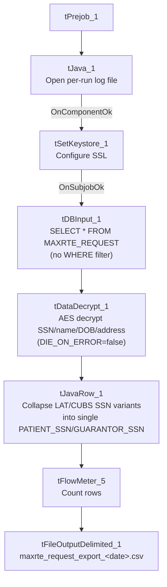

# Talend Job: MaxRTE_Request_Export

## Overview

Exports pending real-time-eligibility (RTE) verification requests from the Snowflake `MAXRTE_REQUEST` table — one row per patient/guarantor with demographics, SSN (both a "LAT" and a "CUBS" variant), address, balance, admit/discharge dates, and NPI — decrypts the sensitive fields, and writes the result to a dated CSV file for an external eligibility-verification vendor (the job name and column set, e.g. `REQUEST_ID`, strongly suggest "MaxRTE" is a real-time-eligibility/insurance-discovery service, consistent with the paired `MaxRTE_Result_Load` job that reads the vendor's response file back in).

## Detail table

| Field | Value |
|---|---|
| Job name | MaxRTE_Request_Export |
| Version | 0.1 |
| Project | EDW2SF |
| Author | jmach@harriscollect.com |
| Created | 2025-06-02T09:35:28.275-0700 |
| Last Modified | 2026-08-11T08:50:35.253-0700 |

## Step-by-step data flow

**Setup subjob:** `tPrejob_1` → `tJava_1` opens a per-run log file at `context.logDir + "_" + jobName + "_" + <timestamp> + ".log"` and redirects `System.out`/`System.err` to it → `tSetKeystore_1` configures SSL trust/keystore (`SSL_TRUSTSERVER_TRUSTSTORE` hardcoded to `"C:/clientTrustStore.trustStore"`, `SSL_KEYSTORE` from `context.keystorePath`, all passwords `***REDACTED***`) → on subjob-ok, `tDBInput_1` begins the main flow.

**Main subjob:**

1. `tDBInput_1` runs `SELECT PACKET_IDX, CLIENT_FACILITY, CLIENT, DEBTOR_ACCOUNT_NUMBER, PATIENT_FIRST_NAME, PATIENT_LAST_NAME, PATIENT_DOB, PATIENT_SEX, PATIENT_SSN_LAT, PATIENT_SSN_CUBS, PATIENT_ADDRESS, CITY, STATE, ZIP_CODE, GUARANTOR_FIRST_NAME, GUARANTOR_LAST_NAME, GUARANTOR_SSN_LAT, GUARANTOR_SSN_CUBS, AMOUNT_DUE, CURRENT_BALANCE, ADMIT_DATE, DISCHARGE_DATE, NPI, REQUEST_ID FROM MAXRTE_REQUEST;` against Snowflake — an unfiltered `SELECT *`-equivalent of the full request table (no `WHERE` clause; see Issues observed).
2. `tDataDecrypt_1` decrypts the row (AES, key/secret/password all `***REDACTED***`, `context.cryptoPath+"dimdbtr.crypt"` — the same crypto file path used in `MBoich_Experian_Extracts`, suggesting a shared decryption key across jobs; `DIE_ON_ERROR=false` here, unlike `MBoich_Experian_Extracts`'s `true` — see Issues observed).
3. `tJavaRow_1` runs custom Java code that maps most input columns straight through, but collapses `PATIENT_SSN_LAT`/`PATIENT_SSN_CUBS` into a single output `PATIENT_SSN` and `GUARANTOR_SSN_LAT`/`GUARANTOR_SSN_CUBS` into a single `GUARANTOR_SSN` (the exact selection logic between the "LAT" and "CUBS" variants is not visible in the truncated code snippet captured in this metadata).
4. `tFlowMeter_5` counts rows passing through (labeled "MyLabel", not renamed for this job).
5. `tFileOutputDelimited_1` writes the rows to `context.outputDir + "maxrte_request_export_" + TalendDate.getDate("CCYYMMDD") + ".csv"` (comma-delimited, header included, ISO-8859-15 encoding).

**No teardown subjob** (`tPostjob`) is present in this job's metadata, and no explicit database connection-close component is shown — see Issues observed.

## Settings tables

### Source: `tDBInput_1` (`tSnowflakeInput`)

| Setting | Value | What it means |
|---|---|---|
| Table | `MAXRTE_REQUEST` | Source table of pending eligibility-verification requests. |
| Query | Fixed `SELECT` of 23 named columns, **no `WHERE` clause** | Every row currently in `MAXRTE_REQUEST` is exported on every run — see Issues observed regarding whether requests already exported get re-sent. |

### Decrypt: `tDataDecrypt_1`

| Setting | Value | What it means |
|---|---|---|
| SECRET_TYPE / SECRET_KEY / PASSWORD_M1 | `***REDACTED***` (all three) | Decryption credentials not visible in this metadata — preserved as redacted. |
| CRYPTO_METHOD / ALGO_VERSION | `AES` / `2` | Same algorithm/version as `MBoich_Experian_Extracts`. |
| CRYPTO_FILE_PATH | `context.cryptoPath+"dimdbtr.crypt"` | Same crypto key file path as `MBoich_Experian_Extracts` — likely a shared project-wide decryption key. |
| DIE_ON_ERROR | `false` | A decryption failure does **not** fail the job — differs from `MBoich_Experian_Extracts`'s `true` on the same component type; see Issues observed. |

### SSL setup: `tSetKeystore_1`

| Setting | Value | What it means |
|---|---|---|
| SSL_TRUSTSERVER_TRUSTSTORE | `"C:/clientTrustStore.trustStore"` (hardcoded) | A hardcoded Windows-style path for the client trust store — flagged as a hardcoded-path finding in this job's own metadata. |
| SSL_KEYSTORE | `context.keystorePath` | The keystore path itself is parameterized via context, unlike the trust store path above. |
| SSL_TRUSTSERVER_PASSWORD / SSL_KEYSTORE_PASSWORD / NEED_CLIENT_AUTH | `***REDACTED***` | Preserved as redacted. |

### Target: `tFileOutputDelimited_1`

| Setting | Value | What it means |
|---|---|---|
| FILENAME | `context.outputDir + "maxrte_request_export_" + TalendDate.getDate("CCYYMMDD") + ".csv"` | Dated output filename (unlike `MBoich_Experian_Extracts`'s hardcoded literal date) — a new file is produced each day the job runs. |
| FIELDSEPARATOR / INCLUDEHEADER | `,` / `true` | Standard CSV with header. |
| ENCODING | `ISO-8859-15` | Same encoding choice as `MBoich_Experian_Extracts`. |

## Dependencies & configuration

- **Triggers/depends on other jobs:** none — no `tRunJob` links found. This job is the export half of a request/response pair with `MaxRTE_Result_Load` (which reads the vendor's response file back in), but the two are not directly linked via `tRunJob` in this metadata — they appear to be scheduled independently.
- **Context variables used:** `cryptoPath`, `keystorePath`, `logDir`, `outputDir`.
- **1 hardcoded path finding:** `tSetKeystore_1.SSL_TRUSTSERVER_TRUSTSTORE` = `"C:/clientTrustStore.trustStore"` — not the usual `C:/Talend-Studio-...` pattern seen in most other jobs, but still a hardcoded, environment-specific path.

## Glossary

| Component type | Plain-English meaning |
|---|---|
| `tSnowflakeInput` | Runs a query against Snowflake and returns its result rows. |
| `tDataDecrypt` | Decrypts previously-encrypted column values using a key file and algorithm configured on the component. |
| `tJavaRow` | Runs custom Java code once per input row — here used to consolidate two SSN source columns into one output column. |
| `tFlowMeter` | Counts rows passing through a point in the flow, for logging/monitoring. |
| `tFileOutputDelimited` | Writes rows to a delimited (CSV-style) text file. |
| `tSetKeystore` | Configures the SSL trust store/keystore used by other components (here, presumably the Snowflake connection) for secure connections. |

## Issues observed

- **The `MAXRTE_REQUEST` source query has no `WHERE` clause and no visible "already exported" flag/filter**, unlike `MBoich_Experian_Extracts`'s companion query which explicitly excludes rows already present in `EDWPRODHH.DW.INSURANCE_DISCOVERY`. If `MAXRTE_REQUEST` is not truncated or flagged between runs, every run of this job would re-export every row currently in the table, including requests already sent to the vendor in a prior run. Unable to determine from this job's own metadata whether `MAXRTE_REQUEST` is populated fresh before each run (e.g. by an upstream job not shown here) or accumulates over time — verify with the team before assuming duplicate requests aren't being sent.
- **`tDataDecrypt_1.DIE_ON_ERROR` is `false` here, but `true` in the otherwise very similar `MBoich_Experian_Extracts` job** (same crypto file, same AES/version-2 algorithm). A decryption failure in this job would let a row with un-decrypted (or partially decrypted) sensitive fields — SSN, name, DOB, address — pass through to the output file rather than stopping the job. Given this file is meant for an external vendor, sending a garbled or still-encrypted SSN could either break the vendor's matching or, depending on what "decryption failure" actually produces, leak inconsistent data. Worth confirming this `DIE_ON_ERROR=false` setting is intentional.
- **No `tPostjob`/connection-close component is present in this job's metadata.** Every other Snowflake-connected job reviewed in this project (`ADP_Payroll_Load`, `CO_Master_Load`, `i3_CallDetail_40_Load`, `Mail_Merge_Load`) explicitly closes its Snowflake connection in a `tPostjob` subjob via `tDBClose`/`tSnowflakeClose`. This job also has no explicit `tDBConnection`/`tSnowflakeConnection` component at all — `tDBInput_1` may be using an inline/embedded connection rather than a shared one. Unable to determine from metadata whether this represents a genuinely different (embedded) connection pattern or a connection-management gap; verify directly in Talend Studio.
- **`tJavaRow_1`'s logic for collapsing `PATIENT_SSN_LAT`/`PATIENT_SSN_CUBS` into one `PATIENT_SSN` (and similarly for `GUARANTOR_SSN`) is not fully visible in this metadata** — the captured code snippet is truncated after `input_row....`. Unable to determine from metadata which SSN source is preferred, or what happens if the two values disagree; verify directly in Talend Studio.
- **`tSetKeystore_1.SSL_TRUSTSERVER_TRUSTSTORE` is hardcoded to `"C:/clientTrustStore.trustStore"`** — a different hardcoded-path pattern than the `C:/Talend-Studio-...` workspace path seen in most other jobs, but the same underlying portability risk: moving this job off the machine where that exact file exists at that exact path would break its SSL configuration.
