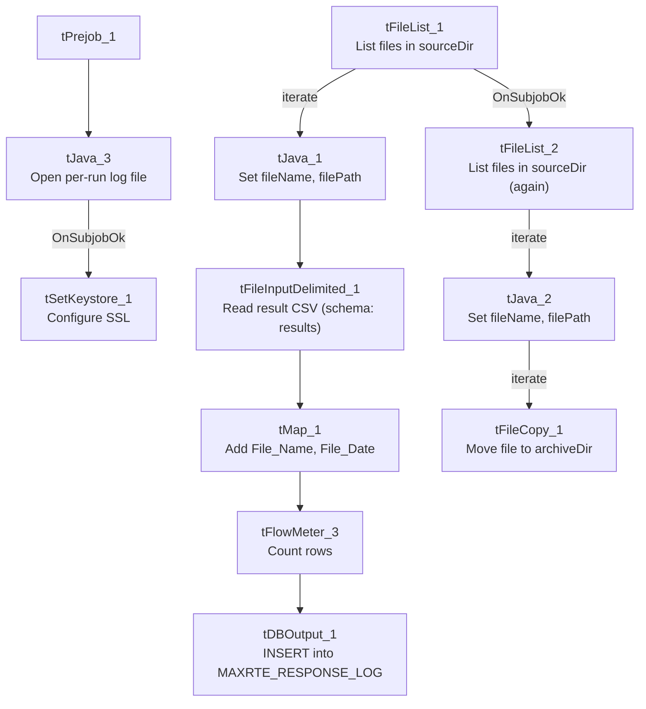

# Talend Job: MaxRTE_Result_Load

## Overview

Reads back eligibility-verification result files (one row per patient, with insurance payer/plan details, deductibles, coverage dates, and match/mismatch flags) that a vendor drops into a source directory — the response half of the request/response pair with `MaxRTE_Request_Export` — loads them into the Snowflake `MAXRTE_RESPONSE_LOG` table, then archives the source files. Unusually for a file-load job in this project, the archive step is driven by a second, separate file-listing loop rather than being wired directly after the load of each file.

## Detail table

| Field | Value |
|---|---|
| Job name | MaxRTE_Result_Load |
| Version | 0.1 |
| Project | EDW2SF |
| Author | jmach@harriscollect.com |
| Created | 2025-06-09T16:39:12.266-0700 |
| Last Modified | 2025-11-16T21:05:39.179-0800 |

## Step-by-step data flow

**Setup subjob:** `tPrejob_1` → `tJava_3` opens a per-run log file at `context.logDir + jobName + "_" + <timestamp> + ".log"` → on subjob-ok, `tSetKeystore_1` configures SSL trust/keystore (same hardcoded trust-store path and `context.keystorePath` pattern as `MaxRTE_Request_Export`).

**Main subjob — load loop:**

1. `tFileList_1` lists files in `context.sourceDir` (`EXCLUDEFILEMASK` of `*.txt` configured but `IFEXCLUDE=false`, so not actually applied).
2. For each file, `tJava_1` sets `context.fileName` and `context.filePath` from the current file.
3. `tFileInputDelimited_1` reads the file (comma-delimited, `CSVROWSEPARATOR="\r\n"`, header row present, `DIE_ON_ERROR=false`) against a repository schema labeled `"...- results"`, with ~44 named business columns (patient/subscriber demographics, insurance payer/ID/type for primary and secondary coverage, deductibles, co-insurance, plan begin/end dates, a `Data_Mismatch`/`Address_Mismatch` flag pair, and 5 generic `UserField1`-`Userfield5` columns).
4. `tMap_1` passes the row through, adding `File_Name` and `File_Date` columns (not populated from any visible source in this metadata's captured schema — see Issues observed).
5. `tFlowMeter_3` counts rows passing through (labeled "MyLabel").
6. `tDBOutput_1` inserts the rows into Snowflake table `MAXRTE_RESPONSE_LOG` (`INSERT`, no table-recreate action).

**Main subjob — archive loop (separate, parallel `tFileList`):**

7. `tFileList_2` independently lists files in `context.sourceDir` again (same directory as the load loop, but not chained after it via any visible connection — see Issues observed).
8. For each file, `tJava_2` sets `context.fileName`/`context.filePath`, then `tFileCopy_1` copies/moves it to `context.archiveDir` (`REMOVE_FILE=true`, `REPLACE_FILE=true`, `CREATE_DIRECTORY=true`).

**No teardown subjob** (`tPostjob`) is present in this job's metadata.

## Settings tables

### Source: `tFileInputDelimited_1`

| Setting | Value | What it means |
|---|---|---|
| FILENAME | `context.filePath` | Current file from `tFileList_1`'s iteration. |
| FIELDSEPARATOR / CSVROWSEPARATOR / HEADER | `,` / `\r\n` / 1 header row | Comma-delimited with explicit Windows-style row separator, distinct from the `\n`-only pattern used in several other jobs. |
| SCHEMA | Repository schema `"...- results"` | ~44 named eligibility-result columns — this is a well-labeled schema, unlike `Mail_Merge_Load`'s mostly-unnamed one. |
| TEMP_DIR | `"C:/Talend-Studio-20211109_1610-V8.0.1/workspace"` | Hardcoded developer-workstation path — same project-wide risk documented in `05_operational_runbook.md`. |
| DIE_ON_ERROR | `false` | Malformed rows don't fail the job, but (as elsewhere) no reject flow is wired to capture them — see Issues observed. |

### Target: `tDBOutput_1` (`tSnowflakeOutput`)

| Setting | Value | What it means |
|---|---|---|
| Table | `MAXRTE_RESPONSE_LOG` | Destination table for vendor eligibility results — named as a "log," suggesting an append-only, non-deduplicated history table rather than a truncate-and-reload staging table (consistent with there being no `TRUNCATE` step in this job). |
| Output action | `INSERT` | Appends rows; no truncate step precedes it. |

### Archive: `tFileCopy_1`

| Setting | Value | What it means |
|---|---|---|
| SOURCE_DERECTORY | `"C:/Talend-Studio-20211109_1610-V8.0.1/workspace"` (hardcoded) | Same developer-workstation path pattern as the input component. |
| DESTINATION | `context.archiveDir` | Standard archive-folder pattern. |
| REMOVE_FILE / REPLACE_FILE | `true` / `true` | Moves (not copies) the file, overwriting if a same-named file already exists at the destination. |

### SSL setup: `tSetKeystore_1`

| Setting | Value | What it means |
|---|---|---|
| SSL_TRUSTSERVER_TRUSTSTORE | `"C:/clientTrustStore.trustStore"` (hardcoded) | Same hardcoded trust-store path as `MaxRTE_Request_Export` — likely a shared/copied component between the two jobs. |

## Dependencies & configuration

- **Triggers/depends on other jobs:** none — no `tRunJob` links found. Functionally paired with `MaxRTE_Request_Export` (this job loads the vendor's response to that job's request export), but the two are not linked via `tRunJob` — they appear to be scheduled independently, presumably with enough time between them for the vendor to process and return results.
- **Context variables used:** `archiveDir`, `fileName`, `filePath`, `keystorePath`, `logDir`, `sourceDir`.
- **3 hardcoded path findings:** `tFileInputDelimited_1.TEMP_DIR`, `tFileCopy_1.SOURCE_DERECTORY` (both `C:/Talend-Studio-20211109_1610-V8.0.1/workspace`), and `tSetKeystore_1.SSL_TRUSTSERVER_TRUSTSTORE` (`C:/clientTrustStore.trustStore`) — the first two are the standard project-wide developer-workstation path risk (`05_operational_runbook.md`); the third is shared with `MaxRTE_Request_Export`.

## Glossary

| Component type | Plain-English meaning |
|---|---|
| `tFileList` | Lists files in a directory for the job to iterate over one at a time. |
| `tFileInputDelimited` | Reads a delimited (CSV-style) text file according to a schema. |
| `tMap` | Maps/transforms columns from one schema to another. |
| `tFlowMeter` | Counts rows passing through a point in the flow, for logging/monitoring. |
| `tSnowflakeOutput` | Writes rows to a Snowflake table. |
| `tFileCopy` | Moves or copies a processed file to another location (here, to the archive folder, removing the original). |
| `tSetKeystore` | Configures the SSL trust store/keystore used by other components for secure connections. |

## Issues observed

- **The load loop (`tFileList_1`) and the archive loop (`tFileList_2`) both independently list `context.sourceDir`, and the only visible connection between them is `tFileList_1 → tFileList_2` on `SUBJOB_OK`** — i.e., the archive loop starts only after the load loop's subjob finishes, but it re-lists the directory from scratch rather than being wired to iterate the same file list or to run once per already-loaded file. If a file arrives in `sourceDir` between the two loops running (a race condition, however narrow), it could be picked up and archived by `tFileList_2` without ever having been loaded by `tFileList_1` in this run — or, more likely given the timing, simply be loaded on this run and archived on this run as intended, but the "get and confirm success, then archive that same file" logic is not as tightly coupled per-file as in jobs like `ADP_Payroll_Load` (which archives immediately after a successful load of that specific file, in the same iteration). Unable to determine from metadata whether this two-pass approach is intentional (e.g., to ensure all loads finish before any archiving starts) — worth confirming the intended behavior with the team, especially around what happens if a file fails to load: `DIE_ON_ERROR=false` on the reader means a malformed file's rows may be silently skipped, yet the file could still be archived by the second, independent loop, obscuring evidence of the load problem.
- **No reject flow wired from `tFileInputDelimited_1`.** `DIE_ON_ERROR=false`, so malformed rows don't fail the job, but there is also no connection carrying rejected rows anywhere — they are silently dropped with no record of how many, or which ones, failed to parse.
- **`tMap_1` adds `File_Name` and `File_Date` output columns, but this metadata does not show them being populated from `context.fileName`/`context.filePath` or any other visible source** — the captured schema only shows the column names, not the mapping expressions themselves. Unable to determine from this metadata whether these audit columns are actually filled in correctly; verify directly in Talend Studio.
- **No error/row-count logging specific to this job's business outcome** (no `tWarn`/`tDie`/`tSendMail`) — a load failure here would only surface as a generic Talend execution error.
- **`MAXRTE_RESPONSE_LOG` has no `TRUNCATE` step before the `INSERT`**, consistent with it being an append-only log table — but this also means there is no visible duplicate-prevention mechanism if the same result file were ever processed twice (e.g., after a failed archive step left the file in `sourceDir` for a subsequent run to pick up again).
