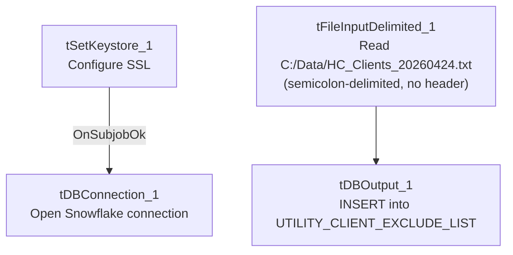

# Talend Job: Migrating_Clients_20260424

## Overview

A small, one-off-looking job that reads a hardcoded local file listing client codes and inserts them into the Snowflake `UTILITY_CLIENT_EXCLUDE_LIST` table. Based on the job name and the target table name, this appears to be a point-in-time load of clients that are migrating (away from, or between, systems) and should be excluded from some other utility/process while the migration is in progress.

## Detail table

| Field | Value |
|---|---|
| Job name | Migrating_Clients_20260424 |
| Version | 0.1 |
| Project | EDW2SF |
| Author | jmach@harriscollect.com |
| Created | 2026-04-23T22:01:22.076-0700 |
| Last Modified | 2026-04-23T22:12:16.488-0700 |

## Step-by-step data flow

Two subjobs run independently with no visible connection between them:

1. **Connection setup:** `tSetKeystore_1` configures SSL trust/keystore (`SSL_TRUSTSERVER_TRUSTSTORE` hardcoded to `"C:/clientTrustStore.trustStore"`, `SSL_KEYSTORE` from `context.keystorePath`, passwords `***REDACTED***`) → on subjob-ok, `tDBConnection_1` opens the Snowflake connection. This subjob does not visibly feed into the load subjob below (see Issues observed).
2. **Load:** `tFileInputDelimited_1` reads the hardcoded file `"C:/Data/HC_Clients_20260424.txt"` (semicolon-delimited, no header row, `DIE_ON_ERROR=false`) into a schema with a single business column, `CLIENT` (the schema lists `CLIENT` twice — likely a main/reject-schema artifact captured as one field, plus `errorCode`/`errorMessage` reject columns) → `tDBOutput_1` inserts the rows directly into Snowflake table `UTILITY_CLIENT_EXCLUDE_LIST` (`INSERT`, no table-recreate action, no intermediate transform component).

## Settings tables

### Source: `tFileInputDelimited_1`

| Setting | Value | What it means |
|---|---|---|
| FILENAME | `"C:/Data/HC_Clients_20260424.txt"` (hardcoded) | A fixed local file path with the job's creation date baked into both the filename and the job name itself — strongly suggests a one-time, manually-prepared input file rather than a repeatable feed. |
| FIELDSEPARATOR / HEADER | `;` / 0 (no header) | Semicolon-delimited, headerless — a simple list-style file, consistent with a short manually-curated list of client codes. |
| DIE_ON_ERROR | `false` | A malformed row doesn't fail the job, but (as with other jobs) no reject flow captures what was skipped. |

### Target: `tDBOutput_1` (`tSnowflakeOutput`)

| Setting | Value | What it means |
|---|---|---|
| Table | `UTILITY_CLIENT_EXCLUDE_LIST` | Destination table — its name suggests other jobs/processes check this list to skip processing for these clients. |
| Output action | `INSERT` | Appends rows; there is no `TRUNCATE` step, so re-running this job would insert duplicate rows for the same clients — see Issues observed. |
| Table action | `NONE` | Table is not recreated/altered by this job. |

## Dependencies & configuration

- **Triggers/depends on other jobs:** none — no `tRunJob` links found. This job does not appear in `06_dependency_matrix.md`'s orchestration table either as a caller or a target.
- **Context variables used:** `keystorePath` (used only by the disconnected `tSetKeystore_1`/`tDBConnection_1` pair — see Issues observed).
- **2 hardcoded path findings:** `tFileInputDelimited_1.FILENAME` (`"C:/Data/HC_Clients_20260424.txt"`, not flagged in the metadata's own `hardcoded_path_findings` list but hardcoded nonetheless — see Issues observed) and `tSetKeystore_1.SSL_TRUSTSERVER_TRUSTSTORE` (`"C:/clientTrustStore.trustStore"`), plus a `TEMP_DIR` hardcoded to `C:/Talend-Studio-20211109_1610-V8.0.1/workspace` per the job's own `hardcoded_path_findings`.

## Glossary

| Component type | Plain-English meaning |
|---|---|
| `tFileInputDelimited` | Reads a delimited (CSV-style) text file according to a schema. |
| `tSnowflakeOutput` | Writes rows to a Snowflake table. |
| `tSetKeystore` | Configures the SSL trust store/keystore used by other components for secure connections. |
| `tSnowflakeConnection` | Opens a Snowflake database connection. |

## Issues observed

- **The `tSetKeystore_1`/`tDBConnection_1` subjob and the `tFileInputDelimited_1`/`tDBOutput_1` load subjob have no visible connection between them in this job's `connections` list.** In every other Snowflake-writing job reviewed in this project, the connection-setup subjob feeds (directly or via a shared implicit connection) into the load subjob. Here, `tDBOutput_1` presumably uses whatever default/shared Snowflake connection context it has, but the explicit `tDBConnection_1` component appears to be disconnected/orphaned relative to the file-read-and-insert flow. Unable to determine from metadata whether this is a genuine wiring gap (the file load might actually run against a stale or default connection rather than the one just opened) or simply how Talend's implicit connection-reuse works when only one Snowflake connection exists in the job — verify directly in Talend Studio.
- **`FILENAME` is hardcoded to a literal path with a specific date baked in (`C:/Data/HC_Clients_20260424.txt`)**, and this hardcoded value was not flagged in the job's own `hardcoded_path_findings` list (which only captured the `TEMP_DIR` and `SSL_TRUSTSERVER_TRUSTSTORE` settings) — a reminder that the automated hardcoded-path scan may not catch every hardcoded value; the `FILENAME` itself is just as much a fixed, non-portable, one-time input as those two flagged settings. Given the job name and modification timestamp are only 11 minutes apart from creation, this job reads very much like a single-use, manually-run load rather than a job intended for a recurring schedule.
- **No `TRUNCATE` before the `INSERT`, and the target is named an "exclude list."** If this job is ever run more than once (e.g., accidentally re-triggered, or reused as a template for a future migration batch without updating the file path), it would insert duplicate `CLIENT` rows into `UTILITY_CLIENT_EXCLUDE_LIST` rather than replacing the prior batch — worth confirming with the team whether downstream consumers of this exclude list are tolerant of duplicate entries.
- **No `tPrejob`/`tPostjob`, no per-run log file, and no row-count logging** (`tFlowMeter`, `tWarn`) — consistent with a quick, manually-supervised one-time load rather than an unattended scheduled job, but it also means there's no audit trail beyond Snowflake's own row count of what was loaded and when.
