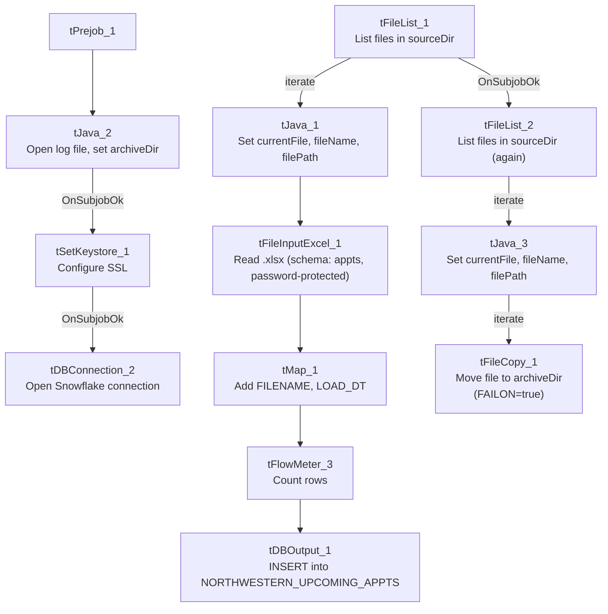

# Talend Job: Northwestern_Future_Appts

## Overview

Loads an Excel-based partner extract from Northwestern (a hospital/health system, based on the column set and job name) into the Snowflake `NORTHWESTERN_UPCOMING_APPTS` table. Each row represents a discharged patient/account with a flagged future appointment (department, appointment date-proximity grouping, mobile phone), likely used to identify patients who have an upcoming visit while still carrying an outstanding balance from a prior discharge — useful for coordinating collections outreach around a patient's next visit. After loading, source files are archived to a separate archive folder via a second file-listing pass.

## Detail table

| Field | Value |
|---|---|
| Job name | Northwestern_Future_Appts |
| Version | 0.1 |
| Project | EDW2SF |
| Author | jmach@harriscollect.com |
| Created | 2026-03-31T14:38:50.978-0700 |
| Last Modified | 2026-04-23T09:54:13.593-0700 |

## Step-by-step data flow

**Setup subjob:** `tPrejob_1` → `tJava_2` opens a per-run log file (named `jobName + "_" + <timestamp> + ".log"`, written to the current working directory rather than `context.logDir` — see Issues observed) and also sets `context.archiveDir` (assignment expression truncated in this metadata) → on subjob-ok, `tSetKeystore_1` configures SSL trust/keystore (hardcoded trust-store path, `context.keystorePath` for the keystore itself) → on subjob-ok, `tDBConnection_2` opens the Snowflake connection.

**Main subjob — load loop:**

1. `tFileList_1` lists files in `context.sourceDir`.
2. For each file, `tJava_1` sets `context.currentFile`, `context.fileName`, and `context.filePath` from the current file.
3. `tFileInputExcel_1` reads the file as an Excel workbook (`VERSION_2007=true`, i.e. `.xlsx`; password `***REDACTED***`; `ALL_SHEETS=false`, so only one sheet is read; header row present; columns 1–20; `DIE_ON_ERROR=false`) against a repository schema labeled `"...- appts"` with ~19 named columns (`REPORT_DATE`, `LOCATION`, `BILLING_SYSTEM`, `PAT_ID`, `GUARANTOR_ID`, `CONCAT_PATGUAR`, `PAT_MRN`, `ACCOUNT_ID`, `ACCOUNT_NAME`, `DISCH_DEPT_ID`, `DISCHARGE_DEPARTMENT`, `MOBILE_PHONE`, `DISCH_DATE`, `AGENCY_ASSIGN_DATE_MAX`, `FUTURE_APPT`, `FUTURE_APPT_CSN`, `DAYS_BEFORE_APPT`, `FUTURE_APPT_GRP`, `FUTURE_APPT_DEPT_ID`, `FUTURE_APPT_DEPT_NAME`).
4. `tMap_1` passes the row through, adding `FILENAME` and `LOAD_DT` audit columns (`DIE_ON_ERROR=true`).
5. `tFlowMeter_3` counts rows passing through (labeled "MyLabel").
6. `tDBOutput_1` inserts the rows into Snowflake table `NORTHWESTERN_UPCOMING_APPTS` (`INSERT`, no table-recreate action).

**Main subjob — archive loop (separate `tFileList`, chained after the load loop):**

7. Once `tFileList_1`'s loop finishes (`OnSubjobOk`), `tFileList_2` independently lists files in `context.sourceDir` again.
8. For each file, `tJava_3` sets `context.currentFile`/`fileName`/`filePath`, then `tFileCopy_1` copies/moves it to `context.archiveDir` (`REMOVE_FILE=true`, `REPLACE_FILE=true`, `CREATE_DIRECTORY=true`, and — unlike most other file-archive components reviewed in this project — `FAILON=true`, meaning a copy failure here does fail the job).

## Settings tables

### Source: `tFileInputExcel_1`

| Setting | Value | What it means |
|---|---|---|
| FILENAME | `context.currentFile` | Current file from `tFileList_1`'s iteration. |
| PASSWORD | `***REDACTED***` | The Excel workbook is password-protected; the password value is preserved as redacted. |
| ALL_SHEETS | `false` | Only the first/default sheet is read — if the partner ever sends a multi-sheet workbook with data on a later sheet, it would be silently ignored. |
| SCHEMA | Repository schema `"...- appts"`, columns 1–20 | 19 named columns describing patient/account/discharge/future-appointment data. |
| DIE_ON_ERROR | `false` | Malformed rows don't fail the job, but (as elsewhere) no reject flow is wired to capture them. |

### Target: `tDBOutput_1` (`tSnowflakeOutput`)

| Setting | Value | What it means |
|---|---|---|
| Table | `NORTHWESTERN_UPCOMING_APPTS` | Destination table for the loaded rows. |
| Output action | `INSERT` | Appends rows; there is no `TRUNCATE` step before it — see Issues observed regarding duplicate-load risk. |

### Archive: `tFileCopy_1`

| Setting | Value | What it means |
|---|---|---|
| SOURCE_DERECTORY | `"C:/Talend-Studio-20211109_1610-V8.0.1/workspace"` (hardcoded) | Standard project-wide developer-workstation path risk. |
| DESTINATION | `context.archiveDir` | Set earlier in `tJava_2` (exact expression truncated in this metadata). |
| FAILON | `true` | Unlike most archive steps reviewed elsewhere in this project, a copy failure here **does** fail the job — see Issues observed. |

## Dependencies & configuration

- **Triggers/depends on other jobs:** none — no `tRunJob` links found; this job doesn't appear in `06_dependency_matrix.md`'s orchestration table.
- **Context variables used:** `archiveDir` (set internally in `tJava_2`), `currentFile`, `fileName`, `filePath`, `keystorePath`, `sourceDir`.
- **2 hardcoded path findings:** `tSetKeystore_1.SSL_TRUSTSERVER_TRUSTSTORE` (`"C:/clientTrustStore.trustStore"`) and `tFileCopy_1.SOURCE_DERECTORY` (`"C:/Talend-Studio-20211109_1610-V8.0.1/workspace"`).

## Glossary

| Component type | Plain-English meaning |
|---|---|
| `tFileList` | Lists files in a directory for the job to iterate over one at a time. |
| `tFileInputExcel` | Reads a Microsoft Excel workbook (here, a password-protected `.xlsx` file) according to a schema. |
| `tMap` | Maps/transforms columns from one schema to another. |
| `tFlowMeter` | Counts rows passing through a point in the flow, for logging/monitoring. |
| `tSnowflakeOutput` | Writes rows to a Snowflake table. |
| `tFileCopy` | Moves or copies a processed file to another location. |
| `tSetKeystore` | Configures the SSL trust store/keystore used by other components for secure connections. |

## Issues observed

- **The per-run log file in `tJava_2` is written using a bare filename (`jobName + "_" + <timestamp> + ".log"`), with no `context.logDir` prefix**, unlike the equivalent log-open code seen in most other jobs in this project (e.g. `Notes_Load`, `MaxRTE_Request_Export`, which all prefix with `context.logDir`). This means the log file lands wherever the job's working directory happens to be when it runs, rather than in a predictable, centralized log location — making it harder to find this job's logs alongside every other job's.
- **`tFileCopy_1.FAILON=true`** — a failure to archive the source file (e.g., a permissions issue, a locked file, or a full disk on the archive destination) will fail this job, even though the load itself may have already succeeded. This differs from the more common pattern elsewhere in this project (`FAILON=false`) where an archive-step failure is tolerated so the load's success isn't retroactively treated as a failure. Whether this stricter behavior is intentional (e.g., ensuring processed files are never left un-archived, which would risk reprocessing) is unable to determine from metadata — worth confirming with the team, since it means an archive-only problem could block visibility into an otherwise-successful data load.
- **No `TRUNCATE` step before the `INSERT` into `NORTHWESTERN_UPCOMING_APPTS`.** If a file is loaded twice (e.g., due to a failed archive step under `FAILON=true` leaving the file in `sourceDir` for the next run to pick up again — see above), its rows would be inserted twice with no deduplication visible in this job's own metadata.
- **`ALL_SHEETS=false`** means only the default sheet of the Excel file is read. If Northwestern's extract format ever changes to include multiple sheets (e.g., a summary tab plus a detail tab), this job would silently ignore any data beyond the first sheet with no error or warning.
- **The load loop and archive loop are two independent `tFileList` passes over the same `context.sourceDir`, chained by `OnSubjobOk`** — the same two-pass pattern seen in `MaxRTE_Result_Load`. See that job's Issues section for the general risk (a file arriving between the two passes, or a load failure not preventing archival of that same file) which applies equally here.
