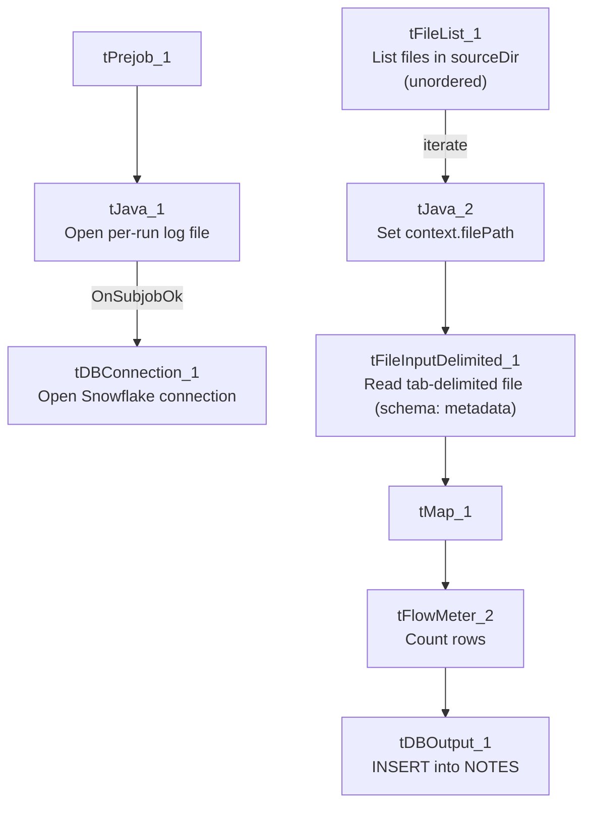

# Talend Job: Notes_Load

## Overview

Loads free-text collector/agent notes ("memos") keyed by debtor and timestamp from a tab-delimited extract file into the Snowflake `NOTES` table. This is a simple, narrow file-load job with only three business columns — debtor identifier, memo timestamp, and memo text — and no merge/staging step visible in this metadata, suggesting `NOTES` is loaded as a straight append-only history table.

## Detail table

| Field | Value |
|---|---|
| Job name | Notes_Load |
| Version | 0.1 |
| Project | EDW2SF |
| Author | jmach@harriscollect.com |
| Created | 2025-08-14T14:45:51.378-0700 |
| Last Modified | 2025-09-24T11:00:22.361-0700 |

## Step-by-step data flow

**Setup subjob:** `tPrejob_1` → `tJava_1` opens a per-run log file at `context.logDir + jobName + "_" + <timestamp> + ".log"` and redirects `System.out`/`System.err` to it → on subjob-ok, `tDBConnection_1` opens the Snowflake connection. This setup subjob has no visible connection into the main load subjob below — see Issues observed (same pattern flagged in `Migrating_Clients_20260424`).

**Main subjob:**

1. `tFileList_1` lists files in `context.sourceDir` (`ORDER_BY_NOTHING=true`, i.e. files are processed in whatever order the filesystem returns them, unlike most other file-load jobs in this project which sort by modified date).
2. For each file, `tJava_2` sets `context.filePath` from the current file.
3. `tFileInputDelimited_1` reads the file (tab-delimited, header row present, `DIE_ON_ERROR=false`) against a repository schema labeled `"...- metadata"` with 3 business columns — `DEBTOR_IDX`, `MEMO_TIMESTAMP`, `MEMO_TEXT` (listed twice in the extracted schema, likely a main/reject-schema capture artifact, plus `errorCode`/`errorMessage` reject columns).
4. `tMap_1` passes the row through unchanged to the same 3-column schema (`DIE_ON_ERROR=true`).
5. `tFlowMeter_2` counts rows passing through (labeled "MyLabel").
6. `tDBOutput_1` inserts the rows into Snowflake table `NOTES` (`INSERT`, no table-recreate action).

No archive or file-cleanup step, no merge/stored-procedure call, and no `tPostjob` teardown are present in this job's metadata.

## Settings tables

### Source: `tFileInputDelimited_1`

| Setting | Value | What it means |
|---|---|---|
| FILENAME | `context.filePath` | Current file from `tFileList_1`'s iteration. |
| FIELDSEPARATOR / HEADER | `\t` (tab) / 1 header row | Tab-delimited with header — distinct from the comma/pipe/semicolon patterns seen in other jobs. |
| SCHEMA | Repository schema `"...- metadata"` | 3 named columns: `DEBTOR_IDX`, `MEMO_TIMESTAMP`, `MEMO_TEXT`. |
| TEMP_DIR | `"C:/Talend-Studio-20211109_1610-V8.0.1/workspace"` | Hardcoded developer-workstation path — same project-wide risk documented in `05_operational_runbook.md`. |
| DIE_ON_ERROR | `false` | Malformed rows don't fail the job, but no reject flow captures them — see Issues observed. |

### Target: `tDBOutput_1` (`tSnowflakeOutput`)

| Setting | Value | What it means |
|---|---|---|
| Table | `NOTES` | Destination table for collector/agent memo text. |
| Output action | `INSERT` | Appends rows; no `TRUNCATE` step precedes it, consistent with `NOTES` being an append-only history table rather than a truncate-and-reload staging table. |
| Table action | `NONE` | Table is not recreated/altered by this job. |

## Dependencies & configuration

- **Triggers/depends on other jobs:** none — no `tRunJob` links found; this job doesn't appear in `06_dependency_matrix.md`'s orchestration table.
- **Context variables used:** `filePath` (set internally per iteration), `logDir`, `sourceDir`.
- **1 hardcoded path finding:** `tFileInputDelimited_1.TEMP_DIR` = `"C:/Talend-Studio-20211109_1610-V8.0.1/workspace"`.

## Glossary

| Component type | Plain-English meaning |
|---|---|
| `tFileList` | Lists files in a directory for the job to iterate over one at a time. |
| `tFileInputDelimited` | Reads a delimited (CSV-style) text file according to a schema. |
| `tMap` | Maps/transforms columns from one schema to another. |
| `tFlowMeter` | Counts rows passing through a point in the flow, for logging/monitoring. |
| `tSnowflakeOutput` / `tSnowflakeConnection` | Write rows to a Snowflake table / open the Snowflake database connection used by other components in the job. |

## Issues observed

- **The `tPrejob_1`/`tJava_1`/`tDBConnection_1` setup chain has no visible connection into the `tFileList_1` load subjob**, the same disconnected-setup pattern flagged in `Migrating_Clients_20260424`. `tDBOutput_1` presumably relies on an implicit/default Snowflake connection rather than the one explicitly opened in the setup subjob. Unable to determine from metadata whether this reflects an actual configuration gap or simply how a single-connection job's implicit wiring works in Talend Studio; verify directly if this job is ever modified to use more than one connection.
- **No file archival or deletion step after a successful load** — unlike most other file-load jobs reviewed in this project (`ADP_Payroll_Load`, `Mail_Merge_Load`, `MaxRTE_Result_Load`, `Northwestern_Future_Appts`), this job does not move, rename, or delete the source file once its rows are loaded. If `tFileList_1` runs again before the source file is manually cleared out of `context.sourceDir`, the same memo rows would be reloaded and duplicated in `NOTES` (there is no `TRUNCATE` and no visible "already loaded" filter). Verify with the team whether file cleanup happens outside this job (e.g., by a separate process) or whether this is a gap.
- **`ORDER_BY_NOTHING=true` on `tFileList_1`** means files are processed in whatever order the underlying filesystem call returns them — not sorted by name, size, or modified date, unlike most other `tFileList` components reviewed in this project (which typically sort by modified date, ascending). If multiple note files can arrive in the same run and their processing order matters (e.g., for a given debtor's notes to be inserted in chronological file-arrival order), this is not guaranteed here.
- **No reject flow wired from `tFileInputDelimited_1`, no row-count-based alerting** (`tWarn`/`tDie`/`tSendMail`) — consistent with the general pattern noted project-wide in `05_operational_runbook.md`, but worth flagging since `MEMO_TEXT` is free-form collector notes that could plausibly contain characters (tabs, embedded newlines) that break simple tab-delimited parsing; a silently-dropped or truncated memo would not be visible from this job's own logging.
