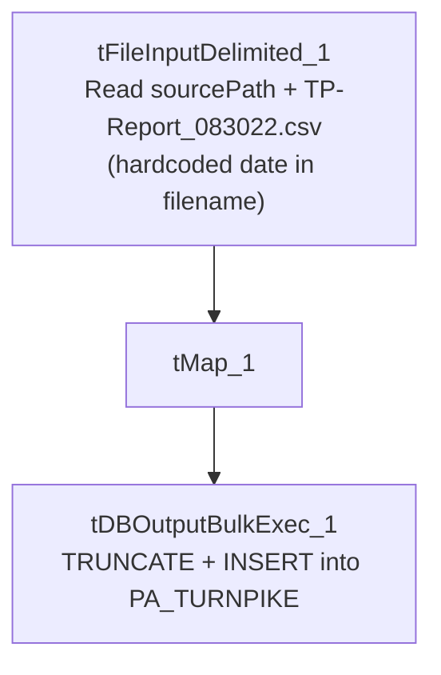

# Talend Job: PA_Turnpike_Load

## Overview

Loads a fixed, single-file CSV extract from the Pennsylvania Turnpike (a client, based on the job name and column set — debtor number, client, CDN, status, assigned/last-payment dates, two flag-like fields, and total balance) into the Snowflake `PA_TURNPIKE` table, replacing the table's contents entirely on each run via a bulk-load truncate-and-insert. This is a narrow, single-purpose reporting/reconciliation table for one client's account status snapshot rather than a general debtor load.

## Detail table

| Field | Value |
|---|---|
| Job name | PA_Turnpike_Load |
| Version | 0.1 |
| Project | EDW2SF |
| Author | jmach@harriscollect.com |
| Created | 2022-08-30T13:36:19.891-0700 |
| Last Modified | 2025-08-28T08:57:24.118-0700 |

## Step-by-step data flow

This job has no `tPrejob`/`tPostjob` structure or explicit connection-open/close components in its metadata — it is a single straight-line flow:

1. `tFileInputDelimited_1` reads a fixed filename, `context.sourcePath + "TP-Report_083022.csv"` — note the literal date string `083022` (August 30, 2022, matching the job's creation date) baked into the filename itself, appended to a parameterized directory path (comma-delimited, header row present, `DIE_ON_ERROR=false`) into a schema of 9 named columns (`DNUM`, `CLIENT`, `CDN`, `STATUS`, `ASSIGN`, `LAST_PAY`, `F853`, `F854`, `TOTAL_BAL`).
2. `tMap_1` passes the row through unchanged to the same 9-column schema (`DIE_ON_ERROR=true`).
3. `tDBOutputBulkExec_1` bulk-loads the rows into Snowflake table `PA_TURNPIKE` with `outputAction=INSERT` and `tableAction=TRUNCATE` — the table is cleared and reloaded fresh on every run.

## Settings tables

### Source: `tFileInputDelimited_1`

| Setting | Value | What it means |
|---|---|---|
| FILENAME | `context.sourcePath+"TP-Report_083022.csv"` | The directory is parameterized via context, but the filename itself is a fixed literal string with a specific date embedded — see Issues observed. |
| FIELDSEPARATOR / HEADER | `,` / 1 header row | Standard comma-delimited CSV with header. |
| TEMP_DIR | `"C:/Talend-Studio-20211109_1610-V8.0.1/workspace"` | Hardcoded developer-workstation path — same project-wide risk documented in `05_operational_runbook.md`. |
| DIE_ON_ERROR | `false` | Malformed rows don't fail the job, but no reject flow is wired to capture them. |

### Target: `tDBOutputBulkExec_1` (`tSnowflakeOutputBulkExec`)

| Setting | Value | What it means |
|---|---|---|
| Table | `PA_TURNPIKE` | Destination table for this client's account snapshot. |
| Output action | `INSERT` | Bulk-inserts rows. |
| Table action | `TRUNCATE` | The table is cleared before the new rows are loaded — a full-refresh, not an incremental, pattern; consistent with a small, periodically-refreshed reporting snapshot rather than an append-only history table. |

## Dependencies & configuration

- **Triggers/depends on other jobs:** none — no `tRunJob` links found; this job doesn't appear in `06_dependency_matrix.md`'s orchestration table.
- **Context variables used:** `sourcePath` (the directory portion of the hardcoded input filename).
- **1 hardcoded path finding:** `tFileInputDelimited_1.TEMP_DIR` = `"C:/Talend-Studio-20211109_1610-V8.0.1/workspace"`. The `FILENAME` itself is also effectively hardcoded (fixed literal filename with a baked-in date) even though it was not separately flagged in this job's own `hardcoded_path_findings` list — see Issues observed.

## Glossary

| Component type | Plain-English meaning |
|---|---|
| `tFileInputDelimited` | Reads a delimited (CSV-style) text file according to a schema. |
| `tMap` | Maps/transforms columns from one schema to another. |
| `tSnowflakeOutputBulkExec` | Bulk-loads rows into a Snowflake table (typically faster than a row-by-row `tSnowflakeOutput` insert for large volumes), with a configurable table-recreate action. |

## Issues observed

- **The input filename is a fixed literal string, `TP-Report_083022.csv`, with the date of the job's creation baked directly into it — not derived from the current run date.** Combined with `tableAction=TRUNCATE`, this means every time this job actually runs, it looks for the exact same file (`TP-Report_083022.csv`) inside `context.sourcePath`, regardless of when it runs — it will never pick up a newer report unless someone renames each new file to that exact literal name, or edits this job's `FILENAME` parameter every time a new extract needs to be loaded. Given the very long gap between creation (2022-08-30) and last modification (2025-08-28) — almost exactly 3 years apart — it's plausible this job is manually re-pointed at a renamed file before each run, or that it was run once and left unscheduled since; unable to determine from metadata which. This should be verified directly with the team, since as written, a scheduled/automated re-run of this job would either silently fail to find the file (if it was moved/archived) or repeatedly reload the exact same stale August 2022 data (if the file was left in place) — either way, the table's contents would not reflect a "PA_TURNPIKE" table that anyone expects to be current.
- **No archive or file-cleanup step after the load** — unlike most other file-load jobs in this project, the source file is neither moved nor deleted after being loaded, consistent with a possibly manually-managed, occasionally-run job rather than a fully automated recurring one.
- **No row-count logging, `tWarn`/`tDie`, or reject-flow handling** — a load producing zero rows (e.g., if the hardcoded filename can no longer be found, or the file is empty) would still let `tDBOutputBulkExec_1`'s `TRUNCATE` clear the table, potentially leaving `PA_TURNPIKE` empty with no error raised. This is a materially higher-impact version of the general "no explicit `tDie`/`tWarn`" pattern documented project-wide in `05_operational_runbook.md`, because the destructive `TRUNCATE` happens unconditionally regardless of whether the subsequent load actually produced any rows.
