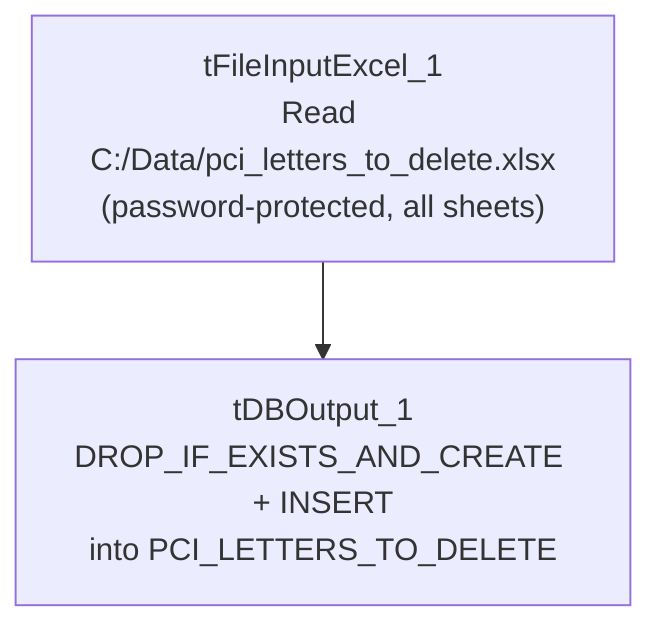

# Talend Job: PCI_LETTERS_TO_DELETE

## Overview

A small utility job that reads a manually-prepared Excel workbook listing specific letters (identified by customer key, raw letter code, file date, and file name) that should be deleted — presumably letters containing PCI (Payment Card Industry / cardholder data) information that were generated in error or need to be purged for compliance — and loads that list into a Snowflake `PCI_LETTERS_TO_DELETE` table, fully replacing the table's contents on each run. This looks like a compliance/remediation utility rather than a recurring business-data load.

## Detail table

| Field | Value |
|---|---|
| Job name | PCI_LETTERS_TO_DELETE |
| Version | 0.1 |
| Project | EDW2SF |
| Author | jmach@harriscollect.com |
| Created | 2023-01-31T15:21:24.551-0800 |
| Last Modified | 2025-09-24T11:00:04.386-0700 |

## Step-by-step data flow

This job has no `tPrejob`/`tPostjob` structure and no explicit connection-open/close components — a single straight-line flow:

1. `tFileInputExcel_1` reads the fixed local file `"C:/Data/pci_letters_to_delete.xlsx"` (`VERSION_2007=true`, i.e. `.xlsx`; password `***REDACTED***`; `ALL_SHEETS=true`, so every sheet in the workbook is read; header row present; columns 1–4; `STOPREAD_ON_EMPTYROW=true`; `DIE_ON_ERROR=false`) into a schema of 4 named columns — `CUSTOMER_KEY`, `RAW_LETTER_CODE`, `FILE_DATE`, `FILE_NAME` (each listed twice in the extracted schema, likely a main/reject-schema capture artifact, plus `errorCode`/`errorMessage` reject columns).
2. `tDBOutput_1` loads the rows directly into Snowflake table `PCI_LETTERS_TO_DELETE` with `outputAction=INSERT` and `tableAction=DROP_IF_EXISTS_AND_CREATE` — the table is dropped and recreated fresh on every run, with no transform component in between the file read and the database write.

## Settings tables

### Source: `tFileInputExcel_1`

| Setting | Value | What it means |
|---|---|---|
| FILENAME | `"C:/Data/pci_letters_to_delete.xlsx"` (hardcoded) | A fixed local file path — not parameterized via context at all, unlike most other file-based jobs in this project. |
| PASSWORD | `***REDACTED***` | The workbook is password-protected; preserved as redacted. |
| ALL_SHEETS | `true` | Every sheet in the workbook is read, not just the first — differs from `Northwestern_Future_Appts`'s `ALL_SHEETS=false`. |
| STOPREAD_ON_EMPTYROW | `true` | Reading stops at the first blank row encountered — if the manually-prepared workbook has any accidental blank rows partway through its data, everything after that blank row is silently skipped. |
| DIE_ON_ERROR | `false` | Malformed rows don't fail the job; no reject flow is wired. |

### Target: `tDBOutput_1` (`tSnowflakeOutput`)

| Setting | Value | What it means |
|---|---|---|
| Table | `PCI_LETTERS_TO_DELETE` | Destination table listing letters flagged for deletion. |
| Output action | `INSERT` | Loads the rows read from the Excel file. |
| Table action | `DROP_IF_EXISTS_AND_CREATE` | The table is dropped and recreated (not just truncated) on every run — the most destructive of the table-recreate options seen across the jobs reviewed in this batch; any permissions, grants, or downstream views/dependencies tied to the specific table object would need to tolerate the table being fully recreated each run. |

## Dependencies & configuration

- **Triggers/depends on other jobs:** none — no `tRunJob` links found; this job doesn't appear in `06_dependency_matrix.md`'s orchestration table. Given the table name (`PCI_LETTERS_TO_DELETE`), this table is presumably consumed by a separate, unseen process (a script, a manual query, or another job not captured in this metadata) that actually performs the deletion — that consuming step is not part of this job.
- **Context variables used:** none — `context_vars_referenced` is empty; every setting in this job is a hardcoded literal.
- **No hardcoded developer-workstation path** (`C:/Talend-Studio-...`) found in this job's own `hardcoded_path_findings`, but the entire source file path (`C:/Data/pci_letters_to_delete.xlsx`) is itself a hardcoded, non-portable, machine-specific path not flagged by the automated scan — see Issues observed.

## Glossary

| Component type | Plain-English meaning |
|---|---|
| `tFileInputExcel` | Reads a Microsoft Excel workbook (here, a password-protected `.xlsx` file, all sheets) according to a schema. |
| `tSnowflakeOutput` | Writes rows to a Snowflake table, with a configurable table-recreate action (here, drop-and-recreate). |

## Issues observed

- **This job uses zero context variables — every path, filename, and setting is a hardcoded literal.** This is a stark contrast to nearly every other job reviewed in this project, which parameterizes at least the source directory via a shared context group like `StandardFolders_0.1`. Combined with the fixed local path `C:/Data/pci_letters_to_delete.xlsx`, this strongly suggests the job is designed to be run manually, once per remediation cycle, by someone who places a freshly-prepared workbook at that exact path before triggering the job — not a job meant to run unattended on a recurring schedule. Worth confirming this operating assumption with the team so nobody schedules it expecting it to pick up a different file automatically.
- **`tableAction=DROP_IF_EXISTS_AND_CREATE` is a more destructive table-recreate action than the `TRUNCATE` pattern used elsewhere in this project** (e.g. `PA_Turnpike_Load`). If any other object (a view, a grant, a downstream job) references `PCI_LETTERS_TO_DELETE` by its exact object identity rather than just its name, a drop-and-recreate cycle could in principle disrupt that dependency in ways a `TRUNCATE` would not — unable to determine from this job's own metadata whether that risk applies here; verify with the team, particularly since the consuming "delete" process itself is not visible in this metadata.
- **`STOPREAD_ON_EMPTYROW=true`** on a manually-curated Excel file is a meaningful silent-data-loss risk: if whoever prepares this workbook leaves an accidental blank row partway down the list (easy to do by hand), every letter listed below that blank row is silently excluded from the load, and therefore never gets deleted downstream — with no error, warning, or row-count check to catch it. Given the apparent compliance/PCI-remediation purpose of this job, a silently-truncated delete list is a meaningfully higher-stakes risk than in a typical reporting extract.
- **No row-count logging, `tWarn`/`tDie`, or reject-flow handling** of any kind — a run that loads zero or partial rows (e.g., due to the `STOPREAD_ON_EMPTYROW` behavior above, or if the file simply isn't present at the hardcoded path) would still complete "successfully" from Talend's perspective, potentially leaving `PCI_LETTERS_TO_DELETE` empty or incomplete with no alert.
