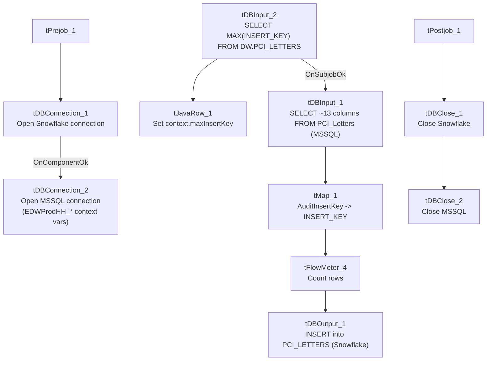

# Talend Job: PCI_Letter_Load

## Overview

Loads letter-generation/mail-disposition audit records (one row per debtor letter attempt, with the raw letter code, any rejection reason/value, and the resulting mail disposition — e.g. suppressed, printed, returned) from the MSSQL `EDWProdHH` database's `PCI_Letters` table into the Snowflake `PCI_LETTERS` table. Uses an incremental-load pattern keyed on `INSERT_KEY`, following the same "check max key in Snowflake, then pull from source" shape used in `i3_CallDetail_40_Load`. As with that job, the "PCI" naming and the letter-suppression/disposition columns suggest this feeds compliance tracking of which letters were withheld from mailing due to PCI (cardholder-data) content.

## Detail table

| Field | Value |
|---|---|
| Job name | PCI_Letter_Load |
| Version | 0.1 |
| Project | EDW2SF |
| Author | jmach@harriscollect.com |
| Created | 2022-01-10T15:54:03.317-0800 |
| Last Modified | 2022-02-28T10:05:17.477-0800 |

## Step-by-step data flow

**Setup subjob:** `tPrejob_1` → `tDBConnection_1` opens the Snowflake connection → on component-ok, `tDBConnection_2` opens the MSSQL connection to `context.EDWProdHH_Server`/`Port`/`Schema`/`Database`/`Login` (password redacted; JTDS driver) — the same `EDWProdHH_*` context-variable naming convention flagged as potentially mismatched in `i3_CallDetail_40_Load`'s doc.

**Main subjob:**

1. `tDBInput_2` runs `SELECT COALESCE(CAST(MAX(INSERT_KEY) AS VARCHAR(10)),'0') AS MAX_INSERT_KEY FROM DW.PCI_LETTERS;` against Snowflake to find the highest `INSERT_KEY` already loaded.
2. `tJavaRow_1` captures that value into `context.maxInsertKey`.
3. On success (`SUBJOB_OK`), `tDBInput_1` runs a fixed `SELECT` (against the shared MSSQL connection, table `PCI_Letters`) pulling `Customer_Key`, `Logon`, `Debtor_Number`, `Raw_Letter_Code`, `Reject_Type`, `Reject_Reason`, `Reject_Value`, `Mail_DispositionCode`, `Mail_Disposition`, `File_Date`, `File_Name`, `AuditInsertKey`, `InsertedBy` — the captured query text is truncated in this metadata after the column list, so **it is not visible whether the query filters on `context.maxInsertKey`** (same caveat as `i3_CallDetail_40_Load` — see Issues observed).
4. `tMap_1` maps the ~13 source columns to an uppercase-named 12-column target schema (`CUSTOMER_KEY`, `LOGON`, `DEBTOR_NUMBER`, `RAW_LETTER_CODE`, `REJECT_TYPE`, `REJECT_REASON`, `REJECT_VALUE`, `MAIL_DISPOSITIONCODE`, `MAIL_DISPOSITION`, `FILE_DATE`, `FILE_NAME`, `INSERT_KEY` — note the source's `AuditInsertKey` becomes the target's `INSERT_KEY`).
5. `tFlowMeter_4` counts rows passing through (labeled "MyLabel").
6. `tDBOutput_1` inserts the rows into Snowflake table `PCI_LETTERS` (`INSERT`, no table-recreate action).

**Teardown subjob:** `tPostjob_1` → `tDBClose_1` (close Snowflake) → `tDBClose_2` (close MSSQL).

## Settings tables

### Source: `tDBInput_1` (`tMSSqlInput`)

| Setting | Value | What it means |
|---|---|---|
| Connection | Shared `tDBConnection_2` | Reuses the job's single MSSQL connection. |
| Table | `PCI_Letters` | Source letter-disposition audit table in the `EDWProdHH` MSSQL database. |
| Query | Fixed `SELECT` of 13 named columns | The visible portion of the query does not show a `WHERE` clause referencing `context.maxInsertKey` — see Issues observed. |

### Target: `tDBOutput_1` (`tSnowflakeOutput`)

| Setting | Value | What it means |
|---|---|---|
| Table | `PCI_LETTERS` | Destination table in Snowflake. |
| Output action | `INSERT` | Appends rows — no `TRUNCATE`/staging step, consistent with an incremental-append design assuming the max-key check is actually applied upstream. |

## Dependencies & configuration

- **Triggers/depends on other jobs:** none — no `tRunJob` links found; this job doesn't appear in `06_dependency_matrix.md`'s orchestration table. Note it produces the `PCI_LETTERS` table, which is a plausible (but not confirmed by any metadata link) reference point for the separate `PCI_LETTERS_TO_DELETE` job's compliance-remediation purpose — the two are not connected via `tRunJob` or any other visible mechanism.
- **Context variables used:** `EDWProdHH_Server`, `EDWProdHH_Port`, `EDWProdHH_Schema`, `EDWProdHH_Database`, `EDWProdHH_Login` (MSSQL connection details), `maxInsertKey` (computed internally from the Snowflake max-key query).
- **No hardcoded developer-workstation paths** found in this job.

## Glossary

| Component type | Plain-English meaning |
|---|---|
| `tSnowflakeConnection` / `tSnowflakeClose` | Open/close a Snowflake database connection shared by other components in the job. |
| `tMSSqlConnection` / `tMSSqlInput` / `tMSSqlClose` | Open a Microsoft SQL Server connection, run a query against it, and close it. |
| `tSnowflakeInput` | Runs a query against Snowflake and returns its result rows (here, used just once for a single aggregate value). |
| `tJavaRow` | Runs custom Java code once per input row — here used to unpack a single query result into a context variable. |
| `tMap` | Maps/transforms columns from one schema to another. |
| `tFlowMeter` | Counts rows passing a point in the flow for logging/monitoring. |
| `tSnowflakeOutput` | Writes rows to a Snowflake table. |

## Issues observed

- **The incremental-load logic may not actually be applied — the same caveat documented for `i3_CallDetail_40_Load`.** The job computes `context.maxInsertKey` from Snowflake before reading the MSSQL source, strongly suggesting an intent to pull only rows with a higher key than what's already loaded, but the `tDBInput_1.QUERY` text captured in this metadata is truncated after the column list and does not show a `WHERE` clause referencing `context.maxInsertKey` in the visible portion. **Unable to determine from this metadata whether the query is actually filtered** — if it isn't, every run re-reads and re-inserts the entire `PCI_Letters` source table, duplicating all previously loaded rows in Snowflake (there is no `TRUNCATE` step before the `INSERT`). This should be verified directly in Talend Studio before assuming the incremental design works as intended — this is the second job in this batch (after `i3_CallDetail_40_Load`, documented separately) with the identical unverifiable pattern, suggesting it may be worth a one-time check across all `tDBInput_2`/`maxInsertKey`-style jobs in the project rather than job-by-job.
- **The MSSQL connection uses `context.EDWProdHH_*` variables**, the same naming convention flagged as ambiguous in `i3_CallDetail_40_Load` — here it is at least plausible the `PCI_Letters` table genuinely lives in the `EDWProdHH` database (unlike the I3 telephony case), but this still can't be confirmed from metadata alone; verify which physical database `context.EDWProdHH_Database` actually points to for this job specifically.
- **The source column `AuditInsertKey` is renamed to `INSERT_KEY` in the target schema**, while the source also has its own distinct `Reject_Type`/`Reject_Value` fields not otherwise cross-referenced to any lookup table visible in this metadata — unable to determine from metadata what the valid `Reject_Type`/`Mail_DispositionCode` value sets are, or what business process consumes them downstream.
- **No error/row-count logging specific to this job's business outcome** (no `tWarn`/`tDie`/`tSendMail`) — a load failure here would only surface as a generic Talend execution error, with no job-specific message to distinguish it in a shared log.
