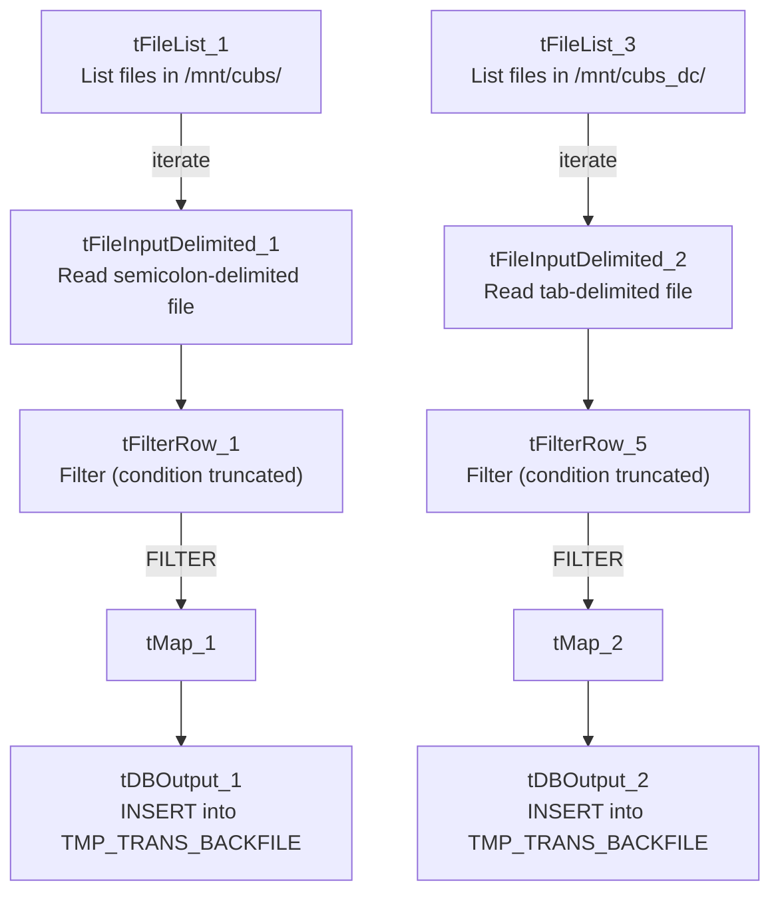

# Talend Job: PDC_Plan_Txn_Backfill

## Overview

A backfill utility that reads flat files from two CUBS extract directories (the general `/mnt/cubs/` source and the DC-site `/mnt/cubs_dc/` source) and loads a narrow set of columns — logon, transaction ID/index, and PDC (pre-authorized/post-dated check?) plan code — into the Snowflake `TMP_TRANS_BACKFILE` table. The job runs two structurally identical, independent pipelines (one per source directory) into the same target table, consistent with a one-time or occasional manual data-correction/backfill exercise rather than a recurring load.

## Detail table

| Field | Value |
|---|---|
| Job name | PDC_Plan_Txn_Backfill |
| Version | 0.1 |
| Project | EDW2SF |
| Author | jmach@harriscollect.com |
| Created | 2023-01-17T10:10:54.751-0800 |
| Last Modified | 2025-09-24T11:08:03.049-0700 |

## Step-by-step data flow

No `tPrejob`/`tPostjob` structure or explicit connection-open/close components are present in this job's metadata. Two independent pipelines run with no visible connection between them:

1. **Pipeline A (general CUBS source):** `tFileList_1` lists files in the hardcoded directory `/mnt/cubs/` → for each file, `tFileInputDelimited_1` reads it (semicolon-delimited, header row present, `DIE_ON_ERROR=false`) into a 4-column schema (`LOGON`, `TRANS_ID`, `TRANS_IDX`, `PDC_PLAN`) → `tFilterRow_1` applies a filter condition (truncated in this metadata — appears to compare two columns to each other; exact logic not visible) → `tMap_1` passes the filtered rows through unchanged (`DIE_ON_ERROR=true`) → `tDBOutput_1` inserts into Snowflake table `TMP_TRANS_BACKFILE`.
2. **Pipeline B (DC CUBS source):** Identical shape — `tFileList_3` lists files in `/mnt/cubs_dc/` → `tFileInputDelimited_2` reads each file (**tab-delimited**, not semicolon — see Issues observed) into the same 4-column schema → `tFilterRow_5` (same truncated filter pattern) → `tMap_2` → `tDBOutput_2` also inserts into `TMP_TRANS_BACKFILE`.

## Settings tables

### Sources: `tFileInputDelimited_1` / `_2`

| Setting | Value | What it means |
|---|---|---|
| DIRECTORY | `/mnt/cubs/` (Pipeline A) / `/mnt/cubs_dc/` (Pipeline B) — both hardcoded literals | These match the Linux-environment values of `StandardFolders_0.1`'s `sourceDir`/`sourceDCDir` context variables (per `_shared_context.json`), but are hardcoded here rather than parameterized via context — see Issues observed. |
| FIELDSEPARATOR | `;` (Pipeline A) / `\t` (Pipeline B) | The two "identical" pipelines actually expect differently-formatted source files — see Issues observed. |
| SCHEMA | 4 columns: `LOGON`, `TRANS_ID`, `TRANS_IDX`, `PDC_PLAN` | Narrow schema focused only on identifying a transaction and its PDC plan code. |
| DIE_ON_ERROR | `false` | Malformed rows don't fail the job; no reject flow is wired. |

### Filter: `tFilterRow_1` / `_5`

| Setting | Value | What it means |
|---|---|---|
| ADVANCED_COND | Truncated in this metadata: `"input_row.columnName1.equals(input_row.columnNam..."` | Appears to compare two of the row's own columns to each other rather than to a fixed value, but the full condition (which columns, what the comparison is for) is not visible — see Issues observed. |
| LOGICAL_OP | `&&` | Multiple filter conditions, if any beyond the truncated one shown, would be AND-combined. |

### Target: `tDBOutput_1` / `_2` (`tSnowflakeOutput`)

| Setting | Value | What it means |
|---|---|---|
| Table | `TMP_TRANS_BACKFILE` (both pipelines write to the same table) | A "TMP" table name suggests this is meant as a temporary staging/working table for the backfill, not a permanent destination. |
| Output action | `INSERT` | Appends rows; no `TRUNCATE` step in either pipeline, so both pipelines' rows accumulate together, and re-running either pipeline would add duplicate rows. |
| Schema declared on the component | A repository schema labeled `"...- LEGACY_DIMDEBTOR"` with ~80 columns (`FILEDATE`, `LOGON`, `DEBTOR`, `DEBTOR_IDX`, `CLIENT`, `NAME1`, ... `UPDATEKEY`, etc.) | **This declared output schema is far wider than what `tMap_1`/`tMap_2` actually produce (4 columns)** — see Issues observed, this is a significant mismatch. |

## Dependencies & configuration

- **Triggers/depends on other jobs:** none — no `tRunJob` links found; this job doesn't appear in `06_dependency_matrix.md`'s orchestration table.
- **Context variables used:** none — `context_vars_referenced` is empty; the source directories are hardcoded literals rather than pulled from `StandardFolders_0.1` context variables, even though their values match that group's `sourceDir`/`sourceDCDir` entries.
- **2 hardcoded path findings** (per the job's own scan): `tFileInputDelimited_1.TEMP_DIR` and `tFileInputDelimited_2.TEMP_DIR` (both `C:/Talend-Studio-20211109_1610-V8.0.1/workspace`). The `/mnt/cubs/` and `/mnt/cubs_dc/` source directories are also effectively hardcoded (not flagged separately by the automated scan, but not context-parameterized either) — see Issues observed.

## Glossary

| Component type | Plain-English meaning |
|---|---|
| `tFileList` | Lists files in a directory for the job to iterate over one at a time. |
| `tFileInputDelimited` | Reads a delimited (CSV-style) text file according to a schema. |
| `tFilterRow` | Passes through only rows matching a configured condition; non-matching rows are dropped (or routed to a separate "reject" output, if wired — not shown as wired here). |
| `tMap` | Maps/transforms columns from one schema to another. |
| `tSnowflakeOutput` | Writes rows to a Snowflake table. |

## Issues observed

- **`tDBOutput_1`/`_2`'s declared output schema (via the `"...- LEGACY_DIMDEBTOR"` repository schema reference) has roughly 80 columns describing a full debtor record — `FILEDATE`, `DEBTOR`, `DEBTOR_IDX`, `CLIENT`, `NAME1`/`NAME2`, address fields, `TOTAL_BAL`, `SSN`, dozens of date/amount/flag fields, etc. — while `tMap_1`/`tMap_2` (the components feeding it) only ever produce 4 columns (`LOGON`, `TRANS_ID`, `TRANS_IDX`, `PDC_PLAN`).** This is a substantial schema mismatch. It strongly suggests this job's `tDBOutput_1`/`_2` components were copied from a debtor-load job (reusing its repository schema reference) and repurposed for this narrower backfill without updating the declared schema to match what's actually being written. Depending on how Talend resolves this at runtime, this could mean: (a) most of the ~80 declared columns are simply written as NULL, which may or may not be acceptable depending on `TMP_TRANS_BACKFILE`'s actual column definitions and constraints, or (b) a runtime schema-mismatch error. **Unable to determine from metadata which actually happens — this should be verified directly in Talend Studio before this job is run again**, since a schema mismatch of this size is unusual even by this project's general standards.
- **The two pipelines use different field separators for what should be the same file format** (`;` for the general CUBS source, `\t` for the DC source) — while it's plausible the two site's extract processes genuinely produce differently-formatted files, this is worth confirming with the team rather than assuming it's intentional, especially given the job's evident copy-paste structure (see above).
- **The `tFilterRow` condition is truncated in this metadata and its exact logic is not visible** — unable to determine what rows are being excluded, or why. Given the job's "backfill" purpose, this filter likely encodes an important business rule about which transactions specifically need backfilling (e.g., excluding already-corrected rows) — verify directly in Talend Studio before assuming all rows in the source files are being loaded.
- **The source directories `/mnt/cubs/` and `/mnt/cubs_dc/` are hardcoded literals that happen to match `StandardFolders_0.1`'s `sourceDir`/`sourceDCDir` context variable values**, rather than being parameterized via `context.sourceDir`/`context.sourceDCDir` as most other jobs in this project do. This job would not automatically follow a future change to those shared context values (e.g., if the mount points are ever reorganized), unlike the 176 jobs in this project that do use the shared context group per `06_dependency_matrix.md`.
- **No `TRUNCATE` before either `INSERT`, and no dedup logic visible** — since `TMP_TRANS_BACKFILE` looks like a working/scratch table by name, re-running this job (e.g., after fixing the schema-mismatch issue above) would add duplicate rows on top of whatever is already there, unless someone manually clears the table between runs.
