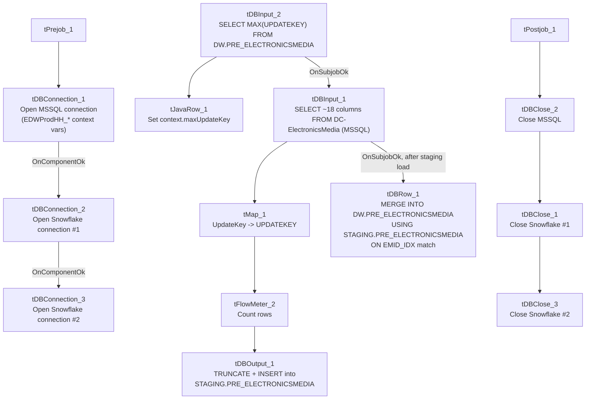

# Talend Job: PRE_E_Media_Load

## Overview

Loads electronic-media/letter-disposition tracking records (one row per generated letter or communication, with status codes/text, waterfall series, and update timestamps) for the "PRE" site from the MSSQL `EDWProdHH` database's `DC-ElectronicsMedia` table into Snowflake, staging into `PRE_ELECTRONICSMEDIA` and then merging into the `DW.PRE_ELECTRONICSMEDIA` warehouse table. Uses the same incremental max-key pattern seen in `i3_CallDetail_40_Load` and `PCI_Letter_Load`, but — unlike those two — this job's merge step is fully visible and does contain an explicit MERGE statement with matched/not-matched logic, giving a clearer picture of the incremental design's intent even though the upstream source query's filter clause is still truncated.

## Detail table

| Field | Value |
|---|---|
| Job name | PRE_E_Media_Load |
| Version | 0.1 |
| Project | EDW2SF |
| Author | jmach@harriscollect.com |
| Created | 2022-05-17T09:44:40.025-0700 |
| Last Modified | 2025-09-24T11:06:53.976-0700 |

## Step-by-step data flow

**Setup subjob:** `tPrejob_1` → `tDBConnection_1` opens the MSSQL connection to `context.EDWProdHH_Server`/`Port`/`Schema`/`Database`/`Login` (password redacted, JTDS driver) → on component-ok, `tDBConnection_2` opens a Snowflake connection → on component-ok, `tDBConnection_3` opens a **second, separate** Snowflake connection (see Issues observed).

**Main subjob:**

1. `tDBInput_2` runs `SELECT CAST(COALESCE(MAX(UPDATEKEY),0) AS VARCHAR(10)) AS MAXUPDATEKEY FROM DW.PRE_ELECTRONICSMEDIA;` against Snowflake to find the highest `UPDATEKEY` already merged into the warehouse table.
2. `tJavaRow_1` captures that value into `context.maxUpdateKey`.
3. On success (`SUBJOB_OK`), `tDBInput_1` runs a query (against the shared MSSQL connection, table `DC-ElectronicsMedia`) pulling `LOGON`, `EMID`, `EMID_IDX`, `LETTER_NAME`, `STATUS_DATE`, `STATUS_TIME`, `STATUS`, `STATUS_TEXT`, `STATUS_TYPE`, `WATERFALL`, `UPDATE_DT`, `UPDATE_TIME`, `CURR_SERIES`, `NEW_SERIES`, `CONTENT`, `ORIG_STATUS`, `SOURCE`, `SRC_NAME`, `UpdateKey` — the captured query text is truncated after the column list, so it is **not visible whether the query filters on `context.maxUpdateKey`** (same caveat as `i3_CallDetail_40_Load`/`PCI_Letter_Load`).
4. `tMap_1` renames `UpdateKey` to `UPDATEKEY` (uppercase) and passes the rest of the columns through unchanged.
5. `tFlowMeter_2` counts rows passing through (labeled "MyLabel").
6. `tDBOutput_1` loads the rows into Snowflake table `PRE_ELECTRONICSMEDIA` with `outputAction=INSERT` and **`tableAction=TRUNCATE`** — this table is cleared and reloaded fresh each run (this is the staging landing table, per the merge query's `FROM STAGING.PRE_ELECTRONICSMEDIA` reference below).
7. Once `tDBInput_1`'s whole subjob (including the staging load above) succeeds (`SUBJOB_OK`), `tDBRow_1` runs a `MERGE INTO DW.PRE_ELECTRONICSMEDIA` statement, sourcing from `STAGING.PRE_ELECTRONICSMEDIA`, matching on `EMID_IDX`: matched rows get all their other columns updated; unmatched rows are inserted as new.

**Teardown subjob:** `tPostjob_1` → `tDBClose_2` (close MSSQL) → `tDBClose_1` (close first Snowflake connection) → `tDBClose_3` (close second Snowflake connection).

## Settings tables

### Source: `tDBInput_1` (`tMSSqlInput`)

| Setting | Value | What it means |
|---|---|---|
| Connection | Shared `tDBConnection_1` | Reuses the job's single MSSQL connection. |
| Table | `DC-ElectronicsMedia` | Source letter/media-disposition table — note the table name itself is prefixed `DC-`, even though this job is named `PRE_E_Media_Load` — see Issues observed. |
| Query | Fixed `SELECT` of 18 named columns | The visible portion of the query does not show a `WHERE` clause referencing `context.maxUpdateKey` — see Issues observed. |

### Staging load: `tDBOutput_1` (`tSnowflakeOutput`)

| Setting | Value | What it means |
|---|---|---|
| Table | `PRE_ELECTRONICSMEDIA` | Destination staging table (in the `STAGING` schema, per the merge query's `FROM STAGING.PRE_ELECTRONICSMEDIA` reference). |
| Output action | `INSERT` | Loads the freshly-read rows. |
| Table action | `TRUNCATE` | The staging table is cleared before each load — standard truncate-then-load staging pattern. |

### Merge: `tDBRow_1` (`tSnowflakeRow`)

| Setting | Value | What it means |
|---|---|---|
| Query | `MERGE INTO DW.PRE_ELECTRONICSMEDIA AS tgt USING (SELECT ... FROM STAGING.PRE_ELECTRONICSMEDIA) AS src ON (tgt.EMID_IDX = src.EMID_IDX) WHEN MATCHED THEN UPDATE ... WHEN NOT MATCHED THEN INSERT ...` | A full upsert: existing rows (matched by `EMID_IDX`) get all their tracked columns updated in place; new rows are inserted. The `SELECT` inside `USING` also applies `LEFT(...)` length-truncation to several string columns and `TRY_TO_NUMBER(WATERFALL,10,0)` to safely coerce `WATERFALL` to a number, defaulting to 0 on a non-numeric value. |
| Result handling | Not captured | Unlike `ADP_Payroll_Load` or `CO_Master_Load`, this job does not capture the merge's result/row count or branch on success/failure. |

## Dependencies & configuration

- **Triggers/depends on other jobs:** none — no `tRunJob` links found; this job doesn't appear in `06_dependency_matrix.md`'s orchestration table.
- **Context variables used:** `EDWProdHH_Server`, `EDWProdHH_Port`, `EDWProdHH_Schema`, `EDWProdHH_Database`, `EDWProdHH_Login` (MSSQL connection details), `maxUpdateKey` (computed internally from the Snowflake max-key query).
- **No hardcoded developer-workstation paths** found in this job.

## Glossary

| Component type | Plain-English meaning |
|---|---|
| `tMSSqlConnection` / `tMSSqlInput` / `tMSSqlClose` | Open a Microsoft SQL Server connection, run a query against it, and close it. |
| `tSnowflakeConnection` / `tSnowflakeClose` | Open/close a Snowflake database connection. |
| `tSnowflakeInput` | Runs a query against Snowflake and returns its result rows. |
| `tJavaRow` | Runs custom Java code once per input row — here used to unpack a single query result into a context variable. |
| `tMap` | Maps/transforms columns from one schema to another. |
| `tFlowMeter` | Counts rows passing through a point in the flow, for logging/monitoring. |
| `tSnowflakeOutput` | Writes rows to a Snowflake table (here, a truncate-and-reload staging table). |
| `tSnowflakeRow` | Runs an arbitrary SQL statement — here, the `MERGE` upsert into the final warehouse table. |

## Issues observed

- **The MSSQL source table is literally named `DC-ElectronicsMedia`, containing "DC" — a different site code than this job's own name (`PRE_E_Media_Load`).** Given `01_system_architecture.md`'s documented site codes (CHI, CO, DC, HH, PRE, TOL), this is a genuine naming inconsistency: either the source table name is a holdover from when this table served the DC site (and was later repurposed/renamed at the target level for PRE without renaming the source), or this job is unintentionally reading DC's electronic-media data and loading it as if it were PRE's. **Unable to determine from this metadata which is the case — this is worth confirming directly with the team**, since if it's the latter, `PRE_ELECTRONICSMEDIA`/`DW.PRE_ELECTRONICSMEDIA` could be silently populated with the wrong site's data.
- **The incremental-load logic may not actually be filtered — the same caveat documented for `i3_CallDetail_40_Load` and `PCI_Letter_Load`.** The job computes `context.maxUpdateKey` from Snowflake before reading the MSSQL source, but `tDBInput_1.QUERY`'s captured text is truncated after the column list and does not show a `WHERE` clause referencing `context.maxUpdateKey`. However, this job's `tDBOutput_1` step does `TRUNCATE` the `STAGING.PRE_ELECTRONICSMEDIA` table before each load, and the subsequent `MERGE`'s `ON (tgt.EMID_IDX = src.EMID_IDX)` match means even a full, unfiltered re-read of the source would only update/re-insert existing rows rather than duplicate them in the final `DW.PRE_ELECTRONICSMEDIA` table — so the practical impact of an unfiltered source query here is likely just wasted read/merge work each run (re-processing the entire source table every time), not duplicate data, unlike the two peer jobs. Still, the max-key computation would then be essentially unused; worth confirming with the team whether the source query is actually filtered.
- **Two separate Snowflake connections (`tDBConnection_2` and `tDBConnection_3`) are opened in this single job**, rather than one shared connection reused by both `tDBOutput_1` (staging load) and `tDBRow_1` (merge). Unable to determine from metadata whether this is necessary (e.g., different connection-level settings between the two) or simply an unnecessary duplicate connection — opening two connections where one would suffice adds unnecessary overhead and two more failure points to monitor.
- **The merge's `MERGE INTO ... USING (SELECT ...)` source subquery applies `LEFT(...)` truncation to several string columns** (e.g., `LEFT(LOGON,50)`, `LEFT(STATUS_TEXT,500)`) — if any staged value is longer than these limits, it will be silently truncated during the merge with no warning, even though the earlier staging load (`tDBOutput_1`) may have accepted the full-length value without truncation. This could produce a staging table and a final warehouse table that briefly disagree in content for any row with an over-length field.
- **No error/row-count logging specific to this job's business outcome** (no `tWarn`/`tDie`/`tSendMail`) and the merge's result is not captured — a load or merge failure here would only surface as a generic Talend execution error.
