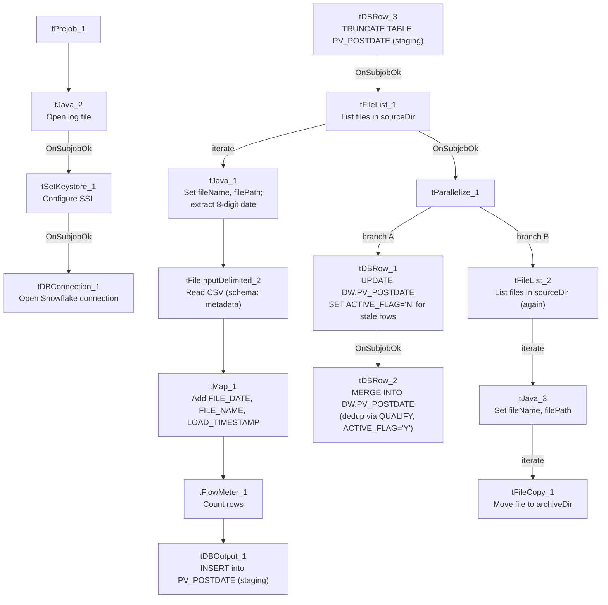

# Talend Job: PV_PostDate_Export_Load

## Overview

Despite its name, this job is a **load**, not an export: it reads post-dated-payment extract files (debtor, payment type/date/amount, an "Ignite" system key) from a source directory into a Snowflake staging table, then reconciles that staging data against the existing `DW.PV_POSTDATE` warehouse table using an active-flag pattern — deactivating (`ACTIVE_FLAG='N'`) any previously-loaded post-dated payment that no longer appears (or has changed) in the new file, then merging/upserting the current file's rows in as active (`ACTIVE_FLAG='Y'`). "PV" is not one of the site codes documented in `01_system_architecture.md` (CHI/CO/DC/HH/PRE/TOL) — its meaning is not defined anywhere in this job's own metadata.

## Detail table

| Field | Value |
|---|---|
| Job name | PV_PostDate_Export_Load |
| Version | 0.1 |
| Project | EDW2SF |
| Author | jmach@harriscollect.com |
| Created | 2026-01-06T10:11:21.974-0800 |
| Last Modified | 2026-05-28T14:57:37.840-0700 |

## Step-by-step data flow

**Setup subjob:** `tPrejob_1` → `tJava_2` opens a per-run log file at `context.logDir + jobName + "_" + <timestamp> + ".log"` → on subjob-ok, `tSetKeystore_1` configures SSL trust/keystore (hardcoded trust-store path, `context.keystorePath` for the keystore) → on subjob-ok, `tDBConnection_1` opens the Snowflake connection.

**Main subjob — staging load:**

1. `tDBRow_3` runs `TRUNCATE TABLE PV_POSTDATE;` (the staging table).
2. On success, `tFileList_1` lists files in `context.sourceDir`.
3. For each file, `tJava_1` sets `context.fileName`/`context.filePath`, then uses a regex (`\d{8}`) to extract an 8-digit date string from the filename (captured into a local variable; the assignment to a context variable is not fully visible in this metadata's truncated code snippet).
4. `tFileInputDelimited_2` reads the file (comma-delimited, header row present, `DIE_ON_ERROR=false`) against a repository schema labeled `"...- metadata"` with 8 named columns (`Logon`, `Account_Number`, `Debtor_Name`, `Payment_Type`, `Payment_Date`, `Payment_Amount`, `Ignite_Key`, `Created_Date`).
5. `tMap_1` renames/reshapes into an 11-column target schema, adding `FILE_DATE`, `FILE_NAME`, and `LOAD_TIMESTAMP` audit columns and renaming e.g. `Account_Number`→`DEBTOR_NUMBER`, `Debtor_Name`→`DEBTOR_NAME`, `Created_Date`→`CREATE_DATE`.
6. `tFlowMeter_1` counts rows passing through (labeled "MyLabel").
7. `tDBOutput_1` inserts the rows into Snowflake table `PV_POSTDATE` (the staging table just truncated in step 1; `INSERT`, no table-recreate action here since the truncate already happened).

**Main subjob — post-load reconciliation and archival (`tParallelize_1`, once the staging load's file loop finishes):**

8. **Branch A — deactivate stale rows:** `tDBRow_1` runs an `UPDATE DW.PV_POSTDATE ... SET ACTIVE_FLAG = 'N'` for any `(DEBTOR_NUMBER, LOGON)` pair present in both `DW.VW_PV_POSTDATE` and `STAGING.PV_POSTDATE` where the staged row's `IGNITE_KEY` is now null, or its `CREATE_DATE`/`PAYMENT_DATE` no longer matches — i.e., flags previously-active post-dated payments as inactive if the new file's version of that record has changed or dropped its Ignite key. On success, `tDBRow_2` runs a `MERGE INTO DW.PV_POSTDATE` from a de-duplicated (`QUALIFY ROW_NUMBER() ... = 1`) `STAGING.PV_POSTDATE`, matching on `DEBTOR_NUMBER`/`PAYMENT_DATE`/`LOGON`/`CREATE_DATE`: matched rows are updated (including `TARGET.ACTIVE_FLAG = 'Y'` and `TRY_TO_NUMBER(...)` coercion of `PAYMENT_AMOUNT`); unmatched rows are inserted as new, also with `ACTIVE_FLAG='Y'`.
9. **Branch B — archive:** `tFileList_2` independently re-lists `context.sourceDir`, and for each file, `tJava_3` sets `context.fileName`/`filePath`, then `tFileCopy_1` moves it to `context.archiveDir` (`REMOVE_FILE=true`, `REPLACE_FILE=true`, `FAILON=false`).

## Settings tables

### Source: `tFileInputDelimited_2`

| Setting | Value | What it means |
|---|---|---|
| FILENAME | `context.filePath` | Current file from `tFileList_1`'s iteration. |
| FIELDSEPARATOR / HEADER | `,` / 1 header row | Standard comma-delimited CSV. |
| SCHEMA | Repository schema `"...- metadata"` | 8 named columns — payment/debtor identifiers and an "Ignite" key (an external payment/collections system, based on the column name). |
| TEMP_DIR | `"C:/Talend-Studio-20211109_1610-V8.0.1/workspace"` | Hardcoded developer-workstation path — same project-wide risk documented in `05_operational_runbook.md`. |
| DIE_ON_ERROR | `false` | Malformed rows don't fail the job; no reject flow is wired. |

### Staging load: `tDBOutput_1`

| Setting | Value | What it means |
|---|---|---|
| Table | `PV_POSTDATE` | Staging table (default/current schema; the merge query's `FROM STAGING.PV_POSTDATE` confirms this is the `STAGING` schema copy). |
| Output action | `INSERT` | Loads the rows; relies on the earlier explicit `tDBRow_3.TRUNCATE TABLE PV_POSTDATE;` to clear it first. |

### Deactivate step: `tDBRow_1`

| Setting | Value | What it means |
|---|---|---|
| Query | `UPDATE DW.PV_POSTDATE pvp SET ACTIVE_FLAG = 'N' FROM (SELECT DISTINCT ... FROM DW.VW_PV_POSTDATE dp INNER JOIN STAGING.PV_POSTDATE sp ON ... WHERE sp.IGNITE_KEY IS NULL OR dp.CREATE_DATE <> sp.CREATE_DATE OR dp.PAYMENT_DATE <> sp.PAYMENT_DATE) AS tbd WHERE pvp.DEBTOR_NUMBER = tbd.DEBTOR_NUMBER AND pvp.LOGON = tbd.LOGON;` | Flags a warehouse row inactive if the corresponding staged row's Ignite key is now missing or its create/payment date has changed — effectively a soft-delete/superseded marker rather than a hard delete. Note this reads from `DW.VW_PV_POSTDATE` (a view), not the base table directly. |

### Merge step: `tDBRow_2`

| Setting | Value | What it means |
|---|---|---|
| Query | `MERGE INTO DW.PV_POSTDATE ... USING (SELECT * FROM STAGING.PV_POSTDATE QUALIFY ROW_NUMBER() OVER (PARTITION BY DEBTOR_NUMBER,LOGON,PAYMENT_DATE,CREATE_DATE ORDER BY PAYMENT_DATE) = 1) ... WHEN MATCHED THEN UPDATE ... ACTIVE_FLAG='Y' ... WHEN NOT MATCHED THEN INSERT ... ACTIVE_FLAG='Y';` | De-duplicates the staged rows (keeping one per debtor/logon/payment-date/create-date combination) before merging, then marks every matched-or-inserted row active. `PAYMENT_AMOUNT` is coerced via `TRY_TO_NUMBER(..., 18, 2)`, silently producing NULL (not an error) for any non-numeric value. |

## Dependencies & configuration

- **Triggers/depends on other jobs:** none — no `tRunJob` links found; this job doesn't appear in `06_dependency_matrix.md`'s orchestration table.
- **Context variables used:** `archiveDir`, `fileDate` (referenced per `context_vars_referenced` though the exact assignment in `tJava_1`'s truncated code is not fully visible), `fileName`, `filePath`, `keystorePath`, `logDir`, `sourceDir`.
- **3 hardcoded path findings:** `tFileInputDelimited_2.TEMP_DIR`, `tFileCopy_1.SOURCE_DERECTORY` (both `C:/Talend-Studio-20211109_1610-V8.0.1/workspace`), and `tSetKeystore_1.SSL_TRUSTSERVER_TRUSTSTORE` (`C:/clientTrustStore.trustStore`).

## Glossary

| Component type | Plain-English meaning |
|---|---|
| `tFileList` | Lists files in a directory for the job to iterate over one at a time. |
| `tFileInputDelimited` | Reads a delimited (CSV-style) text file according to a schema. |
| `tMap` | Maps/transforms columns from one schema to another. |
| `tFlowMeter` | Counts rows passing through a point in the flow, for logging/monitoring. |
| `tSnowflakeOutput` / `tSnowflakeRow` / `tSnowflakeConnection` | Write rows to a Snowflake table / run an arbitrary SQL statement (here, the deactivate `UPDATE` and the `MERGE`) / open the shared Snowflake connection. |
| `tParallelize` | Runs its downstream branches (here, the reconciliation SQL and the archive loop) at the same time. |
| `tFileCopy` | Moves or copies a processed file to another location. |
| `tSetKeystore` | Configures the SSL trust store/keystore used by other components for secure connections. |

## Issues observed

- **The job name says "Export" but this job only loads data — nothing in this metadata writes an output file or sends data anywhere external.** Either this job was renamed from an original export-then-load design without the "Export" being dropped from the name, or it's paired with a separate, unseen export job that isn't part of this metadata (e.g., something that reads `DW.VW_PV_POSTDATE` and writes a file for a downstream consumer). Unable to determine from metadata; worth confirming the job's actual role with the team so it isn't confused with an actual data-export process.
- **"PV" is not one of the six site codes documented in `01_system_architecture.md`** (CHI, CO, DC, HH, PRE, TOL). Unable to determine from this job's own metadata what "PV" stands for (a client name? a payment-vendor abbreviation? "post-void"?) — flag for team clarification, consistent with the general site-code ambiguity noted project-wide.
- **The deactivate step (`tDBRow_1`) reads from `DW.VW_PV_POSTDATE` (a view) rather than the base `DW.PV_POSTDATE` table**, while the `UPDATE` statement itself writes to the base table (`pvp`). If the view applies any filtering (e.g., only currently-active rows, or a date-range restriction) not visible in this job's own metadata, the deactivate logic's actual scope could be narrower or different than a plain read of the base table would suggest. Unable to determine from metadata what `DW.VW_PV_POSTDATE` actually filters; verify its definition before assuming this deactivate step covers all relevant rows.
- **The `tJava_1` code that extracts an 8-digit date from the filename via regex is truncated in this metadata after the match is found** — it's not clear from what's captured whether the extracted date string is ever assigned to a context variable used later (e.g., `context.fileDate`, which is listed in `context_vars_referenced` but whose assignment isn't fully visible). If the date parsing silently fails to produce a usable value, `FILE_DATE` in the loaded rows could be blank or default-valued with no error — verify directly in Talend Studio.
- **No row-count-based alerting** (`tWarn`/`tDie`/`tSendMail`) on either the deactivate `UPDATE` or the `MERGE` — a reconciliation that deactivates far more (or fewer) rows than expected, or a merge that silently NULLs out `PAYMENT_AMOUNT` via `TRY_TO_NUMBER`'s default-on-failure behavior, would produce no job-specific warning.
