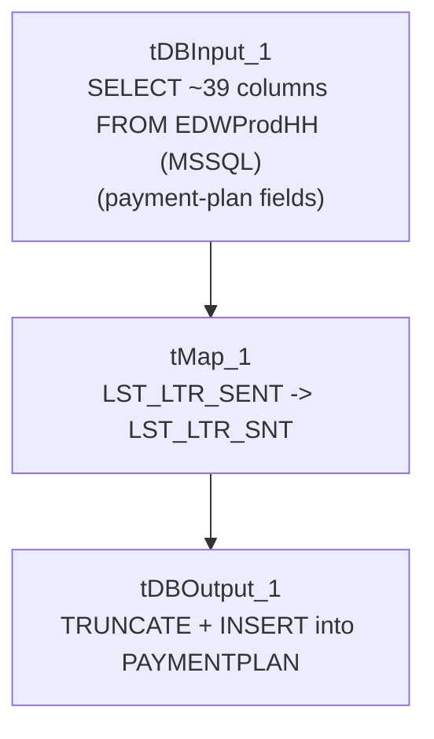

# Talend Job: PaymentPlan_Legacy_Load

## Overview

Loads payment-plan records (plan setup/change dates, payment schedule and amounts, payment/miss counts, letter-series tracking, an "Ignite" system flag) directly from the MSSQL `EDWProdHH` database into the Snowflake `PAYMENTPLAN` table, fully replacing the table's contents on each run. The "Legacy" name, combined with the existence of a separate, more recent `PaymentPlan_Load` job (which instead loads from a file via `CUBS_Raw_File_Load` and performs an incremental `MERGE`), suggests this job represents an older direct-database-extract approach to the same business data that has since been superseded — see Issues observed.

## Detail table

| Field | Value |
|---|---|
| Job name | PaymentPlan_Legacy_Load |
| Version | 0.1 |
| Project | EDW2SF |
| Author | jmach@harriscollect.com |
| Created | 2022-08-11T20:23:33.442-0700 |
| Last Modified | 2025-09-24T10:59:35.311-0700 |

## Step-by-step data flow

This job has no `tPrejob`/`tPostjob` structure or explicit connection-open/close components in its metadata — a single straight-line flow:

1. `tDBInput_1` (`USE_EXISTING_CONNECTION=false`, i.e. opens its own inline MSSQL connection rather than reusing a shared one) runs a query against `context.EDWProdHH_Server`/`Port`/`Schema`/`Database`/`Login` pulling ~39 columns covering plan identification (`FILEDATE`, `DIMLOGON`, `LOGON`, `PPlan_Num`, `PPCHK_IDX` aliased as `PPLAN_IDX`), plan terms (`ORIG_PLAN_AMT`, `BALLOON`, `DELINQ_AFTER_DAYS`, `PMT_AMT`, `NBR_PMTS`, `FREQ`), plan history (`NBR_CHANGES`, `NBR_PMTS_MADE`/`MISS`, `AMT_PMTS_MADE`/`MISS`, `PLAN_BALANCE`), letter-series tracking (`LTR_SERIES`, `LST_LTR_SEQ`, `LST_LTR_SENT`, `LST_LTR_DATE`), and an `IGNITE` flag/`UPDATEKEY`.
2. `tMap_1` passes the row through with a schema that renames the source's `LST_LTR_SENT` to `LST_LTR_SNT` in the target (see Issues observed) and otherwise carries the ~39 columns through unchanged (`DIE_ON_ERROR=true`).
3. `tDBOutputBulkExec`-equivalent — actually `tDBOutput_1` (`tSnowflakeOutput`) — loads the rows into Snowflake table `PAYMENTPLAN` with `outputAction=INSERT` and `tableAction=TRUNCATE`: the table is cleared and reloaded fresh on every run.

## Settings tables

### Source: `tDBInput_1` (`tMSSqlInput`)

| Setting | Value | What it means |
|---|---|---|
| Connection | Inline (`USE_EXISTING_CONNECTION=false`) using `context.EDWProdHH_*` variables | Unlike most other MSSQL-source jobs in this project, this one does not share a `tDBConnection` component — it opens its own connection inline within `tDBInput_1` itself. |
| Query | Fixed `SELECT` of ~39 named/aliased columns | Payment-plan detail and history fields; the visible query text is truncated after the initial column list in this metadata, so any `WHERE` filtering is not visible — but given `tableAction=TRUNCATE` downstream, an unfiltered "load everything" query is consistent with the overall design (this appears to be a full-refresh job, not incremental). |

### Target: `tDBOutput_1` (`tSnowflakeOutput`)

| Setting | Value | What it means |
|---|---|---|
| Table | `PAYMENTPLAN` | Destination table. |
| Output action | `INSERT` | Loads the rows. |
| Table action | `TRUNCATE` | The table is cleared before each load — a full-refresh pattern, consistent with the query pulling the complete payment-plan dataset each run rather than an incremental subset. |

## Dependencies & configuration

- **Triggers/depends on other jobs:** none — no `tRunJob` links found; this job doesn't appear in `06_dependency_matrix.md`'s orchestration table. It writes to the same target table name (`PAYMENTPLAN`) that `PaymentPlan_Load` merges into via a different mechanism (see that job's own doc) — the two are not linked to each other via any mechanism visible in this metadata, so it is unclear whether both are actively scheduled or whether one has superseded the other.
- **Context variables used:** `EDWProdHH_Database`, `EDWProdHH_Login`, `EDWProdHH_Port`, `EDWProdHH_Schema`, `EDWProdHH_Server`.
- **No hardcoded developer-workstation paths** found in this job.

## Glossary

| Component type | Plain-English meaning |
|---|---|
| `tMSSqlInput` | Runs a query against a Microsoft SQL Server database and returns its result rows. |
| `tMap` | Maps/transforms columns from one schema to another. |
| `tSnowflakeOutput` | Writes rows to a Snowflake table, with a configurable table-recreate action (here, truncate). |

## Issues observed

- **This job and `PaymentPlan_Load` both write to a table named `PAYMENTPLAN`, using two structurally very different mechanisms** — this job does a direct MSSQL-to-Snowflake full-refresh (`TRUNCATE` + `INSERT`, source is `EDWProdHH` via `tMSSqlInput`), while `PaymentPlan_Load` triggers `CUBS_Raw_File_Load` (a file-based load) and then calls `STAGING.MERGE_INTO_PAYMENTPLAN()` — an incremental merge from a staging table populated by file, not by this job's MSSQL query. **If both jobs are scheduled and target the same physical `PAYMENTPLAN` table (or a same-named table in a different schema — unable to confirm from metadata which schema each targets), running both would produce inconsistent or conflicting results**: this job's `TRUNCATE` would wipe out anything `PaymentPlan_Load`'s merge had built up, and vice versa. The "Legacy" naming strongly suggests this job is meant to be retired/inactive in favor of `PaymentPlan_Load`, but that cannot be confirmed from metadata alone — this should be verified with the team as a priority, since two live jobs racing to truncate/reload versus incrementally merge the same table is a genuine data-integrity risk, not just a documentation nicety.
- **The source column `LST_LTR_SENT` is renamed to `LST_LTR_SNT` between `tDBInput_1` and `tMap_1`** — a one-letter-shorter target name. This may simply reflect the actual target table's column name (databases sometimes truncate/abbreviate long column names), but it's also exactly the kind of small copy/rename artifact worth double-checking isn't an accidental typo, especially since no other column in this job undergoes a similar abbreviation.
- **No row-count logging, `tWarn`/`tDie`, or reject-flow handling** — a load that pulls zero or a truncated row set from `EDWProdHH` would still let `tDBOutput_1`'s `TRUNCATE` clear `PAYMENTPLAN`, potentially leaving it empty or short with no alert, the same destructive-with-no-safety-check pattern flagged in `PA_Turnpike_Load`.
