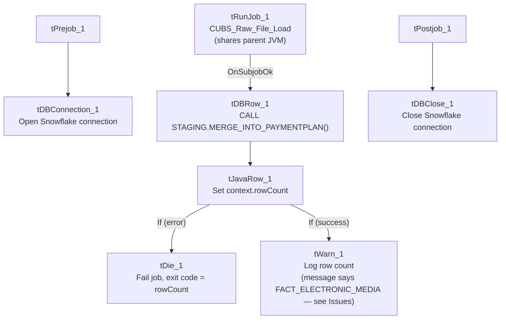

# Talend Job: PaymentPlan_Load

## Overview

An orchestrator-and-merge job for payment-plan data: it triggers the shared `CUBS_Raw_File_Load` job to actually read and stage a payment-plan extract file, then calls a Snowflake stored procedure to merge the staged rows into the final `PAYMENTPLAN` table, checking the merge's row-count result and either warning or failing the job depending on outcome. Unlike `PaymentPlan_Legacy_Load` (a direct MSSQL full-refresh into the same-named target table), this job represents the newer, incremental, file-based loading pattern used elsewhere in this project (e.g. `CO_Master_Load`'s sub-jobs) — see that job's doc for the apparent overlap risk between the two.

## Detail table

| Field | Value |
|---|---|
| Job name | PaymentPlan_Load |
| Version | 0.1 |
| Project | EDW2SF |
| Author | jmach@harriscollect.com |
| Created | 2022-08-17T11:18:12.425-0700 |
| Last Modified | 2022-08-17T12:01:31.600-0700 |

## Step-by-step data flow

**Setup subjob:** `tPrejob_1` → `tDBConnection_1` opens the Snowflake connection.

**Main subjob:**

1. `tRunJob_1` calls **`CUBS_Raw_File_Load`** (`USE_INDEPENDENT_PROCESS=false`, i.e. runs inside this job's own JVM rather than as a separate process; `DIE_ON_CHILD_ERROR=true`; `TRANSMIT_ORIGINAL_CONTEXT=true`) — this shared sub-job (also called by `DimDeskInfo_Load`, `DimEmployeeInfo_Load`, and `Fact_Electronic_Media_Load` per `06_dependency_matrix.md`) presumably reads a payment-plan extract file and loads it into a staging table; its own internal logic is not part of this job's metadata.
2. On success (`SUBJOB_OK`), `tDBRow_1` runs `CALL STAGING.MERGE_INTO_PAYMENTPLAN();` against Snowflake.
3. `tJavaRow_1` captures the procedure's `RETVALUE` into `context.rowCount`.
4. The flow branches on two `RUN_IF` conditions off `tJavaRow_1` (branch conditions not captured in this metadata, but component wiring and message content make the intent clear):
   - **Failure branch:** `tDie_1` fails the job with message `context.rowCount.toString() + ": an error occurred during MERGE"` and exit code = `context.rowCount.intValue()`.
   - **Success branch:** `tWarn_1` logs `context.rowCount.toString() + " rows added to FACT_ELECTRONIC_MEDIA"` — **note this message refers to the wrong table; see Issues observed.**

**Teardown subjob:** `tPostjob_1` → `tDBClose_1` closes the Snowflake connection.

## Settings tables

### Orchestration: `tRunJob_1`

| Setting | Value | What it means |
|---|---|---|
| PROCESS | `CUBS_Raw_File_Load` | A shared, generic file-loading sub-job reused across at least 4 jobs in this project (per `06_dependency_matrix.md`: `PaymentPlan_Load`, `DimCellphone_Load` — actually `DimCellphone_Load` calls `CUBS_Raw_Cellphone_Load`, so the shared caller set specific to `CUBS_Raw_File_Load` is `DimDeskInfo_Load`, `DimEmployeeInfo_Load`, `Fact_Electronic_Media_Load`, `PaymentPlan_Load`). |
| USE_INDEPENDENT_PROCESS | `false` | Runs inside this job's own JVM rather than as a separate process — the same non-default setting flagged as notable for `DimFiscal_CO_Load` inside `CO_Master_Load`. |
| DIE_ON_CHILD_ERROR | `true` | If `CUBS_Raw_File_Load` fails, this job fails too. |
| TRANSMIT_ORIGINAL_CONTEXT | `true` | The sub-job receives this job's context values. |

### Merge step: `tDBRow_1`

| Setting | Value | What it means |
|---|---|---|
| Query | `CALL STAGING.MERGE_INTO_PAYMENTPLAN();` | Calls a stored procedure (not shown in this metadata) that merges the staged payment-plan rows (loaded by `CUBS_Raw_File_Load`) into the final `PAYMENTPLAN` table — following the `MERGE_INTO_<table>` naming convention also seen in `ADP_Payroll_Load`, with the `STAGING.` schema prefix used in `CO_Master_Load`. |
| Result handling | `RETVALUE` → `context.rowCount` → branch to `tDie`/`tWarn` | A negative or error-indicating return code fails the job with that code as the exit status; otherwise a row count is logged. |

## Dependencies & configuration

- **Triggers/depends on other jobs:** calls `CUBS_Raw_File_Load` via `tRunJob` (confirmed in `06_dependency_matrix.md`'s orchestration table, which also lists `DimDeskInfo_Load`, `DimEmployeeInfo_Load`, and `Fact_Electronic_Media_Load` as other callers of the same shared sub-job). Not called by any other job itself.
- **Context variables used:** `rowCount` (set internally from the merge procedure's return value).
- **No hardcoded developer-workstation paths** found in this job's own components (though `CUBS_Raw_File_Load` itself, being a separate job, may have its own — not covered by this job's metadata).

## Glossary

| Component type | Plain-English meaning |
|---|---|
| `tRunJob` | Runs another Talend job as a sub-process (or, since `USE_INDEPENDENT_PROCESS=false` here, inline in the same JVM), waiting for it to finish before continuing. |
| `tSnowflakeRow` | Runs an arbitrary SQL statement or stored-procedure call against Snowflake. |
| `tJavaRow` | Runs custom Java code once per input row — here used to unpack a stored procedure's single return value. |
| `tDie` / `tWarn` | `tDie` ends the job with a specific failure message and exit code; `tWarn` logs a warning without failing the job. |
| `tSnowflakeConnection` / `tSnowflakeClose` | Open/close the Snowflake database connection used by other components in the job. |

## Issues observed

- **The success-branch `tWarn_1` message says `"<rowCount> rows added to FACT_ELECTRONIC_MEDIA"`, but this job merges into `PAYMENTPLAN`, not `FACT_ELECTRONIC_MEDIA`.** This is a clear copy-paste artifact — almost certainly carried over from `Fact_Electronic_Media_Load` (a separate job in this project, also listed in `05_operational_runbook.md`'s 16-jobs-with-explicit-tDie/tWarn list, and which also calls `CUBS_Raw_File_Load` per `06_dependency_matrix.md`) without updating the logged table name for this job's own context. This is a **cosmetic/log-message bug only** — the actual merge (`CALL STAGING.MERGE_INTO_PAYMENTPLAN();`) is correctly targeted — but it means anyone reading this job's run log to confirm what was loaded would see a misleading table name. This is the same class of issue documented for `ADP_Payroll_Load`'s `tJava_4` log messages (which said "roster" instead of "payroll").
- **This job and `PaymentPlan_Legacy_Load` both target a table named `PAYMENTPLAN` via two entirely different mechanisms** (this job: file-based staging + incremental `MERGE_INTO_PAYMENTPLAN()`; `PaymentPlan_Legacy_Load`: direct MSSQL query + `TRUNCATE`+`INSERT` full refresh). See `PaymentPlan_Legacy_Load`'s own doc for the full discussion — if both jobs are actively scheduled against the same physical table, they would conflict with each other (one incrementally merging, the other periodically wiping and reloading from a completely different source). This should be verified as a priority.
- **`CUBS_Raw_File_Load`'s own internal logic (what file it reads, from where, with what schema) is not part of this job's metadata** — this job's documentation is necessarily incomplete regarding the actual source file and its location/format; refer to `CUBS_Raw_File_Load`'s own job documentation (if produced in this documentation effort) for those details.
- **No hardcoded hostnames or hardcoded hard-coded paths found here**, but this job was last modified only about a month after creation (2022-08-17) and has not been touched since, unlike `PaymentPlan_Legacy_Load` (last modified 2025-09-24) — worth noting the two jobs have very different recent-maintenance histories, which may itself be a signal about which one is considered "live" today, though this is inference, not something confirmed by the metadata.
