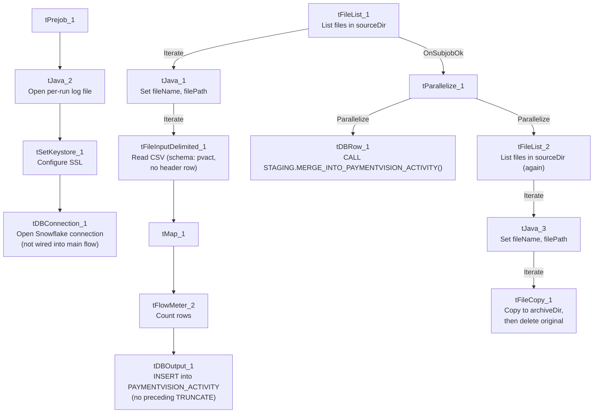

# Talend Job: PaymentVision_Activity_Load

## Overview

Loads user-activity/login audit records (hostname, login ID, user token, event type, timestamp) exported from the third-party PaymentVision payment portal into the Snowflake table `PAYMENTVISION_ACTIVITY`, then calls a stored procedure to merge the newly loaded rows into a downstream warehouse table. In a second, independent pass over the same source directory, it also archives and deletes the source files. Business purpose appears to be an audit trail of who accessed/used the PaymentVision payment portal and when — likely for security or compliance review rather than financial reconciliation, since no dollar amounts appear in this job's schema.

## Detail table

| Field | Value |
|---|---|
| Job name | PaymentVision_Activity_Load |
| Version | 0.1 |
| Project | EDW2SF |
| Author | jmach@harriscollect.com |
| Created | 2025-07-07T09:43:13.341-0700 |
| Last Modified | 2025-11-16T21:08:14.416-0800 |

## Step-by-step data flow

**Setup subjob:** `tPrejob_1` → `tJava_2` opens a per-run log file at `context.logDir + jobName + "_" + <timestamp> + ".log"` and redirects `System.out`/`System.err` to it → `tSetKeystore_1` configures SSL trust/keystore from `context.keystorePath` (passwords redacted) → `tDBConnection_1` opens the Snowflake connection. This setup subjob runs independently of the main load subjob below (Talend guarantees `tPrejob` runs first in the job, but there is no direct wiring from `tDBConnection_1` into the load flow).

**Main subjob:**

1. `tFileList_1` lists files in `context.sourceDir` (an `EXCLUDEFILEMASK` of `*.txt` is configured but `IFEXCLUDE` is `false`, so the exclusion is not actually applied — every file in the directory is picked up, same non-functional-exclusion pattern seen in `ADP_Payroll_Load`).
2. For each file, `tJava_1` sets `context.fileName`/`context.filePath` to the current file.
3. `tFileInputDelimited_1` reads the CSV (comma-delimited, **no header row** — `HEADER=0`) using repository schema `"...- pvact"` for both the main and reject branches (correctly matched, unlike `ADP_Payroll_Load`'s roster/payroll mismatch). `DIE_ON_ERROR=false`.
4. `tMap_1` passes the 5 source columns (`HOSTNAME`, `LOGINID`, `USERTOKEN`, `EVENTTYPENAME`, `CREATEDDATE`) into a 7-column output schema, adding `LOAD_DT` and `FILENAME`. `DIE_ON_ERROR=true` here, so a mapping failure fails the job outright.
5. `tFlowMeter_2` counts rows passing through (labeled "MyLabel", not renamed for this job).
6. `tDBOutput_1` inserts the rows into Snowflake table `PAYMENTVISION_ACTIVITY` (`INSERT`, no table-recreate action). **There is no `TRUNCATE` step anywhere in this job** before the insert — unlike `ADP_Payroll_Load`'s explicit `TRUNCATE TABLE` step. See Issues observed.
7. Once the entire `tFileList_1` iteration subjob completes (`OnSubjobOk`), `tParallelize_1` fires two branches at the same time:
   - **Branch 1 (merge):** `tDBRow_1` runs `CALL STAGING.MERGE_INTO_PAYMENTVISION_ACTIVITY();` — with no result-checking afterward (no `tJavaRow`/`tWarn`/`tDie`), unlike `ADP_Payroll_Load`'s merge-result branching logic.
   - **Branch 2 (archive):** `tFileList_2` performs a **second, independent listing of the same `context.sourceDir`** directory, iterating via `tJava_3` (re-sets `fileName`/`filePath`) into `tFileCopy_1`, which copies each file to `context.archiveDir` with `REMOVE_FILE=true` and `REPLACE_FILE=true` — effectively moving (archiving) the file and deleting the original in one step, rather than `ADP_Payroll_Load`'s separate zip-then-delete pattern.

**No teardown subjob is present** — there is no `tPostjob`/`tDBClose` component anywhere in this job's metadata, so the Snowflake connection opened by `tDBConnection_1` is never explicitly closed. See Issues observed.

## Settings tables

### Source: `tFileInputDelimited_1`

| Setting | Value | What it means |
|---|---|---|
| FILENAME | `context.filePath` | The current file from `tFileList_1`'s iteration. |
| FIELDSEPARATOR / HEADER | `,` / 0 (no header row) | Every row, including the first, is treated as data — unlike most CSV loads in this project. |
| SCHEMA / SCHEMA_REJECT | Repository schema `"...- pvact"` (both) | Main and reject schemas are correctly matched to this job, unlike `ADP_Payroll_Load`'s mismatch. |
| DIE_ON_ERROR | `false` | Malformed rows don't fail the job... |
| Reject flow | Not wired | ...but no connection carries rejected rows anywhere — they are silently dropped, same gap as `ADP_Payroll_Load`. |
| TEMP_DIR | `"C:/Talend-Studio-20211109_1610-V8.0.1/workspace"` | Hardcoded developer-workstation path — see Dependencies & configuration. |

### Target: `tDBOutput_1` (`tSnowflakeOutput`)

| Setting | Value | What it means |
|---|---|---|
| Table | `PAYMENTVISION_ACTIVITY` | Destination table for the raw loaded rows. |
| Output action | `INSERT` | Appends rows — but with **no `TRUNCATE`** anywhere in this job, so every run adds to whatever is already in the table rather than replacing a staging load. See Issues observed. |
| Table action | `NONE` | Table is not recreated/altered by this job. |

### Merge step: `tDBRow_1` (`tSnowflakeRow`)

| Setting | Value | What it means |
|---|---|---|
| Query | `CALL STAGING.MERGE_INTO_PAYMENTVISION_ACTIVITY();` | Calls a stored procedure (not shown in this metadata) that presumably merges the freshly loaded rows into a final warehouse table. |
| Result handling | None | Unlike `ADP_Payroll_Load`, there is no `tJavaRow`/`tWarn`/`tDie` after this call — a merge failure here surfaces only as a generic Talend execution error. |

### Archive/cleanup: `tFileCopy_1`

| Setting | Value | What it means |
|---|---|---|
| FILENAME | `context.filePath` | The current file from `tFileList_2`'s **separate** iteration over the same directory. |
| DESTINATION | `context.archiveDir` | Where the file is copied to. |
| REMOVE_FILE / REPLACE_FILE | `true` / `true` | The original is deleted after the copy, and an existing file of the same name at the destination is overwritten — a move, in effect. |
| SOURCE_DERECTORY | `"C:/Talend-Studio-20211109_1610-V8.0.1/workspace"` (hardcoded) | A hardcoded developer-workstation path; since `FILENAME` is already the full path via `context.filePath`, it is unclear from this metadata whether this field is actually used at runtime. |

## Dependencies & configuration

- **Triggers/depends on other jobs:** none — no `tRunJob` links found in this job's metadata, and it does not appear as a caller or target in `06_dependency_matrix.md`'s orchestration table.
- **Context variables used:** `archiveDir`, `fileName`, `filePath`, `keystorePath`, `logDir`, `sourceDir` (likely from `StandardFolders_0.1`, the project's shared-paths context group — see `06_dependency_matrix.md`).
- **3 hardcoded developer-workstation paths:** `tFileInputDelimited_1.TEMP_DIR` and `tFileCopy_1.SOURCE_DERECTORY` (both `C:/Talend-Studio-20211109_1610-V8.0.1/workspace`), and `tSetKeystore_1.SSL_TRUSTSERVER_TRUSTSTORE` (`C:/clientTrustStore.trustStore`) — same portability risk documented project-wide in `05_operational_runbook.md`.

## Glossary

| Component type | Plain-English meaning |
|---|---|
| `tFileList` | Lists files in a directory for the job to iterate over one at a time. |
| `tFileInputDelimited` | Reads a delimited (CSV-style) text file according to a schema. |
| `tMap` | Maps/transforms columns from one schema to another. |
| `tFlowMeter` | Counts rows passing through a point in the flow, for logging/monitoring. |
| `tSnowflakeOutput` / `tSnowflakeRow` / `tSnowflakeConnection` | Write rows to a Snowflake table / run an arbitrary SQL statement or stored-procedure call against Snowflake / open a Snowflake connection used elsewhere in the job. |
| `tParallelize` | Runs its downstream branches at the same time instead of one after another — here, the merge call and the archive pass run concurrently. |
| `tFileCopy` | Copies a file to a destination directory, optionally deleting the original (used here as an archive-and-delete step). |
| `tSetKeystore` | Configures SSL trust/keystore settings for secure connections used later in the job. |

## Issues observed

- **No `TRUNCATE` step exists anywhere in this job before the `INSERT` into `PAYMENTVISION_ACTIVITY`.** Every run appends the newly read files' rows to whatever is already in the table, unlike the truncate-then-load pattern used in `ADP_Payroll_Load` and documented project-wide in `05_operational_runbook.md`. Whether `PAYMENTVISION_ACTIVITY` is a staging table that the downstream `MERGE_INTO_PAYMENTVISION_ACTIVITY()` procedure knows to deduplicate, or whether this causes accumulating duplicate rows over time, is unable to determine from this job's own metadata — verify with the team.
- **The archive/delete pass (`tFileList_2` → `tFileCopy_1`) is a second, independent directory listing of `context.sourceDir`**, run in parallel with the merge call rather than driven by which files `tFileList_1` actually loaded. If a new file lands in `sourceDir` between the two listings, it could be archived and deleted without ever being loaded; conversely, if a file fails during the load (e.g., a `tMap_1` mapping error, which is `DIE_ON_ERROR=true`), there is no guarantee it would be excluded from this second pass — unable to determine from metadata whether that scenario is actually possible in practice, but the two listings are not coupled to each other's results.
- **No reject flow is wired from `tFileInputDelimited_1`.** `DIE_ON_ERROR` is `false`, so malformed rows don't fail the job, but there is no connection carrying rejected rows anywhere — they are silently dropped with no record of how many, or which, rows failed to parse.
- **No result-checking on the merge procedure call.** Unlike `ADP_Payroll_Load`'s `tJavaRow`/`tWarn`/`tDie` pattern, `tDBRow_1`'s `CALL STAGING.MERGE_INTO_PAYMENTVISION_ACTIVITY();` has no downstream logic to detect or report a failed merge — consistent with `05_operational_runbook.md`'s note that this job is not among the 16 project-wide jobs with explicit `tDie`/`tWarn` merge-result logic.
- **No teardown subjob (`tPostjob`/`tDBClose`) exists in this job**, unlike `ADP_Payroll_Load` and `i3_CallDetail_40_Load`, both of which explicitly close their Snowflake connection at the end. Whether this leaves the connection open until the JVM exits, or Talend closes it implicitly, is unable to determine from metadata alone.
