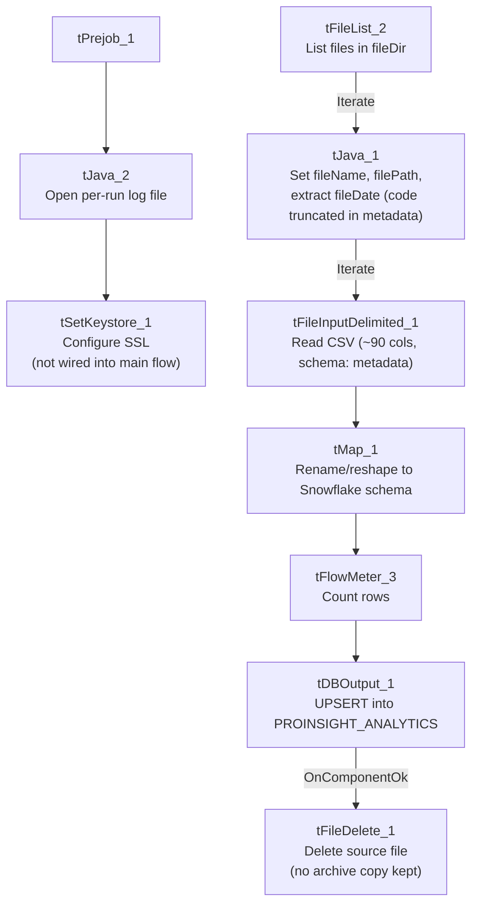

# Talend Job: ProInsight_Analytics_Load

## Overview

Loads AI/speech-analytics call-scoring export files from the "ProInsight" system into the Snowflake table `PROINSIGHT_ANALYTICS` via `UPSERT`. Each source row represents one recorded call, tagged with roughly 70 automatically-detected compliance/behavioral flags (profanity, hardship, bankruptcy mentions, promises to pay, disputes, silence duration, sentiment, etc.) alongside call metadata (agent, borrower, account, campaign, duration). Business purpose is call-quality/compliance analytics — very likely feeding QA dashboards or compliance review, distinct from `ProInsight_CCU_Scorecard_Load`'s manual auditor scorecards (see that job's own doc).

## Detail table

| Field | Value |
|---|---|
| Job name | ProInsight_Analytics_Load |
| Version | 0.1 |
| Project | EDW2SF |
| Author | jmach@harriscollect.com |
| Created | 2023-08-18T09:51:41.850-0700 |
| Last Modified | 2025-11-16T21:12:18.568-0800 |

## Step-by-step data flow

**Setup subjob:** `tPrejob_1` → `tJava_2` opens a per-run log file at `context.logDir + jobName + "_" + <timestamp> + ".log"` → `tSetKeystore_1` configures SSL trust/keystore from `context.keystorePath` (passwords redacted). **This setup subjob has no `tDBConnection` component and is not wired into the main load flow at all** — see Issues observed.

**Main subjob:**

1. `tFileList_2` lists files in `context.fileDir`, ordered by filename ascending (`EXCLUDEFILEMASK` of `*.txt` is set but `IFEXCLUDE` is `false`, so it has no actual effect — the same non-functional-exclusion pattern seen elsewhere in this project).
2. For each file, `tJava_1` sets `context.fileName`/`context.filePath`, then runs a regex (`\d{8}`) against the filename to extract what is presumably an 8-digit date into `context.fileDate` — **the code is truncated in this job's own extracted metadata after the `if (m.lookingAt() || m....` line**, so the exact logic (and whether it always succeeds) can't be confirmed from this metadata.
3. `tFileInputDelimited_1` reads the CSV (`CSV_OPTION=true`, header row present) using repository schema `"...- metadata"` for both main and reject branches, covering roughly 90 columns: call identifiers/metadata (`Call_Id`, `Called_At`, `Duration`, `Agent_ID`, `Client_Name`, `Account`, `Campaign`, etc.) plus ~70 boolean compliance/behavioral flag columns (e.g. `Hardship`, `Bankruptcy_Filed`, `Promise_to_Pay`, `Legal_Threat`, `Silence_over_50`). `DIE_ON_ERROR=false`.
4. `tMap_1` renames/reshapes these into a same-sized uppercase-named Snowflake-ready schema (e.g. `Duration__in_secs` → `DURATION`, `Account` → `ACCOUNT_NUMBER`), adding `FILENAME` and `FILE_DATE`. `DIE_ON_ERROR=true` here, so a mapping failure fails the job outright.
5. `tFlowMeter_3` counts rows passing through (labeled "MyLabel", not renamed for this job).
6. `tDBOutput_1` **upserts** the rows into Snowflake table `PROINSIGHT_ANALYTICS` (`UPSERT`, no table-recreate action) — unlike the plain `INSERT` pattern used in `PaymentVision_Activity_Load` and `ADP_Payroll_Load`, so this job does not need a preceding `TRUNCATE` or a separate merge stored-procedure call to avoid duplicating rows across runs.
7. On success (`OnComponentOk`), `tFileDelete_1` deletes the source file (`context.filePath`) directly — there is no archive step (no `tFileArchive`/`tFileCopy`), unlike `PaymentVision_Activity_Load` and `ADP_Payroll_Load`, both of which preserve a copy of the processed file. See Issues observed.

**No teardown subjob** — no `tPostjob`/`tDBClose`/`tDBConnection` exists anywhere in this job's metadata.

## Settings tables

### Source: `tFileInputDelimited_1`

| Setting | Value | What it means |
|---|---|---|
| FILENAME | `context.filePath` | The current file from `tFileList_2`'s iteration. |
| CSV_OPTION / HEADER | `true` / 1 header row | Standard CSV parsing with header row skipped. |
| SCHEMA / SCHEMA_REJECT | Repository schema `"...- metadata"` (both) | ~90 columns: call metadata plus ~70 boolean compliance/behavioral flags scored by the ProInsight analytics engine, plus `errorCode`/`errorMessage` reject columns. |
| DIE_ON_ERROR | `false` | Malformed rows don't fail the job... |
| Reject flow | Not wired | ...but no connection carries rejected rows anywhere — silently dropped, same gap seen across this project's file-load jobs. |
| TEMP_DIR | `"C:/Talend-Studio-20211109_1610-V8.0.1/workspace"` | Hardcoded developer-workstation path. |

### Target: `tDBOutput_1` (`tSnowflakeOutput`)

| Setting | Value | What it means |
|---|---|---|
| Table | `PROINSIGHT_ANALYTICS` | Destination table for the scored call records. |
| Output action | `UPSERT` | Inserts new rows and updates existing ones (presumably keyed on `CALL_ID`, the one `NOT NULL` column in this schema) — no separate `TRUNCATE`/merge-procedure step is needed for this pattern. |
| Table action | `NONE` | Table is not recreated/altered by this job. |

### Cleanup: `tFileDelete_1`

| Setting | Value | What it means |
|---|---|---|
| FILENAME | `context.filePath` | Deletes the just-loaded source file directly — no archive copy is made first. |
| DIRECTORY | `"C:/Talend-Studio-20211109_1610-V8.0.1/workspace/delete_folder"` (hardcoded) | Appears to be an unused/leftover default value, since `FILENAME` already supplies the full path — see Issues observed. |
| PATH | `"C:/Talend-Studio-20211109_1610-V8.0.1/workspace/delete_folder or delete_file"` (hardcoded) | The literal text `" or delete_file"` in this value strongly suggests it is placeholder/template text that was never replaced, not a real path. |

## Dependencies & configuration

- **Triggers/depends on other jobs:** none — no `tRunJob` links found, and this job does not appear in `06_dependency_matrix.md`'s orchestration table.
- **Context variables used:** `fileDate`, `fileDir`, `fileName`, `filePath`, `keystorePath` (set but never actually consumed by a connected component — see Issues observed), `logDir`.
- **4 hardcoded developer-workstation paths:** `tFileInputDelimited_1.TEMP_DIR`, `tFileDelete_1.DIRECTORY`, `tFileDelete_1.PATH` (the latter two containing template-like placeholder text), and `tSetKeystore_1.SSL_TRUSTSERVER_TRUSTSTORE` — same portability risk documented project-wide in `05_operational_runbook.md`.

## Glossary

| Component type | Plain-English meaning |
|---|---|
| `tFileList` | Lists files in a directory for the job to iterate over one at a time. |
| `tFileInputDelimited` | Reads a delimited (CSV-style) text file according to a schema. |
| `tMap` | Maps/transforms columns from one schema to another. |
| `tFlowMeter` | Counts rows passing through a point in the flow, for logging/monitoring. |
| `tSnowflakeOutput` | Writes rows to a Snowflake table — here configured as `UPSERT`, so it both inserts and updates in one step. |
| `tFileDelete` | Deletes a file from disk — used here with no preceding archive step. |
| `tSetKeystore` | Configures SSL trust/keystore settings for secure connections — present in this job but not wired to anything that uses it. |

## Issues observed

- **The setup subjob (`tPrejob_1` → `tJava_2` → `tSetKeystore_1`) has no `tDBConnection` component and is not wired into the main data-load flow at all.** Every other reference job in this project (e.g. `ADP_Payroll_Load`, `PaymentVision_Activity_Load`) opens a Snowflake connection via `tDBConnection` in its setup subjob; this job's `tDBOutput_1` must therefore be using its own inline connection settings rather than a shared one — unable to confirm from this metadata, since `tDBOutput_1`'s own parameters were not captured beyond table/action. It also means the SSL keystore setup performed by `tSetKeystore_1` does not appear to affect the actual Snowflake write in `tDBOutput_1`, since there's no connection dependency linking them — worth confirming with the team whether this keystore step is doing anything at all in this job.
- **`context.fileDate` is set from a truncated regex extraction whose full logic isn't visible in this metadata.** The captured code cuts off mid-statement (`if (m.lookingAt() || m....`), so it's not possible to confirm from this metadata whether `fileDate` is reliably set for every filename pattern, or what happens if the regex doesn't match. Verify directly in Talend Studio.
- **No reject flow is wired from `tFileInputDelimited_1`.** Malformed rows are silently dropped, with no file, log, or table capturing what was rejected.
- **The source file is deleted immediately after a successful load with no archive step**, unlike `PaymentVision_Activity_Load` and `ADP_Payroll_Load`, which both preserve a copy before deleting. If the Snowflake `UPSERT` needs to be re-run for any reason (e.g. a downstream data issue discovered later), the original source file will not be available — verify whether ProInsight's own export system can regenerate historical files if needed.
- **`tFileDelete_1`'s `DIRECTORY` and `PATH` parameters contain what look like unedited placeholder/template text** (`"...delete_folder or delete_file"`), rather than a real path. Since `FILENAME` is set directly from `context.filePath`, these fields may simply be unused defaults left over from the component's initial drop onto the canvas — but this should be confirmed in Talend Studio rather than assumed harmless.
