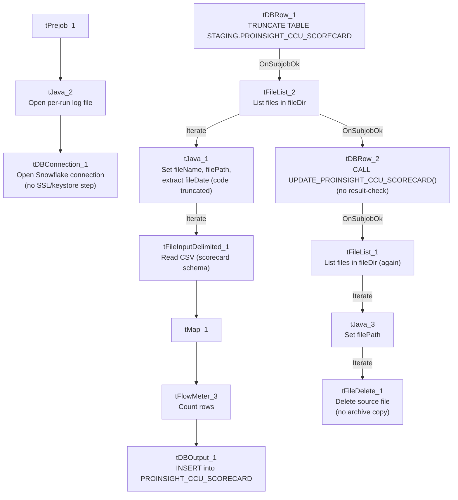

# Talend Job: ProInsight_CCU_Scorecard_Load

## Overview

Loads manual QA-auditor call scorecards (auditor name, collector/agent, team, per-section scores such as Opening/Authentication/Bridging with earned-vs-available points, overall score/grade, acknowledgement status) exported from the ProInsight quality-management system into a Snowflake staging table, then merges them into a downstream table via a stored procedure. This is a companion job to `ProInsight_Analytics_Load` but a different data source: this one is a *manually completed* compliance/quality scorecard per audited call, not the automated speech-analytics flags loaded by `ProInsight_Analytics_Load`. `ProInsight_CCU_Scorecard_V2_Load` is a near-identical but not-identical sibling job — see that job's own doc for the specific differences.

## Detail table

| Field | Value |
|---|---|
| Job name | ProInsight_CCU_Scorecard_Load |
| Version | 0.1 |
| Project | EDW2SF |
| Author | jmach@harriscollect.com |
| Created | 2024-01-16T10:48:28.606-0800 |
| Last Modified | 2025-09-24T11:09:03.625-0700 |

## Step-by-step data flow

**Setup subjob:** `tPrejob_1` → `tJava_2` opens a per-run log file → `tDBConnection_1` opens the Snowflake connection directly. **Unlike its `V2` sibling, this job has no `tSetKeystore` component at all** — no SSL/keystore configuration step exists between the log-file setup and the Snowflake connection. See Issues observed.

**Main subjob:**

1. `tDBRow_1` runs `TRUNCATE TABLE STAGING.PROINSIGHT_CCU_SCORECARD;` to clear the staging table before the new load.
2. On success (`OnSubjobOk`), `tFileList_2` lists files in `context.fileDir` (`EXCLUDEFILEMASK` of `*.txt` set but `IFEXCLUDE=false`, so not actually applied).
3. For each file, `tJava_1` sets `context.fileName`/`context.filePath`, then runs a regex (`\d{8}`) against the filename intended to extract `context.fileDate` — **the code is truncated in this job's own metadata** (cuts off mid-statement), same gap as in `ProInsight_Analytics_Load`.
4. `tFileInputDelimited_1` reads the CSV (header row present, `REMOVE_EMPTY_ROW=true`) using repository schema ID `__SCCcLSfEe6cGLqwyWLPVw` (labeled "metadata") for the **main** schema — covering dozens of scorecard columns (`Scorecard_Link`, `Scorecard_Name`, `Auditor_Name`, `Audit_Date`, `Collector_Name`, `Team`, `Client_Name`, `Call_Date`, `Score`, `Score_Earned`, `Score_Available`, `Grade`, plus per-category earned/available/score triplets like `Opening_Earned`/`Opening_Available`/`Opening_Score`, `Bridging_*`, `Avoiding_Early_Termination_*`, etc.). The **reject** schema is a *different* repository schema ID (`_0CMaMD0wEe6iz_4VDQBfZg`, also labeled "metadata") — see Issues observed regarding whether these two "metadata" schemas actually match.
5. `tMap_1` passes the columns through to a matching Snowflake-ready schema, adding `FILEDATE`.
6. `tFlowMeter_3` counts rows passing through (labeled "ccu").
7. `tDBOutput_1` inserts the rows into Snowflake table `PROINSIGHT_CCU_SCORECARD` (`INSERT`, no table-recreate action).
8. Once the `tFileList_2` iteration subjob completes (`OnSubjobOk`), `tDBRow_2` runs `CALL UPDATE_PROINSIGHT_CCU_SCORECARD();` — **with no result-checking downstream** (no `tJavaRow`/`tWarn`/`tDie`), unlike the `V2` sibling job.
9. On success (`OnSubjobOk`), `tFileList_1` performs a **second, independent listing of the same `context.fileDir`** directory, iterating via `tJava_3` into `tFileDelete_1`, which deletes each file directly — no archive copy is kept, same pattern as `ProInsight_Analytics_Load`.

**No teardown subjob** — no `tPostjob`/`tDBClose` exists in this job's metadata.

## Settings tables

### Source: `tFileInputDelimited_1`

| Setting | Value | What it means |
|---|---|---|
| FILENAME | `context.filePath` | The current file from `tFileList_2`'s iteration. |
| HEADER / REMOVE_EMPTY_ROW | 1 / `true` | Header row skipped; blank rows are dropped rather than loaded as empty records. |
| SCHEMA (main) | Repository schema ID `__SCCcLSfEe6cGLqwyWLPVw` (labeled "metadata") | Dozens of scorecard columns per audited call. |
| SCHEMA_REJECT | Repository schema ID `_0CMaMD0wEe6iz_4VDQBfZg` (also labeled "metadata") | **A different repository schema ID than the main schema**, despite the same label — see Issues observed. |
| DIE_ON_ERROR | `false` | Malformed rows don't fail the job... |
| Reject flow | Not wired | ...but no connection carries rejected rows anywhere — silently dropped. |
| TEMP_DIR | `"C:/Talend-Studio-20211109_1610-V8.0.1/workspace"` | Hardcoded developer-workstation path. |

### Staging clear & target: `tDBRow_1` / `tDBOutput_1`

| Setting | Value | What it means |
|---|---|---|
| Query (`tDBRow_1`) | `TRUNCATE TABLE STAGING.PROINSIGHT_CCU_SCORECARD;` | Clears the staging table before every run — the truncate-then-load pattern used project-wide. Its own `schema_columns` reference an unrelated repository schema labeled `LEGACY_DIMDEBTOR` (debtor/client columns like `DEBTOR`, `CLIENT`, `NAME1`, `ADD1`) — almost certainly a copy-paste artifact from a different job template, since a `TRUNCATE` statement doesn't need an input schema at all. See Issues observed. |
| Table (`tDBOutput_1`) | `PROINSIGHT_CCU_SCORECARD` | Destination staging table for the raw scorecard rows. |
| Output action | `INSERT` | Appends rows; safe because of the preceding `TRUNCATE`. |

### Merge step: `tDBRow_2` (`tSnowflakeRow`)

| Setting | Value | What it means |
|---|---|---|
| Query | `CALL UPDATE_PROINSIGHT_CCU_SCORECARD();` | Calls a stored procedure (not shown in this metadata) that presumably applies the staged scorecards to a final warehouse table. Note the `UPDATE_<table>` naming, distinct from the `MERGE_INTO_<table>` convention used by `ADP_Payroll_Load` and this job's own `V2` sibling — yet another inconsistent merge-procedure naming pattern in this project (see `05_operational_runbook.md`). |
| Result handling | None | No `tJavaRow`/`tWarn`/`tDie` after this call — a failure here would only surface as a generic Talend execution error. |

## Dependencies & configuration

- **Triggers/depends on other jobs:** none — no `tRunJob` links found, and this job does not appear in `06_dependency_matrix.md`'s orchestration table.
- **Context variables used:** `fileDate`, `fileDir`, `fileName`, `filePath`, `logDir`. Notably, **`keystorePath` is not referenced** — consistent with there being no `tSetKeystore` component in this job (unlike `V2`).
- **3 hardcoded developer-workstation paths:** `tFileInputDelimited_1.TEMP_DIR`, and `tFileDelete_1.DIRECTORY`/`PATH` (the latter two containing template-like placeholder text, e.g. `"...delete_folder or delete_file"`).

## Glossary

| Component type | Plain-English meaning |
|---|---|
| `tFileList` | Lists files in a directory for the job to iterate over one at a time. |
| `tFileInputDelimited` | Reads a delimited (CSV-style) text file according to a schema. |
| `tMap` | Maps/transforms columns from one schema to another. |
| `tFlowMeter` | Counts rows passing through a point in the flow, for logging/monitoring. |
| `tSnowflakeOutput` / `tSnowflakeRow` / `tSnowflakeConnection` | Write rows to a Snowflake table / run an arbitrary SQL statement or stored-procedure call against Snowflake / open the Snowflake connection used elsewhere in the job. |
| `tFileDelete` | Deletes a file from disk — used here with no preceding archive step. |

## Issues observed

- **`ProInsight_CCU_Scorecard_Load` has no `tSetKeystore` component and no `keystorePath` reference, while `ProInsight_CCU_Scorecard_V2_Load` has both.** This is the clearest structural difference between the two "sibling" jobs beyond their target tables — see `job_ProInsight_CCU_Scorecard_V2_Load.md` for the full comparison. Whether the missing SSL/keystore step in this (V1) job is intentional (e.g. the V1 Snowflake connection doesn't require client-cert auth) or a gap fixed later in V2 is unable to determine from metadata; verify with the team.
- **The main and reject schemas on `tFileInputDelimited_1` are two different repository schema IDs**, both generically labeled "metadata" in this extraction, rather than the same schema used for both branches (contrast `PaymentVision_Activity_Load`, where main and reject correctly share one ID). Whether the two "metadata" schemas actually have compatible column layouts is unable to determine from this metadata — verify directly in the Talend repository before assuming a rejected row would parse cleanly against the reject schema.
- **`tDBRow_1`'s (`TRUNCATE`) and `tDBRow_2`'s (`CALL UPDATE_...`) captured schemas both reference an unrelated `LEGACY_DIMDEBTOR` repository schema** (debtor/client columns like `DEBTOR`, `NAME1`, `ADD1`) that has nothing to do with call scorecards. Since neither component's actual SQL text needs an input schema, this is very likely a leftover artifact from copying these components from an unrelated debtor-load job template, rather than a functional issue — but it's worth a cleanup pass so the repository metadata doesn't mislead someone reading it later.
- **No reject flow is wired from `tFileInputDelimited_1`**, and **no result-checking exists on the `UPDATE_PROINSIGHT_CCU_SCORECARD()` merge call** — both gaps match patterns seen elsewhere in this project (see `05_operational_runbook.md`), meaning a bad row or a failed merge here produces no job-specific diagnostic, only a generic error if something downstream breaks loudly enough to fail the job at all.
- **The archive/delete pass (`tFileList_1` → `tFileDelete_1`) is a second, independent directory listing** run only after the merge call succeeds, and deletes files with no archive copy kept — same risk profile as `ProInsight_Analytics_Load`: if the merge needs to be re-run later, the original source files will already be gone.
