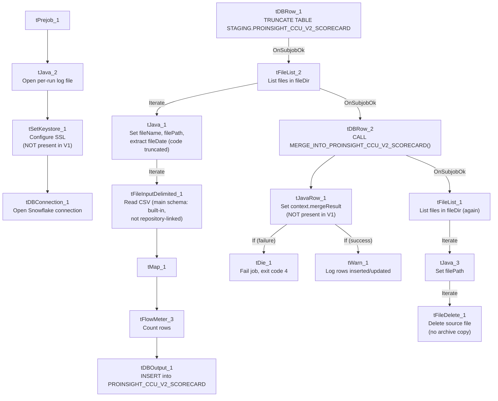

# Talend Job: ProInsight_CCU_Scorecard_V2_Load

## Overview

Loads the same kind of manual QA-auditor call scorecard data as `ProInsight_CCU_Scorecard_Load` (auditor, collector, team, per-category earned/available/score columns, overall grade) into a **separate** Snowflake staging table, `STAGING.PROINSIGHT_CCU_V2_SCORECARD`, then merges it into a downstream table via its own stored procedure. Despite the shared naming and near-identical component layout, this is **not simply a copy** of the V1 job run against a new table — it adds SSL/keystore setup and merge-result error handling that V1 lacks. See Issues observed for the full comparison.

## Detail table

| Field | Value |
|---|---|
| Job name | ProInsight_CCU_Scorecard_V2_Load |
| Version | 0.1 |
| Project | EDW2SF |
| Author | jmach@harriscollect.com |
| Created | 2024-05-17T10:53:59.001-0700 |
| Last Modified | 2025-11-16T21:13:27.184-0800 |

## Step-by-step data flow

**Setup subjob:** `tPrejob_1` → `tJava_2` opens a per-run log file → `tSetKeystore_1` configures SSL trust/keystore from `context.keystorePath` (passwords redacted) → `tDBConnection_1` opens the Snowflake connection. **This is a real difference from V1**, which has no `tSetKeystore` step at all between the log file and the connection.

**Main subjob:**

1. `tDBRow_1` runs `TRUNCATE TABLE STAGING.PROINSIGHT_CCU_V2_SCORECARD;` — note the `_V2_` infix in the table name, a genuinely separate staging table from V1's `STAGING.PROINSIGHT_CCU_SCORECARD`.
2. On success (`OnSubjobOk`), `tFileList_2` lists files in `context.fileDir` (same non-functional `EXCLUDEFILEMASK`/`IFEXCLUDE=false` pattern as V1).
3. For each file, `tJava_1` sets `context.fileName`/`context.filePath` and runs the same truncated-in-metadata regex to extract `context.fileDate` as V1 and `ProInsight_Analytics_Load`.
4. `tFileInputDelimited_1` reads the CSV (header row present, `REMOVE_EMPTY_ROW=true`). **Unlike V1, this component's main schema has no `SCHEMA:SCHEMA_TYPE`/`SCHEMA:REPOSITORY_SCHEMA_TYPE` parameter set at all** — the main schema appears to be defined locally (built-in) rather than pointing at a repository entry, even though the column layout itself (`Scorecard_Link`, `Scorecard_Name`, `Auditor_Name`, `Score`, `Grade`, per-category `_Earned`/`_Available`/`_Score` columns, etc.) is the same shape as V1's. The reject schema is still repository-based, using the **same schema ID** (`_0CMaMD0wEe6iz_4VDQBfZg`, labeled "metadata") that V1's reject schema and `ProInsight_Analytics_Load`'s main/reject schema also use. See Issues observed.
5. `tMap_1` passes the columns through to a matching Snowflake-ready schema, adding `FILEDATE`.
6. `tFlowMeter_3` counts rows passing through (labeled "ccu", same label reused from V1).
7. `tDBOutput_1` inserts the rows into Snowflake table `PROINSIGHT_CCU_V2_SCORECARD` (`INSERT`, no table-recreate action).
8. Once the `tFileList_2` iteration subjob completes (`OnSubjobOk`), `tDBRow_2` runs `CALL MERGE_INTO_PROINSIGHT_CCU_V2_SCORECARD();` — note the `MERGE_INTO_<table>` naming convention here, **different from V1's `UPDATE_PROINSIGHT_CCU_SCORECARD()`**.
9. **Unlike V1, this merge call's result is captured and checked:** `tDBRow_2` also feeds (`MAIN`) into `tJavaRow_1`, which reads the procedure's `MERGERESULT` output column into `context.mergeResult`. Two ordered `RUN_IF` branches follow (branch conditions themselves aren't captured in this metadata, but component order and message content make the intent clear):
   - `tDie_1` (order 1): fails the job with message `"Merge failed: " + context.mergeResult` (exit code 4).
   - `tWarn_1` (order 2): logs `"Rows inserted/updated: " + context.mergeResult` (severity 42) on the apparent success path.
10. On success (`OnSubjobOk`), `tFileList_1` performs a second, independent listing of the same `context.fileDir` directory, iterating via `tJava_3` into `tFileDelete_1`, which deletes each file directly — no archive copy is kept, same as V1.

**No teardown subjob** — no `tPostjob`/`tDBClose` exists in this job's metadata.

## Settings tables

### Source: `tFileInputDelimited_1`

| Setting | Value | What it means |
|---|---|---|
| FILENAME | `context.filePath` | The current file from `tFileList_2`'s iteration. |
| HEADER / REMOVE_EMPTY_ROW | 1 / `true` | Same as V1. |
| SCHEMA (main) | **No repository schema parameter set** | Unlike V1's explicit `REPOSITORY` schema reference, this job's main schema appears to be defined locally (built-in) directly via its column list rather than a shared repository entry. See Issues observed. |
| SCHEMA_REJECT | Repository schema ID `_0CMaMD0wEe6iz_4VDQBfZg` (labeled "metadata") | The **same** reject schema ID used by V1 and by `ProInsight_Analytics_Load` — appears to be a shared generic reject schema across the ProInsight job family. |
| DIE_ON_ERROR | `false` | Malformed rows don't fail the job... |
| Reject flow | Not wired | ...but no connection carries rejected rows anywhere — silently dropped, same as V1. |
| TEMP_DIR | `"C:/Talend-Studio-20211109_1610-V8.0.1/workspace"` | Hardcoded developer-workstation path. |

### Staging clear & target: `tDBRow_1` / `tDBOutput_1`

| Setting | Value | What it means |
|---|---|---|
| Query (`tDBRow_1`) | `TRUNCATE TABLE STAGING.PROINSIGHT_CCU_V2_SCORECARD;` | A genuinely separate staging table from V1's, not a shared one. Same `LEGACY_DIMDEBTOR`-schema copy-paste artifact on this component as seen in V1 (see that job's Issues observed) — it recurs here too. |
| Table (`tDBOutput_1`) | `PROINSIGHT_CCU_V2_SCORECARD` | Destination staging table — distinct from V1's `PROINSIGHT_CCU_SCORECARD`. |
| Output action | `INSERT` | Appends rows; safe because of the preceding `TRUNCATE`. |

### Merge step: `tDBRow_2` (`tSnowflakeRow`) / `tJavaRow_1` / `tDie_1` / `tWarn_1`

| Setting | Value | What it means |
|---|---|---|
| Query | `CALL MERGE_INTO_PROINSIGHT_CCU_V2_SCORECARD();` | Follows the `MERGE_INTO_<table>` naming convention (matches `ADP_Payroll_Load`), unlike V1's `UPDATE_PROINSIGHT_CCU_SCORECARD()`. |
| Result handling | `MERGERESULT` → `context.mergeResult` → branch to `tDie_1`/`tWarn_1` | **The clearest functional difference from V1**: a failed merge here actually fails the job (exit code 4) with a specific message, rather than only surfacing as a generic Talend error. |

## Dependencies & configuration

- **Triggers/depends on other jobs:** none — no `tRunJob` links found, and this job does not appear in `06_dependency_matrix.md`'s orchestration table.
- **Context variables used:** `fileDate`, `fileDir`, `fileName`, `filePath`, `keystorePath`, `logDir`, `mergeResult` (set internally from the merge procedure's return value) — one more variable (`keystorePath`) than V1, reflecting the added `tSetKeystore_1` step.
- **3 hardcoded developer-workstation paths:** `tFileInputDelimited_1.TEMP_DIR`, and `tFileDelete_1.DIRECTORY`/`PATH` (the latter two containing the same template-like placeholder text seen in V1 and `ProInsight_Analytics_Load`).

## Glossary

| Component type | Plain-English meaning |
|---|---|
| `tFileList` | Lists files in a directory for the job to iterate over one at a time. |
| `tFileInputDelimited` | Reads a delimited (CSV-style) text file according to a schema. |
| `tMap` | Maps/transforms columns from one schema to another. |
| `tFlowMeter` | Counts rows passing through a point in the flow, for logging/monitoring. |
| `tSnowflakeOutput` / `tSnowflakeRow` / `tSnowflakeConnection` | Write rows to a Snowflake table / run an arbitrary SQL statement or stored-procedure call against Snowflake / open the Snowflake connection used elsewhere in the job. |
| `tJavaRow` | Runs custom Java code once per input row — here used to unpack a stored procedure's single return value. |
| `tDie` / `tWarn` | `tDie` ends the job with a specific failure message and exit code; `tWarn` logs a warning without stopping the job. |
| `tSetKeystore` | Configures SSL trust/keystore settings for secure connections used later in the job. |
| `tFileDelete` | Deletes a file from disk — used here with no preceding archive step. |

## Issues observed

- **V2 adds a `tSetKeystore_1` SSL-configuration step that V1 lacks entirely**, and correspondingly references `context.keystorePath`, which V1 never uses. Whether this means V1's Snowflake connection genuinely doesn't need SSL/keystore setup, or V1 simply predates this being added and should probably have the same step, is unable to determine from metadata — worth asking the team, since it's an unexplained inconsistency between two jobs that otherwise do the same kind of work.
- **V2 adds real error handling on the merge call (`tJavaRow_1` → `tDie_1`/`tWarn_1`) that V1 lacks.** In V1, a failed `UPDATE_PROINSIGHT_CCU_SCORECARD()` call would only show up as a generic Talend execution error; in V2, a failed `MERGE_INTO_PROINSIGHT_CCU_V2_SCORECARD()` call fails the job explicitly with a message identifying it as a merge failure. This is a genuine behavioral improvement in V2, not just a renamed copy — if V1 is still actively used, it inherits the weaker failure signal.
- **The merge stored procedures follow two different naming conventions between the two jobs** (`UPDATE_PROINSIGHT_CCU_SCORECARD()` in V1 vs. `MERGE_INTO_PROINSIGHT_CCU_V2_SCORECARD()` in V2), suggesting the underlying Snowflake procedures were also rewritten for V2, not just copied and renamed — consistent with the project-wide lack of a single merge-procedure naming standard (see `05_operational_runbook.md`).
- **V2's `tFileInputDelimited_1` main schema is not linked to a Talend repository schema at all** (no `SCHEMA:SCHEMA_TYPE` parameter present), while V1's is. This could mean the V2 job's input schema was built locally/inline rather than migrated to the shared repository schema used by V1 — if the two column layouts drift apart over time, there would be no single repository definition keeping them in sync. Unable to confirm from metadata whether the two schemas are actually identical today; verify directly in Talend Studio.
- **The `TRUNCATE`/merge `tDBRow` components carry the same unrelated `LEGACY_DIMDEBTOR` schema copy-paste artifact documented in V1's own doc** — this appears to be inherited from whatever template both jobs were built from, rather than something introduced specifically in V2.
- **No reject flow is wired from `tFileInputDelimited_1`**, and **the archive/delete pass is a second, independent directory listing with no archive copy kept** — both the same gaps documented in V1's own doc, unresolved in this newer sibling.
