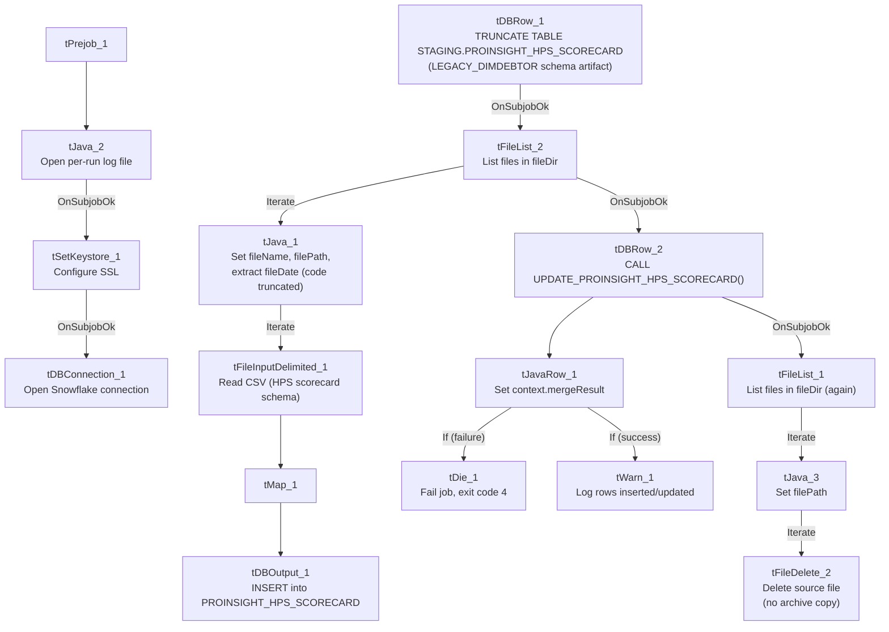

# Talend Job: ProInsight_HPS_Scorecard_Load

## Overview

Loads manual QA-auditor call scorecards from the "HPS" call-quality program (auditor name, collector/agent, team, client, call metadata, overall score/grade, acknowledgement status, and a distinct set of category checklist columns — `HPS_CC_Technique`, `Appropriate_greeting`, `HIPAA_Verification`, `Empathy`, `Zendesk_Ticket`, etc.) exported from the ProInsight quality-management system into a Snowflake staging table, then merges them into a downstream table via a stored procedure. This is a third sibling in the same family as `ProInsight_CCU_Scorecard_Load`/`_V2_Load` — same overall file-list → parse → map → insert → merge → delete shape — but scores a different checklist (HPS-specific compliance/greeting/HIPAA items rather than CCU's Opening/Bridging/Avoiding-Early-Termination categories) and, unlike either CCU sibling, actually checks its merge result and fails the job on error. See Issues observed for the full three-way comparison.

## Detail table

| Field | Value |
|---|---|
| Job name | ProInsight_HPS_Scorecard_Load |
| Version | 0.1 |
| Project | EDW2SF |
| Author | jmach@harriscollect.com |
| Created | 2023-12-21T15:14:54.445-0800 |
| Last Modified | 2025-11-16T21:14:17.296-0800 |

## Step-by-step data flow

**Setup subjob:** `tPrejob_1` → `tJava_2` opens a per-run log file at `context.logDir + jobName + "_" + <timestamp> + ".log"` → on success (`OnSubjobOk`), `tSetKeystore_1` configures SSL trust/keystore from `context.keystorePath` (passwords redacted) → on success, `tDBConnection_1` opens the Snowflake connection. (This job **does** have the `tSetKeystore` step that `ProInsight_CCU_Scorecard_Load` (V1) lacks — matching `V2`'s pattern instead.)

**Main subjob:**

1. `tDBRow_1` runs `TRUNCATE TABLE STAGING.PROINSIGHT_HPS_SCORECARD;`. Its own captured schema references an unrelated repository schema labeled `LEGACY_DIMDEBTOR` (debtor/client columns like `DEBTOR`, `NAME1`, `ADD1`, `SSN`) — the same copy-paste artifact documented in both `ProInsight_CCU_Scorecard_Load` and `_V2_Load`'s own `tDBRow_1`/`tDBRow_2` components, recurring here for a third time in the family (a `TRUNCATE` statement needs no input schema at all, so this is almost certainly harmless leftover metadata, not a functional bug).
2. On success (`OnSubjobOk`), `tFileList_2` lists files in `context.fileDir` (`EXCLUDEFILEMASK` of `*.txt` set but `IFEXCLUDE=false`, so not actually applied — the same non-functional exclusion seen in the CCU siblings).
3. For each file (`Iterate`), `tJava_1` sets `context.fileName`/`context.filePath` from the current file, then runs a regex (`\d{8}`) against the filename intended to extract `context.fileDate` — **the code is truncated in this job's own metadata**, the same gap documented in both CCU siblings and `ProInsight_Analytics_Load`.
4. `tFileInputDelimited_1` reads the CSV (header row present, `REMOVE_EMPTY_ROW=true`) using repository schema `_sJomkKBZEe6nJKm53X2n5A - metadata` for the **main** schema (Scorecard_Link, Scorecard_Name, Auditor_Name, Audit_Date, Collector_Name, Team, Client_Name, Call_Date/Duration/Direction/ID, Score/Score_Earned/Score_Available/Grade, Acknowledged/Acknowledged_By, and the HPS-specific checklist columns: `HPS_CC_Technique` [+ Earned/Available/Score], `Appropriate_greeting`, `Identify_themselves`, `HIPAA_Verification`, `Identify_caller`, `Callback_Phone_Email`, `Use_system_fittingly`, `Listen_to_caller`, `Empathy`, `Provide_correct_Info`, `Use_appropriate_tone`, `Speak_clearly`, `Appropriate_closure`, `Zendesk_Ticket`, `Correct_doc_call`, `Follow_up_provided`). The **reject** schema is a *different* repository schema ID (`_0CMaMD0wEe6iz_4VDQBfZg - metadata`) — the same shared generic reject schema ID used by both `ProInsight_CCU_Scorecard_Load` and `_V2_Load`, confirming it is a reused reject schema across the whole ProInsight job family, not something specific to this job.
5. `tMap_1` passes the columns through to a matching Snowflake-ready schema, uppercasing names and adding `FILE_DATE`.
6. `tDBOutput_1` inserts the rows into Snowflake table `PROINSIGHT_HPS_SCORECARD` (`INSERT`, `tableAction: NONE`).
7. Once the `tFileList_2` iteration subjob completes (`OnSubjobOk`), `tDBRow_2` runs `CALL UPDATE_PROINSIGHT_HPS_SCORECARD();` — following the `UPDATE_<table>` naming convention (matching `ProInsight_CCU_Scorecard_Load`'s V1 convention, not V2's `MERGE_INTO_<table>`).
8. **Unlike V1 CCU, this merge call's result *is* captured and checked**, matching V2 CCU's pattern instead: `tDBRow_2` feeds (`MAIN`) into `tJavaRow_1`, which reads the procedure's `MERGERESULT` into `context.mergeResult`. Two ordered `RUN_IF` branches follow (branch conditions themselves aren't captured in this metadata, but component order and message content make the intent clear):
   - `tDie_1` (order 1): fails the job with message `"Merge failed: " + context.mergeResult` (exit code 4).
   - `tWarn_1` (order 2): logs `"Rows inserted/updated: " + context.mergeResult` (severity 42) on the apparent success path.
9. On success (`OnSubjobOk`), `tFileList_1` performs a **second, independent listing of the same `context.fileDir`** directory, iterating via `tJava_3` into `tFileDelete_2`, which deletes each file directly — no archive copy is kept, same pattern as both CCU siblings.

**No teardown subjob** — no `tPostjob`/`tDBClose` exists in this job's metadata, same as both CCU siblings.

## Settings tables

### Source: `tFileInputDelimited_1`

| Setting | Value | What it means |
|---|---|---|
| FILENAME | `context.filePath` | The current file from `tFileList_2`'s iteration. |
| HEADER / REMOVE_EMPTY_ROW | 1 / `true` | Header row skipped; blank rows dropped rather than loaded as empty records. |
| SCHEMA (main) | Repository schema `_sJomkKBZEe6nJKm53X2n5A - metadata` | The HPS-specific scorecard column layout (auditor/call metadata plus the HPS checklist columns). |
| SCHEMA_REJECT | Repository schema `_0CMaMD0wEe6iz_4VDQBfZg - metadata` | The **same shared reject schema ID** used by `ProInsight_CCU_Scorecard_Load` and `_V2_Load` — a generic reject schema reused across the ProInsight family. |
| DIE_ON_ERROR | `false` | Malformed rows don't fail the job... |
| Reject flow | Not wired | ...but no connection carries rejected rows anywhere — silently dropped, same as both CCU siblings. |
| TEMP_DIR | `"C:/Talend-Studio-20211109_1610-V8.0.1/workspace"` | Hardcoded developer-workstation path. |

### Staging clear & target: `tDBRow_1` / `tDBOutput_1`

| Setting | Value | What it means |
|---|---|---|
| Query (`tDBRow_1`) | `TRUNCATE TABLE STAGING.PROINSIGHT_HPS_SCORECARD;` | Clears the staging table before every run. Its own captured schema references the unrelated `LEGACY_DIMDEBTOR` repository schema — a copy-paste artifact, not a functional issue (a `TRUNCATE` needs no input schema). |
| Table (`tDBOutput_1`) | `PROINSIGHT_HPS_SCORECARD` | Destination staging table for the raw scorecard rows. |
| Output action | `INSERT` | Appends rows; safe because of the preceding `TRUNCATE`. |

### Merge step: `tDBRow_2` (`tSnowflakeRow`) / `tJavaRow_1` / `tDie_1` / `tWarn_1`

| Setting | Value | What it means |
|---|---|---|
| Query | `CALL UPDATE_PROINSIGHT_HPS_SCORECARD();` | Follows the `UPDATE_<table>` naming convention — matches V1 CCU's naming, not V2 CCU's `MERGE_INTO_<table>` convention. Yet another data point confirming this project has no single merge-procedure naming standard (see `05_operational_runbook.md`). |
| Result handling | `MERGERESULT` → `context.mergeResult` → branch to `tDie_1`/`tWarn_1` | A failed merge here **fails the job explicitly** (exit code 4, message identifying it as a merge failure) — matching V2 CCU's error-handling behavior, not V1 CCU's silent (no result-check) behavior. |

## Dependencies & configuration

- **Triggers/depends on other jobs:** none — no `tRunJob` links found, and this job does not appear in `06_dependency_matrix.md`'s orchestration table.
- **Context variables used:** `fileDate`, `fileDir`, `fileName`, `filePath`, `keystorePath`, `logDir`, `mergeResult` (set internally from the merge procedure's return value).
- **4 hardcoded developer-workstation paths:** `tFileInputDelimited_1.TEMP_DIR`, `tFileDelete_2.DIRECTORY`/`PATH` (both containing template-like placeholder text, e.g. `"...delete_folder or delete_file"`), and `tSetKeystore_1.SSL_TRUSTSERVER_TRUSTSTORE`.

## Glossary

| Component type | Plain-English meaning |
|---|---|
| `tFileList` | Lists files in a directory for the job to iterate over one at a time. |
| `tFileInputDelimited` | Reads a delimited (CSV-style) text file according to a schema. |
| `tMap` | Maps/transforms columns from one schema to another. |
| `tSnowflakeOutput` / `tSnowflakeRow` / `tSnowflakeConnection` | Write rows to a Snowflake table / run an arbitrary SQL statement or stored-procedure call against Snowflake / open the Snowflake connection used elsewhere in the job. |
| `tJavaRow` | Runs custom Java code once per input row — here used to unpack a stored procedure's single return value. |
| `tDie` / `tWarn` | `tDie` ends the job with a specific failure message and exit code; `tWarn` logs a warning without stopping the job. |
| `tSetKeystore` | Configures SSL trust/keystore settings for secure connections used later in the job. |
| `tFileDelete` | Deletes a file from disk — used here with no preceding archive step. |

## Issues observed

- **This job is a hybrid of its two documented siblings' behaviors.** It uses V1 CCU's `UPDATE_<table>()` stored-procedure naming convention, but it uses V2 CCU's actual error-handling pattern (capturing `MERGERESULT` and failing the job with `tDie` on error) — a combination neither sibling doc alone would predict. This is a genuinely useful data point for anyone assuming the two CCU jobs represent "old vs. new" ProInsight patterns cleanly: HPS shows the naming and the error-handling conventions evolved independently of each other, not as a single package. Confirmed directly from this job's own metadata (`CALL UPDATE_PROINSIGHT_HPS_SCORECARD()` paired with a full `tJavaRow_1`/`tDie_1`/`tWarn_1` result-check chain).
- **`tDBRow_1`'s captured schema references the unrelated `LEGACY_DIMDEBTOR` repository schema** (debtor/client columns like `DEBTOR`, `NAME1`, `ADD1`, `SSN`) — the same copy-paste artifact already documented in both `ProInsight_CCU_Scorecard_Load` and `_V2_Load`. Seeing it a third time in this family reinforces that all three ProInsight scorecard jobs were very likely built from the same original template, with this leftover schema reference never cleaned up in any of them. Not a functional issue (a `TRUNCATE` statement needs no input schema), but worth a cleanup pass across the whole family.
- **No reject flow is wired from `tFileInputDelimited_1`**, and **the archive/delete pass (`tFileList_1` → `tJava_3` → `tFileDelete_2`) is a second, independent directory listing with no archive copy kept** before deleting source files — both gaps match the same patterns documented in the CCU siblings' own docs and in `05_operational_runbook.md`. If the merge procedure needs to be re-run later after a bad load, the original source files will already be gone.
- **The `tJava_1` regex code for extracting `fileDate` from the filename is truncated in this job's own metadata**, the same gap seen in both CCU siblings and `ProInsight_Analytics_Load` — the exact filename pattern expected cannot be confirmed from this extraction.
