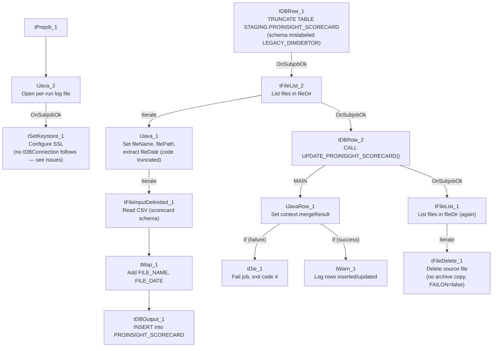

# Talend Job: ProInsight_Scorecard_Load

## Overview

Loads manual QA-auditor call scorecards (scorecard link/name, auditor, edit history, collector/team, client, call details, and per-section earned/available/score fields) exported from the ProInsight quality-management system into a Snowflake staging table (`PROINSIGHT_SCORECARD`), then merges them into a downstream table via a stored procedure. This job is closely related to the already-documented `ProInsight_CCU_Scorecard_Load`/`ProInsight_CCU_Scorecard_V2_Load` (same manual-scorecard concept, same overall shape) but targets a differently-named staging table (`PROINSIGHT_SCORECARD` vs `PROINSIGHT_CCU_SCORECARD`) and has its own set of structural quirks documented below — it is not simply a renamed copy.

## Detail table

| Field | Value |
|---|---|
| Job name | ProInsight_Scorecard_Load |
| Version | 0.1 |
| Project | EDW2SF |
| Author | jmach@harriscollect.com |
| Created | 2023-10-06T12:20:29.090-0700 |
| Last Modified | 2025-11-16T21:15:10.294-0800 |

## Step-by-step data flow

**Setup subjob:** `tPrejob_1` → `tJava_2` opens a per-run log file at `context.logDir + jobName + "_" + <timestamp> + ".log"` → on success (`OnSubjobOk`), `tSetKeystore_1` configures SSL trust/keystore settings from `context.keystorePath` (all passwords redacted). **No `tDBConnection` component exists anywhere in this job's metadata** — see Issues observed; how the Snowflake components below actually obtain a connection is not visible in this extraction.

**Main subjob** — starts independently at `tDBRow_1`:

1. `tDBRow_1` runs `TRUNCATE TABLE STAGING.PROINSIGHT_SCORECARD;`. Its own captured schema is an unrelated repository schema (`LEGACY_DIMDEBTOR`: `FILEDATE`, `LOGON`, `DEBTOR`, `DEBTOR_IDX`, `CLIENT`, `NAME1`, `NAME2`, `ADD1`, `ADD2`, `CITY`, `ST`, `ZIP`, `PACKET`, `PHONE`, `DOB`, `DESK`, `CDN`, and more debtor/collections columns) that has nothing to do with call scorecards — the same kind of copy-paste artifact documented in `ProInsight_CCU_Scorecard_Load`'s doc. Since a `TRUNCATE` statement doesn't need an input schema, this is very likely cosmetic only.
2. On success (`OnSubjobOk`), `tFileList_2` lists files in `context.fileDir`, ordered by filename ascending (`EXCLUDEFILEMASK` of `*.txt` set but `IFEXCLUDE=false`, so not actually applied).
3. For each file, `tJava_1` sets `context.fileName`/`context.filePath`, then runs a regex (`\d{8}`) against the filename intended to extract `context.fileDate` — **the code is truncated in this job's own metadata** (cuts off mid-statement `if (m.lookingAt() || m....`), the same kind of gap documented in `ProInsight_Analytics_Load` and `ProInsight_CCU_Scorecard_Load`.
4. `tFileInputDelimited_1` reads the CSV (comma-delimited, header row present, `REMOVE_EMPTY_ROW=true`, `ENCODING="US-ASCII"`) using repository schema ID `_syPuwGa-Ee6-B9n22oPWjQ` (labeled "metadata") for the **main** schema — dozens of scorecard columns (`Scorecard_Link`, `Scorecard_Name`, `Auditor_Name`, `Audit_Date`, `Edited_By`, `Edited_At`, `Collector_Name`, `Team`, `Client_Name`, `Client_Number`, `Call_Date`, `Call_Duration`, `Call_Direction`, `Call_ID`, and further per-category score fields). The **reject** schema is a *different* repository schema ID (`_0CMaMD0wEe6iz_4VDQBfZg`, also labeled "metadata") — notably, this is the **same reject-schema ID used by `ProInsight_CCU_Scorecard_Load`**, suggesting a shared generic reject schema across the ProInsight family rather than a mismatch unique to this job (though whether its columns actually fit this job's main schema is still unconfirmed — see Issues observed).
5. `tMap_1` passes the columns through to a matching Snowflake-ready schema, adding `FILE_NAME` and `FILE_DATE`.
6. `tDBOutput_1` inserts the rows into Snowflake table `PROINSIGHT_SCORECARD` (`INSERT`, no table-recreate action).
7. Once the `tFileList_2` iteration subjob completes (`OnSubjobOk`), `tDBRow_2` runs `CALL UPDATE_PROINSIGHT_SCORECARD();`.
8. `tDBRow_2`'s `MERGERESULT` output flows (`MAIN`) into `tJavaRow_1`, which captures it into `context.mergeResult`. This then branches via two `RUN_IF` conditions (the branch conditions themselves aren't captured in this metadata, but the message content and ordering make the intent clear): the failure branch routes to `tDie_1` (message `"Merge failed: " + context.mergeResult`, exit code 4), the success branch routes to `tWarn_1` (message `"Rows inserted/updated: " + context.mergeResult`). **Unlike `ProInsight_CCU_Scorecard_Load`, this job does check and react to the merge result** — matching its listing in `05_operational_runbook.md`'s "16 jobs have explicit `tDie`/`tWarn` logic" table.
9. On success (`OnSubjobOk`), `tFileList_1` performs a **second, independent listing of the same `context.fileDir`** directory, iterating (`ITERATE`) into `tFileDelete_1`, which deletes each file directly (`FAILON=false`, so a failed delete doesn't fail the job) — no archive copy is kept, same pattern as `ProInsight_Analytics_Load`/`ProInsight_CCU_Scorecard_Load`.

**No teardown subjob** — no `tPostjob`/`tDBClose` exists in this job's metadata, matching `ProInsight_CCU_Scorecard_Load`.

## Settings tables

### Source: `tFileInputDelimited_1`

| Setting | Value | What it means |
|---|---|---|
| FILENAME | `context.filePath` | The current file from `tFileList_2`'s iteration. |
| HEADER / REMOVE_EMPTY_ROW | 1 / `true` | Header row skipped; blank rows dropped rather than loaded as empty records. |
| ENCODING | `US-ASCII` (custom) | Non-standard encoding relative to the `ISO-8859-15` used by most other file-reading jobs in this project. |
| SCHEMA (main) | Repository schema ID `_syPuwGa-Ee6-B9n22oPWjQ` (labeled "metadata") | Dozens of scorecard columns per audited call. |
| SCHEMA_REJECT | Repository schema ID `_0CMaMD0wEe6iz_4VDQBfZg` (also labeled "metadata") | Same reject-schema ID as `ProInsight_CCU_Scorecard_Load` — likely a shared generic reject schema, but see Issues observed. |
| DIE_ON_ERROR | `false` | Malformed rows don't fail the job... |
| Reject flow | Not wired | ...but no connection carries rejected rows anywhere — silently dropped. |
| TEMP_DIR | `"C:/Talend-Studio-20211109_1610-V8.0.1/workspace"` | Hardcoded developer-workstation path. |

### Staging clear & target: `tDBRow_1` / `tDBOutput_1`

| Setting | Value | What it means |
|---|---|---|
| Query (`tDBRow_1`) | `TRUNCATE TABLE STAGING.PROINSIGHT_SCORECARD;` | Clears the staging table before every run. Its own captured schema references an unrelated `LEGACY_DIMDEBTOR` repository schema — a copy-paste artifact, since a `TRUNCATE` doesn't need an input schema (see Issues observed). |
| Table (`tDBOutput_1`) | `PROINSIGHT_SCORECARD` | Destination staging table for the raw scorecard rows. |
| Output action | `INSERT` | Appends rows; safe because of the preceding `TRUNCATE`. |

### Merge step: `tDBRow_2` (`tSnowflakeRow`)

| Setting | Value | What it means |
|---|---|---|
| Query | `CALL UPDATE_PROINSIGHT_SCORECARD();` | Calls a stored procedure (not shown in this metadata) that presumably applies the staged scorecards to a final warehouse table. Note the `UPDATE_<table>` naming convention, matching `ProInsight_CCU_Scorecard_Load`'s merge call but differing from `ADP_Payroll_Load`'s `MERGE_INTO_<table>` convention — yet another example of this project's inconsistent merge-procedure naming (see `05_operational_runbook.md`). |
| Result handling | `MERGERESULT` → `context.mergeResult` → `tDie_1`/`tWarn_1` | Unlike `ProInsight_CCU_Scorecard_Load`, this job *does* check the merge result and fails loudly (`tDie`, exit code 4) on failure — one of the project's 16 jobs with explicit `tDie`/`tWarn` merge-result logic. |

## Dependencies & configuration

- **Triggers/depends on other jobs:** none — no `tRunJob` links found, and this job does not appear in `06_dependency_matrix.md`'s orchestration table.
- **Context variables used:** `fileDate`, `fileDir`, `fileName`, `filePath`, `keystorePath`, `logDir`, `mergeResult`.
- **4 hardcoded developer-workstation paths:** `tFileInputDelimited_1.TEMP_DIR`, `tFileDelete_1.DIRECTORY`/`PATH` (containing template-like placeholder text, e.g. `"...delete_folder or delete_file"`), and `tSetKeystore_1.SSL_TRUSTSERVER_TRUSTSTORE` (`C:/clientTrustStore.trustStore`).
- **Relationship to sibling ProInsight jobs:** shares its overall shape (truncate → file-list iterate → parse → load → merge with result-check → cleanup-delete) with `ProInsight_CCU_Scorecard_Load`/`_V2_Load`, but loads a differently-named table (`PROINSIGHT_SCORECARD`, not `PROINSIGHT_CCU_SCORECARD`) with a different, larger scorecard column set (including `Edited_By`/`Edited_At`/`Client_Number`/`Call_Duration`/`Call_Direction`/`Call_ID`, none of which appear in the CCU job's documented schema) — these are genuinely different scorecard exports, not a renamed duplicate.

## Glossary

| Component type | Plain-English meaning |
|---|---|
| `tFileList` | Lists files in a directory for the job to iterate over one at a time. |
| `tFileInputDelimited` | Reads a delimited (CSV-style) text file according to a schema. |
| `tMap` | Maps/transforms columns from one schema to another. |
| `tSnowflakeOutput` / `tSnowflakeRow` | Write rows to a Snowflake table / run an arbitrary SQL statement or stored-procedure call against Snowflake. |
| `tJavaRow` | Runs custom Java code once per input row — here used to unpack a stored procedure's single return value into a context variable. |
| `tFileDelete` | Deletes a file from disk — used here with no preceding archive step. |
| `tWarn` / `tDie` | Log a warning without failing the job, or end the job with a specific failure message and exit code, respectively. |
| `tSetKeystore` | Configures SSL trust/keystore settings used by subsequent secure connections. |

## Issues observed

- **No `tDBConnection` component exists anywhere in this job's metadata**, despite three Snowflake components (`tDBRow_1`, `tDBOutput_1`, `tDBRow_2`) actively reading/writing Snowflake. Every other Snowflake-using job reviewed in this project batch opens an explicit `tSnowflakeConnection` in its setup subjob. `tSetKeystore_1` runs in the setup chain but nothing is wired after it. Unable to determine from this metadata whether each Snowflake component in this job is configured with its own embedded/implicit connection (not captured by this extraction, since their own `parameters` fields are empty), or whether a connection component was missed by the extraction — verify directly in Talend Studio before assuming this job's connection handling matches the rest of the project.
- **No teardown subjob** (`tPostjob`/`tDBClose`) exists — consistent with the missing `tDBConnection` above; there is no explicit connection-close step either.
- **`tDBRow_1`'s (`TRUNCATE`) captured schema references an unrelated `LEGACY_DIMDEBTOR` repository schema** (`DEBTOR`, `NAME1`, `ADD1`, `DOB`, `DESK`, etc.) that has nothing to do with call scorecards — the same copy-paste artifact documented in `ProInsight_CCU_Scorecard_Load`, strongly suggesting both jobs were built from the same debtor-load job template and never had this leftover schema cleaned up. Not a functional issue (the `TRUNCATE` statement doesn't use it), but worth a cleanup pass.
- **The main and reject schemas on `tFileInputDelimited_1` are two different repository schema IDs**, both generically labeled "metadata." The reject ID here is identical to the one used in `ProInsight_CCU_Scorecard_Load`, which may indicate a shared, intentionally generic reject schema across the ProInsight job family (in which case this is not an error) — but whether its columns are actually compatible with *this* job's larger main schema (more columns than the CCU job's) is unable to determine from metadata; verify directly in the Talend repository.
- **`tJava_1`'s file-date extraction code is truncated in this metadata** (cuts off mid-conditional), the same capture gap seen in `ProInsight_Analytics_Load` and `ProInsight_CCU_Scorecard_Load` — unable to confirm exactly how `context.fileDate` is derived from the filename beyond the initial `\d{8}` regex match attempt.
- **No reject flow is wired from `tFileInputDelimited_1`**, matching the project-wide pattern documented in `05_operational_runbook.md` — malformed rows are silently dropped with no diagnostic trail.
- **The archive/delete pass (`tFileList_1` → `tFileDelete_1`) is a second, independent directory listing** run only after the merge call succeeds, and deletes files with no archive copy kept (`FAILON=false`, so even a failed delete doesn't stop the job) — same risk profile as `ProInsight_Analytics_Load`/`ProInsight_CCU_Scorecard_Load`: if the merge needs to be re-run later, the original source files will already be gone.
